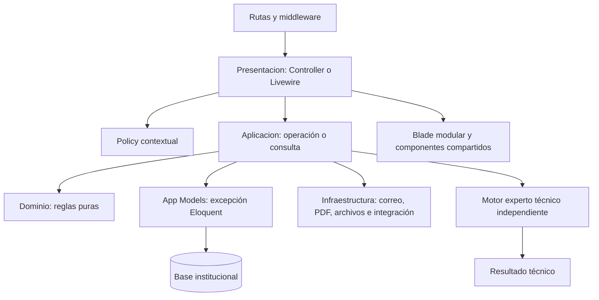

# Mapa de arquitectura vigente

> Lectura vigente del 25/10/2026: este documento conserva las decisiones de organización y la evidencia de migración del 10/10. Sus cifras de modelos, vistas, rutas y tablas pertenecen a ese corte; el [estado actual](../ESTADO_ACTUAL.md) y [los doce propietarios funcionales](../modulos/README.md) recogen la evolución posterior. No restaurar conteos, clases o tablas solo para reproducir aquel inventario.

La organización canónica y sus excepciones están en el [índice](README.md) y en el [ADR aprobado](ADR_ARQUITECTURA_HIBRIDA.md). Este mapa describe el código posterior a la migración, sin redefinir reglas clínicas, permisos ni estructura de PostgreSQL. El contenido anterior de esta ruta describía el corte de Fase 2; su historial permanece en Git.

La [limpieza de carpetas posterior](LIMPIEZA_CARPETAS_2026_10_10.md) conserva los doce módulos y sus cuatro capas; solo reserva con `.gitkeep` las capas principales vacías. No mantiene subdirectorios anticipados sin implementación.

## Propietarios funcionales

| Módulo | Responsabilidad principal |
|---|---|
| Identidad | Cuentas, personal, roles, seguridad de acceso y documentos de identidad |
| Institucion | Áreas, turnos, jornadas, asignaciones y estructura residencial |
| Residentes | Expediente general, estado institucional y documentos del residente |
| Admisiones | Preadmisión, revisión y formalización atómica del ingreso |
| Clinica | Signos, objetivos, atenciones, notas, estudios y consultas longitudinales |
| Medicacion | Prescripción, programación y administración/omisión autorizada |
| Valoraciones | Instrumentos y valoraciones profesionales/funcionales |
| Cuidados | Planes, tareas, registros, heridas, seguimiento y pase de turno |
| Social | Contactos, vínculos, visitas, actividades y participación |
| Alertas | Alertas, incidentes y sus flujos de seguimiento/cierre |
| Reportes | Consultas, composición y exportación de reportes |
| ApoyoDecision | Adaptación Laravel y persistencia técnica del motor experto |

## Entradas y coordinación

La consulta general de presentación todavía puede usar Eloquent; las escrituras y transacciones detectadas están fuera de Presentacion. El análisis AST no prueba todas las posibles mutaciones dinámicas. Las Policies deciden autorización contextual; no coordinan persistencia clínica.

## Integración conservada

Los providers registran explícitamente Policies y alias Livewire. El finder resuelve 248 vistas trasladadas por sus nombres lógicos, sin copias paralelas. routes/web.php compone los registros de propietarios conservando 296 contratos ordenados. El Design System mantiene sus entrypoints y tokens existentes.

Los 96 modelos conservan su identidad pública; no se modifican migraciones, factories, PK/FK ni relaciones estructurales. El [inventario individual](MODELOS_ELOQUENT.json) identifica propietario y motivo. El núcleo experto PHP es independiente; sus 23 tablas técnicas existentes se mantienen dentro del contrato aprobado.

## Transacciones y límites observados

- La formalización de admisión conserva residente, historia, contactos y ocupación inicial dentro de su operación atómica.
- Las operaciones de medicación y signos mantienen sus límites previos; sus diferencias y deudas se detallan en el informe de migración.
- GestionarIncidentesEnfermeria registra incidente, herida opcional y alerta dentro de una transacción tras la auditoría. Una excepción después de insertar herida o alerta revierte las tres escrituras. Se conservan autoría, estados, payloads y permisos.
- La generación documental/correo sigue siendo un efecto externo; no se presenta una transacción SQL como garantía del filesystem o de entrega de correo.
- Existen servicios con coordinación bidireccional entre Clinica, Cuidados, Medicacion y Alertas. El corte no añade Repository, CQRS ni separación artificial de interfaces.

## Deuda que sigue abierta

GestionarAtenciones y GestionarNotasClinicas mantienen operaciones que dependen de la autorización en sus rutas; recibir User no demuestra autorización autónoma del caso. Los endpoints conservan middleware y alcance por residente, pero el refuerzo de llamadas directas requiere un corte específico con pruebas. También continúan las excepciones de seguridad, estados institucionales e interpretación histórica descritas en el [informe de migración](INFORME_MIGRACION_HIBRIDA.md). Esta auditoría no acredita que toda operación sea segura al invocarla desde cualquier nuevo consumidor.

La inferencia clínica asíncrona, conocimiento nuevo, revisión profesional y deduplicación durable del transporte no se activan por la presencia de carpetas, contrato o evento. Las [verificaciones y eliminaciones de este corte](AUDITORIA_LIMPIEZA_2026_10_10.md) son distintas de una certificación clínica o de producción.
