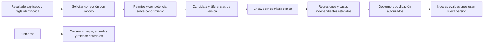

# Cierre por profesión y validación de O.R.I.O.N.

Fecha: 21/10/2026. **Propuesta derivada de auditoría, no protocolo clínico
adoptado ni autorización para ampliar permisos.** Describe cómo alcanzar el
objetivo pedido: que el motor derive la conclusión, sin recibir como entrada
el resultado que se desea obtener, y que exista una corrección trazable de reglas.

## 1. Separar tres actos

| Acto | Quién/qué lo produce | Qué se conserva | Lo que debe evitarse |
|---|---|---|---|
| Registrar originales | Profesional competente que observa, administra una tarea o transcribe un original cotejado | Respuesta, unidad, tarea, instrumento/edición, fecha clínica y técnica, autor, contexto y documento cuando corresponde | Elegir «DCL amnésico» o «dominio alterado» como supuesto bruto que luego el motor devuelve |
| Inferir | Motor con conocimiento y método identificados | Hechos admitidos/excluidos, reglas, faltantes, resultado y explicación con versión/corte | Dar por normal lo desconocido, copiar un diagnóstico al objetivo o completar datos ausentes |
| Corregir conocimiento | Usuario autorizado y competente, con motivo y evidencia | Nueva versión/sucesora, pruebas, diferencias, autor y publicación conforme contrato | Editar la regla original de un histórico o modificar el resultado hasta hacerlo coincidir |

Esto permite retirar la **introducción de conclusiones esperadas** del flujo
objetivo. No permite eliminar los hechos clínicos necesarios ni convertir un
desconocido en una conclusión. La validación independiente del sistema es una
actividad de aceptación separada: no exige un formulario rutinario donde el
médico escriba la salida para que el motor la repita.

La implementación actual todavía recibe A/P/I por dominio y S/N en requisitos
Petersen. Sus campos son juicios originales intermedios, no brutos numéricos.
El contraste con el objetivo está detallado en [revisión experta](REVISION_EXPERTO.md).
No basta ocultar o renombrar ese formulario: el contrato del motor debe cambiar
con una definición explícita de cómo se deriva cada estado desde evidencia.

**Fuente añadida durante el cierre:** el commit `be8cd580` formaliza el
[contrato funcional C01–C05](../../sistema-experto/CONTRATO_FUNCIONAL_PETERSEN_C01_C05_2026_10_21.md).
Confirma nueve juicios originales —cinco dominios y cuatro requisitos—,
C02 derivado, cuatro patrones, abstenciones y una revisión posterior separada.
Es una concreción del comportamiento E–H existente, no la implementación del
nuevo objetivo de sustituir juicios intermedios por derivaciones desde brutos.
La exigencia de cinco dominios, episodios independientes y C05 exacto es local;
el documento la distingue de requisitos universales de Petersen/NIA-AA.
Su cifra de 286 aplicaciones observacionales no se toma como inventario vivo:
la consulta agregada de esta auditoría encontró 990 aplicaciones totales,
sin desglosarlas por ese subconjunto.

## 2. Medicina, Psicología y Enfermería: pantallas y recorrido

Diagrama propio de una propuesta; no es captura ni QA de las pantallas actuales.

| Rol | Vistas que debe poder recorrer | Ya localizado | Falta para cerrar |
|---|---|---|---|
| Enfermería | Mi turno → Mis residentes → ficha de cuidados → registro/confirmación → historial → pendientes/pase; consulta cognitiva comprensible | Dashboard, agenda, formularios de cuidados y administración, pase, consulta cognitiva por residente y asignación | Reparar PDF y reportes; cerrar permisos por recurso en rutas alternativas; comprobar jornada/revocación/duplicados; decidir captura cognitiva protocolizada sin atribución diagnóstica |
| Psicología | Pendientes → residentes autorizados → aplicación original → tareas/respuestas/contexto → perfil/explicación → seguimiento → conocimiento y correcciones autorizadas | Dashboard, instrumentos, modal compartido, resultados, observaciones, gobierno/Petersen | Adoptar instrumento/edición/método y derechos; configurar perfiles exactos; derivar estados sin juicio de salida como entrada; conservar compuesto e historial; revisar alcance de explicación técnica |
| Medicina | Pendientes → historia/contexto → valoración y órdenes → evidencia cognitiva → resultado explicado/faltantes → plan/seguimiento → corrección de conocimiento | Dashboard, expediente, prescripción, consulta, gobierno y captura originales | Corregir dosis/unidades y edición de órdenes en rama antigua; preservar notas longitudinales; asegurar acceso por contenido; integrar evidencia diferencial y resultado derivado sin campo «resultado esperado» |

Los tres deben identificar claramente residente, fecha/corte, autor,
instrumento/versión y estado de guardado. Una lectura al corte no debe tener
la misma etiqueta que una evaluación histórica conservada. Falta de dato,
falta de permiso, fallo técnico e insuficiencia clínica son estados distintos.

No es necesario crear un dashboard por tabla. Los formularios pertenecen al
acto profesional o agregado: una aplicación escribe cabecera y respuestas;
una orden escribe prescripción/horarios; una admisión crea su conjunto
institucional. Las tablas internas de traza no son formularios clínicos.

## 3. Qué debería registrar o aplicar Enfermería

Las responsabilidades actuales siguen gobernadas por permisos y competencia.
La lectura IADL está concedida a Medicina/Psicología y lectura técnica de
Superadministración; esta propuesta **no la concede a Enfermería**.

| Necesidad | Registro/capacidad que conviene organizar | Aporte al experto | Condición antes de habilitar |
|---|---|---|---|
| Cambio observado durante cuidado | Conducta, orientación observada, sueño, participación, comunicación y fecha/contexto concretos | Señal descriptiva longitudinal; puede motivar evaluación | No transformar una observación por sí sola en deterioro objetivo o diagnóstico |
| Capacidad cognitiva inicial | Un único tamizaje breve validado y adoptado, con tareas originales y condiciones, dentro de un recorrido como ICOPE | Detección inicial para valoración posterior; no clasificación Petersen completa | Selección institucional, formación, edición/idioma, población, derechos, procedimiento de derivación y permisos |
| Actividades básicas | Actividades y ayuda realmente observadas; Barthel si es el instrumento adoptado | Funcionalidad básica y continuidad del cuidado | No usar BADL/Barthel como sustituto automático de independencia instrumental C03 |
| Actividades instrumentales | Oportunidad real, tarea, desempeño, ayuda y causa observados | Evidencia específica para independencia relativa; sin oportunidad no se presume dependencia | Definir capturador y competencia, formulario sobre estructura aprobada y permiso correspondiente; hoy no hay escritor IADL de producto localizado |
| Cambio agudo o fluctuante | Inicio, fluctuación, alerta, atención y signos/contexto observados; comunicación asistencial | Diferenciar una alerta aguda de un seguimiento cognitivo crónico | Protocolo clínico y de escalamiento aprobado; no esperar un patrón DCL para atender un cambio agudo |
| Dolor, nutrición, movilidad y factores sensoriales | Formularios existentes con medidas y unidades, ausencia explícita y contexto de aplicación | Posibles confusores/contexto; no equivalen a test cognitivo | El método debe declarar qué contexto utiliza y cómo; no inferir causalidad desde una coincidencia |

**No recomiendo convertir todos los métodos investigados en pruebas de
Enfermería.** Un recorrido inicial breve y coherente es preferible como diseño
operativo; la batería neuropsicológica detallada requiere competencia y
condiciones propias. La elección exacta no puede deducirse del nombre del rol.
La OMS presenta ICOPE como atención centrada en la persona y un enfoque que
debe adaptarse al contexto; su formación incluye distintas profesiones,
entre ellas enfermería y psicología. Es un referente de diseño, no una
concesión local de permisos. [OMS, manual ICOPE 2025](https://www.who.int/publications/i/item/9789240103726),
[programa de formación ICOPE](https://www.who.int/tools/icope-training-programme).

### Candidatos concretos para el tamizaje de Enfermería

Mi propuesta para estudiar primero es el **tamizaje cognitivo básico ICOPE**:
memoria de tres palabras y orientación temporal/espacial. La guía formativa
de la OMS distingue ese primer filtro de una evaluación en profundidad. Esa
guía se declara borrador para prueba de campo: sirve para explorar el flujo,
pero no como fundamento único de adopción; hay que cotejar el manual definitivo
de segunda edición y su adaptación local antes de aprobar la implementación. En
RememberMind se conservarían las respuestas originales, condiciones y fecha;
el resultado indicaría necesidad de valoración adicional según el protocolo
adoptado. No acreditaría los cinco dominios ni clasificaría Petersen. Es una
propuesta para acordar y pilotar, no un test incorporado por esta auditoría.
[OMS, módulo 8 de cognición, guía del facilitador](https://cdn.who.int/media/docs/default-source/mca-documents/ageing/icope-training-programme/revised-modules-19-may-2025/who-icope_m8_cognition_fg.pdf?sfvrsn=60d700a0_3).

Una **alternativa a comparar es Mini-Cog**, que combina recuerdo de palabras
y dibujo del reloj. Su fuente oficial incluye a enfermeras capacitadas entre
quienes pueden administrarlo y aclara que es tamizaje: un resultado normal
no descarta todos los problemas. Antes de elegirlo hay que verificar versión,
idioma, adecuación a la población y condiciones de reproducción/integración;
su titular diferencia uso clínico, investigación y uso comercial. No se
presupone una licencia de software ni se incorporan reactivos aquí.
La fuente oficial considera insuficiente la evidencia para recomendarlo
específicamente como tamizaje de **DCL**. Además, el dibujo del reloj puede
no ser interpretable con alfabetización básica insuficiente o desconocimiento
del reloj analógico. Por eso no lo propongo como sustituto de la batería
neuropsicológica ni como puerta única del patrón Petersen.
[Mini-Cog, administración y límites](https://mini-cog.com/faqs/),
[componentes](https://mini-cog.com/instrument-development/),
[condiciones de uso](https://mini-cog.com/contact/).

No habilitaría ambos por defecto ni convertiría la batería de 23 métodos en
tareas rutinarias de Enfermería. El recorrido propuesto es: comprobar
condiciones y consentimiento aplicables → administrar el tamizaje adoptado →
confirmar originales → mostrar resultado limitado y motivo → comunicar o
derivar por el canal institucional → seguimiento. Frecuencia, responsables,
reglas de derivación y permisos deben quedar expresos antes de implementarlo.

Medicina/Psicología deben disponer de la batería exacta seleccionada según
problema, idioma y población. No es correcto elegir MoCA/MMSE u otra prueba
solo porque existe un campo de puntaje. Los instrumentos y reactivos pueden
tener derechos y requisitos de formación propios. El documento vigente
[Punto 1](../../sistema-experto/PUNTO_1_EVIDENCIA_COGNITIVA_ORIGINAL_2026_10_21.md)
registra lo que todavía falta cotejar; esta auditoría no incorpora reactivos
ni resuelve una licencia por inferencia.

La guía NICE relaciona evaluación cognitiva con historia, impacto funcional y
búsqueda de causas alternativas; una puntuación normal aislada no excluye
demencia. Esto respalda conservar contexto y límites; no impone aquí un
diagnóstico, baremo ni catálogo nuevo. [NICE NG97, 1.2.1–1.2.6](https://www.nice.org.uk/guidance/ng97/chapter/Recommendations).

## 4. Cómo derivar sin pedir una valoración que introduzca la salida

| Paso | Entrada legítima | Operación a definir/verificar | Salida y límite |
|---|---|---|---|
| Medición | Aciertos, tiempos, errores u otras medidas originales por tarea | Extracción exacta y normalización de la edición; edad/escolaridad y aplicabilidad | Medida comparable o causa explícita de no interpretación |
| Hallazgo por componente | Medida interpretable y contexto suficiente | Predicado clínico/metodológico adoptado que transforma medidas en estado | Hallazgo específico, con regla y evidencia; no diagnóstico |
| Estado de dominio | Componentes/hallazgos disponibles, contradictorios y ausentes | Resolvedor explícito de suficiencia, conflicto y atribución, sin umbral universal inventado | Estado derivado por dominio o insuficiencia |
| C01 | Historia previa y cambio corroborado con procedencias independientes | Regla de temporalidad/corroboración | Acreditado/no acreditado/insuficiente/conflicto según contrato |
| C03 | Función instrumental y oportunidad/ayuda/causa documentadas | Criterio integrado adoptado para independencia relativa | No concluirlo desde Barthel, una fila IADL o ausencia de datos |
| C04 | Contexto clínico y revisión diferencial documentados | Definir exactamente evidencia suficiente y contradicciones | No inferir «sin causa alternativa» de «sin diagnóstico registrado» |
| C05 | Calidad y suficiencia de los cinco dominios | Regla de completitud, comparabilidad y exclusiones | El contador de formularios completos no basta |
| Patrón | Dominios y requisitos derivados con soporte | Conjunción y clasificación explícitas | Orientación Petersen o abstención; nunca diagnóstico autónomo |

El cálculo normativo disponible no resuelve automáticamente todos los pasos.
Actualmente faltan perfiles adoptados y varios puentes medidas→estado; no se
deben rellenar con un `z < -1` universal, pesos nuevos o una regla de mayoría
sin metodología. El cambio deseado requiere especificar esos puentes,
probarlos y preservar la incertidumbre. Las revisiones humanas de la versión
pueden permanecer en gobierno sin convertirse en salida clínica ingresada.

## 5. Apartado «Corregir regla»

Ya existen acciones de prueba de condiciones, sucesora, sustitución, archivo y
auditoría. Reutilizarlas; no crear otro editor ni almacenar una corrección como
nota clínica. Debe diferenciarse corregir un error en el original de corregir
el conocimiento: son operaciones sobre entidades distintas.

Contrato del apartado propuesto:

1. Mostrar ID/familia/versión, antecedentes, consecuencia, fuente y alcance.
2. Capturar motivo y cambio permitido. Nada de texto que genere código SQL/PHP
   arbitrario ni un campo libre que conceda nuevas competencias.
3. Mostrar antes/después y evaluación de ejemplos, incluidos faltantes,
   contradicción, fuera de población, permiso insuficiente y origen ajeno.
4. Registrar autor y revisión/versionado con las acciones existentes. Una
   revisión no sobrescribe historia ni cambia retrospectivamente el cálculo.
5. Respetar las restricciones reales: el editor institucional usa AND de
   igualdad; el AST de laboratorio con OR/NOT no está automáticamente
   habilitado en ese editor. Petersen limita cambios de semántica.
6. Si un error pide otra clase de operación, metodología o dato, tramitar ese
   contrato explícito. No fingir que toda corrección cabe cambiando una etiqueta.

La pantalla de explicación profunda tiene otra frontera actual: su Policy
requiere acceso técnico de Superadministración. Dar a Medicina/Psicología un
editor de reglas no les concede automáticamente esa traza. Conviene diseñar
una explicación clínica suficiente sin revelar datos restringidos y decidir
su alcance. La auditoría no cambia esa frontera.

## 6. Sobreentrenamiento, circularidad y evaluación

**No existe entrenamiento ML en el recorrido auditado.** Es un motor
determinista con reglas y cálculos. La cohorte La Paz no entrena una red ni
aporta etiquetas independientes de deterioro. El riesgo equivalente es
ajustar reglas o decidir umbrales hasta que coincidan con ejemplos creados
desde las mismas reglas, y luego llamar a esa coincidencia exactitud clínica.

Plan de validación propuesto:

| Etapa | Qué se comprueba | Cómo impedir circularidad |
|---|---|---|
| Verificación lógica | Cada antecedente, consecuencia, conflicto, abstención y traza | Expected calculado de forma independiente; casos positivos y negativos por condición |
| Cálculo instrumental | Fórmula, unidades, edición y fronteras de aplicabilidad | Cotejo independiente con referencia legítima; no usar la propia función para crear el esperado |
| Desarrollo de reglas | Consistencia y correcciones sobre casos de desarrollo | Congelar versión; registrar cada cambio y qué casos se usaron para decidirlo |
| Evaluación retenida | Comportamiento en casos no utilizados para ajustar | Separar residentes completos; respetar tiempo e impedir que un registro posterior prediga un corte anterior |
| Referencia independiente | Concordancia con evaluación de referencia y desacuerdos | Referencia obtenida sin copiar salida del sistema; puede ser proceso externo de aceptación |
| Evaluación temporal/externa | Transferencia a otros cortes/contextos | Datos nuevos sin reajuste previo; no llamar validación externa a dividir aleatoriamente filas del mismo residente |
| Seguimiento | Cambios de instrumento/población, abstenciones y discrepancias | Auditoría y alertas de cambio; nueva versión después de corregir, sin reescribir las anteriores |

No dividir las 430.532 filas de la cohorte como si fueran 430.532 personas.
Sus 48 residentes nuevos son las unidades longitudinales de esa carga. No
usar como referencia independiente los juicios que el propio motor recibió
como entrada. No eliminar abstenciones del denominador para inflar desempeño.

El protocolo debe fijar población, unidad, estados esperados, referencia,
criterios de aceptación y tratamiento de datos faltantes antes de medir.
Según la salida legítima, podrán estimarse matriz de confusión, concordancia,
cobertura/abstención, sensibilidad/especificidad e intervalos, cuando tengan
referencia y tamaño muestral justificables. **No se inventan valores ni un
porcentaje de aprobación.** Calibración probabilística no aplica a una salida
sin probabilidades. Kappa por sí solo tampoco demuestra utilidad clínica.

TRIPOD distingue desarrollo, validación y actualización de modelos predictivos;
evaluar sobre los mismos casos de ajuste puede ser optimista. Se toma ese
principio como orientación metodológica para separar etapas; no se afirma que
O.R.I.O.N. sea un modelo entrenado ni que este documento satisfaga TRIPOD.
[Alcance TRIPOD](https://www.tripod-statement.org/scope/),
[TRIPOD, validación y sobreajuste](https://www.tripod-statement.org/wp-content/uploads/2023/02/TRIPOD-Cluster-EE.pdf).

## 7. Puertas para declarar «listo»

| Puerta | Evidencia de aceptación |
|---|---|
| Seguridad operativa | Rutas alternativas y agregados respetan cuenta/permiso/scope; correcciones verificadas con negativos y sin exposición |
| Integridad clínica | Dosis/unidades/fechas exactas, notas longitudinales, autoría y ausencia de valores fabricados |
| Captura útil | Protocolos adoptados, originales reales cotejados y perfiles exactos; formularios completos con errores/rectificación |
| Resultado derivado | No se ingresa la conclusión esperada; cada estado tiene transformación adoptada y pruebas; incertidumbre visible |
| Conservación | Guardar→recuperar→recalcular desde entradas y ejecutor originales, incluso tras cambiar fuentes/reglas; concurrencia/rollback |
| Experiencia por rol | Los tres recorridos completos con datos sintéticos en cinco anchos, teclado/temas/estados; ninguna ruta reservada accesible |
| Aceptación independiente | Casos y referencia no usados para ajustar; criterios fijados antes; discrepancias documentadas |
| Operación | Respaldo/restauración, archivos privados, observabilidad y despliegue verificados en su entorno; una suite técnica no lo sustituye |

Estas puertas se entregan como criterios concretos para la siguiente fase.
No se ejecutaron adopciones, cambios de metodología, nuevas concesiones o DDL
como parte de la auditoría.
