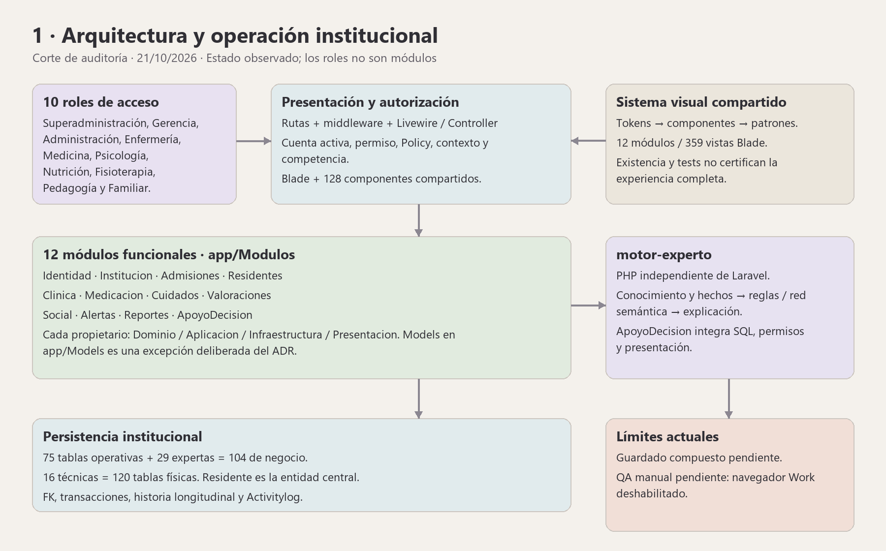
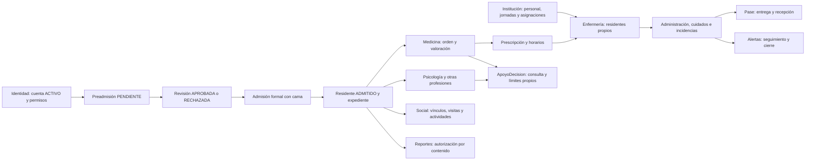

# Parte 1 — Auditoría administrativa, operativa y asistencial

Fecha: 21/10/2026. Dictamen: **NO LISTO PARA ACEPTACIÓN INTEGRAL**. Hay procesos
implementados y pruebas útiles, pero se reprodujeron defectos de lectura y se
encontraron problemas de fidelidad de medicación/historia y reportes.

## Lectura rápida

- **12 módulos**, **10 roles**, **104 tablas de negocio** y **16 técnicas**.
- **359 vistas Blade modulares** y **128 componentes Blade compartidos**.
- No se certifica ningún rol al 100% de punta a punta desde esta evidencia.
  Esto no significa que no funcionen: la tabla de roles diferencia capacidades
  localizadas de pendientes de aceptación.
- La lista de errores indica cuándo ocurre cada uno y si fue reproducido,
  detectado de forma determinista en código o sigue siendo un riesgo.
- Esta auditoría no cambia producto, reglas, permisos, esquema ni datos
  instalados. Las pruebas usan bases desechables y datos sintéticos.



Diagrama propio de arquitectura; no es una captura ni acredita QA de interfaz.

## Dónde está cada parte

Las tablas viven en PostgreSQL, en la base local `remembermind_dev`; no son
carpetas PHP. El repositorio conserva sus definiciones, entidades y consumidores:

| Ubicación | Responsabilidad |
|---|---|
| `database/migrations` y `docs/base-de-datos` | Evolución ejecutable del esquema y contrato estructural aprobado |
| `database/seeders` | Cargas controladas; no sustituyen formularios ni validación clínica |
| `app/Models` | Models, relaciones, casts e invariantes locales; ubicación central aprobada por ADR |
| `app/Modulos/{propietario}/Dominio` | Reglas y conceptos propios de ese proceso |
| `app/Modulos/{propietario}/Aplicacion` | Actions, servicios y consultas de casos de uso |
| `app/Modulos/{propietario}/Infraestructura` | Adaptadores e integración técnica del propietario |
| `app/Modulos/{propietario}/Presentacion` | Rutas, Controllers, Livewire, Policies y vistas del módulo |
| `app/Compartido` | Capacidades realmente compartidas |
| `resources/views/components` y `resources/frontend/styles/design-system` | Componentes y lenguaje visual común |
| `motor-experto` | Cálculo, conocimiento e inferencia independientes de Laravel; ApoyoDecision los integra |

Versiones fijadas en los lockfiles del corte: Laravel 13.33.0, Livewire 4.4.6,
Jetstream 5.5.3, Sanctum 4.3.3, Permission 7.4.2, Activitylog 4.12.3,
PHPUnit 12.5.36, Tailwind 3.4.19 y Vite 8.3.1. Esto registra dependencias,
no demuestra por sí solo que todos sus contratos se usen correctamente.

## Qué está bien y qué está mal desde la integridad clínica

| Aspecto | Correcto localizado | Incorrecto o pendiente observado |
|---|---|---|
| Identidad y admisión | Residente central; aprobación no crea residente; formalización con cama y transacción | Algunos reportes aún filtran ACTIVO y omiten ADMITIDO; un residente local sin admisión requiere conciliación de causa y procedencia no establecidas |
| Medicación | Separación prescripción/horario/administración y roles Medicina/Enfermería | Parsers de dosis ambiguas, fallback a 1, unidad forzada en rama antigua y edición que no cambia la FK de medicamento |
| Historia | Fechas, autoría y relaciones originales presentes en varios flujos | Update de nota sobrescribe contenido; acciones alternativas dependen demasiado de la entrada para autorizar |
| Ausencia de medición | Los contratos expertos distinguen ausente/NULL/cero y se abstienen | El PDF operativo sustituye signos ausentes por 0; tendencia de reporte permanece vacía por implementación |
| Contexto y privacidad | Policies/asignaciones presentes en los flujos principales | Endpoints agregados y PDF alternativos no aplican toda la frontera por recurso/residente |
| Cognición | Orientación/abstención y límites separados de diagnóstico autónomo | Faltan perfiles objetivos adoptados; patrón Petersen aún condicionado por juicios humanos intermedios |
| UI clínica | Componentes comunes, validación y formularios compartidos | La reutilización no demuestra foco/contraste/error/permiso correcto en cada consumidor; QA manual pendiente |

No se valoró la pertinencia de tratamientos de personas reales ni se certificó
un protocolo asistencial. Las conclusiones clínicas de diseño se contrastan
con fuentes primarias en el anexo por profesión. No se convierte un dato
sintético, un puntaje o una pantalla verde en aceptación médica.

## Integridad agregada de la base local

Lectura propia en transacción PostgreSQL REPEATABLE READ / READ ONLY, sin
identidades ni contenido de expedientes. Resultado al corte:

| Comprobación | Incidencias |
|---|---:|
| FK declaradas no validadas | 0 |
| Administración de prescripción/horario de otro residente u orden | 0 |
| Ejecución de intervención de un plan de otro residente | 0 |
| Consentimiento con vínculo o admisión de otro residente | 0 |
| Respuesta con pregunta de otro instrumento u opción de otra pregunta | 0 |
| Resultado de componente de otro tipo de estudio | 0 |
| Ocupación enlazada a admisión de otro residente | 0 |
| Camas o residentes con dos ocupaciones activas | 0 |
| ADMITIDO sin ocupación activa | 0 |
| Residente sin ninguna admisión | **1, causa no establecida; pendiente de conciliación** |
| Cruce residente/atención en 18 tablas inspeccionadas | 0 |

Una comprobación agregada sin incidencias no prueba todas las reglas clínicas,
la calidad del dato ni seguridad de acceso. El residente sin admisión no se
rellenó ni eliminó: debe conciliarse mediante su procedencia real. La evidencia
privada es `storage/app/private/auditoria-integridad-local-20261021.json`.

## Evidencia ejecutada por coordinación

| Verificación actual | Resultado | Alcance |
|---|---|---|
| PostgreSQL desechable dirigido | **169 pruebas / 1.695 aserciones, PASS** | Roles, acceso, admisión, ocupación, captura, IADL, revisión, coherencia compuesta y explorador seleccionados; no todos los procesos |
| Frontend | **226 aprobadas / 2 omitidas / 0 fallos** | Suite del repositorio; fixtures/componentes no equivalen a sesión operativa completa |
| Build | **PASS**, Vite 8.3.1 | Compilación; no QA ni aprobación clínica |
| Contratos de arquitectura aislados | **23 pruebas / 6.133 aserciones / 3 fallos** | Conteos de rutas y Livewire desfasados; discrepancia de expectativa de paleta, por conciliar |
| Reproducciones nuevas | **5 HTTP / 32 aserciones + 4 puras / 30 aserciones** | Verde significa que se reprodujeron defectos; no que el producto los haya reparado |
| Suite PHP general, SQLite | **3.473 pruebas / 63.498 aserciones / 9 fallos / 48 omitidas / 0 errores** | 3.416 aprobadas. FAIL global; contratos de arquitectura y presentación detallados en EVIDENCIA.md |
| Selección posterior de captura/informes | **63 pruebas / 608 aserciones / 2 fallos / 0 errores / 0 omitidas** | Cambios simultáneos en cinco archivos de interfaz; 61 casos aprobados. No equivale a suite global del checkout final |

Evidencia privada: `storage/app/private/auditoria-postgres-20261021.{xml,log}`,
`auditoria-frontend-20261021.log`, `auditoria-build-20261021.log` y
`auditoria-arquitectura-20261021.{xml,log}`. El runner PostgreSQL terminó y
retiró su cluster. La selección y límites están en [EVIDENCIA.md](EVIDENCIA.md).
Las afirmaciones «no ejecuté PostgreSQL/suites» dentro de los informes
independientes siguientes describen el alcance de su revisor, no omiten esta
ejecución de coordinación.

Cinco archivos de interfaz cambiaron por otro trabajo durante el cierre. El
resultado general se conserva como ejecución observada, no como certificado
de un snapshot inmóvil. EVIDENCIA enumera las variaciones y el seguimiento.

## Revisiones detalladas

Las secciones siguientes contienen módulos, errores, flujos, roles y cambios
prioritarios. La matriz por tabla está en [TABLAS_CONSUMIDORES.csv](TABLAS_CONSUMIDORES.csv).
Las referencias de líneas son localizadores del árbol auditado, con cambios
locales; no una declaración de producto estable por la existencia de archivos.

> Subinforme independiente: las declaraciones en primera persona describen únicamente el alcance de ese revisor. La evidencia adicional de coordinación se presenta por separado.

# Auditoría operativa y administrativa — 21/10/2026

Estado: **NO ACEPTABLE COMO CIERRE INTEGRAL**. Auditoría, sin reparación del producto. Alcance: los doce propietarios funcionales y, con mayor profundidad, Medicina, Psicología, Enfermería, lecturas clínicas y reportes. ApoyoDecision se delimita aquí por su integración; la revisión experta detallada pertenece al informe complementario.

## Método y límites

Se aplicaron `remembermind-source-of-truth`, `remembermind-security-review` y `remembermind-geriatric-workflows`. Se leyeron AGENTS raíz/app/database/resources, registros de rutas y sus grupos, baseline/decisiones, permisos del seeder, Controllers, Actions, consultas, Models, componentes compartidos y pruebas relacionadas. La revisión es por muestreo dirigido a fronteras y procesos: no es una inspección de cada método de todos los módulos.

El árbol contiene cambios locales anteriores y trabajo concurrente. Se auditó su estado visible, sin atribuir autoría ni corregirlo. No se modificaron producto, permisos, datos operativos, migraciones o configuración; no se hizo commit/push. El único documento escrito por este revisor es este informe. Por autorización específica de coordinación se creó además un arnés privado efímero, exclusivamente sintético, en `storage/app/private/auditoria-20261021/`.

Evidencia propia ejecutada: **5 pruebas HTTP / 32 aserciones y 4 pruebas puras / 30 aserciones, correctas** (9/62 en dos ejecuciones), PHP 8.3.33/PHPUnit 12.5.36, Laravel con SQLite `:memory:` y almacenamiento/cachés aislados. Son pruebas que reproducen defectos; su resultado verde **no significa producto aprobado**. No se ejecutaron suites amplias, PostgreSQL, navegador, accesibilidad, correo, PDF real ni despliegue. Las dos pruebas PDF interceptan `Pdf::loadView`, comprueban los datos entregados y devuelven una respuesta simulada; no acreditan bytes PDF. Las pruebas puras no persisten ni administran medicación.

Comando repetible desde la raíz, conservando `LARAVEL_STORAGE_PATH` propio del arnés:

```powershell
$env:LARAVEL_STORAGE_PATH = "$PWD\storage\app\private\auditoria-20261021\runner-storage"
php vendor/phpunit/phpunit/phpunit --do-not-cache-result --colors=never storage/app/private/auditoria-20261021/RevisionOperativaReproTest.php --log-junit storage/app/private/auditoria-20261021/revision-operativa.junit.xml
php vendor/phpunit/phpunit/phpunit --do-not-cache-result --colors=never storage/app/private/auditoria-20261021/DosisAuditoriaPureTest.php --log-junit storage/app/private/auditoria-20261021/dosis-pura.junit.xml
```

El arnés HTTP usa `Tests\TestCase` y `RefreshDatabase`; `phpunit.xml` configura testing/SQLite en memoria y las aserciones comprueban SQLite y `:memory:`. El arnés puro comprueba además el entorno testing. El primer intento HTTP tenía una fixture sin la FK de cuenta del profesional; el segundo un mock PDF sin su tipo concreto. Se corrigieron solo esos errores del arnés. Los resultados finales son 5/32 y 4/30, sin fallos ni pruebas riesgosas. No se deshabilitaron controles del producto.

Clasificación de evidencia:

- **R-HTTP:** ruta/middleware/backend ejecutados con datos sintéticos y resultado afirmado.
- **R-pura:** validación/transformación ejecutadas sin persistencia; no demuestra creación HTTP de una orden.
- **E:** defecto determinista de implementación comprobado por lectura; falta reproducción de ese recorrido.
- **Riesgo:** frontera o cobertura insuficiente que requiere prueba antes de afirmar exposición/efecto.
- **Brecha:** capacidad ausente o parcialmente implementada; no se confunde con error de una capacidad existente.

## Fuentes vigentes y conflictos

| Fuente | Uso en esta auditoría | Límite |
|---|---|---|
| [Baseline y decisiones BDD](../../base-de-datos/README.md:18) | 75 operativas + 29 expertas = 104 de negocio instaladas; cuatro consolidaciones ya aprobadas | No se autoriza otra reducción o DDL desde este informe. |
| [Roles congelados](../../arquitectura/REMEMBERMIND_ROLES_BASELINE_CONGELADO.md:71) | Competencia profesional + permiso + contexto; Enfermería administra y Medicina prescribe | Los grants efectivos de la instalación no se consultaron. El seeder es evidencia de configuración, no de su ejecución actual. |
| [Arquitectura híbrida](../../arquitectura/ADR_ARQUITECTURA_HIBRIDA.md:3) | Doce propietarios en `app/Modulos`; Models conservados en `App\Models` | Los conteos del corte arquitectónico son históricos, no inventario actual. |
| [Excepción Superadmin](../../arquitectura/PERMISOS_TEMPORALES_SUPERADMIN.md:24) | Excepción explícita local/testing con flag, personal propio y sin preview | No se reporta como bypass productivo por su sola existencia; falta comprobar configuración del despliegue. |
| [Mapa funcional](../../sistema/MAPA_DOMINIO_FUNCIONAL.md:21), [matriz](../../seguridad/MATRIZ_ROLES_PERMISOS.md:22), contratos `docs/modulos/` | Descubrimiento y responsabilidades | Conservan enlaces anteriores `app/Backend`, `app/Http/Controllers` y conteos/estados de otros cortes. Se localizaron archivos modulares reales. CURRENT no equivale a completo. |
| [Cierre Pase de turno](../../modulos/pase-turno/CIERRE_PASE_TURNO_2026_10_16.md:33) | Evidencia histórica localizada con comandos, carreras y límites | No se repitió en este corte ni se extiende su PASS a otros módulos. |

El contrato obligatorio de admisión distingue aprobar preadmisión de crear residente. `FormalizarAdmision` escribe `ADMITIDO`; algunos reportes todavía buscan `ACTIVO`. Para esos reportes hay una contradicción concreta de implementación, sin necesidad de inventar un catálogo clínico nuevo. Las decisiones abiertas de catálogos, PRN, publicación familiar y estructura deben resolverse en su alcance; no justifican publicar recursos sin permiso.

## Procesos y doce módulos



| Propietario | Proceso y entradas localizadas | Evidencia de backend / consumidor | Resultado de auditoría |
|---|---|---|---|
| Identidad | Usuarios, roles/permisos, personal, preview; `Presentacion/Rutas/web.php` | `UsuariosPanel`, `RolesPermisosPanel`, `RolePreviewService`; middleware de cuenta activa | Implementación localizada, sin aceptación global. Riesgo de mantenimiento por panel de 2361 líneas y superficies de permisos múltiples; revisar desactivación/revocación y mínimos de cada rol con tests. |
| Institucion | Coordinación administrativa, áreas, habitaciones, jornadas, plazas, galería | `OperacionController`, `MapaHabitacionesService`, `AsignarResidenteJornadaHttp` | Asignación HTTP exige Admin/SA, jornada y profesional vigentes; bloqueo de jornada. No se infiere que el grant de Enfermería autorice esta entrada. Planificación real y continuidad deben probarse con datos sintéticos. |
| Admisiones | Preadmisión, revisión y formalización | `FormalizarAdmision.php:58–148`: bloqueo solicitud/cama/habitación, creación de residente/ocupación/historia transaccional | Diseño defensivo visible; no se repitieron atomicidad/carreras. Diferencia con reportes ADMITIDO señalada en OP-08. |
| Residentes | Directorio, ficha administrativa, expediente, vínculos/documentos | `ResidentePolicy`, `ResidenteController`, `PanelResidenteService` | `create=false` y rama familiar reducida visibles. Lectura no familiar carga clínica completa con permiso general: OP-04. |
| Clinica | Atenciones, notas, diagnósticos, signos, estudios/archivos, ficha médica | `ExpedienteClinicoController`, `GestionarEstudiosClinicos`, `GestionarNotasClinicas` | Fuga por recurso reproducida OP-01; edición de nota sin sucesora OP-11 y riesgo en acciones directas OP-12. |
| Medicacion | Orden médica, horarios, agenda, administración programada/PRN | V2 `MedicacionController`, formularios Livewire `GestionarPrescripciones` y ficha HTTP `GestionarPrescripcionFichaHttp`; agenda y pase consumen órdenes | Transformaciones ambiguas de dosis reproducidas en parser actual y alternativo: OP-05. Mapeo alternativo OP-06. No extrapolar verificaciones del servicio programado a todas las entradas. |
| Valoraciones | Valoración médica/enfermería, instrumentos, Psicología y otras profesiones | `RegistrarValoracionProfesional`, `EvaluacionesAreaPanel`, modal instrumental | Autoría propia visible en acciones; listas/lecturas requieren scope por recurso. No hay certificado completo del rol psicológico. OP-13 describe riesgo de metadata y selección manipulable. |
| Cuidados | Mi turno, residentes, registros, planes/programaciones/ejecuciones y pase | `TurnoEnfermeriaService`, `PaseTurnoService`, `GestionarEjecucionesAgenda` | Servicio contextual y transacciones visibles; endpoint agregado fuga recursos OP-02. No se certifica el ciclo por existencia de esas clases. |
| Social | Contactos/red de apoyo, actividades/asistencia y visitas | `GestionarActividadesHttp`, `RegistrarVisitaConsentimientoHttp`, paneles sociales | Existen APIs administrativas para visita y consentimiento; las entradas Familia/Social visitas y ficha social siguen base sin operación: OP-10. |
| Alertas | Generación manual/contextual, reconocimiento, asignación, seguimiento/cierre | `AlertasService`, `AlertaController`, paneles; eventos relacionados | Controles por actor y alcance visibles. Medicina/Psicología están incluidos en lectura global del servicio; el candidato OP-14 se descartó al seguir la delegación. Ciclo y revocación pendientes de QA propio. |
| Reportes | Institucionales, salud, residentes, Enfermería y exportaciones | Controllers/`ReporteDataService`/vistas | Mayor concentración de fallos: OP-03, OP-07–09 y riesgos OP-15. No está listo para aceptación integral. |
| ApoyoDecision | Consulta cognitiva y enlace desde Medicina/Psicología/Enfermería | Rutas/Policies y preparación/informe propios | Se remite al informe experto. La consulta no acredita diagnóstico ni guardado compuesto; no se usa para validar estos once propietarios restantes. |

Todas las rutas anteriores residen bajo `C:/Users/CARLAENCINAS/Desktop/RememberMind/app/Modulos/{Propietario}/`; la composición real se encuentra en [routes/web.php](../../../routes/web.php:8). Sus dos familias de entradas (paneles históricos y endpoints V2 desde la línea 671) deben cubrirse por separado.

## Hallazgos priorizados

### OP-01 — P1, R-HTTP: expediente entrega recursos clínicos sin sus permisos

[ExpedienteClinicoController.php](../../../app/Modulos/Clinica/Presentacion/Http/Controllers/ExpedienteClinicoController.php:27) comprueba `view` del residente y devuelve notas, diagnósticos, antecedentes, alergias, signos, dolor, antropometría, incidentes e indicaciones. [Rutas de Clínica](../../../app/Modulos/Clinica/Presentacion/Rutas/web.php:175) autorizan la entrada por `atenciones.ver`; `ResidentePolicy::view` no autoriza esos recursos.

Reproducción: cuenta activa con `residentes.ver` y `atenciones.ver`, sin `diagnosticos.ver`; GET `/admin/residentes/{id}/expediente` devuelve 200 y el marcador de un diagnóstico sintético. No se añadió rol privilegiado ni se omitió middleware. Arnés `test_expediente_expone_diagnostico_sin_permiso_del_recurso`.

Impacto: revocar un recurso no impide consultarlo mediante el agregado. Reparación futura: contrato de proyección con permiso/scope por recurso antes de consultarlo/serializarlo; negativos por cada sección y rol. No solucionarlo concediendo lectura de expediente completo.

### OP-02 — P1, R-HTTP: cuidados entrega recursos ajenos a `planes_cuidado.ver`

[CuidadoController.php](../../../app/Modulos/Cuidados/Presentacion/Http/Controllers/CuidadoController.php:32) carga asignaciones, cognición, conducta, sueño, ingesta, hidratación, eliminación, movilidad, heridas/curaciones, planes, ejecuciones y pases tras `view`. La ruta solo exige `planes_cuidado.ver`.

Reproducción: cuenta activa con `residentes.ver` y `planes_cuidado.ver`, sin `registros_sueno.ver`; GET `/admin/residentes/{id}/cuidados` devuelve 200 con la observación sintética de sueño. Arnés `test_cuidados_expone_sueno_sin_permiso_del_recurso`.

Debe aplicarse permiso y contexto por sección, incluido alcance de Enfermería. Que la interfaz principal sí use `TurnoEnfermeriaService` no protege este endpoint alternativo.

### OP-03 — P1, R-HTTP con PDF simulado: exportación carga notas sin autorización del recurso

[ReporteV2Controller.php](../../../app/Modulos/Reportes/Presentacion/Http/Controllers/ReporteV2Controller.php:13) niega familiares, pero a otras cuentas solo les exige `view` del residente; carga `atenciones.notas`, prescripciones y contactos. [Ruta](../../../app/Modulos/Reportes/Presentacion/Rutas/web.php:167) exige únicamente `residentes.ver`, sin permiso de exportación ni lectura de cada recurso.

Reproducción: cuenta activa con `residentes.ver`, sin `notas_clinicas.ver`, GET `/admin/residentes/{id}/reporte.pdf`; respuesta 200 del mock y el marcador de nota llega a `Pdf::loadView`. Se comprobó el backend y los datos entregados al renderizador, no bytes PDF ni incidente real.

Aplicar autorización por contenido y exportación; reutilizar consultas seguras, no cargar el modelo completo y luego ocultar secciones en Blade.

### OP-04 — P1, E: ficha V2 no familiar repite el agregado clínico sin permisos específicos

[ResidenteController.php](../../../app/Modulos/Residentes/Presentacion/Http/Controllers/ResidenteController.php:27) ya limita la rama FAMILIAR a identidad mínima. Sin embargo, la rama no familiar `:38` carga admisiones, contactos, notas y prescripciones con `view` y devuelve el modelo completo en JSON. `view` basta con `residentes.ver` para una cuenta no familiar ([Policy](../../../app/Modulos/Residentes/Presentacion/Policies/ResidentePolicy.php:26)).

No se ejecutó esta ruta en el arnés. El patrón es equivalente a OP-03; requiere negativo propio con Admin/Psicología y permisos revocados. No reabrir como vigente la fuga familiar antigua: esa rama está corregida en el código actual.

### OP-05 — P1, R-pura/E: formularios de prescripción transforman dosis ambiguas sin rechazarlas

[StoreMedicacionRequest.php](../../../app/Modulos/Medicacion/Presentacion/Http/Requests/StoreMedicacionRequest.php:30) admite `dosis` como cualquier cadena. [GestionarPrescripcionFichaHttp.php](../../../app/Modulos/Medicacion/Aplicacion/Acciones/GestionarPrescripcionFichaHttp.php:36) toma el primer número mediante regex, convierte a float, usa fallback `1.0` y fija `unidad_dosis='unidad'`. Su POST sigue registrado como `admin.adultos-mayores.medicacion.store` ([registro](../../../app/Modulos/Medicacion/Presentacion/Rutas/web.php:13), [composición](../../../routes/web.php:288), [Controller](../../../app/Modulos/Medicacion/Presentacion/Http/Controllers/AdultoMayorMedicacionController.php:17)). El test puro comprueba ruta, Controller y middleware; no demuestra una orden guardada.

Reproducción pura alternativa: el Request acepta `1/2 comprimido`, `0,5 mg` y `según indicación`; la regex exacta del archivo produce, respectivamente, 1, 0 y 1 y el código fija unidad. El arnés coteja la regex y la constante con el archivo; esta parte reproduce el algoritmo, sin invocar la acción transaccional ni persistir.

Los formularios visibles actuales usan otra rama: [SaludMedicacionPanel.php:109](../../../app/Modulos/Medicacion/Presentacion/Livewire/Paginas/SaludMedicacionPanel.php:109) valida `nuevo_dosis` como string y delega en `guardarDesdePanel`; [su formulario](../../../app/Modulos/Medicacion/Presentacion/Vistas/livewire/medicacion/salud-medicacion.blade.php:63) hace `wire:submit="guardarNuevoMedicamento"`. El [modal](../../../app/Modulos/Medicacion/Presentacion/Vistas/livewire/medicacion/medicacion-adulto-modal.blade.php:18) envía `guardar`, que delega en [guardarDesdeModal](../../../app/Modulos/Medicacion/Presentacion/Livewire/Funcionalidades/MedicacionAdultoModal.php:137); la pantalla monta este modal y tiene botón de edición en sus líneas 599/640. No se encontró un consumidor Blade/JS del nombre de la ruta HTTP alternativa durante la búsqueda; ruta registrada no equivale a formulario actual consumidor.

Ambos Livewire llaman [GestionarPrescripciones::separarDosis](../../../app/Modulos/Medicacion/Aplicacion/Acciones/GestionarPrescripciones.php:262). Se invocó **ese método real**, por Reflection y sin persistir: `1/2 comprimido` produce cantidad `1.0`, unidad `/2 comprimido`; texto sin número produce cantidad `1`, unidad `según indicación`. `0,5 mg` aquí sí produce `0.5 mg`, a diferencia de la rama HTTP. Las reglas reales del modal aceptan las cadenas ambiguas. La prioridad P1 describe riesgo de fidelidad de la orden; no acredita daño clínico real ni administración ejecutada.

Requiere validación estructurada de dosis/unidad y conservación exacta, sin conversión heurística ni fallback clínico. Probar fracciones, decimales, unidad, dosis cero/no numérica y rollback sin orden/horario parcial. La regla clínica sobre qué dosis indicar corresponde al médico.

### OP-06 — P2, E: edición del nombre de medicación no cambia el medicamento referenciado

[GestionarPrescripcionFichaHttp.php](../../../app/Modulos/Medicacion/Aplicacion/Acciones/GestionarPrescripcionFichaHttp.php:66) cambia `indicacion` con `nombre_medicamento`, pero conserva `cod_medicamento`; [Prescripcion.php](../../../app/Models/Prescripcion.php:94) presenta el nombre de la relación. Una entrada aceptada puede aparentar sustitución y seguir administrándose con el medicamento original. La creación también valida fechas/estado en el Request, pero persiste `now()`/ACTIVA en `:41`, sin representar esa selección.

No decidir silenciosamente si el cambio debe ser edición o nueva orden: reconciliar formulario y operación con el contrato de historia, y probar la identidad visible y la consumida por agenda. La restauración `:110` reactiva sin comprobar un estado origen permitido; comprobar ese ciclo antes de aceptarlo.

### OP-07 — P1, R-HTTP con PDF simulado: ficha de Enfermería omite asignación contextual

[FichaPacienteReporteController.php](../../../app/Modulos/Reportes/Presentacion/Http/Controllers/FichaPacienteReporteController.php:15) carga el residente antes de comprobar una lista de roles; no consulta Policy ni turno/asignación. La ruta solo exige `enfermeria.ver_ficha_paciente`.

Reproducción: ENFERMEROS, cero asignaciones de ese residente, GET `/admin/enfermeria/pacientes/{id}/pdf` llega al mock PDF y devuelve 200. La comparación de destino es exacta; no se añadió un vínculo para satisfacer el acceso. Debe reutilizar el scope de la ficha y exigirlo antes de cargar datos. La autorización general del rol no cubre a cualquier residente.

### OP-08 — P2, R-HTTP: el PDF falla cuando existe una asignación activa; su timeline también es incorrecto

[FichaPacienteReporteController.php](../../../app/Modulos/Reportes/Presentacion/Http/Controllers/FichaPacienteReporteController.php:20) solicita eager loading `asignacionTurnoActiva.turno`. [AsignacionResidenteJornada.php](../../../app/Models/AsignacionResidenteJornada.php:65) tiene `jornada()` y un accesor `getTurnoAttribute()`, no relación `turno()`.

Reproducción: con asignación ACTIVA, GET produce `RelationNotFoundException` para `turno`, antes de generar el PDF. Sin asignación, el mock pudo comprobar otro error: residente ADMITIDO obtiene `timeline['ADMITIDO']=false` porque `:37` solo contempla ACTIVO/EN_OBSERVACION. Además `:35–36` atribuyen ambas valoraciones a la mera existencia de cualquier atención; no prueban que Medicina y Enfermería hayan valorado.

Distinguir bloqueo técnico de autorización: la excepción no corrige OP-07; la ruta sí avanza para residentes sin asignación. Reparar relación y comprobar hechos reales del timeline, sin inventar registros.

### OP-09 — P2, E: reportes fabrican ceros y prometen una tendencia que no se calcula

[FichaPacienteReporteController.php](../../../app/Modulos/Reportes/Presentacion/Http/Controllers/FichaPacienteReporteController.php:53) convierte NULL de presión/saturación a cero, dibujando una medición inexistente. [ReporteEnfermeria.php](../../../app/Modulos/Reportes/Presentacion/Livewire/Paginas/ReporteEnfermeria.php:71) siempre envía `collect()` para tendencia; su [vista](../../../app/Modulos/Reportes/Presentacion/Vistas/livewire/cuidados/reporte-enfermeria.blade.php:41) anuncia alimentación, hidratación y dolor desde registros firmados y su empty state solicita registrar cuidados, aunque esos registros ya puedan existir.

Además [ReporteDataService.php](../../../app/Modulos/Reportes/Aplicacion/Consultas/ReporteDataService.php:49) y `:373` excluyen ADMITIDO de residentes activos/sin contacto. La alta formal usa ese estado. Separar medición ausente, capacidad no implementada y ausencia real; contrastar alcance temporal/unidad de las agregaciones. No inventar umbrales ni tendencia clínica para rellenar el hueco.

### OP-10 — P2, brecha: Visitas y Ficha social en Familia/Social son entradas sin proceso

[Rutas de Social](../../../app/Modulos/Social/Presentacion/Rutas/web.php:70) enlazan `/admin/familia-social/visitas` y `/admin/familia-social/ficha-social` a `pages.familia-social.base`. La [vista](../../../app/Modulos/Social/Presentacion/Vistas/paginas/familia-social/base.blade.php:24) dice «Vista base preparada» y reserva la función a una fase posterior. No son un módulo de visitas terminado. Existen operación administrativa/API y vistas en otras entradas; este hallazgo no afirma que toda visita sea imposible.

Definir el consumidor de estas entradas y su navegación al proceso existente; no duplicar tablas ni conceder acceso familiar a clínica para completarlas.

### OP-11 — P1, E: actualización de nota clínica sobrescribe el contenido original

[GestionarNotasClinicas.php](../../../app/Modulos/Clinica/Aplicacion/Acciones/GestionarNotasClinicas.php:30) recibe una nota por residente y actualiza su contenido/tipo en la misma fila. No crea sucesora/rectificación ni utiliza `cod_nota_anterior`, cuya relación ya existe en [NotaClinica](../../../app/Models/NotaClinica.php:8). La creación de esta rama también copia el texto inicial a `Atencion.observacion`; esa copia puede conservar el primer texto, pero no conserva una cadena de versiones de la nota ni sus correcciones intermedias. La entrada está registrada en las rutas de Clínica y su Controller delega en esta acción.

AGENTS exige historia longitudinal. Verificar el recorrido completo y su auditoría antes de corregir; un cambio de `contenido` no queda convertido en rectificación por el solo hecho de usar `update`. La firma/autor original tampoco deben atribuirse al actor que modifica otro registro. No se ejecutó mutación clínica en esta auditoría.

### OP-12 — P2, riesgo: acciones clínicas alternativas dependen de controles de su entrada

[GestionarAtenciones.php](../../../app/Modulos/Clinica/Aplicacion/Acciones/GestionarAtenciones.php:16) y [GestionarNotasClinicas.php](../../../app/Modulos/Clinica/Aplicacion/Acciones/GestionarNotasClinicas.php:16) no comprueban por sí mismas cuenta ACTIVO, permiso, profesión y Policy. Seleccionan personal y última asignación; no exigen allí vigencia diaria. En update/destroy el actor recibido no participa de la decisión.

La arquitectura ya lo reconoce en [ARQUITECTURA_VIGENTE.md](../../arquitectura/ARQUITECTURA_VIGENTE.md:64). No se afirma que los HTTP carezcan de middleware. Falta probar invocación directa, personal inactivo, fecha/jornada y acceso cruzado, y centralizar una guarda proporcional antes de nuevos consumidores.

### OP-13 — P2, riesgo: selección de área y detalle de valoraciones necesita integridad de lectura

[EvaluacionesAreaPanel.php](../../../app/Modulos/Valoraciones/Presentacion/Livewire/Paginas/EvaluacionesAreaPanel.php:16) expone `codArea` como estado editable mientras `instrumentosCodes` está Locked. Cambiar la primera puede producir catálogo/acción de otra área sin cambiar el filtro original y el contexto inicial del título. La autorización general exige personal activo pero no profesión psicológica exacta. [ValoracionMedicaPanel.php](../../../app/Modulos/Valoraciones/Presentacion/Livewire/Paginas/ValoracionMedicaPanel.php:193) recupera detalle por ID sin el filtro de tipos aplicado al listado.

No se reporta exposición HTTP reproducida. Probar payload Livewire, permisos revocados, tipo/área ajena, y competencia de la cuenta. Mantener separados lectura y capacidad de crear; no convertir estos riesgos en motivo para ampliar permisos.

### OP-14 — Candidato descartado: el servicio sí reconoce lectura global de Medicina/Psicología

[AlertaController.php](../../../app/Modulos/Alertas/Presentacion/Http/Controllers/AlertaController.php:22) y `AlertasService::autorizarLectura` delegan el alcance en `TurnoEnfermeriaService`. Aunque sus nombres remiten a asignación, [tieneLecturaClinicaGlobal](../../../app/Modulos/Cuidados/Aplicacion/Consultas/TurnoEnfermeriaService.php:38) incluye Medicina/Psicología y [obtenerPacientesAsignadosQuery](../../../app/Modulos/Cuidados/Aplicacion/Consultas/TurnoEnfermeriaService.php:92) devuelve el universo sin exigir asignación cuando no hay filtro específico.

Se descarta la hipótesis de denegación por ausencia de asignación enfermera para estos dos roles. Se conserva este número para evitar que el candidato preliminar se mezcle con hallazgos confirmados. No constituye PASS funcional del ciclo de alertas ni aprobación de su proyección por rol.

### OP-15 — P2, riesgo: reportes de salud y exportaciones no tienen contrato de contenido por rol

[ReporteSaludController.php](../../../app/Modulos/Reportes/Presentacion/Http/Controllers/ReporteSaludController.php:20) compila listas clínicas globales desde `ReporteDataService`; su entrada usa `reportes.ver`/`reportes.exportar_pdf`. Admin tiene esos grants sin competencia clínica general. [ReporteDataService.php](../../../app/Modulos/Reportes/Aplicacion/Consultas/ReporteDataService.php:233) proyecta nombres y dosis; no recibe actor/scope. La vista de Enfermería, por contraste, sí limita IDs por asignaciones.

Se debe definir y probar la proyección institucional autorizada; no afirmar fuga de un reporte concreto sin ejecutar su render y determinar si el contrato aprueba ese contenido. Verificar también autorización independiente de exportación CSV/PDF V2 y fórmulas de hojas de cálculo al exportar texto aportado por usuario. No se ejecutaron exportaciones reales.

## Prioridades por rol

| Rol | Responsabilidad conservada | Obstáculo prioritario | Verificación pendiente |
|---|---|---|---|
| Medicina | Prescribir/suspender, valoración propia, expediente autorizado, estudios y revisión cognitiva según contrato | OP-05/06 dosis y medicamento; OP-11 historia; agregados sobreexpuestos | Órdenes estructuradas, suspensión/restauración, origen/autor, negativos y rollback de todas las entradas; no solo modal nuevo. |
| Psicología | Valoraciones propias, instrumentos autorizados, lectura cognitiva y revisión independiente | OP-01/02 permiten leer recursos sin permiso; OP-13 área/competencia | Perfil psicológico activo, revocación, instrumentos por área, fechas/originales; no habilitar diagnóstico médico por tener lectura del residente. |
| Enfermería | Asignados/jornada, administración, registros, alertas, entrega/recepción | OP-07/08 PDF fuera de scope o fallido; OP-09 reporte sin tendencia | Jornada nocturna, fuera de turno, residente ajeno, omisión/PRN, pase exacto, PDF con/sin asignación; sin permiso para prescribir. |
| Administración | Ingreso, alojamiento y operación diaria | Reportes con contenido excesivo; estados inconsistentes | Admisión concurrente, cama ocupada, contactos/consentimiento, documentos, scopes de exportación. |
| Gerencia | Personal, planificación, cobertura y dirección | No confundir lectura gerencial con expediente clínico completo | Gestión RRHH/turnos, límites frente a Admin, reportes minimizados. |
| Superadministración | Supervisión técnica | Excepción local no acredita producción | Configuración fuera de local/testing y preview; permisos clínicos no bastan sin responsabilidad profesional. |
| Familia | Vínculo activo e información publicada | No extrapolar rama familiar corregida a todos los documentos/rutas | Dos familias/dos residentes, revocación vínculo/autoriza_informacion, documentos propios/ajenos; ninguna publicación clínica automática. |
| Nutrición/Fisioterapia/Pedagogía | Actos por profesión y permiso | Cobertura menor de esta auditoría | Ciclo positivo y negativo de cada valoración; no declarar completos por existir la definición. |

No se propone añadir permisos ni reescribir la matriz congelada. Los problemas comprobados son aplicación insuficiente de la frontera existente. Las diferencias de responsabilidad abiertas deben documentarse para decisión, no resolverse con grants amplios.

## Arquitectura, componentes y mantenibilidad

La estructura mantiene los doce propietarios y el motor independiente. `routes/web.php` compone registros inertes; `ArquitecturaModularServiceProvider` registra Policies, Livewire y finder modular. Esa integración evita duplicar vistas por rol. Models en `App\Models` es excepción aprobada, no defecto por sí misma.

Persisten nombres/contratos heredados (`AdultoMayor*`, `adulto_mayor`, `getTurnoAttribute`) y ramas paralelas HTTP/ficha. Algunos usan tablas V2 reales y son compatibilidad nominal; otros contienen traducciones destructivas como OP-05. No se afirma que todo nombre heredado sea uso de tablas V1. Es necesario inventariar consumidores antes de retirar la compatibilidad; el estado final V2 no debe depender permanentemente de ella.

Tamaño observado, sin inferir un fallo automáticamente: `MisPacientes.php` 3303 líneas, `FichaPaciente.php` 1641, `UsuariosPanel.php` 2361. La mezcla de lectura, interacción y múltiples procesos hace costoso garantizar que todas las acciones reautoricen el mismo contexto. Priorizar extracción de responsabilidades tocadas y pruebas por invariante; no una reescritura global.

Los componentes [modal-livewire](../../../resources/views/components/ui/modal-livewire.blade.php:81) y [drawer-livewire](../../../resources/views/components/ui/drawer-livewire.blade.php:46) contienen trap, inert, Escape y labels. Eso prueba implementación estática, no teclado o lector de pantalla funcionando en todos sus consumidores. Las variantes docked/compact y cierres desde servidor requieren QA real. Las interfaces antiguas aún usan estilos locales y alias semánticos; no se propone otra paleta por rol.

Las consultas de reportes usan `get()` sin paginación para numerosas colecciones y el PDF puede cargar expediente completo. Es riesgo de volumen/exposición y mantenimiento; no se midió latencia ni se recomienda cache/índice nuevo sin evidencia.

## Evidencia mínima para la siguiente fase, sin implementar en esta auditoría

1. Convertir OP-01/02/03/07 en negativos permanentes: 403 o proyección permitida sin el marcador reservado; ningún artefacto/audit de exportación exitoso al denegar. Añadir casos positivos y roles reales. No basta que una consulta falle por una relación inválida.
2. OP-05/06: Request/Action/Model/agenda deben conservar exactamente dosis, unidad, medicamento, autor y fechas. Probar todos los formularios y endpoints existentes sin crear una orden desde texto no interpretable.
3. OP-08/09: PDF con asignación activa y sin asignación, residente ADMITIDO, atención de tipo diferente, NULL clínico y reportes con registros presentes. Verificar bytes PDF reales en entorno sintético después del control de datos.
4. OP-11/12: actor competente propio, cuenta inactiva, permiso revocado, nota ajena, rectificación/anulación y auditoría fallida. La historia original debe seguir recuperable.
5. Cerrar contratos incompletos de Social y reportes mediante alcance concreto; no rellenar una pantalla con datos de ejemplo ni asumir que ausencia de cálculo es ausencia de cuidados.
6. Repetir con PostgreSQL desechable las propiedades que lo necesitan: admisión/cama, asignaciones, administración/pase concurrentes y rollback. SQLite solo acredita este arnés de lectura y fixture.
7. Navegador por Medicina/Psicología/Enfermería en 1440/1280/1024/768/390 CSS px, temas, teclado, foco/Escape, errores/dirty state, revocación y documentos. Este revisor no ejecutó esa matriz.

Pruebas existentes localizadas, **no ejecutadas aquí**: `Fase3AdmisionAtomicidadTest`, `AdmisionesOperativasTest`, `MapaHabitacionesTest`, `AsignacionesJornadaPlanificadaTest`, `RolesBaselineCongeladoTest`, `RolesVistasPermisosMatrixTest`, `ActividadesIntegrityTest`, `ReportesPortabilidadTest`, `FichaPacienteBotonesTest`, `PaseTurnoIntegridadTest`, `PaseTurnoReconstruidoTest`, `PaseTurnoConcurrenciaPostgresTest`. Sus nombres o verde de otra entrega no sustituyen los negativos nuevos descritos.

## Dictamen

La arquitectura y varios procesos tienen guardas, transacciones y pruebas localizables; no constituyen aceptación global. Esta revisión encontró **accesos indebidos reproducidos por recurso y scope**, fallos deterministas en medicación/reportes y funciones visibles incompletas. Se recomienda una fase implementadora separada, priorizando seguridad de lectura y fidelidad de órdenes antes de mejoras de presentación. No se solicita aprobación de DDL ni se certifica clínica, producción o cumplimiento legal desde este informe.


> Subinforme independiente: las declaraciones en primera persona describen únicamente el alcance de ese revisor. La evidencia adicional de coordinación se presenta por separado.

# Revisión independiente de BDD, autorización y arquitectura

Fecha: 21/10/2026. Auditoría de solo lectura del checkout y PostgreSQL local. Sin DDL, migraciones, seeders, reset, autenticación con cuentas reales ni cambios de producto. Se escriben únicamente este informe y su CSV solicitado. Hay trabajo simultáneo no confirmado; estas referencias corresponden al corte inspeccionado, no a un commit inmutable.

## Dictamen y fuentes

**120 tablas físicas = 104 de negocio (75 operativas + 29 expertas) + 16 técnicas. Diez roles instalados.** Las 104 tienen Model explícito. No se encontró fundamento para declarar prescindible alguna de ellas. Esto no demuestra mínimo matemático ni completitud de formularios: cero filas, cero FK entrantes o ausencia de CRUD propio no prueban desuso.

**Cero de diez roles pueden certificarse íntegramente completos mediante este gate acotado.** Es un límite de aceptación, no una afirmación de que diez roles sean inservibles. La presencia de dashboards, permisos y endpoints es evidencia de implementación; faltan recorridos y negativos integrales vigentes por cada rol. La raíz verifica suites y UX por separado.

Se aplicaron remembermind-source-of-truth, remembermind-database-audit y remembermind-security-review. Fuente vigente: núcleo congelado más decisiones aprobadas posteriores. El inventario actual está en [docs/base-de-datos/REMEMBERMIND_BDD_BASELINE_CONGELADO.md:20](<C:/Users/CARLAENCINAS/Desktop/RememberMind/docs/base-de-datos/REMEMBERMIND_BDD_BASELINE_CONGELADO.md:20>); la reducción instalada y sus límites en `docs/base-de-datos/DECISION_REDUCCION_EXPERTA_2026_10_20.md`. Los conteos 71/94/106/108 de snapshots anteriores no sustituyen 104.

`docs/arquitectura/REMEMBERMIND_ROLES_BASELINE_CONGELADO.md` gobierna competencias y decisiones posteriores IADL/Petersen/gobierno. `docs/arquitectura/ADR_ARQUITECTURA_HIBRIDA.md` gobierna carpetas y excepción App/Models. `docs/seguridad/MATRIZ_ROLES_PERMISOS.md` es parcialmente útil, pero conserva enlaces a ubicaciones retiradas: no acredita las entradas actuales. `docs/sistema-experto/FASE_0_1_CONSERVACION_PENDIENTE_2026_10_20.md` es propuesta pendiente, no autorización de estructura ni certificación de recálculo íntegro.

## Diez hallazgos prioritarios

| ID / prioridad | Evidencia | Impacto / siguiente corrección separada |
|---|---|---|
| S01 / P1 | [app/Providers/AppServiceProvider.php:79](<C:/Users/CARLAENCINAS/Desktop/RememberMind/app/Providers/AppServiceProvider.php:79>), callback Gate::before, permite lectura a Superadministración sin comprobar ACTIVO; [app/Modulos/Residentes/Presentacion/Policies/ResidentePolicy.php:11](<C:/Users/CARLAENCINAS/Desktop/RememberMind/app/Modulos/Residentes/Presentacion/Policies/ResidentePolicy.php:11>) sí rechaza cuenta inactiva. | Reproducción con User/Role/Residente sintéticos no persistidos: estado INACTIVO, Gate view=true, Policy before directa=false. El Gate global evita la Policy. HTTP cuenta.activa mitiga sus rutas; no llamadas internas. Rechazar inactivos antes del bypass y añadir negativo autónomo. |
| S02 / P1 | [app/Compartido/Infraestructura/Documentos/AlmacenamientoDocumentosUsuario.php:38](<C:/Users/CARLAENCINAS/Desktop/RememberMind/app/Compartido/Infraestructura/Documentos/AlmacenamientoDocumentosUsuario.php:38>) escribe documentos en disco public; [app/Modulos/Identidad/Presentacion/Vistas/livewire/identidad/usuarios-panel.blade.php:502](<C:/Users/CARLAENCINAS/Desktop/RememberMind/app/Modulos/Identidad/Presentacion/Vistas/livewire/identidad/usuarios-panel.blade.php:502>) enlaza Storage::url. | Una URL pública puede evitar reautorización si el enlace público habitual está habilitado. No se inspeccionaron archivos reales ni exposición del despliegue. Plan compatible hacia almacenamiento privado, descarga contextual y pruebas de revocación/enlaces antiguos. |
| S03 / P1 | [app/Modulos/Clinica/Aplicacion/Acciones/GestionarNotasClinicas.php:30](<C:/Users/CARLAENCINAS/Desktop/RememberMind/app/Modulos/Clinica/Aplicacion/Acciones/GestionarNotasClinicas.php:30>) actualiza contenido de la misma nota; [app/Models/NotaClinica.php:8](<C:/Users/CARLAENCINAS/Desktop/RememberMind/app/Models/NotaClinica.php:8>) ya define relación anterior. | Se pierde el contenido original en la fila y no se crea rectificación enlazada. ModeloOperativo protege DELETE/PK, no este UPDATE. Preservar original mediante mecanismo de dominio, autor y justificación; no inventar tablas. |
| S04 / P1 | [app/Modulos/Clinica/Aplicacion/Acciones/GestionarAtenciones.php:26](<C:/Users/CARLAENCINAS/Desktop/RememberMind/app/Modulos/Clinica/Aplicacion/Acciones/GestionarAtenciones.php:26>): update/destroy/restore reciben User pero no lo usan para autorizar. | Dependencia de permisos/middleware de ruta. Falta contrato autónomo de cuenta, permiso, competencia, estado y autor. No se afirma explotación HTTP; mantener el alcance por residente y probar llamadas directas sin efectos. |
| S05 / P1 | [app/Modulos/Clinica/Aplicacion/Acciones/GestionarNotasClinicas.php:16](<C:/Users/CARLAENCINAS/Desktop/RememberMind/app/Modulos/Clinica/Aplicacion/Acciones/GestionarNotasClinicas.php:16>): mutaciones reciben User sin revalidar permiso/competencia/ámbito; create deriva personal pero eso no acredita autorización. | Nuevo consumidor interno podría escribir fuera de competencia. Reautorizar en backend; negativos de cuenta, revocación, profesional y recurso. No confundir esta deuda con ausencia de middleware HTTP. |
| S06 / P1 | [app/Modulos/Reportes/Aplicacion/Consultas/DashboardService.php:24](<C:/Users/CARLAENCINAS/Desktop/RememberMind/app/Modulos/Reportes/Aplicacion/Consultas/DashboardService.php:24>) cachea 60 s por usuario y roles; [app/Modulos/Reportes/Aplicacion/Consultas/RoleDashboardDataService.php:183](<C:/Users/CARLAENCINAS/Desktop/RememberMind/app/Modulos/Reportes/Aplicacion/Consultas/RoleDashboardDataService.php:183>) consulta recursos por personal sin comprobar cada permiso. | Reproducción READ ONLY con User/Personal no persistidos, sin roles/permisos: forRole(NUTRICIONISTA) ejecuta ocho SELECT de valoración/antropometría/atención/planes/alertas con autor sintético inexistente. Ninguna fila personal expuesta. Reautorizar antes de consultar y servir caché; invalidar por permisos/contexto. |
| S07 / P1 | [app/Modulos/Reportes/Aplicacion/Consultas/RoleDashboardDataService.php:281](<C:/Users/CARLAENCINAS/Desktop/RememberMind/app/Modulos/Reportes/Aplicacion/Consultas/RoleDashboardDataService.php:281>) filtra vínculo/contacto al generar el dashboard familiar, pero la caché anterior no incluye su estado. | Resultado previamente autorizado puede sobrevivir a revocación hasta TTL. Riesgo estático, no incidente sobre familiares reales. Revalidar vínculo antes de devolver caché y probar revocación inmediata. |
| D08 / P2 | [docs/sistema-experto/FASE_0_1_CONSERVACION_PENDIENTE_2026_10_20.md:11](<C:/Users/CARLAENCINAS/Desktop/RememberMind/docs/sistema-experto/FASE_0_1_CONSERVACION_PENDIENTE_2026_10_20.md:11>): compuesto instrumental/Petersen preparado en memoria, sin escritor relacional íntegro. | Captura, DTO y replay en memoria no cierran recálculo histórico institucional. Faltan retención de entradas/contexto/perfiles/exclusiones/membresías/release; requiere diseño y autorización propios, sin JSON/EAV/archivo clínico de sustitución. |
| D09 / P2 | La sección [Integridad SQL pendiente](<C:/Users/CARLAENCINAS/Desktop/RememberMind/docs/sistema-experto/FASE_0_1_CONSERVACION_PENDIENTE_2026_10_20.md:83>) identifica relaciones_evidencias_evaluacion, evaluaciones_reglas, evaluaciones_condiciones_regla y evidencias_soporte_condicion. | FK simples prueban existencia, no toda igualdad de evaluación/versión/pertenencia. Models y lectores que rechazan corrupción no son garantía SQL universal. Gate específico y decisión estructural antes de nuevos constraints. |
| A10 / P2 | `docs/seguridad/MATRIZ_ROLES_PERMISOS.md` enlaza app/Backend, app/Frontend y app/Policies; [docs/arquitectura/ARQUITECTURA_VIGENTE.md:74](<C:/Users/CARLAENCINAS/Desktop/RememberMind/docs/arquitectura/ARQUITECTURA_VIGENTE.md:74>) ya registra deuda de autorización autónoma. | Relocalizar símbolos, enlaces y estado por sección. No presentar snapshots históricos como PASS global ni reabrir problemas ya cerrados por decisiones posteriores. |

Son diez hallazgos de riesgo/completitud, no diez incidentes de producción. S01 y S06 se reprodujeron con objetos sintéticos sin persistencia; los restantes son lectura estática y fuentes. No se corrigieron por tratarse de auditoría independiente.

## Roles instalados y aceptación pendiente

Catálogo local: **199 permisos distintos y 537 asignaciones rol–permiso**. Grants agregados de role_has_permissions; no incluyen permisos directos por usuario ni prueban acceso contextual. No se consultaron usuarios asignados.

| Rol exacto | Grants locales | Implementación localizada | Falta para aceptar rol completo |
|---|---:|---|---|
| SUPERADMINISTRADOR | 191 | Gestión técnica y lectura global | S01/S02; lectura sin convertirla en competencia clínica. |
| GERENTE | 32 | Dashboard gerencial, personal, áreas y planificación | Recorrido completo de cobertura, reportes y límites frente a operación/clínica. |
| ADMINISTRADOR | 59 | Dashboard operativo, admisión, alojamiento, asignaciones y documentos | Errores, reintentos y continuidad; negativos frente a RRHH/escritura clínica. |
| MEDICO GENERAL/GERIATRA | 74 | Dashboard, expediente, prescripción, instrumentos, gobierno y Petersen | S03–S06; continuidad completa y conservación compuesta pendiente. |
| ENFERMEROS | 73 | Dashboard, agenda, cuidados, pase, administración y consulta cognitiva | Turnos/cierres/revocaciones por captura; nunca prescripción. |
| PSICOLOGO/A | 35 | Dashboard, instrumentos, observaciones, gobierno y Petersen | Recorrido documental/método/seguimiento y conservación íntegra. |
| NUTRICIONISTA | 23 | Dashboard de datos propios y endpoint profesional | S06; valoración→seguimiento→plan→informe y navegación. |
| FISIOTERAPEUTA | 23 | Dashboard de datos propios y endpoint funcional | Valoración→plan/intervención→seguimiento→informe y negativos. |
| PEDAGOGO | 20 | Dashboard de actividades/participación/seguimientos propios | Planificación→participantes→resultados→seguimiento→informe. |
| FAMILIAR | 7 | Dashboard con vínculo/contacto activos | S07; publicación documental individual no existe; vínculo no publica expediente. |

Los diez roles tienen representación en seeder y RolePreviewService. Hay cuatro dashboards especializados (Administración, Medicina, Enfermería, Psicología) y un dashboard compartido con variantes para Superadministración, Gerencia, Nutrición, Fisioterapia, Pedagogía y Familiar: no son seis roles sin dashboard. Presencia de una tarjeta no acredita proceso completo.

Consulta local selectiva: IADL.ver, reglas_expertas.ver y valoraciones_petersen.ver corresponden a Medicina/Psicología/Superadministración. Gestionar/revisar reglas, crear/rectificar Petersen y ejecutar_observaciones están en Medicina/Psicología. No en los otros siete roles ni en Superadministración. El permiso IADL no acredita C03.

## Por qué falta evidencia objetiva interpretable en el experto

Configuración runtime leída: perfiles_instrumentales=0, perfiles_interpretativos=0, lectura_clinica=0, contratos_conocimiento=0; version_cognitiva no configurada. Fuente base [config/sistema_experto.php:6](<C:/Users/CARLAENCINAS/Desktop/RememberMind/config/sistema_experto.php:6>) y siguientes. No se configuraron perfiles durante la auditoría.

Instrumentos: 21 (FUNCIONAL 2, OBSERVACIONAL 19); estados ACTIVO 2 / INACTIVO 19. Preguntas 39, opciones 98, aplicaciones 990, respuestas 7326. Petersen originales 0 y soportes 0. Solo agregados: no se deduce población, naturaleza real/sintética ni calidad clínica. Aplicaciones y respuestas existentes no equivalen a una medición objetiva interpretable con perfil/método/versión aprobados. No fabricar perfiles ni clasificadores para llenar una pantalla.

## Tablas, formularios y arquitectura

El [CSV de consumidores](TABLAS_CONSUMIDORES.csv) enumera las 120 tablas con grupo, propietario técnico, filas, Model y consumidores estáticos de lectura/escritura/presentación. El barrido localizó referencias candidatas de escritura/carga para 103 de 104 tablas, lectura/relación para 104 y presentación directa o dependiente para 96; **no son 96 formularios ni 103 escritores aceptados**. IADL es la única sin escritor de producto directo localizado. Las referencias de código son localización, no prueba de ejecución; columnas no localizadas se marcan explícitamente. No se cuenta CatalogoCodigos ni renumeración como uso funcional.

Las 104 tablas de negocio tienen Model explícito. Una admisión escribe varias tablas; instrumento captura aplicación/respuestas; gobierno administra regla/condiciones/consecuencia; conservar evaluación distribuye cabecera/evidencias/criterios/trazas. No se requiere un formulario por tabla. Catálogos y detalles internos pueden necesitar carga/edición controlada o formulario del agregado, no CRUD abierto. IADL tiene lectura/vinculación sin formulario independiente de escritura localizado; eso no autoriza nuevas responsabilidades. Tipos/componentes de estudio y vocabularios semánticos deben distinguir carga técnica de captura profesional.

Cien de104tablas de negocio tienen filas en el corte; cuatro están vacías: relaciones_evidencias_evaluacion, revisiones_evaluacion_experta, valoraciones_petersen_originales y soportes_valoracion_petersen. Las dos primeras tienen cero filas locales pero sí contratos y consumidores. No son prescindibles por ese contador. Las cuatro tablas consolidadas ya no existen físicamente; sus nombres como alias de identidad o en migración/reversa no significan tablas escondidas.

Doce propietarios: Admisiones, Alertas, ApoyoDecision, Clinica, Cuidados, Identidad, Institucion, Medicacion, Reportes, Residentes, Social y Valoraciones. Capas Dominio/Aplicacion/Infraestructura/Presentacion; rutas compuestas por propietario; app/Compartido para capacidades compartidas y motor-experto independiente. App/Models es excepción ADR deliberada para identidades/relaciones/factories/Activitylog/autenticación. No reorganizarlo por preferencia estética.

Nombres ejecutables AdultoMayor/adultos-mayores siguen en Controllers/rutas aunque usen Residente/cod_residente: deuda V2, no prueba de tabla V1 física. No aparecen adultos_mayores/adulto_mayor en el inventario. Esta auditoría no afirma barrido íntegro de todas las columnas ni eliminación global de legacy.

## Evidencia y límites

- Ejecutado `php artisan app:auditar-base-datos-remember-mind --contar-filas`: PostgreSQL local, 29/29 expertas + 91 adicionales. Metadata y conteos; sin registros clínicos.
- Ejecutadas consultas READ ONLY de metadata y agregados roles/permisos/tablas. Sin usuarios, contraseñas, tokens, expedientes ni ficheros reales.
- Ejecutados casos sintéticos S01/S06 sin autenticación ni escrituras. No son pruebas de una ruta HTTP explotable.
- Trazabilidad estática de Models, acciones, consultas, presentación, configuraciones y fuentes. Aquí no se ejecutaron suites ni QA visual: evidencia de raíz separada.

No se certifica producción, exposición de archivos del despliegue, restauración de respaldo, validación clínica, licencias, concurrencia global, mínimo de tablas o completitud de diez roles. Las correcciones deben ser otra fase con negativos y efectos comprobados. Mantener 104 tablas mientras no exista una nueva decisión estructural concreta.


> Subinforme independiente: las declaraciones en primera persona describen únicamente el alcance de ese revisor. La evidencia adicional de coordinación se presenta por separado.

# Inventario estático de reutilización UI — 21/10/2026

Conteo estático; ocurrencias no equivalen a defectos o a verificación visual. Style puede ser geometría de gráfico; HEX puede ser export o gráfico. No incluye componentes dinámicos ni vistas no modulares.

Componentes Blade en `resources/views/components`: **128**. No es un conteo de pantallas.

| Módulo | Vistas Blade | Referencias x-* | Componentes distintos | Atributos style | Vistas con HEX | Señales de consultas en Blade |
|---|---:|---:|---:|---:|---:|---:|
| Admisiones | 10 | 47 | 11 | 1 | 0 | 0 |
| Alertas | 16 | 83 | 17 | 3 | 1 | 0 |
| ApoyoDecision | 33 | 60 | 5 | 1 | 0 | 0 |
| Clinica | 71 | 112 | 20 | 25 | 1 | 0 |
| Cuidados | 68 | 355 | 52 | 6 | 0 | 0 |
| Identidad | 48 | 49 | 15 | 168 | 28 | 0 |
| Institucion | 29 | 80 | 19 | 17 | 0 | 0 |
| Medicacion | 15 | 55 | 17 | 0 | 0 | 0 |
| Reportes | 24 | 42 | 14 | 215 | 16 | 0 |
| Residentes | 27 | 56 | 17 | 15 | 4 | 0 |
| Social | 7 | 45 | 8 | 2 | 0 | 0 |
| Valoraciones | 11 | 41 | 12 | 1 | 0 | 0 |

## Componentes compartidos más referenciados

| Componente | Referencias |
|---|---:|
| `ui.field` | 112 |
| `ui.empty-state` | 80 |
| `ui.action-button` | 79 |
| `ui.metric-card` | 72 |
| `ui.status-badge` | 61 |
| `ui.section-card` | 60 |
| `ui.form-section` | 52 |
| `ui.filter-bar` | 52 |
| `ui.modal-livewire` | 51 |
| `ui.selector` | 31 |
| `ui.page-header` | 28 |
| `ui.collection-header` | 28 |
| `sistema-layout` | 26 |
| `ui.section-header` | 24 |
| `ui.card` | 21 |
| `validation-errors` | 17 |
| `ui.clinical-consultation-bar` | 14 |
| `ui.paginacion` | 12 |
| `ui.resultado-operacion-clinica` | 12 |
| `ui.callout` | 11 |
| `ui.drawer-livewire` | 10 |
| `residentes.navegacion-ficha` | 9 |
| `ui.clinical-clear-action` | 9 |
| `ui.calendario` | 8 |
| `secondary-button` | 8 |
| `ui.skeleton` | 8 |
| `ui.collection-results` | 8 |
| `input` | 7 |
| `ui.clinical-trend-window` | 7 |
| `button` | 6 |
| `ui.elimination-choice-group` | 6 |
| `ui.clinical-capture-choice` | 6 |
| `app-layout` | 6 |
| `ui.free-text-select` | 5 |
| `ui.resident-card` | 5 |

## Lectura correcta

- Reutilizar un modal/input no demuestra que todos sus consumidores conserven foco, validación o permisos.
- Un formulario de alta no implica que existan corrección, anulación, historial y exportación autorizados.
- El estado completo de UI requiere comprobar 1440/1280/1024/768/390 px, claro/oscuro, teclado, carga, vacío, error, éxito y permisos.
- La sesión auditada no tiene navegador habilitado. Se registra QA manual pendiente; los tests renderizados existentes solo acreditan sus fixtures.
- Consolidar estilos funcionalmente equivalentes en tokens/patrones y eliminar consultas de Blade por fases. No reemplazar el sistema visual aprobado.
