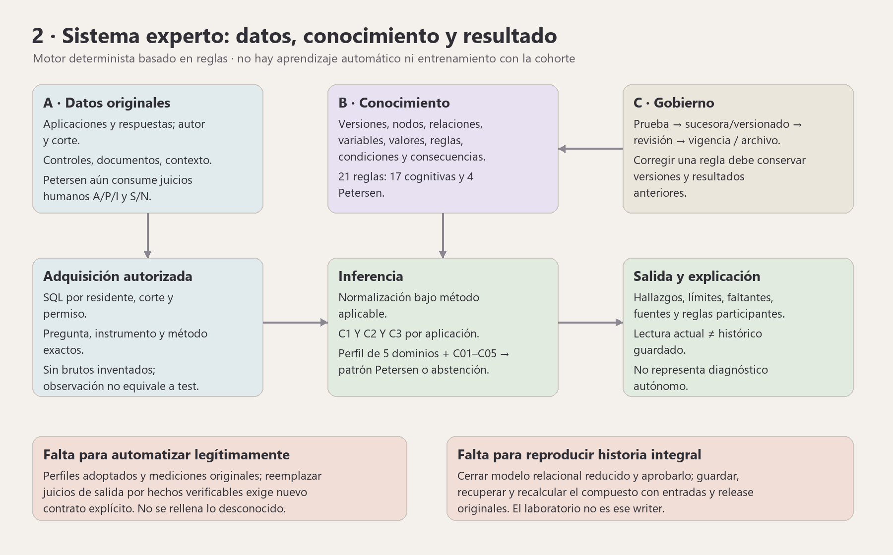
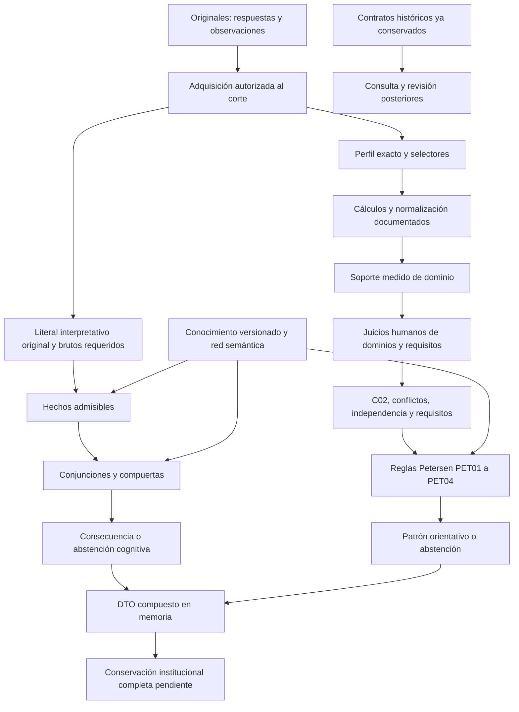
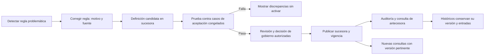
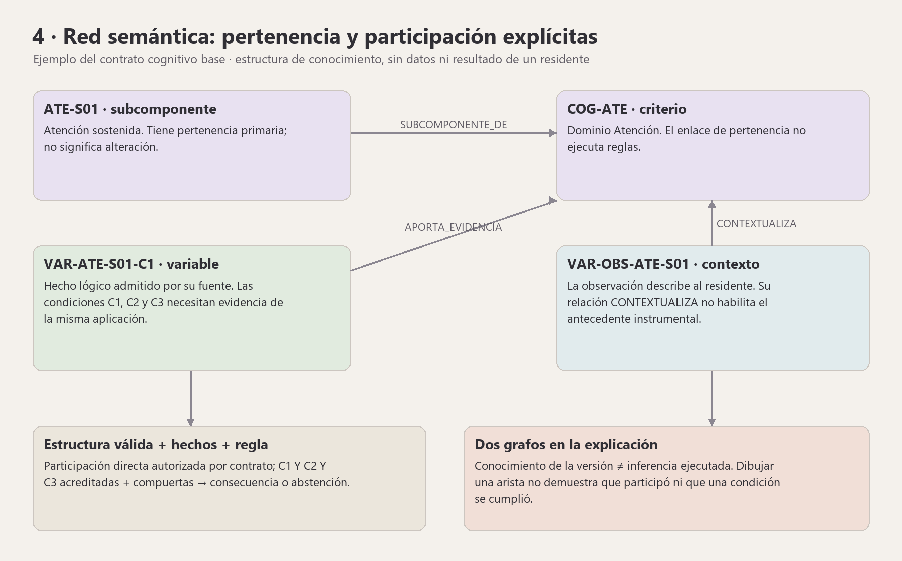
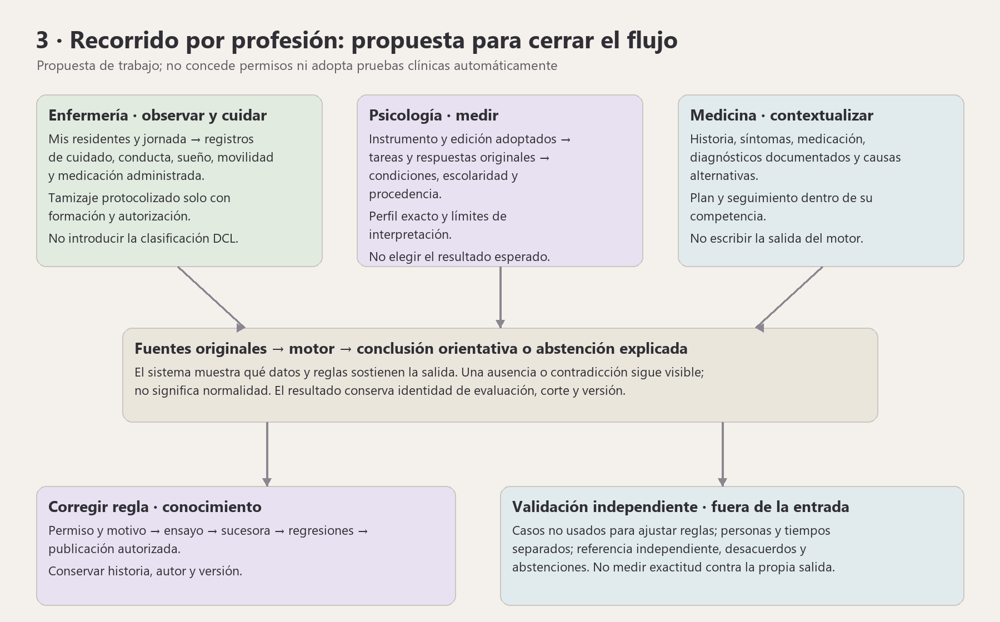
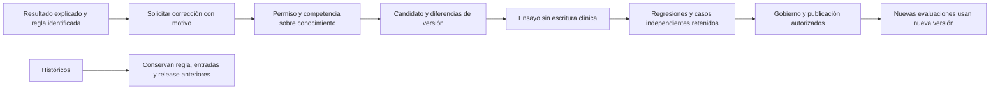

# Parte 2 — Auditoría del sistema experto O.R.I.O.N.

Fecha: 21/10/2026. Dictamen: **MOTOR Y GOBIERNO IMPLEMENTADOS EN ALCANCES
CONCRETOS; AUTOMATIZACIÓN Y CONSERVACIÓN INSTITUCIONAL COMPLETAS PENDIENTES**.

## Respuesta al objetivo de la propietaria

El sistema debe producir su conclusión desde originales verificables. Un
formulario que pida de antemano «dominio alterado» no cumple por sí solo ese
objetivo. Hoy el patrón final se calcula, pero Petersen todavía consume
juicios A/P/I de cinco dominios y S/N de requisitos. La auditoría identifica
el puente exacto que falta; no se oculta cambiando el nombre del campo.

«Corregir regla» debe actuar sobre conocimiento versionado y probar el cambio
sin reescribir resultados previos. Existen acciones aprovechables de gobierno,
pero no todas las transformaciones metodológicas caben en su editor actual.
No se necesita que un médico escriba la salida esperada en cada evaluación
para que el motor la repita. Sí se necesita una referencia independiente al
validar el sistema: son actividades distintas.

Diagrama propio del funcionamiento; no es una captura ni acredita QA de interfaz.

## Situación local comprobada

| Recurso | Situación al corte | Consecuencia |
|---|---|---|
| Tablas expertas | 29, dentro de las 104 de negocio | No corresponden a 29 formularios |
| Familias institucionales | 17 reglas cognitivas y 4 Petersen | No confundir con las 32 filas locales de reglas, que incluyen otros alcances/versiones |
| Componentes/métodos investigados | 19 componentes, 23 métodos documentados | Cálculo disponible no equivale a método adoptado/administrado |
| Perfiles de captura e interpretación runtime | 0 y 0 | No existe un binding objetivo institucional completo activado por esos arrays |
| Contratos configurados/publicación clínica runtime | 0 y 0 | Las familias pueden resolver contratos incorporados por código; arrays vacíos no prueban ausencia total de conocimiento |
| Instrumentos locales | 21: 19 observacionales y 2 funcionales; 2 activos | El número de aplicaciones no demuestra una batería cognitiva objetiva |
| Aplicaciones/respuestas | 990 / 7.326 | Solo conteos; no certificados de calidad o etiquetas clínicas |
| Originales Petersen/soportes | 0 / 0 | No inventar juicios para obtener un patrón en la pantalla |
| Compuesto institucional | Preparado en memoria con `persistido=false` | No existe writer/reader institucional completo para su historia exacta |
| Entrenamiento ML | No localizado en la cadena auditada | La cohorte no entrena el motor; hay riesgo de ajuste manual/circularidad |

## División y necesidad de tablas

La revisión enumera las 29 tablas y sus consumidores. Un original puede vivir
en tablas operativas; el hecho experto es su proyección autorizada y admitida.
La base de conocimiento define variables/mapeos/red/reglas; la traza conserva
su ejecución. No son sinónimos. Una tabla vacía con contrato y consumidor no
se puede borrar por su contador. Las reducciones previas ya aprobadas no
aprueban otras nuevas ni permiten persistir historia en JSON/EAV o archivos
clínicos de sustitución.

## Revisión detallada del motor

> Subinforme independiente: las declaraciones en primera persona describen únicamente el alcance de ese revisor. La evidencia adicional de coordinación se presenta por separado.

# Auditoría integral de O.R.I.O.N. — 21/10/2026

Estado: **revisión estática; conservación institucional y validación clínica completas pendientes**. Árbol compartido con cambios intencionales sin commit, referencia HEAD `8eee364ed32c079703b95c0eb63204dcb5512cbe` más WIP. La coordinación conserva el manifiesto técnico del corte en `storage/app/private/auditoria-corte-20261021.json`; este informe no sustituye ese manifiesto ni atribuye al HEAD los cambios no confirmados. No se consultaron datos de residentes, no se mutó SQL, no se aplicó DDL ni se ejecutaron suites en este encargo. Las cifras documentadas de pruebas anteriores pertenecen a sus cortes, no son pruebas nuevas del auditor. Único archivo escrito: este informe.

Skills: `remembermind-source-of-truth` y `remembermind-expert-validation`. Las citas `ruta:línea` son del árbol leído; cambios posteriores pueden desplazarlas. Los prefijos abreviados **APP** y **MOTOR** significan respectivamente `app/Modulos/ApoyoDecision` y `motor-experto/src/motor_experto`.

## Fuentes y autoridad

| Fuente | Estado y alcance |
|---|---|
| Instrucción actual de la propietaria | Prioritaria: entradas sin conclusión esperada; estudiar automatización y «Corregir regla». No implementar un resultado clínico supuesto para satisfacerla. |
| `docs/base-de-datos/REMEMBERMIND_BDD_BASELINE_CONGELADO.md:22` | Vigente: **75 operativas +29 expertas =104 tablas de negocio**. El núcleo original de 70 conserva sus extensiones aprobadas. |
| `docs/sistema-experto/PROPUESTA_CONTRATO_INSTITUCIONAL_FASE_4_2026_10_19.md:3` | A–D adoptado; adopción distinta de validación clínica. |
| `docs/sistema-experto/FASE_2_MATRIZ_MAESTRA_INFERENCIA_2026_10_20.md:3` | Matriz A–D y Petersen E–H vigente para el comportamiento existente. |
| `docs/sistema-experto/PUNTO_1_EVIDENCIA_COGNITIVA_ORIGINAL_2026_10_21.md:3` | Captura técnica disponible; adquisición clínica original pendiente. Fuente más reciente del punto instrumental. |
| `docs/sistema-experto/ENTREGA_INTEGRAL_ORION_2026_10_20.md:6` | Expediente en curso, sin cierre institucional completo. |
| `docs/sistema-experto/FASE_0_1_CONSERVACION_PENDIENTE_2026_10_20.md:12` | Brecha de conservación compuesta explícita. |
| `docs/sistema-experto/DICTAMEN_LIMITE_100_TABLAS_2026_10_20.md:3` | Propuesta de factibilidad, no autorización DDL. Candidatos previos de 25 y 15 tablas adicionales rechazados. |

La preferencia actual cambia el objetivo de entrada respecto al contrato E–H: el código vigente **sí recibe conclusiones clínicas intermedias**. Ese conflicto se presenta expresamente; no se resuelve renombrándolas «hechos» ni completándolas automáticamente.

## Diez hallazgos principales

| ID | Hallazgo y evidencia | Implicación |
|---|---|---|
| H01 | Petersen recibe A/P/I por cinco dominios y S/N para C01,C03,C04,C05, más fundamento/comprobaciones. `APP/Presentacion/Vistas/livewire/petersen/captura-original.blade.php:35`; `APP/Aplicacion/Acciones/RegistrarValoracionPetersenOriginal.php:51`. | **Desajuste con el nuevo objetivo:** la clasificación no nace íntegramente de brutos. Eliminar el formulario sin nuevos contratos dejaría abstenciones. |
| H02 | C02 no se registra; se deriva del perfil. PET-01..04 también son calculados. `MOTOR/dominio/petersen/ValoracionOriginalPetersen.php:9`; `EvaluarPetersenInstitucional.php:120`; `dominio/conocimiento/versiones/PaquetePetersenInstitucional.php:38`. | No hay campo de patrón final esperado, pero los estados humanos intermedios condicionan ese patrón. |
| H03 | Cálculo numérico y predicados interpretativos son vías diferentes. `dominio/instrumentos/ExtractorCapturaInstrumental.php:16`; `adaptadores/entrada/ConstructorMemoriaInstrumental.php:49`; `dominio/conocimiento/AdmisibilidadCognitivaInstitucional.php:31`. | Tener un z no produce C1/C2/C3. Las guardas comprueban identidad/perfil/medidas finitas; no demuestran una función clínica general brutos→literal. |
| H04 | Perfiles instrumentales e interpretativos vacíos por defecto. `config/sistema_experto.php:8`, `:17`; documento del punto1, línea25. | Los 23 métodos investigados no equivalen a23 protocolos adoptados, licenciados y administrados. No se deben rellenar con fixtures. |
| H05 | El compuesto sigue en memoria; su verificador rechaza `persistido=true` y `release_retenido=true`. `APP/Aplicacion/Consultas/PrepararEvaluacionInstitucional.php:23`; `MOTOR/soporte/conservacion/InstantaneaEvaluacionInstitucional.php:41`. | No declarar cerrado guardar→recuperar→replay institucional. ZIP y hash solos no conservan las entradas. |
| H06 | Existe gobierno real: probar condiciones, sucesora, sustituir, archivar, primera revisión y auditoría. `APP/Aplicacion/Acciones/GestionarReglasExpertas.php:27`, `:68`, `:197`. | Base reutilizable para «Corregir regla». Petersen prohíbe nueva semántica libre en línea88; cambiar rótulo no elimina esa frontera. |
| H07 | Regla ACTIVA/PENDIENTE puede ejecutar; RECHAZADA se excluye. `MOTOR/dominio/conocimiento/reglas/EvaluadorReglas.php:41`; `PaquetePetersenInstitucional.php:172`; `docs/sistema-experto/PROPUESTA_GOBIERNO_REGLAS_2026_10_18.md:25`. | Conducta contractual, no aprobación clínica. Una firma previa obligatoria sería otra decisión, no un arreglo técnico. |
| H08 | Las 29 tablas son definición, adquisición, ejecución, trazas, conservación y revisión. `APP/Infraestructura/Persistencia/InventarioExperto.php:11`, `:37`, `:46`. | No son29 formularios ni un mínimo irreducible probado. Un UNIQUE solo señala una candidata a consolidación. |
| H09 | No se encontró entrenamiento ML en la cadena revisada: reglas deterministas y cálculos bibliográficos. `MOTOR/dominio/conocimiento/reglas/EvaluadorReglas.php:10`. | El riesgo es validación circular/sobreajuste manual de reglas al corpus, no sobreentrenamiento de una red neuronal inexistente. |
| H10 | Medicina/Psicología capturan originales y gobiernan conocimiento con permisos; Enfermería consulta por asignación/turno. `APP/Presentacion/Policies/ValoracionPetersenPolicy.php:35`; `VersionModeloExpertoPolicy.php:25`; `EvaluacionExpertaPolicy.php:88`. | La Policy permite a ambas disciplinas crear cualquier elemento Petersen: no imponer en el informe una exclusividad por requisito que el backend no exige. |

No todos son bugs: H02,H07,H08,H10 describen contratos/límites; H01,H03,H04,H05 son brechas materiales frente al cierre solicitado. No se cambia conocimiento durante una auditoría.

## Hechos, conocimiento, red y resultados

| Capa | Significado real | No equivale a |
|---|---|---|
| Original operativo | Respuesta por pregunta, observación, IADL, diagnóstico registrado o documento, con autor y fecha | Hecho experto admisible por existir una fila |
| Hecho contextualizado | Original traducido a variable/valor mediante mapeo autorizado, con corte, episodio y motivos | Nota libre interpretada por parecido textual |
| Conocimiento | Definiciones, valores, variables, fuentes, mapeos, reglas/consecuencias por versión | Historia de un residente |
| Red semántica | Nodos/relaciones tipadas y participación variable–criterio/componente | Red neuronal o prueba de alteración clínica |
| Regla | Antecedentes y consecuencia en dominio definido | Probabilidad, causalidad o score global |
| Ejecución/traza | Qué fuentes y reglas se evaluaron, con estados, soportes y faltantes | Reescritura del original |
| Resultado | Consecuencia, conflicto, insuficiencia o patrón orientativo | Diagnóstico/orden autónomos |
| Revisión | Dictamen posterior por disciplina, sobre evaluación recuperable | Cambio retrospectivo del cálculo o validación estadística |

Fuentes: `MOTOR/dominio/conocimiento/PaqueteConocimiento.php:15`; `ConstructorMemoriaInstrumental.php:139`; `dominio/conocimiento/reglas/EvaluadorReglas.php:15`; `APP/Aplicacion/Acciones/RevisarValoracionExperta.php:24`.

La flecha hacia juicio humano describe la implementación, no una recomendación de mantenerla contra el nuevo objetivo. Hoy no hay conexión universal «z→A/P→patrón».

## Operaciones de inferencia

1. **Adquirir:** permisos actuales, residente, autoría, vigencia, corte técnico/clínico y procedencia; separar ausente, cero, false y NULL.
2. **Calcular:** método por identidad exacta; medidas por pregunta/canal; normalización con edad/escolaridad y límites propios. Sin método aplicable se informa ausencia/no normalizable, no se escoge otro por semejanza.
3. **Mapear:** literal lógico/textual original→valor semántico. El constructor prohíbe umbrales numéricos implícitos (`ConstructorMemoriaInstrumental.php:49`). Un perfil y brutos presentes no prueban que ese literal sea una consecuencia aritmética de ellos.
4. **A–D:** núcleo AND de igualdad variable/valor, sin pesos/prioridad (`EvaluadorReglas.php:76`). G09 exige conjunción completa por componente en una misma aplicación (`EvaluadorReglasCognitivas.php:19`, `:51`). Memoria agrega compuertas y resolvedor D131. No trasladar las capacidades OR/NOT del AST experimental al editor institucional AND.
5. **E–H:** validar soportes de juicios; conflicto de estados→X; impedir independencia ficticia por fuente/episodio compartido; exigir cinco dominios interpretables y que C05 identifique sus juicios concretos. Derivar C02 y cantidad alterada (`EvaluarPetersenInstitucional.php:73`, `:95`, `:102`, `:120`).
6. **Emitir:** todos los requisitos acreditados, gobierno válido, Memoria A/P y cantidad única/múltiple→PET01..04. Faltantes, contradicciones o impedimento→abstención explicada. No hay voto, mayoría, probabilidad ni normalidad por silencio.
7. **Explicar:** originales, hechos, condiciones, reglas, consecuencias, exclusiones, corte y versión. La lectura histórica declara no completar con fuentes actuales (`APP/Aplicacion/Consultas/LecturaResultadosExperto.php:15`, `:104`).

No se identifican aprendizaje online, ajuste automático de pesos, AHP, inferencia difusa, porcentaje de DCL o tratamiento autónomo. Incorporarlos sería otra metodología.

## Catálogo explícito de las 21 reglas

Los identificadores de abajo son `codigo_regla` estables de los paquetes base. Las PK SQL se traducen al registrar una versión: no se presenta una PK calculada del paquete puro como si fuera una fila instalada. Una sucesora puede archivar/sustituir reglas; **21 es el catálogo base, no un conteo vivo de ACTIVO**. Fuente: `MOTOR/dominio/conocimiento/versiones/PaqueteCognitivoInstitucional.php:32`, `:90`, `:100`, `:144`; `PaquetePetersenInstitucional.php:38`, `:79`; matriz maestra, líneas30–54.

Definiciones de faltantes:

- **G:** faltan perfiles y brutos realmente aplicados que acrediten C1/C2/C3; también tarea/edición/contexto/confusores. Hoy no hay función automática general que produzca esos predicados desde z. Los tres deben pertenecer a una misma aplicación; no completar ACREDITADA por defecto.
- **M:** falta interpretación instrumental original vinculada a MEM-S01..04, método y medidas aplicables; compuerta EV-CM-2, condiciones/confusores y episodio. El literal positivo/negativo no se infiere de una observación ni de la ausencia de dificultades.
- **P:** faltan cinco dominios A/P sustentados y C01,C03–05 admisibles; C02 se deriva. Originales/fuentes independientes, C05 con referencias exactas, diferencial sin impedimento y gobierno compatible. No convertir una z/IADL aislada en requisito acreditado.

| # | ID de regla | Condiciones y operación actuales | Consecuencia exacta | Faltantes para emisión/automatización |
|---|---|---|---|---|
| 1 | R-ATE-S01-P01 | VAR-ATE-S01-C1 ∧C2 ∧C3 =ACREDITADA | ATE-R-SOSTENIMIENTO | G, atención sostenida |
| 2 | R-ATE-S02-P01 | VAR-ATE-S02-C1 ∧C2 ∧C3 =ACREDITADA | ATE-R-SELECCION | G, atención selectiva |
| 3 | R-ATE-S03-P01 | VAR-ATE-S03-C1 ∧C2 ∧C3 =ACREDITADA | ATE-R-DISTRIBUCION | G, atención dividida |
| 4 | R-EJE-S01-P01 | VAR-EJE-S01-C1 ∧C2 ∧C3 =ACREDITADA | EJE-R-INHIBICION | G, inhibición |
| 5 | R-EJE-S02-P01 | VAR-EJE-S02-C1 ∧C2 ∧C3 =ACREDITADA | EJE-R-FLEXIBILIDAD | G, flexibilidad |
| 6 | R-EJE-S03-P01 | VAR-EJE-S03-C1 ∧C2 ∧C3 =ACREDITADA | EJE-R-ACTUALIZACION | G, memoria de trabajo; pertenece a EJE |
| 7 | R-EJE-S04-P01 | VAR-EJE-S04-C1 ∧C2 ∧C3 =ACREDITADA | EJE-R-PLANIFICACION | G, planificación |
| 8 | R-EJE-S05-P01 | VAR-EJE-S05-C1 ∧C2 ∧C3 =ACREDITADA | EJE-R-RAZONAMIENTO | G, razonamiento |
| 9 | R-LEN-S01-P01 | VAR-LEN-S01-C1 ∧C2 ∧C3 =ACREDITADA | LEN-R-DENOMINACION | G, denominación |
| 10 | R-LEN-S02-P01 | VAR-LEN-S02-C1 ∧C2 ∧C3 =ACREDITADA | LEN-R-FLUIDEZ | G, fluidez |
| 11 | R-LEN-S03-P01 | VAR-LEN-S03-C1 ∧C2 ∧C3 =ACREDITADA | LEN-R-COMPRENSION | G, comprensión |
| 12 | R-LEN-S04-P01 | VAR-LEN-S04-C1 ∧C2 ∧C3 =ACREDITADA | LEN-R-REPETICION | G, repetición |
| 13 | R-LEN-S05-P01 | VAR-LEN-S05-C1 ∧C2 ∧C3 =ACREDITADA | LEN-R-DISCURSO | G, discurso |
| 14 | R-VIS-S01-P01 | VAR-VIS-S01-C1 ∧C2 ∧C3 =ACREDITADA | VIS-R-PERCEPCION | G, relaciones espaciales |
| 15 | R-VIS-S02-P01 | VAR-VIS-S02-C1 ∧C2 ∧C3 =ACREDITADA | VIS-R-CONSTRUCCION | G, visuoconstrucción |
| 16 | MEM-DIFICULTAD | VAR-MEM-INST-01 =DIFICULTAD_INSTRUMENTAL; compuertas/contexto/resolvedor | DIFICULTAD_EVIDENCIADA | M |
| 17 | MEM-SIN-DIFICULTAD | VAR-MEM-INST-01 =SIN_DIFICULTAD_INSTRUMENTAL; mismas compuertas | SIN_DIFICULTAD_EVIDENCIADA | M; no equivale a cuatro subcomponentes normales |
| 18 | PET-01 | C01..C05=S ∧PERFIL=INTERPRETABLE ∧MEMORIA=A ∧CANTIDAD=UNICO | Amnésico de dominio único | P |
| 19 | PET-02 | C01..C05=S ∧PERFIL=INTERPRETABLE ∧MEMORIA=A ∧CANTIDAD=MULTIPLE | Amnésico multidominio | P |
| 20 | PET-03 | C01..C05=S ∧PERFIL=INTERPRETABLE ∧MEMORIA=P ∧CANTIDAD=UNICO | No amnésico de dominio único | P |
| 21 | PET-04 | C01..C05=S ∧PERFIL=INTERPRETABLE ∧MEMORIA=P ∧CANTIDAD=MULTIPLE | No amnésico multidominio | P |

Los C1/C2/C3 de G09 **no son** C01/C02/C03 de Petersen. Las 15 consecuencias G09 son hallazgos específicos candidatos, no A/P del dominio ni diagnóstico. Las dos de Memoria tampoco se copian a sus cuatro subcomponentes. La matriz no inventa reglas específicas para MEM-S01..04: esas cuatro no existen hoy por subcomponente.

## Los19 componentes: qué se calcula y qué sigue sujeto a interpretación

Fuente de componentes/métodos: `docs/sistema-experto/DICCIONARIO_ADQUISICION_23_METODOS_2026_10_19.md:15`; implementación `MOTOR/dominio/instrumentos/RegistroMetodosInstrumentales.php:12`, `:32`. Son métodos candidatos exactos, no intercambiables. **Automático** significa cálculo disponible si originales/perfil/población cumplen, no conclusión disponible para todos los residentes. En todos siguen pendientes adopción del protocolo, derechos, identidad y evidencia realmente administrada.

| Componente | Medidas/métodos implementados de referencia | Automático actual | Interpretación o regla aún necesaria |
|---|---|---|---|
| MEM-S01 aprendizaje | HVLT-R-BO-2015-F5; PFCSRT-ES-2025-IMAGENES-A-LIBRE | Ensayos/suma y cálculo de referencia aplicable | No regla propia de subcomponente; interpretación de aprendizaje y contexto, no copiar resultado global |
| MEM-S02 recuerdo diferido libre | HVLT-R-BO-2015-F5 | Diferido y normalización propia | No usar baremo de aprendizaje; juicio del componente/dominio pendiente |
| MEM-S03 recuerdo con claves | FCSRT-ES-SABIEX-2021-APRENDIZAJE; FCSRT-PALABRAS-NEURONORMA-BRUTO-1 | Norma aplicable o cálculo descriptivo según método | Las dos salidas no son equivalentes; juicio y regla del componente no definidos |
| MEM-S04 reconocimiento | CERAD-RECONOCIMIENTO-CO-API-2019; HVLT-R-F5-RECONOCIMIENTO-BRUTO-1 | Norma/cálculo descriptivo propio | No trasladar baremo de recuerdo; no regla propia |
| ATE-S01 sostenida | CANCELACION-A-CO-API-2019 | Medida y norma de referencia aplicable | C1–C3 de R-ATE-S01-P01 y confusores |
| ATE-S02 selectiva | LC-PW-ES-SCAND-2023-EFICIENCIA | Eficiencia/referencia del método | C1–C3, atribución a tarea selectiva |
| ATE-S03 dividida | BTA-BO-2015-NL | TotalN+L y modelo de referencia | C1–C3; no convertirlo en atención sostenida |
| EJE-S01 inhibición | STROOP-BO-2015-GOLDEN | Condiciones/medidas y normalización implementadas | C1–C3; condiciones sensoriales, motoras y protocolo |
| EJE-S02 flexibilidad | TMT-B-BO-2015 | Tiempo y referencia del método | C1–C3; interpretar límites de ejecución |
| EJE-S03 trabajo | DSB/LN/SPAN-ES-SABIEX-2021-LONGITUD(ES) | Longitudes y referencia de cada variante | C1–C3; no es memoria episódica COG-MEM |
| EJE-S04 planificación | TOL-F-DE-GHS-2019-24 | Puntuación/modelo aplicables | C1–C3; transferencia poblacional y condiciones |
| EJE-S05 razonamiento | RAVEN-A-CO-API-2019 | SerieA/referencia pertinente | C1–C3; no generalizar a otra edición/serie |
| LEN-S01 denominación | BNT-BO-2015-60 | Medida de 60 ítems y modelo aplicable | C1–C3; versión e idioma |
| LEN-S02 fluidez | FLUIDEZ-BO-2015-FAS-ANIMALES | Cálculo de cada tarea/referencia | C1–C3; no mezclar fonológica y semántica |
| LEN-S03 comprensión | TOKEN-CO-UNAL-2017-TABLAS | Tabulación según referencia | C1–C3; forma/edad/escolaridad compatibles |
| LEN-S04 repetición | TB-A-ES-NEURONORMA-2011-LENGUAJE; WAB-ES-2000-ORAL-BRUTO-1 | Norma o descriptivo según método | C1–C3; no usar descriptivo como normalización |
| LEN-S05 discurso | Mismos métodos, medidas específicas de discurso | Medidas/cálculos propios | C1–C3; no asumir que repetición acredita discurso |
| VIS-S01 espacial | JLO-ES-SABIEX-2021-30 | Medida/referencia de 30 ítems | C1–C3; visión y contexto |
| VIS-S02 construcción | ROCF-BO-2015-COPIA-A | Copia y modelo de referencia | C1–C3; visión/motricidad; no sustituir copia por recuerdo |

No existe una suma universal de 19 componentes ni un umbral común de z para concluir dominio/DCL. La documentación de cada método conserva sus entradas y límites; inventar ese agregado rebajaría el contrato solicitado.

## Juicio humano frente a automatización solicitada

| Elemento | Entrada actual | Automatización legítima actual | Falta para eliminar conclusión manual |
|---|---|---|---|
| Medidas por tarea | Brutos originales, unidades y contexto | Validar/calcular método implementado | Protocolo real adoptado, derechos, perfiles y evidencia original |
| C1/C2/C3 | Literal interpretado +perfil +brutos | Admisibilidad, atribución y conjunción | Función por método/población que derive cada predicado de brutos/contexto |
| A/P/I por dominio | Conclusión humana +medición compatible | Excluir medición incompleta/fuera de contexto; resolver conflictos | Integración de medidas del dominio con fronteras propias, sin umbral universal |
| C01 | S/N +historia previa +corroboración independiente | Fechas, episodios, identidad, contenido | Semántica de cambio: dos fechas distintas no demuestran deterioro |
| C02 | No se registra | Derivación del perfil admisible | Resolver antes automatización del perfil |
| C03 | S/N +IADL contextual | Actividad, oportunidad, nivel previo, desempeño, ayuda/causa y coherencia | Integración/atribución cognitiva; no Barthel ni permiso IADL aislado |
| C04 | S/N +diferencial +impedimento explícito | Revisión documental; bloquear si hay impedimento | No deducir ausencia de causas por falta de diagnósticos; representar evaluado/no evaluado |
| C05 | S/N +calidad +cinco juicios concretos | Completitud, fechas, identificación exacta | Validez/interpretabilidad del conjunto; completitud administrativa no la sustituye |
| PET01..04 | Requisitos/estados anteriores | Distribución determinista y abstención | No necesita campo de patrón esperado |
| Dictamen posterior | CONFIRMADA/RECHAZADA y motivo | Autoría, cadena y conflicto | No usarlo como entrada del mismo resultado; validación externa puede tener otro circuito |

Fuentes: `MOTOR/dominio/petersen/EvaluarPetersenInstitucional.php:190`, `:218`, `:249`, `:268`, `:297`; `dominio/conocimiento/AdmisibilidadCognitivaInstitucional.php:31`, `:48`. El sistema no puede fabricar una prueba que no se hizo, escolaridad desconocida, causalidad, ausencia de confusores ni derechos de uso. Retirar una pantalla no elimina esos hechos necesarios.

## Las 29 tablas: uso y relación con formularios

Inventario: `APP/Infraestructura/Persistencia/InventarioExperto.php:11`, `:37`, `:46`. Se describe uso estático, sin conteos vivos ni necesidad irreducible.

| # | Tabla | Grano/uso | Interacción o consumidor |
|---|---|---|---|
| 1 | versiones_modelo_experto | Versión, vigencia, origen y antecesora | Registro de paquetes/selección histórica/sucesora |
| 2 | nodos_semanticos | Concepto, criterio o variable de versión | Explorador/red; no resultado del residente |
| 3 | relaciones_semanticas | Arista tipada entre nodos | Pertenencia/participación autorizada |
| 4 | dominios_valores_expertos | Dominio permitido de variable/resultado | Valida conocimiento |
| 5 | valores_semanticos | Valor y aprobación semántica | Selectores de prueba/consecuencia |
| 6 | variables_expertas | Nodo, dominio y propietario de variable | Antecedentes/mapeos; candidata 0..1 respecto al nodo |
| 7 | fuentes_datos_expertas | Definición de origen/campos | Adquisición/catalogación, no historia clínica |
| 8 | mapeos_variables_fuente | Fuente/selector→variable | Traducción autorizada de originales |
| 9 | mapeos_valores_fuente | Literal→valor semántico | Traducción tipada; no depósito de atributos SQL |
| 10 | criterios_dominios_resultado | Criterio→dominio de consecuencias | Valida consecuencia; candidata 0..1 de nodo |
| 11 | reglas_expertas | Definición por versión, estado/revisión | Gobierno: probar/revisar/archivar/sustituir |
| 12 | condiciones_regla_experta | Antecedente variable/valor de regla | Prueba/editor acotado AND |
| 13 | consecuencias_regla_experta | Regla→criterio/valor | Definición; no conclusión tecleada por residente |
| 14 | evaluaciones_expertas | Ejecución histórica identificada | Historial/resultados/revisión; no conserva sola V3 |
| 15 | evidencias_evaluacion | Evidencia adquirida/mapeada para ejecución | Procedencia/soportes |
| 16 | relaciones_evidencias_evaluacion | Vínculo entre evidencias | Contexto/independencia según contrato; no red conceptual |
| 17 | evaluacion_criterios | Instancia evaluada de criterio | Áreas/detalle/integridad histórica |
| 18 | evidencias_criterio_evaluacion | Evidencia/hecho participante en criterio | Soportes; incluye rama sintética trasladada |
| 19 | resultados_criterio | Resultado de instancia de criterio | Consecuencia guardada; candidata 0..1 con alias/ausencia |
| 20 | trazas_inferencia | Traza de instancia de criterio | Reglas/condiciones; candidata 0..1, no prescindible por ocultarla |
| 21 | evaluaciones_reglas | Evaluación de regla en traza | CUMPLE/NO_CUMPLE y regla realmente evaluada |
| 22 | evaluaciones_condiciones_regla | Evaluación de condición | Estado del antecedente |
| 23 | evidencias_soporte_condicion | Soportes de condición evaluada | Navegación condición→original |
| 24 | hechos_instantanea_experta | Hecho conservado bajo contrato cerrado | Replay de memoria y subtipos aprobados |
| 25 | clasificaciones_dcl_instantanea | Clasificación del contrato experimental | Replay DCL segregado; no writer Petersen institucional |
| 26 | motivos_dcl_instantanea | Motivo ordenado de clasificación | Explicación, no EAV |
| 27 | reglas_aplicadas_dcl_instantanea | Regla capturada para DCL | Replay independiente de cambios posteriores |
| 28 | condiciones_regla_instantanea | AST/condición capturada | Operadores/orden/hijos; no retirar OR/NOT por el AND institucional |
| 29 | revisiones_evaluacion_experta | Dictamen por disciplina y cadena | Revisión posterior; no reescribe cálculo |

Consumo comprobado en código: `MOTOR/dominio/conocimiento/PaqueteConocimiento.php:15` (doce relaciones más cabecera); `APP/Aplicacion/Acciones/PersistirEvaluacionTecnica.php:36`, `:100`; `Aplicacion/Consultas/LecturaResultadosExperto.php:56`; `Infraestructura/Persistencia/Conservacion/AlmacenInstantaneas.php:136`, `:200`, `:505`, `:582`; `Aplicacion/Acciones/RevisarValoracionExperta.php:31`.

Las tablas de originales Petersen y sus soportes están dentro de las 75 **operativas**, igual que aplicaciones/respuestas y maestros de instrumentos. No contarlas otra vez entre las 29. Los formularios capturan originales y gobierno; el motor produce muchas filas de trazabilidad sin29 formularios independientes.

**Necesidad:** separar conocimiento de hechos, soportes y traza tiene una función real. El número29 no está demostrado como mínimo. Consolidar resultados/trazas en su criterio, criterio/variable en nodo y clasificación en cabecera es una candidata, condicionada a preservar bloques ausentes, alias, FK e historia. El cálculo `104−8+4=100` no prueba 4FN ni roundtrip. Tampoco se demuestra aquí que100 sea imposible: sigue pendiente un diccionario legítimo probado. No se propone JSON/EAV ni descartar AST, originales o membresías para cuadrar el número.

## Rutas, pantallas y roles

Fuente: `APP/Presentacion/Rutas/web.php:14`; los prefijos se agregan en el registro modular.

| Ruta modular | Pantalla/propósito | Control |
|---|---|---|
| /sistema-experto/residentes | ResidentesSistemaExperto | Medicina/Psicología +viewAny |
| /sistema-experto/residentes/{residente}/petersen | CapturaPetersenPanel | Consultar/crear/rectificar originales por Policy |
| /sistema-experto/reglas | GobiernoReglasPanel | Consulta gobierno; gestionar/revisar por permisos distintos |
| /sistema-experto | ConocimientoPanel | Superadministración +auditoría técnica |
| /pacientes/{residente}/resultados-experto | Entrada Enfermería | Ficha +Policy/asignación/turno |
| /residente/{residente}/evaluacion-cognitiva/resultados-experto | Entrada Medicina | Policy de resultados |
| /residente/{residente}/resultados-experto | Entrada Psicología | Revisar_psicologia +Policy |

| Capacidad | Medicina | Psicología | Enfermería |
|---|---|---|---|
| Consulta cognitiva | Permiso, alcance y personal activo | Permisos psicológicos/revisión, competencia y alcance | Ficha/residentes/controles +asignación/turno |
| Captura de mediciones | Solo según Policy propia de Valoraciones | Captura compartida según permisos | Ver resultados no concede captura instrumental |
| Originales Petersen | Permisos específicos +MEDICINA activa | Permisos específicos +PSICOLOGIA activa | No por rol |
| Gobierno/Corregir regla | Gestionar/revisar separados | Gestionar/revisar separados | No por rol |
| Lectura IADL experta | Permiso específico +Policy contextual | Igual | No concedido por este incremento |
| Revisión posterior | Su disciplina y contrato recuperable | Su disciplina y contrato recuperable | No firma por Medicina/Psicología |
| Cuidados | Consulta según permisos propios | Consulta según permisos propios | Agenda/pendientes; inferencia no ejecuta cuidados |

**H11 — Frontera adicional de explicación:** `EvaluacionExpertaPolicy::consultarTrazabilidad` exige `VersionModeloExpertoPolicy::consultar`, reservado a SUPERADMINISTRADOR+auditoria.ver (`EvaluacionExpertaPolicy.php:33`; `VersionModeloExpertoPolicy.php:11`). El gobierno sí admite Medicina/Psicología, pero no concede esa ability. `ConsultarExploracionOrion.php:21` y `ResultadosExpertoResidente.php:613`, `:657` la consumen. No afirmar que el explorador profundo está habilitado a los profesionales ordinarios solo porque existe la vista. Si se pretende habilitarlo, revisar permiso mínimo y contenido por rol; no ampliar automáticamente una frontera sensible desde la auditoría.

En Enfermería las pestañas son interpretación/registro/cuidados (`ResultadosExpertoResidente.php:303`). El gráfico de actividad cuenta controles y declara que no mide mejoría/deterioro (`Aplicacion/Consultas/ConsultarActividadCognitiva.php:23`). Las series instrumentales agrupan medidas de igual procedencia/referencia, sin mezclar baremos (`Aplicacion/DTOs/ConsultaCognitivaEnfermeria.php:58`). La presente lectura no demuestra navegación ni revocación runtime.

## Propuesta de entrada sin conclusión esperada y «Corregir regla»

Se distinguen tres correcciones para evitar circularidad:

1. **Error de original:** rectificar aplicación/respuesta/documento/contexto por su mecanismo, con autor y motivo. No modificar una regla para compensar una transcripción errónea.
2. **Error de conocimiento:** corregir mediante nueva versión, conservando original, fuente, pruebas, autoría y vigencias. No editar una regla utilizada ni cambiar el resultado anterior.
3. **Evaluación clínica independiente:** referencia externa al motor para comparar desempeño. Puede ser un procedimiento de validación fuera de la pantalla rutinaria; no debe introducirse como «resultado esperado» que el motor lea para producir el mismo resultado.

La entrada rutinaria objetivo contendría originales, fecha, autor, protocolo, versión, tareas, brutos/unidades y contexto registrado, con distinción evaluado/no evaluado. Excluiría patrón esperado, diagnóstico objetivo, estado A/P esperado, confirmación del resultado y cualquier campo que copie la etiqueta que se quiere predecir. Una nota clínica sigue siendo un original legítimo si el contrato la usa con un significado explícito; no se convierte por ello en patrón DCL ni en ausencia de confusores.

El gobierno existente permite este recorrido candidato:

«Casos bloqueados» significa aquí **casos congelados contra edición durante la prueba**, con manifiesto de entradas/esperados y comparación independiente; no inventar un nuevo estado SQL. El editor/probador actual compara condiciones explícitas, pero no demuestra automáticamente una regresión clínica completa sobre un corpus congelado antes de publicar. Ese gate es trabajo pendiente. Su expectativa no se envía al motor como hecho del residente.

Reutilizar `GestionarReglasExpertas::crearRevision` (`:68`) y la retirada de antecesora (`:183`), no añadir un sistema paralelo de reglas. La pantalla actual ofrece «Archivar o sustituir» (`APP/Presentacion/Vistas/livewire/conocimiento/reglas-panel.blade.php:98`). Propuesta concreta: acción **Corregir regla** que muestre antecesora, problema, referencia, definición permitida, comparación de casos y alcance temporal, y termine en sucesora/auditoría. No debe prometer edición de todas las familias: Petersen mantiene su semántica canónica y rechaza otra definición libre (`GestionarReglasExpertas.php:88`).

Por tanto, retirar los juicios A/P y S/N exige revisar E–H y definir las derivaciones que faltan. Renombrar «Conclusión original» como «Evidencia» no satisface la petición. Hasta que exista esa derivación, la conducta correcta ante falta de entrada es abstención; el sistema no debe completar estados ocultos ni pedir a Medicina que firme el output para volverlo input.

## Documentación, validación y riesgo de evaluación circular

| Límite | Evidencia y consecuencia |
|---|---|
| Bibliografía distinta de adopción/licencia | `PUNTO_1_EVIDENCIA_COGNITIVA_ORIGINAL_2026_10_21.md:25`, `:29`. Esta auditoría no volvió a consultar sitios externos ni emite obligaciones legales nuevas. Adoptar protocolos y derechos sigue siendo decisión institucional. |
| Población y versiones específicas | `MOTOR/dominio/instrumentos/RegistroMetodosInstrumentales.php:12`; diccionario de 23 métodos. No trasladar baremos a cualquier edad/escolaridad/idioma o edición. |
| Prueba sintética distinta de validación clínica | `FASE_4_CONTRATO_AD_INTEGRADO_2026_10_19.md:139`; matriz maestra, línea69. Implementar una tabla de decisión y pasar fixtures derivados de ella no demuestra exactitud clínica. |
| Memoria distinta de historia conservada | `FASE_0_1_CONSERVACION_PENDIENTE_2026_10_20.md:16`. Una FK/hash no reconstruye el contenido mutable adquirido, su membresía y sus ausencias. |
| Software distinto de entradas clínicas | `InstantaneaEvaluacionInstitucional.php:41`. El release puede conservar el ejecutor, pero necesita un writer/reader institucional de las entradas completas. |
| Model/lector distinto de integridad SQL universal | `FASE_0_1_CONSERVACION_PENDIENTE_2026_10_20.md:85`: cruces evaluación/versión/pertenencia aún no prohibidos físicamente en todas las relaciones. No asumir autorización de nuevos triggers. |
| Firma posterior distinta de referencia ciega | `FORMALIZACION_FUNCIONAL_V0_1_2026_10_17.md:50`. La revisión que ve el resultado no demuestra por sí sola concordancia independiente. |
| Conteo documental distinto de inventario vivo | El baseline vigente gobierna104; tablas/propuestas de otros cortes no se suman como instaladas. El laboratorio y su representación de 42 tablas no prueban el diseño de 100. |

No existe entrenamiento ML localizado en esta cadena. **No hay evidencia de sobreentrenamiento de un modelo estadístico**; tampoco base para afirmar que una batería técnica elimina el sobreajuste manual del conocimiento. El riesgo verificable es que mismos supuestos produzcan reglas, casos esperados y aceptación, o que se ajuste la regla hasta reproducir una conclusión humana introducida como antecedente.

Controles propuestos para una validación posterior, sin crear nuevas tablas ni protocolos clínicos desde este informe:

- Separar corpus de desarrollo y aceptación; congelar versión/reglas antes de ver el conjunto de aceptación.
- Mantener todos los episodios de un residente en la misma partición; no repartir aplicaciones correlacionadas entre desarrollo y prueba como si fueran personas independientes.
- Separar por tiempo cuando se estudie generalización temporal; usar únicamente información disponible al corte, sin rectificaciones, diagnósticos, documentos o etiquetas posteriores.
- No permitir que el estado esperado, la revisión final o un juicio derivado del propio motor entren como predictor del mismo resultado. Una referencia independiente pertenece al evaluador externo.
- Conservar casos negativos, faltantes, contradicciones, confusores y abstenciones; no evaluar únicamente PET positivos limpios.
- Registrar toda modificación de reglas y su motivo; tras usar un caso para ajustar, ese caso ya no demuestra aceptación independiente de ese ajuste.
- Acordar unidad de análisis, referencia profesional, población, muestra autorizada y criterios de aceptación antes de calcular concordancia/sensibilidad/especificidad/Kappa. No deducir métricas diagnósticas de PHPUnit ni de una firma individual.

Estos controles son una propuesta metodológica; no afirman que exista ya una muestra independiente o resultados clínicos medidos. La comparación clínica puede realizarse fuera del uso rutinario y sin añadir un apartado donde un profesional introduzca el output esperado para el motor.

## Pendientes y criterio de aceptación

| Pendiente | Evidencia de cierre | Estado observado |
|---|---|---|
| Entrada sin conclusión esperada | Contrato revisado que derive A/P y requisitos desde hechos clínicos/medidos definidos, o decisión explícita de conservar un juicio humano como entrada | Desajuste actual H01–H03 |
| Adquisición original real | Protocolo/edición/idioma adoptados, derechos, aplicación cotejada y perfiles/selector/unidad/contexto completos | Captura técnica sí; adquisición clínica original pendiente |
| Interpretación por método | Función brutos/contexto→predicado con fronteras/exclusiones propias y fuentes | No sustituida por guardas de presencia/identidad |
| Corregir regla | Sucesora/prueba de casos congelados/decisión/auditoría; diferencia clara entre original errado y conocimiento errado | Base de gobierno existente; gate integral pendiente |
| Explicación para los usuarios competentes | Decidir permiso mínimo de trazabilidad por rol y probarlo sin exposición improcedente | H11: hoy profunda reservada a Superadministración |
| Conservación compatible con límite | Diccionario legítimo, inversa exacta poblada, FK/SQL por motor, writer/reader/replay institucional y recuperación del release | Propuesta; no DDL autorizado en este encargo |
| Seguridad | Positivos y negativos por rol, revocación, cruces, autoría y fuentes; revisión independiente | Policies localizadas; pruebas runtime a cargo de coordinación |
| UI | Recorrido real de Medicina/Psicología/Enfermería, vacíos/errores/abstenciones, teclado y viewports | Código auditado; QA independiente |
| Aceptación clínica | Protocolo, referencia independiente, muestra autorizada y casos no usados para ajustar | No acreditada |

| Dimensión | Dictamen acotado |
|---|---|
| Separación hechos/conocimiento/red/traza | **PASS estático:** responsabilidades localizadas; no acredita todos los datos instalados |
| Determinismo y abstenciones | **Coherencia estática localizada**; sin PASS runtime nuevo en esta auditoría |
| Automatización íntegra desde brutos | **NO CUMPLIDA:** dependencia explícita de literales interpretados y juicios previos |
| Gobierno/corrección versionada | **PASS estático acotado:** sucesión real, con límites de familia/tipo |
| Conservación compuesta institucional | **PENDIENTE:** DTO y laboratorio no son writer institucional |
| Mínimo 29 o viabilidad 25 expertas | **NO DEMOSTRADO:** ni irreducibilidad ni reducción exacta completas se deducen del inventario |
| Validación clínica/diagnóstica | **NO ACREDITADA:** no se aportó protocolo/muestra/referencia independientes en este encargo |

No se necesita un médico introduciendo el resultado que se desea obtener para probar corrección técnica. Sí se necesita conocimiento explícito suficiente para derivarlo y, para medir utilidad clínica, una referencia independiente que permanezca fuera de la entrada del motor. Las tres tareas son diferentes y deben conservar esa separación.

# Red semántica: estructura, participación e inferencia

Este detalle describe el contrato implementado del paquete cognitivo base.
Los códigos son semánticos, no las PK físicas de una versión instalada.
El diagrama no representa el resultado de ningún residente.

## Qué significa cada relación

| Relación del paquete | Origen → destino | Efecto real | Lo que no demuestra |
|---|---|---|---|
| `SUBCOMPONENTE_DE` | SUBCOMPONENTE → CRITERIO | Pertenencia primaria; por ejemplo ATE-S01 → COG-ATE | Que el componente esté alterado o que una variable participe por transitividad |
| `APORTA_EVIDENCIA` | VARIABLE → CRITERIO | El contrato permite participación inferencial; además exige relación activa y tipos/modalidad compatibles | Que exista un hecho suficiente o que la condición se cumpla |
| `CONTEXTUALIZA` | VARIABLE → CRITERIO | Conserva contexto sin habilitar participación como antecedente instrumental | Que una observación sustituya una medición instrumental |

Fuente: [PaqueteCognitivoInstitucional.php:22](../../../motor-experto/src/motor_experto/dominio/conocimiento/versiones/PaqueteCognitivoInstitucional.php:22).
Estos son predicados de ese paquete; no una lista universal para cualquier
contrato de conocimiento o versión experimental.

## Operación real, paso por paso

1. `RedSemantica` carga nodos y aristas de una sola versión. Rechaza identidad
   duplicada, referencia inexistente, versión ajena y relación sin contrato
   único de tipos/modalidad. No aprende pesos ni interpreta textos.
2. `PertenenciaVariableCognitiva` comprueba propietario primario. Si es un
   subcomponente, debe pertenecer a un único dominio primario activo y existir
   además una arista directa de la variable al criterio. La pertenencia de
   ATE-S01 a Atención no basta para habilitar cualquier variable relacionada.
3. `PaqueteConocimiento::variableParticipa` examina aristas **directas**, activas,
   y el contrato con `habilita_participacion=true`. Una arista de contexto no
   satisface esa prueba. No ejecuta una expansión transitiva de evidencia.
4. El evaluador compara hechos admisibles con los antecedentes de las reglas.
   Por ejemplo, R-ATE-S01-P01 requiere C1, C2 y C3 acreditadas para emitir su
   consecuencia. La arista habilita el vínculo; el hecho y la regla deciden el
   resultado. Las condiciones deben satisfacer también las compuertas de su
   familia. El grafo conceptual por sí solo no calcula alteración.
5. El explorador Laravel construye un payload documental desde aristas
   existentes y otro payload de inferencia histórica. El recorrido para
   organizar columnas visuales no vuelve a ejecutar reglas ni convierte todas
   las conexiones mostradas en evidencia utilizada. Reautoriza y recupera la
   lectura en el servidor antes de preparar ambos grafos.

Fuentes: [RedSemantica.php:15](../../../motor-experto/src/motor_experto/dominio/conocimiento/red_semantica/RedSemantica.php:15),
[PertenenciaVariableCognitiva.php:12](../../../motor-experto/src/motor_experto/dominio/conocimiento/PertenenciaVariableCognitiva.php:12),
[PaqueteConocimiento.php:88](../../../motor-experto/src/motor_experto/dominio/conocimiento/PaqueteConocimiento.php:88),
[ConsultarExploracionOrion.php:20](../../../app/Modulos/ApoyoDecision/Aplicacion/Consultas/ConsultarExploracionOrion.php:20).

## Cómo mejorar su explicación

Mantener visibles dos modos: **conocimiento de la versión** y **ejecución de
la evaluación**. En el segundo, cada enlace debe indicar si participó y sus
fuentes, condición y estado; no colorear como cumplidas todas las relaciones
del catálogo. Conservar relaciones transversales y contradicciones sin
inventar un árbol clínico. La explicación clínica accesible a Medicina o
Psicología necesita un contrato de contenido y autorización distinto de
suponer que todo acceso al editor concede auditoría técnica profunda.

Esto es una propuesta de explicación y prueba, no un cambio de permisos ni
una aprobación clínica de las relaciones existentes.

# Cierre por profesión y validación de O.R.I.O.N.

Fecha: 21/10/2026. **Propuesta derivada de auditoría, no protocolo clínico
adoptado ni autorización para ampliar permisos.** Describe cómo alcanzar el
objetivo pedido: que el motor derive la conclusión, sin recibir como entrada
el resultado que se desea obtener, y que exista una corrección trazable de reglas.

## 1. Separar tres actos

| Acto | Quién/qué lo produce | Qué se conserva | Lo que debe evitarse |
|---|---|---|---|
| Registrar originales | Profesional competente que observa, administra una tarea o transcribe un original cotejado | Respuesta, unidad, tarea, instrumento/edición, fecha clínica y técnica, autor, contexto y documento cuando corresponde | Elegir «DCL amnésico» o «dominio alterado» como supuesto bruto que luego el motor devuelve |
| Inferir | Motor con conocimiento y método identificados | Hechos admitidos/excluidos, reglas, faltantes, resultado y explicación con versión/corte | Dar por normal lo desconocido, copiar un diagnóstico al objetivo o completar datos ausentes |
| Corregir conocimiento | Usuario autorizado y competente, con motivo y evidencia | Nueva versión/sucesora, pruebas, diferencias, autor y publicación conforme contrato | Editar la regla original de un histórico o modificar el resultado hasta hacerlo coincidir |

Esto permite retirar la **introducción de conclusiones esperadas** del flujo
objetivo. No permite eliminar los hechos clínicos necesarios ni convertir un
desconocido en una conclusión. La validación independiente del sistema es una
actividad de aceptación separada: no exige un formulario rutinario donde el
médico escriba la salida para que el motor la repita.

La implementación actual todavía recibe A/P/I por dominio y S/N en requisitos
Petersen. Sus campos son juicios originales intermedios, no brutos numéricos.
El contraste con el objetivo está detallado en [revisión experta](REVISION_EXPERTO.md).
No basta ocultar o renombrar ese formulario: el contrato del motor debe cambiar
con una definición explícita de cómo se deriva cada estado desde evidencia.

**Fuente añadida durante el cierre:** el commit `be8cd580` formaliza el
[contrato funcional C01–C05](../../sistema-experto/CONTRATO_FUNCIONAL_PETERSEN_C01_C05_2026_10_21.md).
Confirma nueve juicios originales —cinco dominios y cuatro requisitos—,
C02 derivado, cuatro patrones, abstenciones y una revisión posterior separada.
Es una concreción del comportamiento E–H existente, no la implementación del
nuevo objetivo de sustituir juicios intermedios por derivaciones desde brutos.
La exigencia de cinco dominios, episodios independientes y C05 exacto es local;
el documento la distingue de requisitos universales de Petersen/NIA-AA.
Su cifra de 286 aplicaciones observacionales no se toma como inventario vivo:
la consulta agregada de esta auditoría encontró 990 aplicaciones totales,
sin desglosarlas por ese subconjunto.

## 2. Medicina, Psicología y Enfermería: pantallas y recorrido

Diagrama propio de una propuesta; no es captura ni QA de las pantallas actuales.

| Rol | Vistas que debe poder recorrer | Ya localizado | Falta para cerrar |
|---|---|---|---|
| Enfermería | Mi turno → Mis residentes → ficha de cuidados → registro/confirmación → historial → pendientes/pase; consulta cognitiva comprensible | Dashboard, agenda, formularios de cuidados y administración, pase, consulta cognitiva por residente y asignación | Reparar PDF y reportes; cerrar permisos por recurso en rutas alternativas; comprobar jornada/revocación/duplicados; decidir captura cognitiva protocolizada sin atribución diagnóstica |
| Psicología | Pendientes → residentes autorizados → aplicación original → tareas/respuestas/contexto → perfil/explicación → seguimiento → conocimiento y correcciones autorizadas | Dashboard, instrumentos, modal compartido, resultados, observaciones, gobierno/Petersen | Adoptar instrumento/edición/método y derechos; configurar perfiles exactos; derivar estados sin juicio de salida como entrada; conservar compuesto e historial; revisar alcance de explicación técnica |
| Medicina | Pendientes → historia/contexto → valoración y órdenes → evidencia cognitiva → resultado explicado/faltantes → plan/seguimiento → corrección de conocimiento | Dashboard, expediente, prescripción, consulta, gobierno y captura originales | Corregir dosis/unidades y edición de órdenes en rama antigua; preservar notas longitudinales; asegurar acceso por contenido; integrar evidencia diferencial y resultado derivado sin campo «resultado esperado» |

Los tres deben identificar claramente residente, fecha/corte, autor,
instrumento/versión y estado de guardado. Una lectura al corte no debe tener
la misma etiqueta que una evaluación histórica conservada. Falta de dato,
falta de permiso, fallo técnico e insuficiencia clínica son estados distintos.

No es necesario crear un dashboard por tabla. Los formularios pertenecen al
acto profesional o agregado: una aplicación escribe cabecera y respuestas;
una orden escribe prescripción/horarios; una admisión crea su conjunto
institucional. Las tablas internas de traza no son formularios clínicos.

## 3. Qué debería registrar o aplicar Enfermería

Las responsabilidades actuales siguen gobernadas por permisos y competencia.
La lectura IADL está concedida a Medicina/Psicología y lectura técnica de
Superadministración; esta propuesta **no la concede a Enfermería**.

| Necesidad | Registro/capacidad que conviene organizar | Aporte al experto | Condición antes de habilitar |
|---|---|---|---|
| Cambio observado durante cuidado | Conducta, orientación observada, sueño, participación, comunicación y fecha/contexto concretos | Señal descriptiva longitudinal; puede motivar evaluación | No transformar una observación por sí sola en deterioro objetivo o diagnóstico |
| Capacidad cognitiva inicial | Un único tamizaje breve validado y adoptado, con tareas originales y condiciones, dentro de un recorrido como ICOPE | Detección inicial para valoración posterior; no clasificación Petersen completa | Selección institucional, formación, edición/idioma, población, derechos, procedimiento de derivación y permisos |
| Actividades básicas | Actividades y ayuda realmente observadas; Barthel si es el instrumento adoptado | Funcionalidad básica y continuidad del cuidado | No usar BADL/Barthel como sustituto automático de independencia instrumental C03 |
| Actividades instrumentales | Oportunidad real, tarea, desempeño, ayuda y causa observados | Evidencia específica para independencia relativa; sin oportunidad no se presume dependencia | Definir capturador y competencia, formulario sobre estructura aprobada y permiso correspondiente; hoy no hay escritor IADL de producto localizado |
| Cambio agudo o fluctuante | Inicio, fluctuación, alerta, atención y signos/contexto observados; comunicación asistencial | Diferenciar una alerta aguda de un seguimiento cognitivo crónico | Protocolo clínico y de escalamiento aprobado; no esperar un patrón DCL para atender un cambio agudo |
| Dolor, nutrición, movilidad y factores sensoriales | Formularios existentes con medidas y unidades, ausencia explícita y contexto de aplicación | Posibles confusores/contexto; no equivalen a test cognitivo | El método debe declarar qué contexto utiliza y cómo; no inferir causalidad desde una coincidencia |

**No recomiendo convertir todos los métodos investigados en pruebas de
Enfermería.** Un recorrido inicial breve y coherente es preferible como diseño
operativo; la batería neuropsicológica detallada requiere competencia y
condiciones propias. La elección exacta no puede deducirse del nombre del rol.
La OMS presenta ICOPE como atención centrada en la persona y un enfoque que
debe adaptarse al contexto; su formación incluye distintas profesiones,
entre ellas enfermería y psicología. Es un referente de diseño, no una
concesión local de permisos. [OMS, manual ICOPE 2025](https://www.who.int/publications/i/item/9789240103726),
[programa de formación ICOPE](https://www.who.int/tools/icope-training-programme).

### Candidatos concretos para el tamizaje de Enfermería

Mi propuesta para estudiar primero es el **tamizaje cognitivo básico ICOPE**:
memoria de tres palabras y orientación temporal/espacial. La guía formativa
de la OMS distingue ese primer filtro de una evaluación en profundidad. Esa
guía se declara borrador para prueba de campo: sirve para explorar el flujo,
pero no como fundamento único de adopción; hay que cotejar el manual definitivo
de segunda edición y su adaptación local antes de aprobar la implementación. En
RememberMind se conservarían las respuestas originales, condiciones y fecha;
el resultado indicaría necesidad de valoración adicional según el protocolo
adoptado. No acreditaría los cinco dominios ni clasificaría Petersen. Es una
propuesta para acordar y pilotar, no un test incorporado por esta auditoría.
[OMS, módulo 8 de cognición, guía del facilitador](https://cdn.who.int/media/docs/default-source/mca-documents/ageing/icope-training-programme/revised-modules-19-may-2025/who-icope_m8_cognition_fg.pdf?sfvrsn=60d700a0_3).

Una **alternativa a comparar es Mini-Cog**, que combina recuerdo de palabras
y dibujo del reloj. Su fuente oficial incluye a enfermeras capacitadas entre
quienes pueden administrarlo y aclara que es tamizaje: un resultado normal
no descarta todos los problemas. Antes de elegirlo hay que verificar versión,
idioma, adecuación a la población y condiciones de reproducción/integración;
su titular diferencia uso clínico, investigación y uso comercial. No se
presupone una licencia de software ni se incorporan reactivos aquí.
La fuente oficial considera insuficiente la evidencia para recomendarlo
específicamente como tamizaje de **DCL**. Además, el dibujo del reloj puede
no ser interpretable con alfabetización básica insuficiente o desconocimiento
del reloj analógico. Por eso no lo propongo como sustituto de la batería
neuropsicológica ni como puerta única del patrón Petersen.
[Mini-Cog, administración y límites](https://mini-cog.com/faqs/),
[componentes](https://mini-cog.com/instrument-development/),
[condiciones de uso](https://mini-cog.com/contact/).

No habilitaría ambos por defecto ni convertiría la batería de 23 métodos en
tareas rutinarias de Enfermería. El recorrido propuesto es: comprobar
condiciones y consentimiento aplicables → administrar el tamizaje adoptado →
confirmar originales → mostrar resultado limitado y motivo → comunicar o
derivar por el canal institucional → seguimiento. Frecuencia, responsables,
reglas de derivación y permisos deben quedar expresos antes de implementarlo.

Medicina/Psicología deben disponer de la batería exacta seleccionada según
problema, idioma y población. No es correcto elegir MoCA/MMSE u otra prueba
solo porque existe un campo de puntaje. Los instrumentos y reactivos pueden
tener derechos y requisitos de formación propios. El documento vigente
[Punto 1](../../sistema-experto/PUNTO_1_EVIDENCIA_COGNITIVA_ORIGINAL_2026_10_21.md)
registra lo que todavía falta cotejar; esta auditoría no incorpora reactivos
ni resuelve una licencia por inferencia.

La guía NICE relaciona evaluación cognitiva con historia, impacto funcional y
búsqueda de causas alternativas; una puntuación normal aislada no excluye
demencia. Esto respalda conservar contexto y límites; no impone aquí un
diagnóstico, baremo ni catálogo nuevo. [NICE NG97, 1.2.1–1.2.6](https://www.nice.org.uk/guidance/ng97/chapter/Recommendations).

## 4. Cómo derivar sin pedir una valoración que introduzca la salida

| Paso | Entrada legítima | Operación a definir/verificar | Salida y límite |
|---|---|---|---|
| Medición | Aciertos, tiempos, errores u otras medidas originales por tarea | Extracción exacta y normalización de la edición; edad/escolaridad y aplicabilidad | Medida comparable o causa explícita de no interpretación |
| Hallazgo por componente | Medida interpretable y contexto suficiente | Predicado clínico/metodológico adoptado que transforma medidas en estado | Hallazgo específico, con regla y evidencia; no diagnóstico |
| Estado de dominio | Componentes/hallazgos disponibles, contradictorios y ausentes | Resolvedor explícito de suficiencia, conflicto y atribución, sin umbral universal inventado | Estado derivado por dominio o insuficiencia |
| C01 | Historia previa y cambio corroborado con procedencias independientes | Regla de temporalidad/corroboración | Acreditado/no acreditado/insuficiente/conflicto según contrato |
| C03 | Función instrumental y oportunidad/ayuda/causa documentadas | Criterio integrado adoptado para independencia relativa | No concluirlo desde Barthel, una fila IADL o ausencia de datos |
| C04 | Contexto clínico y revisión diferencial documentados | Definir exactamente evidencia suficiente y contradicciones | No inferir «sin causa alternativa» de «sin diagnóstico registrado» |
| C05 | Calidad y suficiencia de los cinco dominios | Regla de completitud, comparabilidad y exclusiones | El contador de formularios completos no basta |
| Patrón | Dominios y requisitos derivados con soporte | Conjunción y clasificación explícitas | Orientación Petersen o abstención; nunca diagnóstico autónomo |

El cálculo normativo disponible no resuelve automáticamente todos los pasos.
Actualmente faltan perfiles adoptados y varios puentes medidas→estado; no se
deben rellenar con un `z < -1` universal, pesos nuevos o una regla de mayoría
sin metodología. El cambio deseado requiere especificar esos puentes,
probarlos y preservar la incertidumbre. Las revisiones humanas de la versión
pueden permanecer en gobierno sin convertirse en salida clínica ingresada.

## 5. Apartado «Corregir regla»

Ya existen acciones de prueba de condiciones, sucesora, sustitución, archivo y
auditoría. Reutilizarlas; no crear otro editor ni almacenar una corrección como
nota clínica. Debe diferenciarse corregir un error en el original de corregir
el conocimiento: son operaciones sobre entidades distintas.

Contrato del apartado propuesto:

1. Mostrar ID/familia/versión, antecedentes, consecuencia, fuente y alcance.
2. Capturar motivo y cambio permitido. Nada de texto que genere código SQL/PHP
   arbitrario ni un campo libre que conceda nuevas competencias.
3. Mostrar antes/después y evaluación de ejemplos, incluidos faltantes,
   contradicción, fuera de población, permiso insuficiente y origen ajeno.
4. Registrar autor y revisión/versionado con las acciones existentes. Una
   revisión no sobrescribe historia ni cambia retrospectivamente el cálculo.
5. Respetar las restricciones reales: el editor institucional usa AND de
   igualdad; el AST de laboratorio con OR/NOT no está automáticamente
   habilitado en ese editor. Petersen limita cambios de semántica.
6. Si un error pide otra clase de operación, metodología o dato, tramitar ese
   contrato explícito. No fingir que toda corrección cabe cambiando una etiqueta.

La pantalla de explicación profunda tiene otra frontera actual: su Policy
requiere acceso técnico de Superadministración. Dar a Medicina/Psicología un
editor de reglas no les concede automáticamente esa traza. Conviene diseñar
una explicación clínica suficiente sin revelar datos restringidos y decidir
su alcance. La auditoría no cambia esa frontera.

## 6. Sobreentrenamiento, circularidad y evaluación

**No existe entrenamiento ML en el recorrido auditado.** Es un motor
determinista con reglas y cálculos. La cohorte La Paz no entrena una red ni
aporta etiquetas independientes de deterioro. El riesgo equivalente es
ajustar reglas o decidir umbrales hasta que coincidan con ejemplos creados
desde las mismas reglas, y luego llamar a esa coincidencia exactitud clínica.

Plan de validación propuesto:

| Etapa | Qué se comprueba | Cómo impedir circularidad |
|---|---|---|
| Verificación lógica | Cada antecedente, consecuencia, conflicto, abstención y traza | Expected calculado de forma independiente; casos positivos y negativos por condición |
| Cálculo instrumental | Fórmula, unidades, edición y fronteras de aplicabilidad | Cotejo independiente con referencia legítima; no usar la propia función para crear el esperado |
| Desarrollo de reglas | Consistencia y correcciones sobre casos de desarrollo | Congelar versión; registrar cada cambio y qué casos se usaron para decidirlo |
| Evaluación retenida | Comportamiento en casos no utilizados para ajustar | Separar residentes completos; respetar tiempo e impedir que un registro posterior prediga un corte anterior |
| Referencia independiente | Concordancia con evaluación de referencia y desacuerdos | Referencia obtenida sin copiar salida del sistema; puede ser proceso externo de aceptación |
| Evaluación temporal/externa | Transferencia a otros cortes/contextos | Datos nuevos sin reajuste previo; no llamar validación externa a dividir aleatoriamente filas del mismo residente |
| Seguimiento | Cambios de instrumento/población, abstenciones y discrepancias | Auditoría y alertas de cambio; nueva versión después de corregir, sin reescribir las anteriores |

No dividir las 430.532 filas de la cohorte como si fueran 430.532 personas.
Sus 48 residentes nuevos son las unidades longitudinales de esa carga. No
usar como referencia independiente los juicios que el propio motor recibió
como entrada. No eliminar abstenciones del denominador para inflar desempeño.

El protocolo debe fijar población, unidad, estados esperados, referencia,
criterios de aceptación y tratamiento de datos faltantes antes de medir.
Según la salida legítima, podrán estimarse matriz de confusión, concordancia,
cobertura/abstención, sensibilidad/especificidad e intervalos, cuando tengan
referencia y tamaño muestral justificables. **No se inventan valores ni un
porcentaje de aprobación.** Calibración probabilística no aplica a una salida
sin probabilidades. Kappa por sí solo tampoco demuestra utilidad clínica.

TRIPOD distingue desarrollo, validación y actualización de modelos predictivos;
evaluar sobre los mismos casos de ajuste puede ser optimista. Se toma ese
principio como orientación metodológica para separar etapas; no se afirma que
O.R.I.O.N. sea un modelo entrenado ni que este documento satisfaga TRIPOD.
[Alcance TRIPOD](https://www.tripod-statement.org/scope/),
[TRIPOD, validación y sobreajuste](https://www.tripod-statement.org/wp-content/uploads/2023/02/TRIPOD-Cluster-EE.pdf).

## 7. Puertas para declarar «listo»

| Puerta | Evidencia de aceptación |
|---|---|
| Seguridad operativa | Rutas alternativas y agregados respetan cuenta/permiso/scope; correcciones verificadas con negativos y sin exposición |
| Integridad clínica | Dosis/unidades/fechas exactas, notas longitudinales, autoría y ausencia de valores fabricados |
| Captura útil | Protocolos adoptados, originales reales cotejados y perfiles exactos; formularios completos con errores/rectificación |
| Resultado derivado | No se ingresa la conclusión esperada; cada estado tiene transformación adoptada y pruebas; incertidumbre visible |
| Conservación | Guardar→recuperar→recalcular desde entradas y ejecutor originales, incluso tras cambiar fuentes/reglas; concurrencia/rollback |
| Experiencia por rol | Los tres recorridos completos con datos sintéticos en cinco anchos, teclado/temas/estados; ninguna ruta reservada accesible |
| Aceptación independiente | Casos y referencia no usados para ajustar; criterios fijados antes; discrepancias documentadas |
| Operación | Respaldo/restauración, archivos privados, observabilidad y despliegue verificados en su entorno; una suite técnica no lo sustituye |

Estas puertas se entregan como criterios concretos para la siguiente fase.
No se ejecutaron adopciones, cambios de metodología, nuevas concesiones o DDL
como parte de la auditoría.
