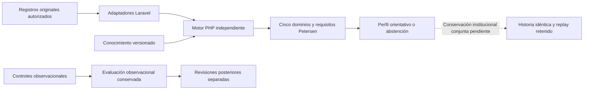

# Auditoría integral de RememberMind y su sistema experto

**Fecha:** 25 de octubre de 2026, America/La_Paz.\
**Objeto:** implementación local de `VarlaCdev20/RememberMind`.\
**Rama observada:** `feature/apoyo-decision-informe-neurocognitivo`.\
**HEAD al iniciar:** `6d7b8c6d`, con modificaciones locales preexistentes.\
**Naturaleza:** auditoría técnica, funcional, de seguridad y de consistencia de presentación. No acredita una titulación profesional, validación clínica ni certificación regulatoria.

## 1. Dictamen ejecutivo

**NO APTO para declarar culminación institucional ni habilitación asistencial general.**

RememberMind tiene arquitectura, procesos y componentes útiles, y el motor simbólico no es una pantalla vacía. Sin embargo, existen fallos reproducidos de autorización, interpretaciones clínicas introducidas por la interfaz sin el contrato del motor, navegación incoherente y un bloqueo material de conservación histórica.

Los problemas principales son:

1. Revocar permisos no impide que el dashboard psicológico muestre determinada información de residentes y atenciones.
2. La lectura del directorio de personal permite llegar a una operación de horarios que no comprueba el permiso de asignación en su backend responsable.
3. La ficha psicológica puede presentar aumentos numéricos como mejoría y observaciones como evidencia cognitiva objetiva. El motor principal puede abstenerse correctamente y, aun así, la ficha inducir una lectura distinta.
4. La evaluación institucional conjunta instrumental/Petersen sigue siendo transitoria. No está implementado el circuito completo guardar → recuperar idéntico → reproducir con ejecutor histórico → revisar ambas disciplinas.
5. La base institucional sí tiene un inventario coherente de **100 tablas de negocio**. La referencia de conservación con 229 tablas hipotéticas no es una solución institucional terminada; su propio informe reconoce el problema.
6. La aceptación técnica no está verde: hay fallos en pruebas de conservación y medicación, además de un fallo del arnés de concurrencia de medicación en PostgreSQL.
7. Parte de las mejoras visuales anteriormente documentadas existe como archivos, pero no está conectada a la ficha activa del estado local actual.

**No todo se explica por falta de mediciones o aprobación médica.** Los bypass de permisos, los errores de campos, las etiquetas incorrectas, la consulta duplicada, el enlace de Gerencia y los ensayos desactualizados son defectos de software. Deben corregirse antes de atribuir la incompletitud a la documentación o a profesionales externos.

No se propone suprimir compuertas para obtener más clasificaciones. Una abstención fundada es comportamiento correcto; llamar «objetiva» a una observación o fabricar una firma no lo es.

## 2. Alcance, método y límites reales

Se combinaron:

- Lectura de AGENTS y fuentes por carpeta, arquitectura híbrida, baseline vigente, decisiones y contratos del experto.
- Inventario del router real cargado por Laravel, módulos, plantillas y controles declarados.
- Lectura agregada de PostgreSQL mediante una transacción `SET TRANSACTION READ ONLY`, finalizada con rollback. No se extrajeron historias identificables al informe.
- Pruebas unitarias, de integración Laravel/Livewire y de navegación con datos sintéticos en SQLite desechable.
- Pruebas seleccionadas de concurrencia y continuidad en un clúster PostgreSQL temporal propio.
- Reproducciones nuevas, también desechables, que comprueban los dos fallos de autorización y el solapamiento nocturno.
- Auditorías de dependencias mediante Composer/npm, sin instalar ni actualizar paquetes.
- Build de Vite y pruebas JavaScript que no requieren navegador.

### Limitación visual esencial

La herramienta del navegador rechazó el acceso a la página local por su política de seguridad. No se intentó eludir ese rechazo mediante otro navegador, CDP o herramientas indirectas.

Por tanto, **no se afirma que se haya pulsado cada botón, medido cada contraste ni revisado cada pantalla en los cinco tamaños** durante esta auditoría. La evaluación visual actual es de estructura, semántica y código; la inspección renderizada queda pendiente. Las capturas del 22/10 son evidencia histórica, no prueba del código actual del 25/10.

Los inventarios de botones cuentan declaraciones de plantilla, incluidas ramas condicionales y componentes repetidos. No equivalen al número de botones que una persona ve en una pantalla ni a cobertura de pruebas de cada acción.

## 3. Inventario comprobado

| Elemento | Resultado |
|---|---:|
| Propietarios funcionales bajo `app/Modulos` | 12 |
| Rutas cargadas | 311 |
| Nombres distintos de ruta | 304 |
| Plantillas Blade en los doce módulos | 383 |
| Plantillas Blade incluyendo `resources/views` | 573 |
| Declaraciones `<button>` en ese inventario ampliado | 1.620 |
| Declaraciones `<a>` | 447 |
| Casos PHP enumerados por PHPUnit | 3.722 |
| Archivos de pruebas frontend | 53 |
| Archivos frontend seleccionables sin navegador | 31 |
| Tablas físicas instaladas en PostgreSQL | 116 |
| Tablas operativas / expertas / técnicas | 75 / 25 / 16 |

Las 16 técnicas incluyen `secuencias_codigos`; excluirla por error produce un conteo falso de 101 tablas de negocio. Se corrigió la clasificación del inventario de auditoría antes de emitir este dictamen.

### Volumen local: no confundir cantidad con calidad

| Entidad | Filas observadas |
|---|---:|
| Residentes | 110 |
| Personal / cuentas | 54 / 133 |
| Alertas / eventos de alerta | 21 / 41 |
| Instrumentos | 26 |
| Aplicaciones | 1.139 |
| Controles cognitivos | 4.360 |
| Controles IADL | 190 |
| Juicios originales Petersen | 271 |
| Versiones de conocimiento / reglas | 6 / 32 |
| Evaluaciones expertas almacenadas | 8 |
| Revisiones profesionales expertas | **0** |

En las aplicaciones se observan 149 cognitivas, 704 funcionales y **286 observacionales**. Ninguna tiene documento clínico enlazado en `cod_documento_clinico`; las 149 cognitivas tienen usuario y fecha técnica de registro, mientras esas dos columnas están vacías en los grupos funcional y observacional.

Esto no demuestra que todas sean falsas o inválidas: puede existir procedencia mediante otro localizador o documentación fuera de esa FK. Sí impide usar los conteos como prueba de trazabilidad original completa. No deben rellenarse metadatos históricos desconocidos con autores o fechas inventados.

La base contiene la cohorte local de entrenamiento. Sus casos y salidas verifican software; no demuestran sensibilidad, especificidad ni diagnóstico en población real.

## 4. Módulo por módulo

Las cifras de rutas se atribuyen por el namespace de su acción directa; rutas Closure/redirect y entradas compartidas no quedan todas asignadas a un propietario mediante ese criterio. Las mutaciones Livewire tampoco son rutas POST individuales: viajan por el endpoint de actualización compartido.

| Módulo | Blade | Botones declarados | Rutas de acción directa | Evaluación crítica |
|---|---:|---:|---:|---|
| Admisiones | 10 | 56 | 7 | Hay flujo formal y pruebas de atomicidad/cama; no se sustituye por CRUD directo. Mantener esa fortaleza. Falta aceptación visual del wizard completo y validación de cada error/recuperación. |
| Alertas | 22 | 66 | 9 | Existen servicio, eventos, bandeja por rol y pruebas de continuidad. No hay evidencia de que todas las alertas estén rotas. Debe comprobarse equivalencia de entradas HTTP/Livewire y estados, sin asumir que notificación es resolución clínica. |
| ApoyoDecision | 44 | 229 | 7 | Núcleo simbólico e inferencias parciales reales. La conservación conjunta y la explicación clínica autorizada siguen incompletas. Hay consulta observacional duplicada y errores de interfaz mezclados entre ramas. |
| Clínica | 71 | 264 | 54 | Ficha, signos, seguimientos y registros existentes. El acceso a Nutrición desemboca en placeholder pese a existir otro circuito de valoración. Densidad alta y múltiples modales exigen recorrido visual pendiente. |
| Cuidados | 68 | 236 | 22 | Agenda, pase, registros y contexto de turno están conectados. La autorización depende de asignaciones válidas: el solapamiento de horarios puede volver ambiguo ese contexto. No se certifica cada actuación por una pantalla inicial correcta. |
| Identidad | 48 | 146 | 23 | Cuentas, personal, permisos y navegación tienen controles importantes. El formulario de horarios embebido rompe la frontera lectura/asignación. Revisar revocación en componentes hijos y acciones directas. |
| Institución | 29 | 121 | 33 | Defectos confirmados en autorización de horarios, guardias nocturnas, enlace de Ocupación de Gerencia y accesibilidad del drawer de Áreas. Es un frente prioritario, no un detalle cosmético. |
| Medicación | 15 | 49 | 15 | Separación orden/horario/administración presente. La prueba de integración y el arnés de carrera tienen errores actuales. No se debe retirar el control de ocurrencia para volver verde una prueba. Hay clases hover inválidas. |
| Reportes | 24 | 28 | 33 | Reportes/PDF y parámetros existentes. Labels sin asociación y canvas sin alternativa suficiente; no se puede afirmar accesibilidad o integridad de exportación de todas las salidas. |
| Residentes | 27 | 48 | 28 | Directorio y expediente reutilizables; la creación debe seguir siendo admisión formal. Falta recorrer cada carpeta con datos, ausencia, fuente restringida y enlaces directos por rol. |
| Social | 7 | 98 | 17 | Actividades y red de apoyo presentes; ocho métricas antes del listado y filtros sin nombre accesible añaden carga. La existencia de tarjetas no acredita continuidad de asistencia y seguimiento. |
| Valoraciones | 18 | 105 | 28 | Mayor concentración de defectos semánticos encontrados: interpretación paralela, Petersen divergente, puntajes no visibles, firmas no verificadas, fechas clínicas sustituidas por fecha de registro y mejoras visuales no integradas. |

### Fortalezas que deben conservarse

Arquitectura híbrida modular, motor PHP independiente, admisión formal, distinción entre observación e instrumento en buena parte del motor, compuertas de admisibilidad, controles de residentes ajenos, conservación observacional, revisión posterior independiente, componentes visuales compartidos y pruebas de atomicidad. Reescribir el proyecto completo desperdiciaría esos activos sin resolver por sí mismo los defectos.

## 5. Rol por rol: navegación realmente ejecutada

Se construyeron cuentas sintéticas activas y, cuando correspondía, personal activo. Se consultaron los enlaces que el propio sidebar publicaba para cada rol y se siguieron hasta dos redirecciones internas. No se crearon vinculaciones familiares o guardias clínicas ficticias para hacer aparecer opciones adicionales.

| Rol | Entradas de menú comprobadas | Destinos finales 200 | Otros | Interpretación |
|---|---:|---:|---|---|
| Superadministración | 25 | 25 | 0 | Menú accesible; no acredita competencia para actos clínicos. |
| Gerencia | 10 | 9 | **1 × 403 tras 302** | «Ocupación» publica un destino que no permite su acceso actual. |
| Administración | 18 | 18 | 0 | Menú operativo inicial disponible; las operaciones internas no se certifican por esos GET. |
| Medicina | 10 | 10 | 0 | Entradas visibles disponibles; la traza experta tiene restricciones distintas. |
| Enfermería | 7 | 7 | 0 | Escenario sin residentes/turno asignados; no cubre todas las actuaciones dentro de la guardia. |
| Psicología | 11 | 11 | 0 | Menú disponible, pero se reprodujo lectura de datos tras revocar permisos. |
| Nutrición | 2 | 2 | 0 | Cobertura de menú muy limitada; no prueba proceso nutricional completo. |
| Fisioterapia | 2 | 2 | 0 | Cobertura de menú muy limitada; falta aceptación de proceso propio. |
| Pedagogía | 3 | 3 | 0 | Entradas visibles disponibles; no aceptación de todas las intervenciones. |
| Familiar | 1 | 1 | 0 | Sin vínculo sintético de residente en este recorrido; no certifica todas las publicaciones familiares. |
| **Total** | **89** | **88** | **1 × 403** | Sin 500 en esa muestra de entradas del menú. |

El test de recorrido pasa porque comprueba ausencia de destinos inexistentes/métodos erróneos/500 en el menú; su aprobación **no oculta el 403**, registrado expresamente en la matriz. La salud funcional del enlace de Gerencia se considera fallida.

## 6. Qué significan 403, 404, 405 y 422 aquí

| Código | Uso legítimo | Defecto comprobado o límite |
|---|---|---|
| 403 | Cuenta/rol/permiso no autoriza la operación. Se reprodujo con Familiar entrando a Usuarios. | Ocupación de Gerencia: el sidebar permite la entrada, un redirect lleva a `admin.administracion.habitaciones` y el middleware de esa agrupación exige `admisiones.ver_dashboard`. |
| 404 | Ruta/recurso inexistente; también `denyAsNotFound()` oculta recursos fuera de alcance para evitar enumeración. | Enfermería fuera de la asignación puede recibirlo deliberadamente. Forzar traza experta sin capacidad también lo produce; eso no demuestra ruta rota. |
| 405 | La ruta existe, pero el método HTTP no es el admitido. Se reprodujo haciendo GET a Logout, que requiere POST. | El escaneo de enlaces literales no encontró enlaces normales dirigidos a rutas exclusivamente no-GET. No equivale a demostrar ausencia de fallos JS/formulario en todas las pantallas. |
| 422 | Validación o argumento no admitido. | El anterior incidente de destino `orion-petersen-detalle` era un rechazo de navegación, no un diagnóstico fallido. Su regresión se incluye en la selección experta actual. |
| 409 | Conflicto de estado/operación no permitida. | La restauración instrumental tiene un 409 explícito porque no tiene contrato de rectificación habilitado; no debe confundirse con un 405. |
| 500 | Error inesperado del servidor. | La muestra de 89 entradas no lo produjo. Eso no demuestra que todas las acciones internas estén libres de errores. |

Fuentes del enlace roto: `SidebarService.php:161`, `Institucion/Presentacion/Rutas/web.php:98`, `routes/web.php:77`. Los códigos no deben eliminarse indiscriminadamente: corregir un enlace no significa abrir permisos generales.

Se detectaron cuatro referencias literales no encontradas en el router. Una es falso positivo (`request()->route('token')`); las otras pertenecen a plantillas de 2FA, verificación de correo y equipos deshabilitados por configuración. Se clasifican como residuo/alcance inactivo, **no como tres 404 actuales demostrados**. No se encontraron métodos de controlador registrados inexistentes en la revisión efectuada.

## 7. Hallazgos de seguridad y operación

### H01 — Alta: revocación de lectura ineficaz en el dashboard psicológico

`app/Modulos/Valoraciones/Presentacion/Livewire/Paginas/DashboardPsicologo.php:16`, `:40`, `:53`.

El componente verifica rol al montar, pero sus consultas de atenciones/aplicaciones no verifican los permisos correspondientes. Un usuario PSICOLOGO/A con `residentes.ver`, `atenciones.ver` y `aplicaciones_instrumento.ver` revocados sigue recibiendo el nombre de un residente y una próxima atención propia.

**Evidencia:** reproducción desechable con Livewire, incluida en `DashboardPermisosAuditoriaTest.php`. **Cierre exigido:** reautorizar por fuente en cada consulta/render y probar que la revocación elimina el dato del payload, no solamente el botón.

### H02 — Alta: asignar horarios sin permiso de asignación

`app/Modulos/Institucion/Presentacion/Livewire/Funcionalidades/PersonalInstitucionalHorarios.php:46`, `:100`, `:206`, `:274`, `:322`; `Institucion/Aplicacion/Acciones/GestionarHorariosPersonal.php:27`.

El hijo Livewire no controla al actor en sus operaciones y la Action tampoco recibe/autoriza al actor. Un gerente con lectura de personal y los permisos de turnos revocados puede guardar una asignación activa. Sus propiedades públicas tampoco sustituyen una autorización contextual.

**Evidencia:** reproducción sintética de escritura confirmada en SQLite. **Cierre:** autorización en Action y entradas Livewire; identidad del trabajador validada, alcance institucional y pruebas de manipulación/revocación/finalización sin efectos laterales.

### H03 — Media: solapamiento nocturno no detectado

`GestionarHorariosPersonal.php:173`, `:203`.

La búsqueda limita jornadas a la misma fecha y no incorpora la guardia iniciada el día anterior. Se guardaron dos asignaciones activas sintéticas: 26/10 20:00–27/10 08:00 y 27/10 07:00–15:00.

**Cierre:** comparar ventanas completas en transacción, días adyacentes y cambios concurrentes, sin modificar historia para ocultar el conflicto.

### H04 — Media: menú de Gerencia desemboca en 403

«Ocupación» es visible, pero redirige a una agrupación administrativa con otro permiso. Reproducción HTTP: 302 → 403. **Cierre:** destino de consulta coherente con la competencia de Gerencia y pruebas de toda la cadena, sin conceder escritura clínica ni acceso administrativo amplio como atajo.

**Actualización del 26/10/2026:** [corrección H04 implementada y probada](../../especificacion-funcional/vistas/gerencia/34-CORRECCION-ACCESO-OCUPACION-H04.md): consulta directa con filtros/detalle sobre ruta autorizada; sin ampliar permisos. 56 pruebas PHP/361 aserciones, dos JS y build correctos; QA visual con sesión pendiente. El hallazgo anterior conserva la reproducción de este informe del 25/10.

### H05 — Media: fecha técnica sustituye a la fecha clínica

`FichaPsicologicaResidente.php:140`, `:208`; `RegistrarValoracionProfesional.php:44`.

La captura afectiva y de sesiones persiste `now()` sin permitir declarar cuándo ocurrió la valoración. Una transcripción diferida queda fechada como acto actual. **Cierre:** separar captura de fecha clínica y registro técnico dentro de las estructuras aprobadas; mantener autoría y validación de fechas, sin rellenar retrospectivamente historia desconocida.

### H06 — Dependencias: avisos de seguridad vigentes

`composer audit --format=json --no-interaction` identifica Livewire **4.4.6** en el intervalo afectado por GHSA-mhf7-xp6r-6qrc. El aviso del mantenedor fija corrección en 4.4.8 y limita el problema a usos concretos de `#[Authorize]`. La búsqueda de esos atributos en `app/` no encontró usos; **no se demostró explotación de ese aviso en RememberMind**. Los bypass H01/H02 son defectos independientes y sí se reprodujeron.

Fuente primaria: [aviso de Livewire](https://github.com/livewire/livewire/security/advisories/GHSA-mhf7-xp6r-6qrc), verificado el 25/10/2026.

`npm audit --omit=dev --json` informa **cinco paquetes con severidad alta**: `follow-redirects`, `zod`, `chromium-bidi`, `puppeteer-core` y `puppeteer`. Hay propagación transitiva: **no son cinco vulnerabilidades raíz independientes**. Parte afecta herramientas de automatización, no necesariamente código servido al residente. El aviso primario de `follow-redirects` clasifica su escenario como moderado, mientras el agregado de npm puede ser alto por otros avisos: no se fusionan esas severidades como si describieran el mismo alcance.

Fuente primaria: [aviso de follow-redirects](https://github.com/follow-redirects/follow-redirects/security/advisories/GHSA-q3jh-wrc6-jgq8). Informes íntegros: `dependencias-composer.json` y `dependencias-npm.json` en la evidencia.

**Cierre:** actualizar de forma controlada, revisar alcanzabilidad por uso y lockfiles, probar regresión. No se ejecutó `audit fix`, instalación ni cambio de versiones durante la auditoría.

## 8. Sistema experto: funcionamiento real y brechas

### 8.1. Arquitectura y recorrido existente



El motor es simbólico y determinista. No se encontró un mecanismo de aprendizaje automático que se entrene o corrija conocimiento automáticamente con las revisiones. La cohorte permite ensayar casos; llamarlo «entrenamiento» no lo convierte en aprendizaje estadístico ni valida reglas clínicas.

### 8.2. Cinco dominios, 19 componentes y reglas

| Dominio | Componentes | Qué se comprobó y límite |
|---|---:|---|
| Aprendizaje y memoria | 4 | Compuerta propia y dos reglas institucionales; no confundir cuatro tareas con cuatro reglas clínicas completas. |
| Atención | 3 | Red y contratos presentes; interpretación sujeta a perfil, método y medidas admisibles. |
| Funciones ejecutivas | 5 | Mismo requisito de evidencia aplicable; no se acredita clínica por copiar Memoria. |
| Lenguaje | 5 | Representación y ejecución condicionadas a fuentes/métodos aplicables. |
| Visuoespacial | 2 | Representación y ejecución condicionadas a fuentes/métodos aplicables. |

Las 15 reglas G09 comprueban C1 ∧ C2 ∧ C3 en una misma aplicación. Las observaciones nominales no deben acreditar por sí solas alteración objetiva. Petersen utiliza cinco juicios de dominio y C01/C03/C04/C05; **C02 se deriva, no se captura**.

La lectura local encontró 32 reglas: 17 ACTIVO/PENDIENTE en versión 4; cuatro ACTIVO/PENDIENTE en versión 5; ocho ACTIVO con revisión NULL en versión 3; tres ACTIVO con revisión NULL en versión 6. Los contratos adoptados permiten técnicamente ejecutar reglas pendientes, excluyendo rechazadas/archivadas; **ACTIVO no significa aprobado clínicamente**.

No se concluye que el sistema carezca de inferencia porque tenga cero revisiones. Se concluye que no existe evidencia local de revisiones profesionales realizadas y que las pruebas sintéticas no sustituyen esa evidencia.

### H07 — Alta: conservación institucional conjunta no terminada

`motor-experto/src/motor_experto/soporte/conservacion/InstantaneaEvaluacionInstitucional.php:20`, `:54`; `ConsultarPerfilInstrumental.php:33–43`.

El DTO se construye y verifica como `persistido=false` y `release_retenido=false`. No hay aquí un repositorio institucional instalado que cierre ambas ramas. `ResultadosExpertoResidente.php:154–161` descarta el análisis transitorio al hidratar otra petición.

**Impacto:** abrir otro detalle puede volver a consultar el expediente actual; no acredita que se esté leyendo exactamente el cálculo anterior. **Cierre:** escritor/lector SQL institucional, instantánea tipada completa, identidad/orden/ausencias, conocimiento y ejecutor retenidos, idempotencia, cierre y replay independientes. Solo entonces revisiones del resultado conjunto.

### H08 — Alta de alcance: el prototipo no es una solución SQL institucional instalable

`tests/Feature/ConservacionCompletaSQLTest.php:35–45` carga clases de `prototipos/orion-conservacion-nominal`, no un repositorio institucional integrado.

El informe `RECUPERACION_SQL_COMPLETA_REFERENCIA_2026_10_22.md:87–104` reconoce 129 relaciones adicionales, 229 tablas hipotéticas en total, 4.411 columnas y un máximo de 412 columnas por relación. También reconoce FK semánticas históricas incompletas y que copiar el DTO no demuestra 4FN.

No basta pedir permiso para instalarlo ni cambiar el máximo: faltan decisiones de diseño y una implementación mantenible. La referencia sirve como oráculo de igualdad de contenido, no como cierre del requisito.

### H09 — Media: consulta observacional duplicada y error imputado a la rama incorrecta

`ResultadosExpertoResidente.php:702–727` consulta dos veces hallazgos/revisiones para Medicina/Psicología. En el primer catch se activa `errorInstrumental` y se limpia el estado exitoso del análisis.

Un fallo observacional puede ocultar una rama instrumental correcta. **Cierre:** adquisición única por rama, errores independientes, estado visible coherente y prueba de fallo de una fuente sin falsear la otra.

### H10 — Media: el corte retrospectivo consulta estados actuales

`Valoraciones/Aplicacion/Acciones/AplicarInstrumento.php:146` anula la aplicación previa al rectificar; `CapturasInstrumentalesResidente.php:37–38`, `:77–78` consulta fecha/corte, pero interpreta el estado actual.

Después de rectificar, un corte anterior puede ver anulada una aplicación que estaba completa entonces. Esto demuestra que consultar tablas actuales con filtro de fecha **no equivale** a replay histórico. **Cierre:** conservar estado y pertenencias utilizados en la evaluación original; no reconstruir lo desconocido desde el presente.

### H11 — Media: lectura clínica y firma están acopladas

`EvaluacionExpertaPolicy.php:96–100` exige permiso de revisión de Psicología para consultar resultados. Revocarlo puede retirar lectura, aunque la institución solo pretendiera retirar firma. **Cierre:** resolver la intención institucional y separar capacidades cuando corresponda; no añadir permisos sensibles sin decisión.

### H12 — Media: los profesionales no reciben una explicación de reglas equivalente a su objetivo clínico

`EvaluacionExpertaPolicy.php:35–40`, `VersionModeloExpertoPolicy.php:13–16`, `ResultadosExpertoResidente.php:385–388`.

La traza se delega a auditoría técnica de Superadministración. Medicina/Psicología pueden gestionar reglas pero no necesariamente abrir esa traza del resultado. **Cierre:** proyección clínica autorizada de fundamento/evidencias; conservar inspector técnico separado, sin conceder auditoría global como atajo.

### H13 — Media de aceptación: manifiesto de «104 escenarios» no localizado

`FASE_2_MATRIZ_MAESTRA_INFERENCIA_2026_10_20.md:7` y `ACEPTACION_INTEGRAL_ORION_2026_10_21.md:23` reconocen la ausencia. Existen VT01–VT15 y 225 cruces de matriz; no son 225 pacientes ni sustituyen el manifiesto solicitado.

**Cierre:** identificar archivo versionado con entradas, fuentes, reglas, salida esperada y comando reproducible, o retirar la cifra como criterio de aceptación no respaldado.

### 8.3. Qué resultados puede entregar realmente

- Hallazgos observacionales y límites, con conservación del contrato observacional.
- Interpretación por dominio cuando existen fuente, método, perfil y medida admisibles.
- Cuatro perfiles orientativos de posible DCL: amnésico único/multidominio y no amnésico único/multidominio.
- Abstenciones por contradicción, revisión diferencial, insuficiencia, requisito negativo o falta de gobierno/regla habilitada.
- Trazas y explicaciones con el alcance realmente disponible.

No acredita diagnóstico confirmado, porcentajes de deterioro, probabilidad individual, tratamiento automático ni validación clínica. La historia conjunta instrumental/Petersen sigue sin el cierre SQL institucional descrito.

## 9. Hallazgos de frontend y contenido clínico

### H14 — Alta: «mejoría» automática por aumento de puntos

`ConsultarTendenciaResidente.php:364–375`; ficha psicológica `:166–189`.

Cualquier aumento cognitivo se traduce a MEJORIA/Evolución favorable, sin dirección de puntuación ni método de cambio. La igualdad numérica se presenta como ausencia de cambios significativos sin criterio de cambio fiable. La presentación usa color y texto de conclusión clínica.

**Reproducción:** `[3,6]`, tipo cognitivo → MEJORIA y aumento favorable de tres puntos. **Cierre:** variación numérica neutral por serie comparable; solo interpretación clínica cuando proceda de contrato aplicable y verificable. El verde no puede decidir la clínica.

### H15 — Alta: series incompatibles y fechas incorrectas

`ConsultarTendenciaResidente.php:65–70`, `:96`, `:121`, `:137`, `:344–347`.

Agrupa por nombre, no por edición/método; incluye observaciones y no filtra adecuadamente estado/sucesión; retiene una lectura por día y usa etiquetas globales para resumir una serie. `[null,10,11,null]` con fechas 1–4/10 devuelve intervalo 1–4/10 aunque las medidas válidas sean 2–3/10.

**Cierre:** identidad de serie compatible, todos los momentos válidos, valores y fechas enlazados, exclusión explícita y tests de dos instrumentos/versiones y múltiples lecturas por día.

### H16 — Alta: observaciones etiquetadas como evidencia objetiva C02

`FichaPsicologicaResidente.php:338–343`; ficha `:1121`.

La colección incluye OBSERVACIONAL y la vista aplica un badge fijo «Criterio C02 (Objetivo)». No consulta la admisibilidad real. **Cierre:** distinguir observación, medida y evidencia objetiva; consumir el resolvedor de C02, no una etiqueta declarada en Blade.

### H17 — Alta: Petersen redefinido dentro de la ficha

Ficha `:1010`, `:1025`, `:1036`, `:1069–1071`.

Se busca C02 como juicio original y se ofrece «Documentar», aunque el contrato prohíbe capturarlo. C05 se llama juicio global interdisciplinario, en vez de calidad/interpretabilidad con los soportes y cinco dominios exactos. **Cierre:** una sola fuente de presentación desde el contrato/backend vigente, C02 derivado y C05 exacto.

### H18 — Alta de claridad: «fuente restringida» se convierte en «no hay datos»

Backend ficha `:300`, `:330`; vista `:739`, `:1047`, `:1069`.

La falta de permiso fuerza colección vacía y la pantalla declara ausencia de registro. **Cierre:** estados diferenciados `restringido`, `sin_registros`, `error`, `consultado`. No completar una evaluación parcial como si fuese íntegra.

### H19 — Media: un campo mal nombrado oculta puntuaciones

Ficha `:1112` utiliza `puntuacion_total`; el modelo `AplicacionInstrumento.php:19` y el esquema usan `puntaje_total`. No existe ese accessor alternativo. **Cierre:** campo canónico y prueba de contenido con puntuación cero, valor no nulo y NULL diferenciados.

### H20 — Media: valoraciones llamadas «firmadas» sin comprobar firma

Backend ficha `:323–327`; vista `:941`, `:952`.

La consulta obtiene valoraciones sin comprobar firma/estado y la UI dice «Conclusiones firmadas / Firmado por». Autoría de registro no es revisión formal. **Cierre:** «Registrado por» cuando solo existe autor; firma y estado solamente si están acreditados.

### H21 — Media: mejoras visuales existentes no integradas en la ficha activa

Existen `ficha-psicologica/cabecera.blade.php`, `resumen.blade.php` y `resident-file.css`. La ficha activa actual arranca con su cabecera anterior y no los incluye ni usa la raíz `.rm-resident-file`.

Esto explica una interfaz sin cambios pese a informes previos de mejoras. **Cierre:** elegir una implementación, conectar consumidores y comprobar la ruta real tras la integración; no declarar terminado por crear parciales.

### H22 — Media: jerga y códigos internos visibles

Ficha `:985` muestra `persistido = false` y «Nivel 1»; resultados expertos `:66` muestra un código en una rama; `perfil-instrumental.blade.php:17–18` imprime regla/variable y `captura-instrumental.blade.php:50` una identidad de rectificación.

**Cierre:** vista clínica con hallazgo, fecha, origen, límite y siguiente paso; códigos en inspector técnico autorizado. Los identificadores siguen siendo necesarios internamente y no deben borrarse de las relaciones.

### H23 — Media: botón de Nutrición termina en placeholder

`Clinica/Presentacion/Vistas/livewire/clinica/salud-seguimiento-list-panel.blade.php:58`, `:264–270`; la valoración nutricional ya tiene ruta en Valoraciones `:85`.

**Cierre:** conectar la capacidad existente o distinguir claramente lo disponible y lo pendiente. No hacer pasar una sección «Próximamente» por recorrido operativo terminado.

### H24 — Media: diálogo de Áreas y reportes inaccesibles en su implementación

`areas-institucionales-panel.blade.php:251` refiere un ID de título inexistente, `:266` tiene cierre sin nombre accesible y no implementa trap/Escape en el archivo. Labels de ese formulario `:582` y de `salud-reportes-panel.blade.php:53/66/80` carecen de asociación. Canvas de `reportes-institucionales-panel.blade.php:501/516/533/562/577/594` no tienen nombre/alternativa textual suficiente.

**Cierre:** componentes canónicos, foco y retorno, Escape, labels asociados, descripción y tabla equivalente por gráfica. Debe verificarse renderizado, no solo mediante lectura de clases.

### H25 — Media: inconsistencias de color, tamaño y feedback

Ficha `:473` y backend `:379` fijan HEX locales; badges Tailwind `:1043` no explicitan adaptación oscura. `system-density.css:37` reduce controles heredados hasta 40 px; el contrato usa objetivos operativos de aproximadamente 44 px. `salud-medicacion.blade.php:242/342/512/592` incluye `hover:bg-[var(--rm-primary)]Hover`, clase inválida.

**Cierre:** tokens y variantes reales, presets de gráficas, significados provenientes del backend, feedback de carga/error/éxito y verificación de contraste compuesto en ambos temas. No se declara que cada color falle AA: falta medición renderizada.

### Distribución que debería adoptarse después de corregir semántica

| Superficie | Jerarquía propuesta | Qué retirar o desplazar |
|---|---|---|
| Ficha | Identidad → tareas disponibles → último registro por área → historia | Jerga de motor y datos técnicos en la cabecera; duplicaciones de Petersen. |
| Resultados | Conclusión principal grande → límites → cinco dominios → requisitos → evidencia | Resultados de demostración junto al actual sin separación; etiquetas objetivas fijas. |
| Fuentes | Resumen por tipo/estado/fecha → tabla → detalle individual en drawer | Bloques largos anidados abiertos a la vez; códigos como explicación. |
| Historia | Selector de serie compatible → gráfica → tabla equivalente | Mezclar ediciones y construir «mejorías» por signo del delta. |
| Alertas | Pendiente prioritario → origen → acción permitida → seguimiento | Contadores y decoración antes de la tarea; asumir cierre por notificación. |
| Personal/turnos | Profesional y ventana completa → asignación → residentes → conflictos | Calendarios que validan solo fechas, y controles de escritura accesibles desde mera lectura. |

El número de líneas o botones no demuestra por sí solo saturación visual. Sí demuestra concentración de responsabilidades que exige simplificar y separar lectura general, tarea y detalle técnico. La decisión final de distribución requiere la revisión renderizada pendiente.

## 10. Calidad de pruebas, historia y mantenimiento

### H26 — Media: ensayo F02 desactualizado respecto de la base consolidada

`prototipos/orion-conservacion-0_2/ensayar-sqlite-completo.php:68–69`, `:313` exige 120 tablas físicas. `tests/Unit/ReferenciaF02SqliteDesechableTest.php:32` espera un texto sobre 104 tablas de negocio y 157 físicas. La base actual es 100 + 16.

El fallo fue reproducido por la suite unitaria completa. **Cierre:** actualizar inventario, transición y cálculos del ensayo conservando las garantías; no borrar la comprobación para obtener PASS.

### H27 — Media: la prueba de medicación falla por una ocurrencia no seleccionable

`tests/Feature/MedicacionV2Test.php:82` termina en `RegistrarAdministracionMedicacionService.php:53`, que exige exactamente un horario vigente. El test obtiene hora a minutos de `now()` mientras la prescripción usa fecha/hora con segundos; `AgendaMedicacionService` excluye horarios previos al instante de prescripción.

La falta de tiempo controlado es una explicación compatible con el código; no se ha demostrado en esta auditoría que toda administración desde la UI falle. **Cierre:** escenario determinista con horario y fecha válidos, investigar el recorrido real y mantener el rechazo de dosis ambiguas/anteriores.

### H28 — Media: arnés de concurrencia de medicación no concluye

`AdministracionMedicacionConcurrenciaPostgresTest.php:194` falla al interpretar JSON de un proceso; el cleanup `:207` llama `proc_terminate` sobre un recurso ya cerrado y enmascara el error anterior.

**Cierre:** capturar el resultado y error seguros de cada worker, cerrar una sola vez sus recursos, repetir carrera real y verificar unicidad/auditoría. Este error no prueba por sí mismo doble administración en el producto; significa que la garantía concurrente solicitada no quedó acreditada en esta ejecución.

### H29 — Media: tests verdes conservan textos clínicos incorrectos

`FichaPsicologicaResidenteTest.php:326/330` exige «Evolución favorable», las definiciones paralelas de Petersen y `persistido = false`. **Cierre:** expectativas del contrato vigente y pruebas de semántica/datos/admisibilidad, no aceptación de cadenas que contradicen el backend principal.

### H30 — Media: documentación y estado local divergen

AGENTS y tests/AGENTS siguen citando 104 como inventario instalado mientras el baseline posterior y SQL muestran 100; existe prioridad documental para resolverlo, pero la lectura es confusa. Los informes del 22/10 de ficha mejorada no describen su integración actual. Persistencia de referencia e integración institucional deben etiquetarse por separado.

**Cierre:** registrar qué documento sustituye a cuál, versiones de implementación y enlaces verificables; conservar historia sin presentarla como aceptación actual. La documentación no debe afirmar una funcionalidad que la ruta activa no consume.

### H31 — Media de rendimiento: assets globales grandes

El build actual produce aproximadamente **1.933,21 kB de CSS** (274,54 kB gzip) y **535,54 kB de JS** (168,78 kB gzip); Vite advierte chunks mayores de 500 kB. Son tamaños de artefacto, **no mediciones de tiempo de carga real ni prueba de lentitud de todas las pantallas**.

**Cierre:** medir carga real por rol, revisar importaciones globales y código no utilizado, separar bundles donde reduzca coste sin romper Alpine/Livewire. No añadir caché o librerías sin medir.

### H32 — Pendiente de aceptación: revisión visual y clínica no realizadas

La revisión visual actual está bloqueada por la política del navegador. La base tiene cero revisiones expertas; no se aportó una muestra de casos con dictamen profesional independiente vinculada al resultado conservado. No se puede asignar un porcentaje serio de culminación global ni validación clínica por suites sintéticas.

**Cierre:** recorrido visual autorizado por rol/estado/tamaño y validación clínica separada, con discrepancias, responsables y límites. Estas verificaciones no deben usarse para retrasar la corrección técnica de H01–H31.

## 11. Resultados de pruebas de esta auditoría

Los resultados corresponden al árbol local, no al estado remoto. No se suman ejecuciones con filtros solapados como si fueran pruebas únicas de mayor cobertura.

| Grupo | Entorno | Resultado y lectura correcta |
|---|---|---|
| Suite Unit completa | SQLite/objetos puros y ensayos desechables | 1.616 casos, 19.845 aserciones; **1 fallo y 4 omitidos**. No es suite verde. |
| Operación transversal seleccionada | SQLite `:memory:` | 109 casos, 1.047 aserciones; **1 error** de integración de medicación. |
| Experto seleccionado | SQLite desechable | 146 casos, 1.967 aserciones; cero fallos/errores, **5 omitidos**. Los prototipos comprobados no acreditan persistencia institucional instalada. |
| Navegación del sidebar y semántica HTTP | SQLite `:memory:` | 11 pruebas, 14 aserciones, satisfactorias; matriz registra **89 enlaces, 1 con 403**. |
| Reproducciones de defectos | SQLite `:memory:` | 3 pruebas, 11 aserciones, satisfactorias **porque prueban los defectos**, no porque seguridad esté aceptada. |
| Concurrencia/continuidad seleccionada | PostgreSQL temporal | 8 casos, 114 aserciones, **1 error** del arnés concurrente de medicación; 7 casos satisfactorios. Clúster detenido al concluir. |
| JavaScript sin navegador | Node | 234 pruebas satisfactorias, cero omitidas en los 31 archivos seleccionados. |
| Build | Vite | Satisfactorio en 9,02 s; advertencia de tamaño de chunks. |

Las siete pruebas PostgreSQL satisfactorias incluyen continuidad observacional/revisión, protección de lectura IADL y concurrencias seleccionadas de cama/alerta/Petersen; su alcance exacto consta en JUnit. No se atribuye a SQLite evidencia de locks PostgreSQL.

Además, la revisión especializada ejecutó 113 pruebas unitarias focalizadas (896 aserciones) y 45 pruebas de permisos/ficha (209 aserciones), satisfactorias. Son parcialmente redundantes con los filtros principales y **no se agregan a un total inflado**.

## 12. Plan de cierre ordenado y verificable

| Prioridad | Trabajo | Evidencia que lo cierra |
|---|---|---|
| 1 | Corregir H01/H02: revocación de fuentes y mutaciones de horarios. | Los tres ensayos de defecto se convierten en regresiones que exigen rechazo y cero escrituras/datos filtrados. |
| 2 | Eliminar interpretación paralela H14–H18 y firmas aparentes H20. | Una misma fuente produce el mismo significado en ficha y resultados; C02 derivado, C05 exacto, sin permiso ≠ sin dato. |
| 3 | Resolver guardias nocturnas y enlace de Gerencia H03/H04. | Ventanas adyacentes/concurrentes válidas; todos los enlaces visibles del rol abren su destino permitido. |
| 4 | Corregir campos, fechas originales y error entre ramas H05/H09/H19. | Autoría/fecha no inventadas; puntajes visibles; fallo de una fuente no se imputa a otra. |
| 5 | Reparar arneses/escenarios H26–H29 y dependencias H06. | Unit y gates seleccionados verdes con escenarios válidos; avisos revisados/actualizados, sin debilitar invariantes. |
| 6 | Diseñar y terminar conservación institucional H07/H08/H10. | DDL nominal aprobable, normalización/FK históricas, writer/reader completos, idempotencia, cierre y replay desde datos conservados, en ambos motores. |
| 7 | Integrar explicación clínica, revisiones y lectura por rol H11/H12. | Medicina/Psicología revisan de forma independiente el mismo resultado conservado; inmutabilidad demostrada. |
| 8 | Conectar una sola ficha vigente y resolver controles/overlays H21–H25. | Ruta real, cinco tamaños, claro/oscuro, teclado, errores, carga, éxito, cierre/retorno y tablas equivalentes con evidencia. |
| 9 | Consolidar documentación, rendimiento y aceptación H13/H30–H32. | Trazabilidad requisito→archivo→prueba→evidencia; muestra clínica independiente y límites publicados. |

Las prioridades 1–5 son correcciones de software; no requieren inventar umbrales ni firmas médicas. Las ampliaciones estructurales o de permisos sensibles deben seguir su aprobación específica. El trabajo de diseño no puede sustituirse por presentar el bloqueo como una mera espera de autorización.

## 13. Evidencia reproducible y estado de Git

Directorio de evidencia: `output/auditoria-integral-20261025/`.

- `rutas.json`, `rutas-inventario.csv`: router real.
- `inventariar.mjs`, `inventario.json`, `modulos.csv`, `vistas-controles.csv`: inventario estático por propietario y plantilla.
- `rutas-literales-no-encontradas.csv`, `enlaces-metodo-no-get.csv`, `botones-candidatos-sin-accion.csv`: candidatos, con falsos positivos clasificados en este informe; no todos son bugs.
- `leer_estado.php`, `estado-local-agregado.json`: lectura de metadata/conteos, sin historias identificadas y sin writes institucionales.
- `AuditoriaRecorridosTest.php`, `recorridos-roles.jsonl`, `recorridos.junit.xml`: enlaces por rol y códigos HTTP.
- `DashboardPermisosAuditoriaTest.php`, `reproducciones-seguridad.*`: escenarios sintéticos de los defectos.
- `reproducir-tendencias.php`, `tendencias.json`: ejecución pura de H14/H15, sin acceso a BDD.
- `unitarias.*`, `operacion.*`, `experto.*`, `postgres.*`, `frontend.log`, `build.log`: resultados reales.
- `dependencias-composer.json`, `dependencias-npm.json`: avisos al momento de ejecutar.
- `RESUMEN_PRUEBAS.md`: resumen final generado desde los XML presentes.
- `HALLAZGOS.csv`: los 32 hallazgos y brechas para seguimiento; `INDICE_FUENTES.md` resuelve las rutas completas de los archivos abreviados.
- `git-status-final.txt`, `git-diff-stat-final.txt`, `git-head-final.txt`: estado observado al cierre. El diff del árbol compartido incluye cambios preexistentes y no se atribuye íntegramente a esta auditoría.

Comandos principales:

```powershell
php artisan route:list --json
php vendor/phpunit/phpunit/phpunit --list-tests
node output/auditoria-integral-20261025/inventariar.mjs
php output/auditoria-integral-20261025/leer_estado.php
php vendor/phpunit/phpunit/phpunit --testsuite Unit --colors=never --log-junit output/auditoria-integral-20261025/unitarias.junit.xml
php vendor/phpunit/phpunit/phpunit output/auditoria-integral-20261025/AuditoriaRecorridosTest.php --log-junit output/auditoria-integral-20261025/recorridos.junit.xml
composer audit --format=json --no-interaction
npm audit --omit=dev --json
npm run build
```

Los filtros exactos y las ejecuciones adicionales se conservan en `COMANDOS.md`.

**Cambios de esta tarea:** documentos, scripts y evidencia de auditoría. Se preservaron las modificaciones locales existentes; no se corrigió producto durante el gate de lectura. No hubo migraciones, cambios de permisos, edición de historia, commit, push o despliegue. El build regenera assets locales; no equivale a publicación.

## Conclusión

El proyecto tiene una base reutilizable considerable, pero **su mayor riesgo es la falta de coherencia entre capas**: una Policy puede ser rigurosa mientras otro componente omite permisos; el motor puede abstenerse mientras una ficha proclama evidencia objetiva; una prueba puede aprobar textos incorrectos; una referencia SQL puede conservar un corpus sin estar integrada en la institución.

Cerrar esas contradicciones, y demostrar el recorrido institucional completo, es más importante que añadir más tarjetas, más datos o más tablas. No hay fundamento para declarar el sistema completo o clínicamente validado en el estado auditado.
