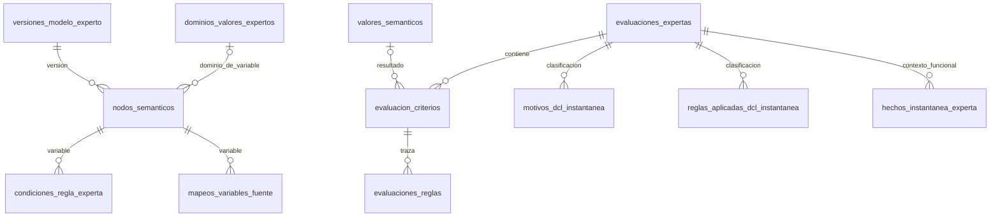

# Consolidación de cuatro bloques expertos — 22/10/2026

## Decisión y alcance

La propietaria pidió reducir las tablas conservando funcionamiento y mantenimiento. Después del [análisis de cuatro consolidaciones](../sistema-experto/ANALISIS_REFACTOR_REDUCCION_MANTENIBLE_2026_10_22.md), indicó «realiza ese cambio» y pidió culminar la fase con funcionamiento correcto, seguido de «continua».

Se registra la aprobación de **esas cuatro consolidaciones**, sus campos originales, identidades alternativas, FK y transición reversible. No abarca la quinta unión opcional de soportes, tablas nuevas de conservación compuesta, cambios de permisos o activaciones clínicas. El máximo de 110 se mantiene. No se interpreta como autorización para fabricar mediciones o aprobación profesional.

| Relación retirada después de verificar la copia | Propietario físico existente | Cardinalidad original |
|---|---|---|
| `resultados_criterio` | `evaluacion_criterios` | 0..1 por criterio; `se19_u1` |
| `trazas_inferencia` | `evaluacion_criterios` | 0..1 por criterio; `se20_u1` |
| `variables_expertas` | `nodos_semanticos` | 0..1 por nodo; `se06_u1` |
| `clasificaciones_dcl_instantanea` | `evaluaciones_expertas` | 0..1 por evaluación |

Inventario objetivo: **75 operativas + 25 expertas = 100 tablas de negocio**, más las mismas 16 técnicas. Son cuatro retiros adicionales a los del 20/10; no se vuelve a descontar aquella reducción. El núcleo de 70 tablas no cambia.

## Diccionario físico

Se añaden **28 columnas nominales nullable**, sin JSON/EAV. NULL en la identidad del bloque exige que todo su contenido sea NULL; una identidad presente exige los campos originalmente NOT NULL. Los campos originalmente opcionales siguen siéndolo. No se exige que resultado y traza aparezcan simultáneamente.

| Tabla | Columna nueva | Tipo SQL Laravel/PostgreSQL | Significado original |
|---|---|---|---|
| `evaluacion_criterios` | `cod_resultado_criterio` | varchar(20) | Identidad original, UNIQUE |
| | `resultado_cod_valor_semantico` | varchar(20) | FK al valor semántico original |
| | `resultado_fecha_hora_determinacion` | timestamp sin zona | Fecha de determinación original |
| | `resultado_justificacion_original` | text | Justificación opcional original |
| | `cod_traza_inferencia` | varchar(20) | Identidad original, UNIQUE |
| | `traza_estado_inferencia` | varchar(30) | Estado original |
| | `traza_fecha_hora_inicio` | timestamp sin zona | Inicio original |
| | `traza_fecha_hora_fin` | timestamp sin zona | Fin opcional original |
| `nodos_semanticos` | `cod_variable_experta` | varchar(20) | Identidad original, UNIQUE |
| | `cod_nodo_propietario_primario` | varchar(20) | FK opcional al nodo propietario |
| | `cod_dominio_valores` | varchar(20) | FK opcional al dominio de valores |
| | `tipo_semantico` | varchar(30) | Tipo original |
| | `papel_inferencial` | varchar(40) | Papel original |
| | `estado_variable` | varchar(20) | Estado de variable, independiente del nodo |
| | `fecha_hora_creacion_variable` | timestamp sin zona | Fecha propia de variable |
| | `cod_usuario_creacion_variable` | varchar(20) | FK a autor propio de variable |
| | `observacion_variable` | text | Observación opcional de variable |
| `evaluaciones_expertas` | `cod_clasificacion_dcl_instantanea` | varchar(20) | Identidad original, UNIQUE |
| | `cod_funcionalidad_instantanea` | varchar(20) | Identidad funcional original, UNIQUE |
| | `dcl_version_contrato` | varchar(80) | Contrato usado |
| | `dcl_diferencial` | varchar(40) | Estado diferencial original |
| | `dcl_patron_candidato` | varchar(10) | Patrón opcional original |
| | `dcl_justificacion` | text | Justificación conservada |
| | `dcl_uso` | varchar(50) | Alcance de uso original |
| | `dcl_huella_clasificacion` | char(64) | Huella original |
| | `funcionalidad_independencia_relativa` | varchar(20) | Estado funcional original |
| | `funcionalidad_revisor_sintetico_id` | text | Referencia sintética opcional ya existente; no crea firmas |
| | `funcionalidad_justificacion` | text | Justificación funcional original |

`cod_evaluacion_criterio`, `cod_nodo_semantico`, `cod_version_modelo` y `cod_evaluacion_experta` se reutilizan como identidades del propietario. No se copian a columnas redundantes. La anchura pasa a 19 columnas en criterio, 19 en nodo y 27 en evaluación.

## Integridad y relaciones

Las PK de los tres propietarios permanecen. Las cuatro PK retiradas sobreviven como claves alternativas únicas; se conservan los prefijos y secuencias RCR, TRI, VEX y CIX. No se renumeran datos.

Siete FK entrantes se reubican conservando columnas, cardinalidades y comportamiento restrictivo:

1. `condiciones_regla_experta.cod_variable_experta` → `nodos_semanticos.cod_variable_experta`.
2. `mapeos_variables_fuente.cod_variable_experta` → la misma identidad.
3. `mapeos_variables_fuente.(cod_variable_experta,cod_version_modelo)` → nodo/variable de esa versión.
4. `evaluaciones_reglas.cod_traza_inferencia` → `evaluacion_criterios.cod_traza_inferencia`.
5. `hechos_instantanea_experta.(iadl_cod_funcionalidad_instantanea,cod_evaluacion_experta)` → `evaluaciones_expertas.(cod_funcionalidad_instantanea,cod_evaluacion_experta)`.
6. `motivos_dcl_instantanea.cod_clasificacion_dcl_instantanea` → evaluación/clasificación.
7. `reglas_aplicadas_dcl_instantanea.cod_clasificacion_dcl_instantanea` → evaluación/clasificación.

Se mantienen además la FK de resultado al valor, autor de variable, dominio y propietario primario. Tanto dominio como propietario deben compartir versión con la variable mediante FK compuestas. Las FK existentes de nodo/versión y evaluación/criterio cubren la identidad del propietario. Se indexan las nuevas FK y se conservan los índices de las FK entrantes. Se añade UNIQUE de variable/versión y funcionalidad/evaluación para los destinos compuestos.

Ocho triggers por motor validan presencia completa e inmutabilidad de los cuatro bloques, incluidas sus identidades de propietario y versión. PostgreSQL usa excepciones de integridad y SQLite `RAISE(ABORT)`; no se afirma que SQLite pruebe los bloqueos de PostgreSQL. Los triggers históricos ajenos se preservan. Una FK nueva no contemplada impide retirar o revertir la tabla en vez de eliminarla silenciosamente.

## Normalización y mantenimiento

Cada traslado está respaldado por una dependencia funcional 0..1 y una clave UNIQUE previa: la unión por propietario no multiplica filas. No se combinan colecciones independientes ni se introduce una dependencia multivaluada nueva. Se retienen atributos propios de la variable que pueden diferir del nodo. Las preguntas, respuestas, hechos, soportes, reglas ejecutadas y condiciones siguen en filas independientes. La red semántica continúa definiendo conocimiento; no recibe observaciones clínicas.

`BloquesExpertos` contiene cuatro proyecciones cerradas, no un catálogo de campos configurables. Sus escritores completan atómicamente un bloque ausente y rechazan duplicados. Los modelos Eloquent conservan sus entidades y relaciones con proyección a los campos lógicos originales. El motor independiente mantiene su contrato de conocimiento. No se crean tablas ni vistas de compatibilidad.

## Transición y reversión

Migración única: `2026_10_22_120000_consolidate_bloques_expertos_singulares`.

Forward: inspección de FK → bloqueo exclusivo PostgreSQL → lectura original → columnas nominales → copia → comparación inversa completa → restricciones/FK → retiro RESTRICT → segunda comparación → commit. Cualquier fallo revierte también DDL en ambos motores admitidos. SQLite suspende/restaura triggers dentro de la misma transacción para permitir sus reconstrucciones de tabla y ejecuta `foreign_key_check`.

Rollback: verifica consumidores → reconstruye las cuatro relaciones anteriores y sus claves → copia inversa exacta → reubica FK → retira únicamente columnas/guardas propias → comparación. No restaura una copia antigua sobre datos nuevos. Si aparecen consumidores no contemplados, se rechaza explícitamente.

El instalador `scripts/consolidar-bloques-expertos.php` consulta por defecto. `--aplicar --base=remembermind_dev` exige destino local exacto, 120 tablas físicas y las cuatro relaciones de entrada. Mantiene temporalmente el acceso web, crea un respaldo PostgreSQL privado fuera del repositorio, verifica su catálogo, aplica sólo la migración indicada y compara todas las filas. No ejecuta seed, reset ni otras migraciones pendientes.

## Aceptación y límite de cierre

La prueba `ConsolidacionBloquesExpertosTest` cubre migración/reversión pobladas, copia exacta, siete FK entrantes, clasificación recuperada, triggers previos, fallo intermedio, dependencia inesperada, dominio de otra versión, bloque incompleto y sobrescritura. Se ejecutó en SQLite y PostgreSQL desechables. La evidencia final de instalación y regresiones se registra en el [informe de cierre de la refactorización](../sistema-experto/CIERRE_REFACTOR_BLOQUES_2026_10_22.md).

**Esta decisión no declara resuelta la persistencia de `EVALUACION-INSTITUCIONAL-1`.** La reducción integra cuatro relaciones existentes; no conserva por sí misma los 39 modelos completos de ese DTO. No habilita revisiones de una evaluación compuesta transitoria ni cambia su `persistido=false`. Tampoco transforma las 286 observaciones en mediciones instrumentales.
