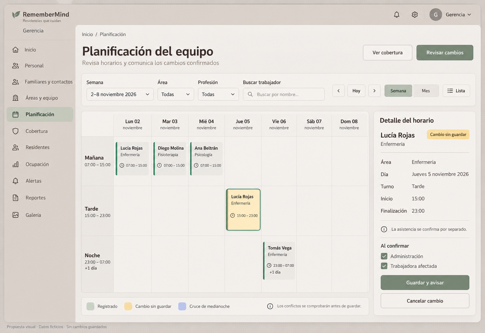
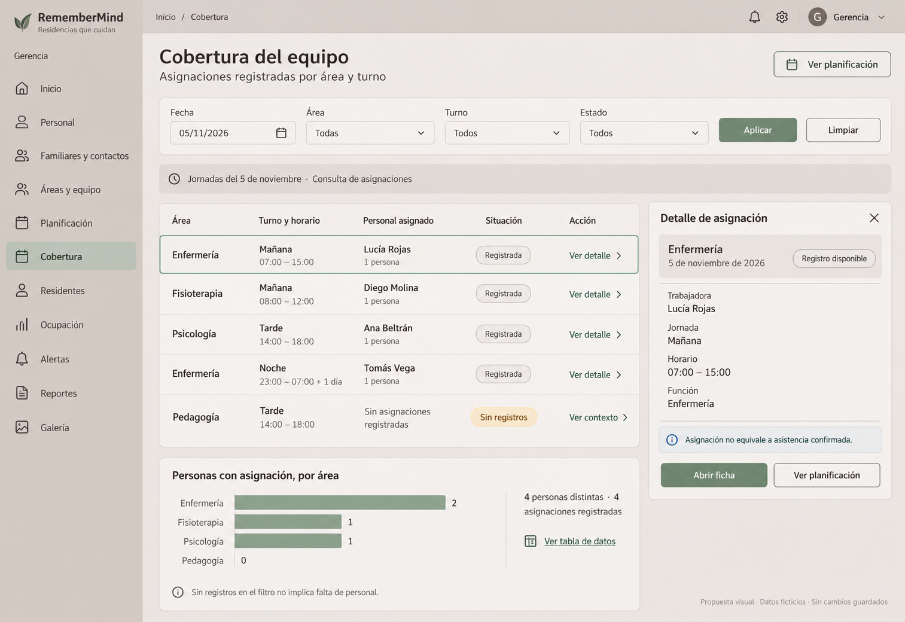

# Diseño propuesto de Planificación y cobertura

## 1. Naturaleza de las imágenes

La propietaria solicitó imágenes detalladas de cómo quedarían las vistas. Se generaron dos propuestas estáticas con datos ficticios; **no son capturas del sistema, no se han aprobado como referencia definitiva y no acreditan implementación**. Los nombres, fechas y horarios ilustran distribución; no son registros añadidos al sistema.

**Refinamiento solicitado el 26/10/2026:** «hay que mejorar un poco el diseño y reutilizar nuestros diseños y componentes, pero esta genial». La composición sirve de base de trabajo; se debe ajustar a los componentes Blade/Livewire, tokens, iconos y marca reales del proyecto antes de implementar. No se adopta una segunda paleta ni el logotipo generado. Contraste, tipografía, geometría de controles y estados requieren QA sobre la pantalla real; la recepción favorable no acredita aprobación definitiva de cada detalle de las imágenes.

Fuentes: [contrato visual institucional](../../../frontend/CONTRATO_VISUAL_UX_UI.md), [tokens de color](../../../../resources/frontend/styles/design-system/tokens/colors.css), [tokens tipográficos](../../../../resources/frontend/styles/design-system/tokens/typography.css), decisiones 21A/22A/23A y especificaciones de [Planificación](14-PLANIFICACION-DEL-EQUIPO.md) y [Cobertura](15-COBERTURA-DEL-EQUIPO.md).

## 2. Imagen 1: planificación semanal

[Abrir imagen completa](imagenes/planificacion-semanal-propuesta-v1.png).

| Zona | Ubicación y composición | Contenido/acción |
|---|---|---|
| Menú | Lateral izquierdo, aproximadamente 220 px en escritorio | Rol Gerencia y navegación ya especificada; Planificación seleccionada |
| Barra global | Superior | Notificaciones, ajustes y cuenta; reutilizar controles existentes, no inventar nuevos permisos |
| Encabezado | Sobre el contenido, a la izquierda | «Planificación del equipo», descripción breve y breadcrumb |
| Acciones de cabecera | A la derecha del título | Ver cobertura como secundaria, Revisar cambios como primaria contextual |
| Filtros | Fila bajo la cabecera | Semana, Área, Profesión, Buscar trabajador; labels visibles |
| Navegación temporal | En la misma barra o segunda fila en tamaños menores | Anterior, Hoy, Siguiente y Semana/Mes/Lista; sin guardar |
| Calendario | Columna principal, aproximadamente 70 % del ancho útil | Siete días, bloques de mañana/tarde/noche solo como ejemplo del catálogo; nombre, función y hora |
| Bloque seleccionado | Dentro del calendario | Borde/tono salvia y estado textual; el cambio sin guardar usa texto y acento ámbar |
| Detalle | Panel derecho, aproximadamente 30 % | Persona, área, día, turno, inicio y finalización; fechas cuando cruza medianoche |
| Aviso del detalle | Debajo del horario | «La asistencia se confirma por separado»; no atribuir presencia por tener asignación |
| Destinatarios | Parte inferior del detalle | Administración y persona afectada; derivados del cambio real, no selección de cuentas ajenas |
| Confirmación | Pie del detalle | Guardar y avisar / Cancelar cambio; confirmar según permiso y backend, sin doble envío |
| Leyenda | Bajo el calendario | Registrado, Cambio sin guardar, Cruce de medianoche, con texto y símbolos |

La imagen contiene pocas personas para mantener legibilidad. En implementación, eventos adicionales requieren resumen y abrir lista, no comprimir texto hasta hacerlo ilegible. No ampliar artificialmente duración, profesión o datos para llenar columnas vacías.

## 3. Imagen 2: cobertura en tabla

[Abrir imagen completa](imagenes/cobertura-equipo-propuesta-v1.png).

| Zona | Ubicación y composición | Contenido/acción |
|---|---|---|
| Menú | Mismo shell | Cobertura seleccionada; misma identidad visual |
| Cabecera | Superior del contenido | «Cobertura del equipo» y subtítulo que aclara que son asignaciones registradas |
| Continuidad | Derecha de cabecera | Ver planificación, conservando filtros pertinentes |
| Filtros | Banda compacta | Fecha, Área, Turno, Estado y Aplicar/Limpiar |
| Contexto | Banda breve bajo filtros | Fecha/jornadas consultadas; evitar ISO técnico o códigos |
| Tabla principal | Aproximadamente 70 % del ancho | Área, Turno y horario, Personal asignado, Situación y Acción |
| Filas | Altura suficiente para nombre y horario | Estado textual y Ver detalle; sin códigos de persona o fuente visibles |
| Detalle | Panel/drawer derecho | Nombre, área, fecha, jornada, horario y función registrados; cierre accesible |
| Aviso | Dentro del detalle | «Asignación no equivale a asistencia confirmada» |
| Acciones de detalle | Pie del panel | Abrir ficha / Ver planificación, solo autorizadas |
| Gráfico auxiliar | Debajo de la tabla, con menos jerarquía | Barras de personas con asignación por área, valores/unidad y tabla alternativa |
| Aclaración | Bajo el gráfico | Sin registros en el filtro no implica falta de personal |

El gráfico del ejemplo tiene Enfermería 2, Fisioterapia 1, Psicología 1 y Pedagogía 0: cuatro personas distintas y cuatro asignaciones. Es un dataset ficticio interno de esa imagen, no una métrica institucional. La imagen semanal es otro ejemplo visual, no la fuente histórica del gráfico de cobertura.

## 4. Colores, tipografía y geometría

El diseño utiliza el lenguaje institucional café grisáceo/capuchino, superficies más claras y salvia para acción, con bordes suaves y sombras discretas. Correspondencia de referencia: lienzo #D8D2CD, shell #D7CEC7, cards #ECE9E6, ventanas #F0EDEA, campos #E7E2DE, texto principal #4F4742 y secundario #6B625C, según contrato vigente. Estos valores son referencias para consolidar tokens existentes, no CSS local nuevo.

Encabezados Nunito Sans, contenido Inter, conforme a fuentes y pesos locales disponibles. Título principal alrededor de 28–32 px; secciones 18–20 px, tabla y controles 14–16 px. Botones de al menos 44 px y padding de tarjetas 16–20 px. Evitar texto diminuto de leyenda; no trasladar dimensiones del raster como unidades normativas.

No nueva paleta por rol, fondos oscuros azules o gradientes decorativos. El render generado puede introducir variaciones de tono, contraste, iconos o acabados: la implementación deberá usar colores sólidos/tokens oficiales y marca existente, no copiar literalmente un logotipo o texto de marca inventado por la imagen. Para botones salvia, la tinta debe alcanzar contraste AA real; un texto blanco dibujado en la propuesta no certifica que cumpla. Medir contraste sobre el componente final y corregirlo con la tinta semántica apropiada.

## 5. Microinteracciones previstas

Hover discreto y foco visible para acciones; fila/evento seleccionado con señal adicional al color. Loading solo mientras hay operación; disabled con explicación cuando falta permiso o selección. Confirmar y cancelar cambios, errores junto al campo y retorno de foco al origen del drawer. Movimiento reducido; sin desplazamiento animado obligatorio o arrastre como única vía de edición.

Cambiar filtros vuelve a consultar y anuncia resultado; no muestra éxito de guardado. Si el usuario intenta cambiar de semana con captura pendiente, ofrece conservar el contexto para terminar o descartar explícitamente. Un aviso persistente de conflicto no desaparece solo con un toast.

## 6. Responsive y límites de verificación

- 1440/1280: calendario o tabla y detalle lateral cuando sean legibles.
- 1024: panel adaptable; no reducir filas/tipografía para forzar dos columnas.
- 768: detalle como drawer/modal accesible; barra de filtros distribuida en varias filas.
- 390: vista lista/agenda como alternativa del calendario, tabla transformada conservando labels, filtros apilados y acciones táctiles. No se produjo una imagen móvil en esta entrega.

Se inspeccionaron las dos imágenes generadas para comprobar composición, nombres legibles, estados y separación de asistencia. Es revisión de propuestas estáticas; **no es PASS de accesibilidad, QA responsive en navegador o aceptación funcional**. Los [28 escenarios](16-ACEPTACION-PLANIFICACION-COBERTURA.md) se ejecutarán al implementar.

Imágenes copiadas al proyecto, manteniendo originales fuera de él; no datos reales, código de aplicación, DB, permisos o mensajes modificados. Variantes posteriores se guardan con versión nueva para conservar comparación.
