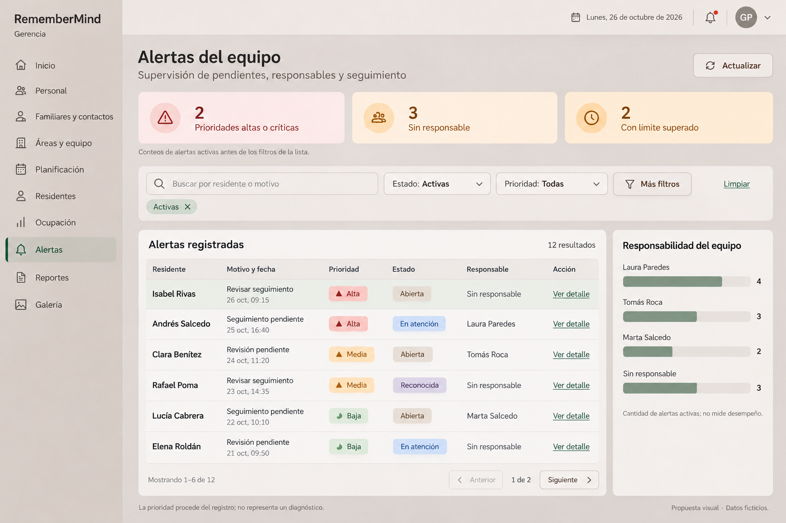
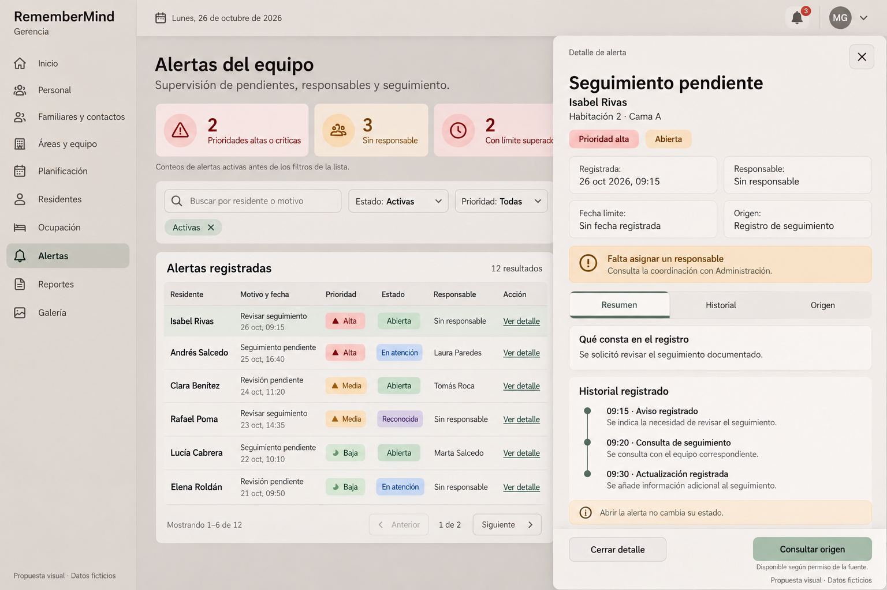

# Propuestas visuales de Alertas

## 1. Naturaleza y ubicación

Dos imágenes generadas a petición de la propietaria, con datos ficticios. Son propuestas de distribución, no capturas de la aplicación ni aprobación definitiva de sus colores, texto o comportamiento. No se añadió ninguno de estos ejemplos a la BDD.

Ubicación funcional: **Gerencia → Alertas**, con entrada desde Inicio y menú; detalle lateral desde «Ver detalle». Reutilizar el módulo actual, no crear otro dashboard. Contratos: [bandeja](21-ALERTAS-GERENCIA.md) y [detalle](22-DETALLE-TRAZABILIDAD-ALERTAS.md). La propietaria pidió mejorar el diseño utilizando nuestros componentes; los tokens y APIs reales gobiernan la implementación, no los píxeles generados.

## 2. Imagen de la bandeja

[Abrir imagen completa](imagenes/alertas-gerencia-bandeja-propuesta-v1.png).

| Zona | Ubicación | Elementos y comportamiento previsto |
|---|---|---|
| Shell | Lateral izquierdo y barra superior | RememberMind, Gerencia, menú actual, Alertas seleccionado; sin crear controles globales nuevos |
| Título | Superior izquierda del contenido | «Alertas del equipo», Nunito Sans; descripción breve en Inter |
| Actualizar | Superior derecha | Botón secundario con icono; relee consulta, muestra carga y última actualización real |
| Indicadores | Primera fila del contenido | Tres cantidades: altas/críticas activas, sin responsable y límite superado; se pueden solapar, no sumarlas como un total |
| Filtros | Debajo de indicadores | Buscador, Estado, Prioridad, Más filtros y Limpiar; chips activos removibles |
| Tabla | Columna principal, aproximadamente tres cuartos del espacio | Seis columnas; nombre destacado, motivo/fecha en dos líneas, prioridad/estado textuales, responsable y Ver detalle |
| Responsabilidad | Columna lateral de menor jerarquía | Barras y cantidades por grupo; alternativa tabular y aviso de que no mide desempeño |
| Paginación | Pie de tabla | Rango, total, anterior/siguiente; preservar filtros |
| Nota | Pie de contenido | Prioridad de origen, sin diagnóstico; caption de propuesta con datos ficticios |

Ejemplo ilustrativo: 12 alertas activas; responsabilidad distribuida 4+3+2+3=12. La primera página contiene seis; 2 altas/críticas y 3 sin responsable. Las dos con límite superado pertenecen al conjunto y no implican que todas las alertas tengan fecha límite. El gráfico y los indicadores no significan doce personas distintas. La selección de Isabel Rivas enlaza con el ejemplo del detalle, sin atribuirlo a un residente existente.

## 3. Imagen del detalle lateral

[Abrir imagen completa](imagenes/alertas-gerencia-detalle-propuesta-v1.png).

| Zona | Ubicación | Elementos y comportamiento previsto |
|---|---|---|
| Fondo | Bandeja atenuada | Conserva consulta/contexto; queda inerte mientras el drawer modal tiene el foco |
| Drawer | Lateral derecho, aproximadamente 580 px en el ejemplo | Superficie neutra, separación/sombra cálida; ancho limitado al viewport |
| Cabecera | Parte superior | Detalle de alerta, motivo en grande, X de cierre de al menos 44 px |
| Residente | Bajo el motivo | Nombre y ubicación actual autorizada, sin PK ni código técnico |
| Badges | Debajo del contexto | Prioridad alta y estado legible; no basta el color para entenderlos |
| Metadatos | Rejilla de dos columnas | Registro, responsable, límite y origen; una columna en móvil |
| Aviso | Bajo los metadatos | Sin responsable, con continuidad hacia coordinación; texto informativo, sin botón de reasignación gerencial |
| Tabs | Zona central | Resumen / Historial / Origen, teclado y selección anunciada |
| Contenido | Panel central desplazable | Resumen breve y extracto de eventos; historia completa autorizada accesible desde su tab |
| Aviso de lectura | Antes del footer | «Abrir la alerta no cambia su estado» |
| Footer | Inferior del drawer | Cerrar detalle / Consultar origen cuando autorizado; botones diferenciados de cerrar la alerta |

La historia es solo ilustración de registros persistidos posibles. «Consulta de seguimiento» representa una actuación registrada en el ejemplo, **no un evento generado por abrir el drawer**. En producto cada evento debe mostrar fecha, autor y contenido realmente conservados; esos autores no están completados en la imagen y no deben inventarse al implementarla.

## 4. Componentes que se reutilizan

| Función | Pieza existente | Adaptación requerida, sin implementación en esta tarea |
|---|---|---|
| Cabecera/filtros | [vista actual](../../../../app/Modulos/Alertas/Presentacion/Vistas/livewire/alertas/alertas-panel.blade.php), [filter-bar](../../../../resources/views/components/ui/filter-bar.blade.php), [field](../../../../resources/views/components/ui/field.blade.php) | Compactar esenciales y expandir secundarios, manteniendo validación y scopes |
| Chips | [alerta-filtro-chips](../../../../resources/views/components/ui/alerta-filtro-chips.blade.php) | Selección visible, aria-pressed, labels humanos |
| Indicadores | [metric-card](../../../../resources/views/components/ui/metric-card.blade.php) o KPI existente del módulo | Confirmar API/semántica de botón; no envolver controles interactivos dentro de otros |
| Equipo | [resumen-trabajo](../../../../app/Modulos/Alertas/Presentacion/Vistas/livewire/alertas/resumen-trabajo.blade.php), [consulta](../../../../app/Modulos/Alertas/Aplicacion/Consultas/ConsultarResumenEquipoAlertas.php) | Representar cantidades y alcance; mantener tope explícito y alternativa tabular |
| Tabla y estados | Tabla existente de la bandeja, [status-badge](../../../../resources/views/components/ui/status-badge.blade.php), [LenguajeAlerta](../../../../app/Modulos/Alertas/Aplicacion/Formato/LenguajeAlerta.php) | Reutilizar traducciones sin cambiar estados originales |
| Drawer | [drawer-livewire](../../../../resources/views/components/ui/drawer-livewire.blade.php), [detalle existente](../../../../app/Modulos/Alertas/Presentacion/Vistas/livewire/alertas/modales/detalle.blade.php) | Vista de lectura gerencial; sin copiar controles de intervención |
| Mensajes/vacío | [callout](../../../../resources/views/components/ui/callout.blade.php), [empty-state](../../../../resources/views/components/ui/empty-state.blade.php) | Ausencia, falta de permiso y error distintos |

## 5. Apariencia y microinteracciones

Consumir el [contrato visual](../../../frontend/CONTRATO_VISUAL_UX_UI.md), [tokens de color](../../../../resources/frontend/styles/design-system/tokens/colors.css) y [tipografía](../../../../resources/frontend/styles/design-system/tokens/typography.css). Propuesta: canvas gris café/crema, lateral capuchino, tabla sólida, salvia para acciones y selección. Rojo suave con tinta fuerte para prioridades realmente altas/críticas; ámbar para límites/pedidos pendientes. «Abierta» no es éxito: usar representación neutral, no verde de finalización.

Títulos de página Nunito Sans según escala; contenido, etiquetas y tabla Inter. No añadir familias por CDN. Jerarquía objetivo: título 28–32 px, secciones 18–20 px, contenido 14–16 px, ayudas legibles sin reducir a 10 px para encajar columnas. Prioridad/cantidad destacada sin competir con todos los elementos. Cards con padding 16–20 px, radios y sombras de componentes oficiales, iconos 20–24 px. Glass limitado a shell/drawer/toolbar; tabla opaca y fallback sólido. No introducir HEX locales en componentes para imitar la imagen.

Hover discreto, foco visible contrastado, active diferenciado, carga anunciada y estado disabled con motivo. Ver detalle cambia solo selección/apertura; tabs no guardan. Transiciones breves usando tokens, sin desplazamientos decorativos y respetando movimiento reducido. Drawer con focus trap, Escape, aria-labelledby/description, fondo inerte y retorno al botón original. No usar notificaciones de «Guardado» en un recorrido de consulta.

Responsive previsto: a 1440/1280 px tabla y panel lateral si ancho útil lo permite; a 1024 px el panel puede pasar debajo; a 768 px filtros secundarios plegables y detalle a ancho disponible; a 390 px resultados compactos con labels o tabla con scroll local, controles táctiles y drawer sin recortes. Mantener alternativa textual a barras. Validación visual, teclado, reflow, contraste AA y modo oscuro siguen pendientes sobre la implementación real.

## 6. Diferencias de las imágenes respecto al contrato

La generación mejora la distribución pero no es un render determinista de nuestros componentes. En la imagen del drawer, el fondo conserva «Abierta» en verde y el indicador de límite en rojo; para implementación prevalece la semántica neutral/ámbar descrita arriba. Las imágenes abrevian estados («Abierta», «Reconocida»); usar las etiquetas de LenguajeAlerta donde correspondan, sin introducir un catálogo nuevo. El fondo se recompone al abrir el drawer: el producto debe conservar la posición real de la lista, no imitar ese reflow generado.

La tipografía, contraste, medidas y proporciones son objetivos aproximados, no métricas verificadas por un PNG. La marca en las imágenes es texto; en producto se reutiliza el asset institucional existente. Los ejemplos no habilitan botones ni fuentes restringidas.

## 7. Procedencia y verificación de assets

Se generaron y refinaron con la herramienta de imágenes integrada el 26/10/2026. Copias finales dentro del proyecto; originales preservados en el directorio de imágenes generado por Codex. No se editaron datos operativos ni se subieron datos de residentes.

| Asset | SHA-256 |
|---|---|
| alertas-gerencia-bandeja-propuesta-v1.png | 98fdce37633e624220f31db8d213b76202aa5c2facf37815582aef0d538beb51 |
| alertas-gerencia-detalle-propuesta-v1.png | b29efa5a2e06d2051d57a483c518e7b7e885084e4e053458e8cfc1f411f5849d |

Imágenes inspeccionadas como propuestas; no atribuirles PASS de QA de aplicación. Los [24 casos](23-ACEPTACION-ALERTAS-GERENCIA.md) requieren implementación y ejecución posteriores.
