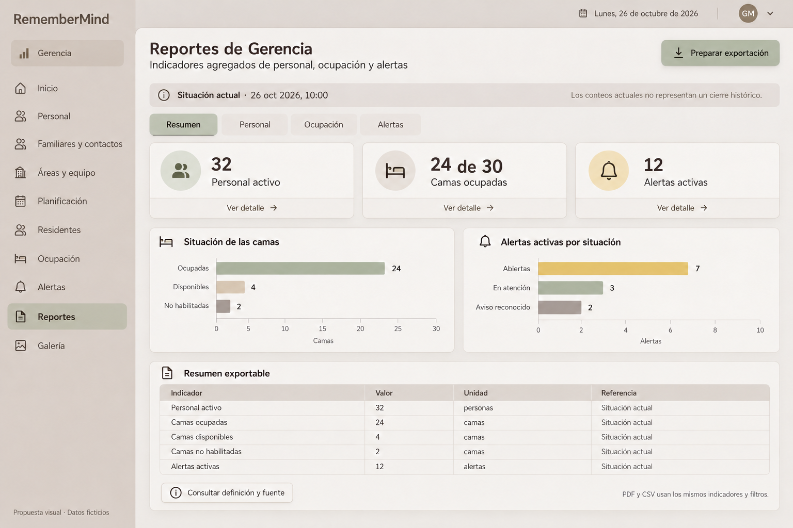
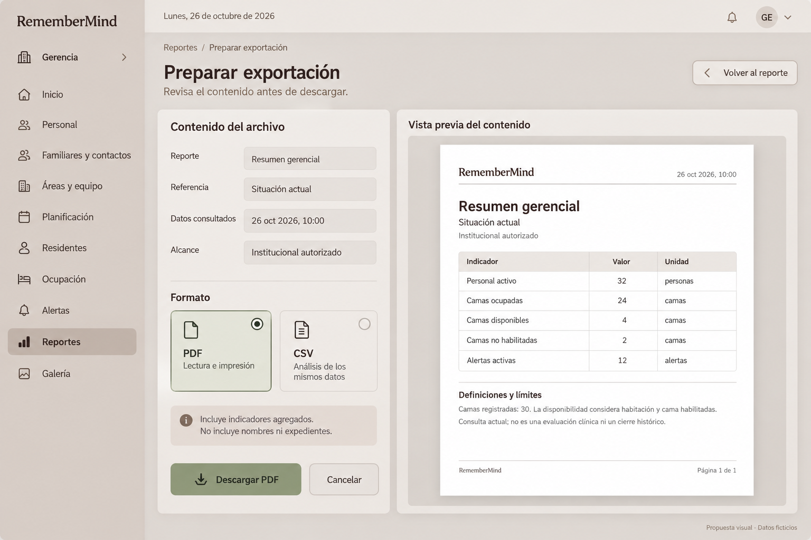

# Propuestas visuales de Reportes

## 1. Ubicación y naturaleza

**Gerencia → Reportes → Resumen / Personal / Ocupación / Alertas → Preparar exportación.** Dos imágenes generadas con datos ficticios a petición de la propietaria. No son capturas de una pantalla implementada ni reportes emitidos de la institución. No se cargaron los ejemplos a la BDD.

La composición traduce la decisión 26B/C y el pedido de reutilizar nuestros componentes. [Contrato de indicadores](25-REPORTES-GERENCIA.md), [exportación](26-EXPORTACION-REPORTES-GERENCIA.md) y [aceptación](27-ACEPTACION-REPORTES-GERENCIA.md) definen el comportamiento; los píxeles de las imágenes no lo sustituyen.

## 2. Vista general

[Abrir imagen completa](imagenes/reportes-gerencia-resumen-propuesta-v1.png).

| Elemento | Ubicación | Apariencia y función |
|---|---|---|
| Shell | Lateral y barra superior | Navegación existente, Reportes seleccionado; cuenta/fecha global sin nuevos permisos |
| Título | Superior izquierda | «Reportes de Gerencia», jerarquía principal y descripción breve |
| Exportación | Superior derecha | Botón salvia con tinta contrastada e icono de descarga; abre preparación, no descarga inmediata |
| Contexto | Banda debajo del título | Situación actual, hora legible y aclaración de que no es cierre histórico |
| Secciones | Bajo contexto | Resumen activo, Personal, Ocupación, Alertas; tabs con estado anunciado |
| Indicadores | Primera fila de tarjetas | Personal activo, camas ocupadas respecto a registradas y alertas activas; icono, cantidad y Ver detalle |
| Camas | Panel izquierdo central | Barras de ocupadas/disponibles/no habilitadas con cantidad y eje en camas |
| Alertas | Panel derecho central | Barras por estados excluyentes y eje en alertas; sin riesgo clínico inferido |
| Tabla | Inferior | Resumen exportable con indicador, valor, unidad y referencia |
| Definiciones | Bajo tabla | Botón secundario Consultar definición y fuente; panel de lectura, no SQL visible |

Ejemplo coherente: 32 trabajadores activos; 30 camas registradas = 24 ocupadas + 4 disponibles + 2 no habilitadas; 12 alertas activas = 7 abiertas + 3 en atención + 2 reconocidas. La imagen inicial decía «Por atender» en la primera barra: se corrigió a **Abiertas**, porque Por atender puede incluir reconocidas. En datos reales deben aparecer los estados originales pertinentes, incluidos asignadas/pendientes si existen; el ejemplo no define un catálogo incompleto como norma.

Los cinco indicadores de la tabla son el conjunto de exportación ilustrado. Los dos gráficos desglosan ese conjunto; si se desean sus categorías en CSV, la selección y vista previa deben incluir también esas filas antes de generar ambos formatos. No enviar columnas o detalles extras ocultos en un formato.

## 3. Preparación de exportación

[Abrir imagen completa](imagenes/reportes-gerencia-exportacion-propuesta-v1.png).

| Elemento | Ubicación | Apariencia y función |
|---|---|---|
| Breadcrumb/título | Superior | Reportes / Preparar exportación; explicación de revisión |
| Volver | Derecha de cabecera | Secundario; mantiene consulta y filtros |
| Contenido del archivo | Columna izquierda | Reporte, referencia, datos consultados y alcance de lectura; no son campos editables |
| Formato | Debajo del contexto | Radios PDF y CSV dentro de tiles; label, icono y ayuda; PDF seleccionado solo en esta ilustración |
| Privacidad | Debajo de formatos | Incluye agregados, no nombres ni expedientes |
| Acciones | Pie de columna izquierda | Descargar PDF o CSV según selección, Cancelar; carga/error y prevención de doble envío |
| Previsualización | Columna derecha, mayor ancho | Papel A4 con título, contexto, misma tabla, definiciones/límites y paginación |

Las dos imágenes comparten cifras, unidades y referencia temporal. El papel no es un archivo PDF realmente generado. La hora de generación y autor de auditoría deben obtenerse del servidor; una captura no prueba que se hayan registrado. Los labels de contexto se muestran como cajas en la imagen: implementación debe tratarlos como lectura (`dl` o equivalente), no inputs habilitados.

## 4. Reutilización de componentes reales

| Necesidad | Pieza localizada | Adaptación prevista |
|---|---|---|
| Shell y cabecera | Layout y navegación del rol; [sidebar](../../../../app/Modulos/Identidad/Presentacion/Navegacion/SidebarService.php) | Conservar identidad, asset de marca y menú reales |
| Tarjetas | [metric-card](../../../../resources/views/components/ui/metric-card.blade.php), [card](../../../../resources/views/components/ui/card.blade.php) | Datos agregados, unidades y acción no anidada en otro control |
| Filtros | [filter-bar](../../../../resources/views/components/ui/filter-bar.blade.php), [field](../../../../resources/views/components/ui/field.blade.php) | Filtros solo si aplican a la fuente; labels/errores locales |
| Barras | [RMCharts](../../../../resources/frontend/styles/design-system/charts/README.md) | Tokens, ciclo de vida de gráficas, resize/tema y tabla alternativa; sin CDN |
| Definición | [drawer-livewire](../../../../resources/views/components/ui/drawer-livewire.blade.php) | Lectura accesible, cierre/Escape/foco; no editor de fórmula |
| Mensajes | [callout](../../../../resources/views/components/ui/callout.blade.php), [empty-state](../../../../resources/views/components/ui/empty-state.blade.php) | Error, cero comprobado y falta de fuente distintos |
| Archivo | [ReportExportService](../../../../app/Modulos/Reportes/Infraestructura/Exportaciones/ReportExportService.php), [plantilla institucional actual](../../../../app/Modulos/Reportes/Presentacion/Vistas/paginas/reportes/institucional/general.blade.php) | Reutilizar infraestructura con proyección agregada; no copiar bloques clínicos/nominales |

No se han implementado estas adaptaciones. Las APIs existentes deben comprobarse al integrar; no se inventa un componente maestro por cada tarjeta de la imagen.

## 5. Diseño, estados y responsive

[Contrato visual](../../../frontend/CONTRATO_VISUAL_UX_UI.md), [colores](../../../../resources/frontend/styles/design-system/tokens/colors.css) y [tipografía](../../../../resources/frontend/styles/design-system/tokens/typography.css) prevalecen sobre la aproximación generada. Canvas gris café/crema, sidebar capuchino, superficies neutras y tabla sólida. Salvia para acción/selección; ámbar para límites pertinentes, rojo solo si el dato/estado lo justifica. No convertir ocupación normal en alarma o verde en promesa clínica.

Nunito Sans para títulos y secciones, Inter para contenido, ayudas y tabla. Jerarquía objetivo de página 28–32 px, sección 18–20 px, contenido 14–16 px, cifra destacada; usar escala/tokens realmente disponibles. La marca de las imágenes es aproximada y cambia de forma entre propuestas: en producto se conserva el asset institucional, no se reproduce esa variación tipográfica. Padding de tarjetas 16–20 px, iconos 20–24 px, botones mínimo 44 px, bordes/radios/sombras compartidos. Glass discreto solo shell/toolbar, no celdas o documento imprimible.

Hover/active discretos, focus visible, loading anunciado, disabled con motivo y errores junto al control. PDF/CSV son radios accesibles; cambiar formato no descarga. Tabs con teclado; drawer de definición con focus trap, Escape y retorno de foco. Tabla con encabezados y unidades, barras con valores alternativos y sin tooltip como único acceso. Respetar movimiento reducido.

1440/1280 px: dos gráficas y preparación en dos columnas si ancho útil lo admite. 1024 px: reducir columnas según espacio real, sin comprimir texto. 768 px: paneles apilados y filtros secundarios plegables. 390 px: una columna, acciones accesibles y tabla con scroll local o presentación etiquetada; hoja previa con zoom/tabla legible, no letra diminuta para encajar A4. Modo oscuro con tokens compartidos; PDF conserva estilo imprimible. QA de estos cinco anchos, teclado, contraste AA y temas está pendiente sobre pantalla implementada, no aprobado por ver un PNG.

## 6. Procedencia y assets

Generación integrada de imágenes el 26/10/2026; propuesta general refinada para evitar solapamiento de categorías. Originales preservados, copias finales dentro del proyecto. Datos ficticios, sin transmisión de registros operativos ni credenciales.

| Archivo | SHA-256 |
|---|---|
| reportes-gerencia-resumen-propuesta-v1.png | bcb41ff6d53735aafaf5fcc984b153ca7d8a9db33df60ac02672e4e98a3d1449 |
| reportes-gerencia-exportacion-propuesta-v1.png | 9070336300e857b2f35da70ae7c0961808134d167c9d534bf3a17587de0be516 |

Los archivos son referencias de diseño, no aprobación final, evidencia de descarga o garantía de accesibilidad. El contrato funcional y los [casos de aceptación](27-ACEPTACION-REPORTES-GERENCIA.md) gobiernan la implementación.
