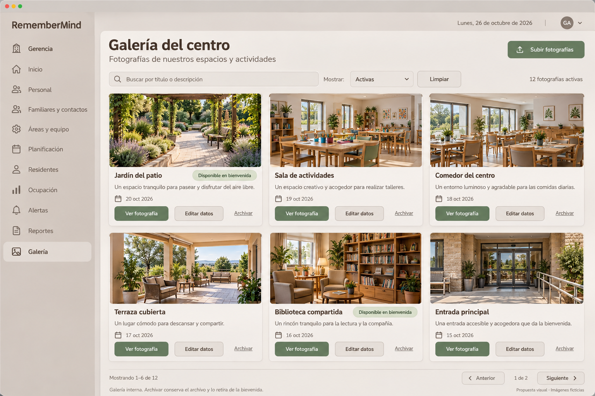
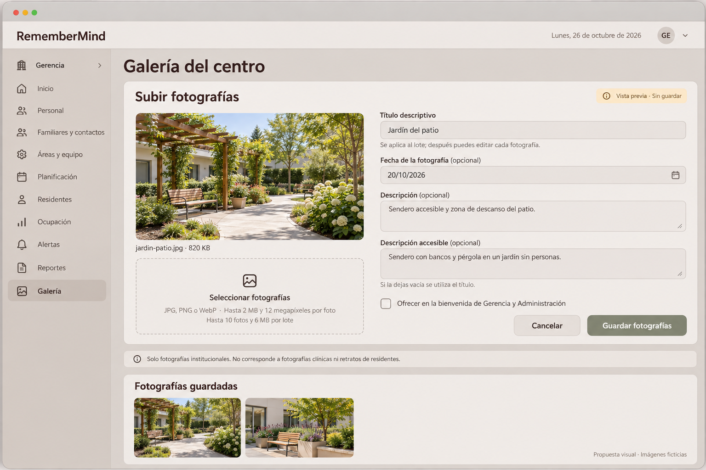

# Propuestas visuales de Galería

## 1. Ubicación y carácter de las imágenes

**Gerencia → Galería → listado / carga / edición.** Dos imágenes generadas con espacios ficticios sin personas. Son propuestas visuales, no capturas de la aplicación ni fotografías de la residencia. No se cargaron estos recursos a la Galería o BDD. [Contrato de vista](29-GALERIA-GERENCIA.md), [formulario](30-CARGA-PRIVACIDAD-GALERIA.md) y [casos](31-ACEPTACION-GALERIA-GERENCIA.md) gobiernan el comportamiento.

## 2. Imagen del listado

[Abrir imagen completa](imagenes/galeria-gerencia-listado-propuesta-v1.png).

| Elemento | Ubicación | Composición y función |
|---|---|---|
| Shell | Lateral y parte superior | Menú de Gerencia, Galería seleccionado, cuenta/fecha institucional; marca real al implementar |
| Título | Superior izquierda del contenido | «Galería del centro» y descripción breve; sin estadísticas decorativas |
| Subir fotografías | Superior derecha | Acción principal de gestión con permiso; abre editor, no sube sin revisión |
| Filtros | Fila bajo título | Buscar título/descripción, Mostrar Activas/Archivadas y Limpiar propuesto |
| Cantidad | Junto a filtros | Total del filtro, no total de imágenes de todas las fuentes del sistema |
| Rejilla | Zona principal | Tres columnas de tarjetas en ejemplo de escritorio; foto 4:3 aproximada, título y descripción breve |
| Metadatos | Bajo imagen | Fecha conocida de fotografía; elegibilidad de bienvenida solo si procede |
| Acciones | Pie de tarjeta | Ver fotografía, Editar datos y Archivar; sin eliminar/publicar/compartir públicamente |
| Paginación | Pie de contenido | Ejemplo 1–6 de 12, controles y contexto; no catálogo completo cortado sin aviso |
| Nota | Pie | Galería interna y efecto de archivar; caption de imágenes ficticias |

El dataset gráfico ilustra doce activas, seis visibles, dos elegibles para bienvenida entre las visibles. No son registros existentes. La implementación actual pagina doce; mostrar seis aquí es una decisión de composición de la propuesta, no una nueva regla o cambio ya aplicado.

## 3. Imagen del editor de carga

[Abrir imagen completa](imagenes/galeria-gerencia-carga-propuesta-v1.png).

| Elemento | Ubicación | Composición y función |
|---|---|---|
| Editor | Bajo cabecera de Galería | Panel inline compartido con listado, no dashboard nuevo |
| Sin guardar | Cabecera del panel | Distingue preview de archivo persistido; desaparece solo tras resultado real |
| Preview | Columna izquierda | Foto seleccionada, nombre/peso temporal y proporción; varias fotos requieren lista de previews, no superposición |
| Seleccionar | Debajo de preview | Control nativo accesible o label asociado, formatos y límites existentes |
| Datos | Columna derecha | Título, fecha opcional, descripción y descripción accesible con labels/ayudas |
| Bienvenida | Bajo campos | Checkbox explícito del conjunto interno aprobado, no publicación externa |
| Pie de formulario | Inferior derecha | Cancelar / Guardar fotografías; loading, errores y prevención de doble envío |
| Advertencia de alcance | Debajo del panel | Fotografías institucionales, no clínica ni retratos de residentes |
| Continuidad | Parte inferior | Listado guardado mantiene contexto; preview no se cuenta como fotografía guardada |

Los jardines de ambas imágenes son ilustraciones distintas; no demuestran igualdad de bytes ni existencia de `jardin-patio.jpg`. El peso 820 KB es ficticio de la selección; no es el peso de este PNG de diseño ni del WebP que guardaría la aplicación. El alt de la foto real debe describir la foto seleccionada, no copiar texto de la propuesta.

## 4. Componentes y diseño reutilizables

| Necesidad | Componente/código existente | Ajuste previsto |
|---|---|---|
| Cabecera | [collection-header](../../../../resources/views/components/ui/collection-header.blade.php) | Conservar jerarquía y slot de acciones autorizado |
| Filtros | [filter-bar](../../../../resources/views/components/ui/filter-bar.blade.php), [field](../../../../resources/views/components/ui/field.blade.php) | Labels, búsqueda y estado de carga consistentes |
| Tarjetas/editor | [card](../../../../resources/views/components/ui/card.blade.php), [vista actual](../../../../app/Modulos/Institucion/Presentacion/Vistas/livewire/galeria-institucional-panel.blade.php) | Compactar descripciones y preservar variantes/errores actuales |
| Avisos/vacío | [callout](../../../../resources/views/components/ui/callout.blade.php), [empty-state](../../../../resources/views/components/ui/empty-state.blade.php) | Resultado parcial, vacío y error diferentes |
| Paginación | [paginacion](../../../../resources/views/components/ui/paginacion.blade.php) | Filtros, página y foco conservados |
| Confirmaciones | [modal-livewire](../../../../resources/views/components/ui/modal-livewire.blade.php) o diálogo institucional existente | Confirmar descarte/archivo con foco; no otra librería o permiso |
| Lectura de imagen | [ruta protegida](../../../../app/Modulos/Institucion/Presentacion/Http/Controllers/FotografiaInstitucionalController.php) | Preservar acceso privado/estado; visor futuro conserva esas condiciones |

Consumir [contrato visual](../../../frontend/CONTRATO_VISUAL_UX_UI.md), [tokens de color](../../../../resources/frontend/styles/design-system/tokens/colors.css) y [tipografía](../../../../resources/frontend/styles/design-system/tokens/typography.css). Superficies crema/gris café, capuchino en shell, salvia para selección/acción; texto marrón contrastado. Nunito Sans títulos, Inter contenido, ayudas y formulario. Tarjetas con padding 16–20 px; controles de 44 px e iconos 20–24 px según tokens. Tabla no es necesaria para explorar fotografías; la rejilla no pierde labels ni acciones al reducir ancho.

Hover/foco/active visibles, estado disabled con motivo, carga anunciada y errores por campo. Movimiento discreto y reducido según preferencia. Confirmación con Escape y retorno al control; no depender del hover para Editar/Archivar. Sin foco en imágenes decorativas innecesarias: preview completa necesita alt apropiado y acción identificable.

Responsive previsto: 1440/1280 px hasta tres columnas si ancho útil admite texto/acciones; 1024 px dos; 768 px adaptar a dos o una según sidebar; 390 px una columna, editor apilado, botones y archivos largos sin recortes. Imagen completa mantiene proporción y zoom accesible, sin impedir cerrar con teclado. QA de esos anchos, contraste AA, tema oscuro y dispositivos sigue pendiente sobre producto real.

## 5. Diferencias respecto a implementación/objetivo

La herramienta generó una barra de ventana de escritorio y texto blanco sobre algunos botones verdes; no son nuevos componentes institucionales. En producto reutilizar el shell existente, sin dibujar controles de sistema operativo, y aplicar tinta/contraste de los tokens, verificándolo sobre la superficie real. La marca y fotografías son aproximaciones, no assets para reemplazar identidad o imágenes guardadas.

La imagen propone Limpiar y un botón visible Ver fotografía; la vista actual abre la foto a través de la miniatura. El editor actual utiliza input nativo y paginación de doce; adaptar sin eliminar validaciones o afirmar que el cambio ya se integró. La descripción accesible se dibuja como textarea, pero el backend sigue máximo 255: no ampliar límites por estética. Estas diferencias quedan explícitas, no se certifica fidelidad exacta o accesibilidad con el PNG.

## 6. Procedencia

Generación integrada el 26/10/2026, originales preservados y copias finales en el proyecto. Sin datos reales o envío de imágenes clínicas.

| Archivo | SHA-256 |
|---|---|
| galeria-gerencia-listado-propuesta-v1.png | ebaf60be29cd7bde8880e9c980c192963f7af51ef239b1d2e486762d9fe3b930 |
| galeria-gerencia-carga-propuesta-v1.png | 513d6247ac43945e0799f95618114218cf81de70efed5f3a4fd97c317fdf0aec |

No atribuir a estas propuestas aprobación visual final, nueva migración, carga institucional real o ejecución de los [casos de aceptación](31-ACEPTACION-GALERIA-GERENCIA.md).
