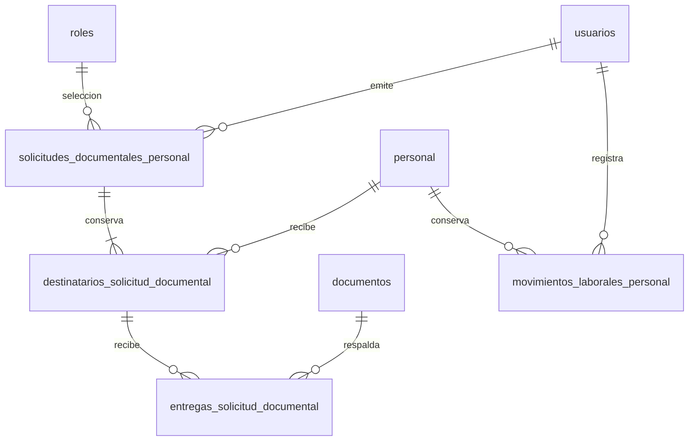

# Diseño aprobado para implementación en bases desechables

**Estado posterior — 27/10/2026:** la propietaria respondió «autorizo» para instalar los diseños35/37. Este diseño quedó instalado en PostgreSQL local, sin cambiar los bytes del DDL revisado. [Decisión específica](../../../base-de-datos/DECISION_GERENCIA_DOCUMENTACION_HISTORIA_2026_10_27.md) e [informe40](40-INSTALACION-AUTORIZADA-Y-PRORROGA-EXPEDIENTE.md): inventario conjunto106 de negocio +16 técnicas. No autoriza despliegues.

La propietaria respondió **«aprobar diseño» el 26/10/2026**, después de aclarar el término candidato y el alcance de ocho columnas y cuatro relaciones. Esa primera decisión aprobó desarrollo e integración en bases desechables; al cierre de ese día todavía no estaba instalado. [AGENTS](../../../../AGENTS.md) exige «request approval before changing the frozen model» y [database/AGENTS](../../../../database/AGENTS.md) prohíbe agregar columnas/tablas/FK sin aprobación específica.

El diseño añade **8 columnas nullable y4 relaciones**, sin retirar ninguna existente. Por separado lleva el inventario anterior de100 a104 de negocio; junto con37, la instalación comprobada deja106 y las mismas16 técnicas. La propuesta inicial no consultó ni modificó la base institucional; la instalación posterior sí está autorizada y enlazada arriba. El máximo de110 no equivale a aprobar otros cambios.

## Problemas comprobados

- `usuarios` no conserva fecha técnica de alta ni obligación de cambio inicial; `personal.fecha_ingreso` es otra fecha.
- `documentos.cod_usuario` identifica al titular. `cod_usuario_validacion` y `fecha_validacion` identifican la revisión, no la carga. No existe fecha de emisión propia.
- No hay solicitud documental con membresía histórica, entregas explícitas o única prórroga. Coincidir por nombre o tipo no acredita una entrega.
- La baja/reactivación laboral requiere motivo y fecha propios. Suspender `usuarios.estado` no representa esa operación.

No se guardarán estos hechos en `observacion`, JSON/EAV, vencimiento de archivo ni una segunda tabla corporativa de auditoría.

## 1. Columnas en relaciones existentes

Todas son nuevas y nullable, sin rellenar el pasado por inferencia. Las PK/FK actuales permanecen. Las fechas usan `timestamp without time zone`, conforme a los `dateTime` actuales, en la zona institucional de la aplicación; se documentará y probará su ida/vuelta. Los actores se derivan siempre de la sesión.

| Tabla | Columna | Tipo | Regla |
|---|---|---|---|
| usuarios | fecha_hora_alta | timestamp | Reloj servidor en nuevas altas; NULL = alta técnica histórica desconocida |
| usuarios | cambio_password_pendiente | boolean | TRUE = cambio requerido; FALSE = obligación atendida/no vigente explícitamente; NULL = no consta, sin inventar cambio histórico |
| documentos | cod_usuario_carga | varchar(20) | FK usuarios.cod_usuario, índice, ON DELETE RESTRICT |
| documentos | fecha_hora_carga | timestamp | Se conserva la carga original; no se sobrescribe al revisar |
| documentos | fecha_emision | date | Fecha propia del documento cuando consta; no se completa con la carga |
| documentos | cod_usuario_anulacion | varchar(20) | FK usuarios.cod_usuario, índice, RESTRICT |
| documentos | fecha_hora_anulacion | timestamp | Instante de la anulación registrada |
| documentos | motivo_anulacion | text | Motivo concreto de anulación laboral |

CHECK carga: autor y fecha ambos NULL o ambos presentes. CHECK anulación: tres campos NULL o los tres presentes, motivo no vacío y estado ANULADO/ANULADA. Los documentos históricos anulados sin esos datos permanecen desconocidos. No se infieren autores desde observaciones. La validación conserva sus columnas y significado actuales.

## 2. solicitudes_documentales_personal

Grano: **una petición emitida de un documento para un rol laboral**, con su contenido original. No es una plantilla permanente, un catálogo o un archivo.

| Columna | Tipo | NULL | Restricción |
|---|---|---|---|
| cod_solicitud_documental | varchar(20) | no | PK |
| rol_id | bigint | no | FK roles.id, RESTRICT; índice. Tipo técnico Spatie, no PK institucional sustituta |
| tipo_documento | varchar(60) | no | Código existente aceptado por el servicio; no crea catálogo ni código nuevo |
| nombre_documento | varchar(160) | no | Nombre concreto pedido; CHECK trim no vacío |
| indicaciones | text | sí | Instrucciones propias de la petición |
| motivo | text | no | CHECK trim no vacío |
| cod_usuario_solicitante | varchar(20) | no | FK usuarios.cod_usuario, índice, RESTRICT |
| fecha_hora_emision | timestamp | no | Reloj servidor |
| clave_solicitud | uuid | no | UNIQUE; reintento de la misma confirmación no duplica petición |

El rol solo selecciona destinatarios; las personas emitidas se conservan aparte. Un documento libre usa un tipo existente compatible —por ejemplo OTROS— y su nombre propio; no se fuerza su equivalencia a CI/título. Las siete funciones laborales autorizadas se comprueban al emitir, sin FK a nombres de roles.

## 3. destinatarios_solicitud_documental

Grano: **una persona destinataria de una petición**, con su plazo original. Puede conservar el acto nominal de concesión; la única prórroga de la misma alta se comprueba en el expediente completo y su efecto se consulta sin copiar ese acto a cada petición.

| Columna | Tipo | NULL | Restricción |
|---|---|---|---|
| cod_destinatario_documental | varchar(20) | no | PK |
| cod_solicitud_documental | varchar(20) | no | FK solicitudes_documentales_personal, índice, RESTRICT |
| cod_personal | varchar(20) | no | FK personal.cod_personal, índice, RESTRICT |
| origen_plazo | varchar(20) | no | CHECK ALTA / SOLICITUD_POSTERIOR |
| fecha_limite_original | date | no | Conservada, no recalculada con el rol actual |
| fecha_limite_prorrogada | date | sí | Solo prórroga de ALTA: original + 7 días calendario |
| cod_usuario_prorroga | varchar(20) | sí | FK usuarios.cod_usuario, índice, RESTRICT |
| fecha_hora_prorroga | timestamp | sí | Reloj servidor |
| motivo_prorroga | text | sí | Motivo no vacío si se prorroga |

UNIQUE(cod_solicitud_documental,cod_personal). CHECK: los cuatro campos de prórroga son todos NULL o todos presentes; solo origen ALTA y nueva fecha exactamente siete días después de la original. Índice de fecha_limite_original. La solicitud posterior usa fecha prospectiva expresa y no recibe prórroga de alta por implicación.

El acto de concesión es una dependencia0..1 de su destinatario de origen; no una lista comprimida. La Action serializa emisión/prórroga y comprueba todas las solicitudes ALTA de la persona con el mismo límite original antes de conceder. Lectura, detalle y avisos consultan ese efecto compartido; las demás filas mantienen sus cuatro campos de prórroga NULL. SQL protege composición y duración por fila, no una unicidad global entre peticiones; varias concesiones introducidas fuera de la Action se muestran como contradicción. El alta diferible usa la fecha técnica original +7 días; el mínimo inmediato no se posterga. Las reglas temporales cruzadas se validan bajo transacción, incluyendo fecha prospectiva, estado y rol originales. No se vuelve obligatorio un respaldo por aparecer en el catálogo.

## 4. entregas_solicitud_documental

Grano: **vinculación explícita de un documento original a un destinatario de una petición**. Un archivo nuevo/corregido conserva su propia identidad en documentos y su cadena anterior.

| Columna | Tipo | NULL | Restricción |
|---|---|---|---|
| cod_entrega_documental | varchar(20) | no | PK |
| cod_destinatario_documental | varchar(20) | no | FK destinatarios_solicitud_documental, índice, RESTRICT |
| cod_documento | varchar(20) | no | FK documentos.cod_documento, índice, RESTRICT |
| cod_usuario_registro | varchar(20) | no | FK usuarios.cod_usuario, índice, RESTRICT |
| fecha_hora_registro | timestamp | no | Instante de vinculación, distinto de carga/emisión |

UNIQUE(cod_destinatario_documental,cod_documento). No copia nombre/archivo/estado de revisión. Bajo bloqueo de destinatario/documento, la Action comprueba titular real vía personal.cod_usuario, tipo compatible, estado no anulado/reemplazado y actor autorizado. Las FK no acreditan solas esta igualdad cruzada; la prueba de integración debe intentar titular y petición equivocados. Ninguna coincidencia automática de texto crea entrega o validación. No se exige un índice UNIQUE global de documento que impida un uso explícito legítimo en otra petición.

## 5. movimientos_laborales_personal

Grano: **transición aplicada de estado laboral**, independiente del acceso, de la admisión y del movimiento de turnos.

| Columna | Tipo | NULL | Restricción |
|---|---|---|---|
| cod_movimiento_laboral | varchar(20) | no | PK |
| cod_personal | varchar(20) | no | FK personal.cod_personal, índice, RESTRICT |
| estado_anterior | varchar(20) | no | CHECK ACTIVO / INACTIVO |
| estado_nuevo | varchar(20) | no | CHECK ACTIVO / INACTIVO, distinto del anterior |
| fecha_hora_efecto | timestamp | no | Fecha efectiva de la transición aplicada |
| fecha_hora_registro | timestamp | no | Reloj técnico de registro |
| cod_usuario_registro | varchar(20) | no | FK usuarios.cod_usuario, índice, RESTRICT |
| motivo | text | no | CHECK trim no vacío |

Índice(cod_personal,fecha_hora_efecto,cod_movimiento_laboral). No se programan bajas futuras con este diseño: fecha de efecto no posterior al registro y sin reescritura del pasado ni inversiones temporales. Si se necesita programación futura, requiere otro contrato antes de añadir estados. Estado de personal y movimiento se confirman atómicamente; el acceso permanece igual. Administración recibe aviso interno y revisa sus asignaciones, sin eliminaciones automáticas.

## Relaciones y normalización

No hay dependencia multivaluada independiente mezclada: petición, persona destinataria, entrega y transición laboral tienen identidades/granos distintos. El historial documental sigue en su relación existente; Activitylog sigue siendo auditoría, no almacenamiento de peticiones. El encabezado requiere al menos un destinatario mediante la operación atómica; una FK no garantiza por sí sola ese mínimo. Las pruebas SQL comprueban restricciones, no demuestran por sí solas 4FN: la justificación se apoya en estos cuatro granos y en la separación de sus colecciones. No se presenta como una auditoría independiente del esquema completo.

## Impacto, instalación y reversión

Consumidores: GuardarPersonalInstitucional, cambios de contraseña Fortify y perfil, DocumentosUsuarioService/Controller, ficha de personal, solicitudes/entregas, avisos internos de plazo y Administración. La recuperación por enlace se reutiliza; no se mandan contraseñas a logs. Las cargas antiguas mantienen NULL y se muestran «No consta».

Después de aprobación: migración candidata aditiva, modelos/Actions/Policies, captura y seguimiento, pruebas SQLite/PostgreSQL desechables, alta y corrección pobladas, reintento/idempotencia/concurrencia, rollback y build. No instalar en remembermind_dev sin verificar expresamente destino/alcance. Despliegue no está autorizado.

Reversión: deshabilitar las nuevas escrituras; las tablas y columnas nuevas solo pueden retirarse automáticamente si están vacías/NULL. Si contienen hechos, detener rollback con mensaje, conservar copia y realizar transición explícita aprobada. Nunca drop de solicitudes, entregas o movimientos poblados para ocultar datos. Prueba de reversión vacía y rechazo de reversión poblada obligatoria.

**Aprobación recibida para este diccionario, sus FK/índices/checks y desarrollo en bases desechables; no constituye aprobación clínica ni autorización de despliegue.** Cualquier cambio al grano o columnas exige actualizar la propuesta antes de instalar. Implementación y resultados reales en el [informe 36](36-RENOVACION-GERENCIA-IMPLEMENTACION-Y-PRUEBAS.md). El DDL ejecutable queda fuera del directorio de migraciones automáticas: [transición propuesta](../../../../database/propuestas/gerencia/2026_10_26_000001_documentacion_y_estado_laboral.php).
