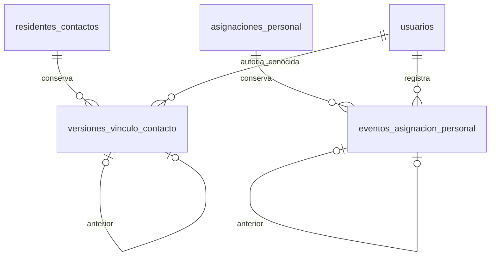

# Propuesta estructural 37 — dos relaciones históricas

**Estado posterior — 27/10/2026:** autorización específica «autorizo» e instalación local comprobada de35/37. [Decisión](../../../base-de-datos/DECISION_GERENCIA_DOCUMENTACION_HISTORIA_2026_10_27.md) e [informe40](40-INSTALACION-AUTORIZADA-Y-PRORROGA-EXPEDIENTE.md). Las condiciones de solicitud de aprobación que siguen describen el corte anterior; el inventario instalado es106 de negocio +16 técnicas. No se aprueban otros DDL o despliegues.

La orden de completar Gerencia no se interpreta como autorización automática de un DDL nuevo. El diseño 35 conserva documentación y cambios laborales, pero no las versiones de vínculos ni las fechas/actos de finalización de asignaciones. Activitylog mantiene la auditoría técnica; no reemplaza estas relaciones de dominio.

## Inventario e impacto

100 tablas de negocio del inventario anterior +4 del diseño35 +**2 de este diseño =106 instaladas**, con las mismas16 técnicas. No elimina columnas, tablas o FK anteriores. No introduce JSON/EAV. DDL exacto en [transición fuera de migraciones automáticas](../../../../database/propuestas/gerencia/2026_10_26_000002_historia_vinculos_asignaciones.php).

## Diccionario físico nominal

### versiones_vinculo_contacto

Grano: una versión completa de los atributos originales de un único vínculo. No representa un contacto ni una cuenta. Los extremos permanecen en residentes_contactos y no se reatribuyen.

| Columna | Tipo/nulabilidad y restricciones |
|---|---|
| cod_version_vinculo | varchar20 PK, código VVC |
| cod_residente_contacto | varchar20 NOT NULL FK restrictiva al vínculo |
| numero_version | integer NOT NULL >0; UNIQUE(vínculo,número) |
| cod_version_anterior | varchar20 nullable; FK compuesta(vínculo,anterior) a UNIQUE(vínculo,versión), impide cadena de otro vínculo |
| parentesco | varchar40 NOT NULL |
| responsable_principal / contacto_emergencia | boolean NOT NULL, independientes |
| autoriza_informacion / autoriza_salida | boolean NOT NULL, reflejan datos conservados; este diseño no autoriza concederlos |
| estado | varchar20 NOT NULL; conserva código original, sin cambiar catálogo |
| observacion | text nullable, contenido original |
| cod_usuario_acto | varchar20 nullable FK usuarios RESTRICT, índice con fecha |
| fecha_hora_acto | timestamp nullable, fecha real de la corrección/registro si consta |
| motivo | text nullable, no vacío cuando hay acto |
| fecha_hora_conservacion | timestamp NOT NULL, momento técnico de conservación, distinto del acto original |

CHECK: autor/fecha/motivo todos NULL o todos presentes. Una línea base antigua conserva esos NULL; no se inventa su autor/fecha. Primera versión sin anterior; siguientes con anterior. La Action bloquea el vínculo, conserva línea base antes del cambio y nueva versión atómicamente. Los consentimientos conservan su FK al vínculo estable.

### eventos_asignacion_personal

Grano: un acto sobre una asignación concreta de una jornada, persona y área. La ocurrencia original y su ventana se consultan desde asignación/jornada/turno; el turno referenciado no permite alterar sus horas. No inventa una entidad recurrente ni un grupo serializado.

| Columna | Tipo/nulabilidad y restricciones |
|---|---|
| cod_evento_asignacion | varchar20 PK, código EAP |
| cod_asignacion_personal | varchar20 NOT NULL FK asignaciones_personal RESTRICT |
| numero_evento | integer NOT NULL >0, UNIQUE(asignación,número) |
| cod_evento_anterior | varchar20 nullable; FK compuesta a evento de la misma asignación |
| tipo_evento | varchar20 NOT NULL CHECK ALTA/FINALIZACION/CANCELACION/RECTIFICACION |
| estado_anterior | varchar20 nullable: NULL en alta sin anterior |
| estado_nuevo | varchar20 NOT NULL, código realmente aplicado |
| fecha_hora_efecto | timestamp NOT NULL; fecha efectiva expresamente indicada |
| fecha_hora_registro | timestamp NOT NULL, reloj servidor |
| cod_usuario_registro | varchar20 NOT NULL FK usuarios RESTRICT; índice con fecha |
| motivo | text NOT NULL CHECK trim no vacío |

Primero sin anterior; siguientes encadenados y serializados mediante lock de asignación. No se inventan eventos para asignaciones antiguas; una finalización nueva puede ser el primer acto conservado y mantiene estado anterior real. Al finalizar desde una fecha se preservan las ocurrencias previas y se cancelan únicamente las afectadas según revisión visible.

## Relaciones, 4FN y consumidores

Cada relación tiene un solo hecho y no mezcla colecciones independientes. Atributos de una versión dependen de su versión completa; los eventos dependen de su identidad de acto. No se usan pares nombre/valor ni propietarios polimórficos. Las FK compuestas impiden encadenamientos cruzados. Checks SQL no demuestran toda la4FN: la justificación descansa en los granos separados.

Consumidores: GestionarRedApoyo, consultas de red, GestionarHorariosPersonal y formulario/historial existentes. Política y permisos existentes permanecen. Vista explica ausencia de historia previa; no reconstruye aprobaciones desde texto.

## Pruebas, instalación y reversión

Se ensayaron SQLite/PostgreSQL desechables antes de instalar: FK cruzada, unicidad, grupos NULL, secuencia, transacción/rollback y recuperación de línea base/acto. El DDL permanece fuera de database/migrations y se instaló mediante su ruta explícita con la decisión específica del27/10. Reversión vacía retira ambas; poblada se rechaza y conserva hechos. La instalación verificada permite actualizar el inventario vigente. La aprobación proviene de la decisión, no del nombre de esta propuesta o de existir código.

## Prototipo ejecutado y protección de historia

`GerenciaHistoriaNominalTest`: tres casos iniciales/21 aserciones en SQLite, con conservación de versiones, línea base anterior desconocida, eventos de asignación y reversión vacía. Grupo PostgreSQL temporal con Contactos y acceso Familiar:14 pruebas/75 aserciones. Se añaden negativos SQL y concurrencia al cierre; estos resultados iniciales no equivalen a pruebas que todavía no se hayan ejecutado.

El DDL exacto incorpora triggers de inmutabilidad que rechazan UPDATE/DELETE de ambas relaciones históricas: SQLite utiliza triggers por operación; PostgreSQL usa `ger_historia_inmutable()` y un trigger por tabla. No alteran la tabla corporativa Activitylog. Su reversión solo retira triggers/función con tablas vacías. Las cuatro relaciones del diseño35 permanecen independientes y sin cambios.

**Revisión posterior de integridad:** cada cadena tiene además un trigger BEFORE INSERT que exige el anterior ya existente, del mismo propietario y con número exactamente n−1. Junto con las claves únicas impide autoenlaces, saltos y ramas. PostgreSQL utiliza dos funciones nominales adicionales, retiradas por `down()` después de las tablas vacías; SQLite usa triggers propios. La revisión independiente detectó y corrigió esta brecha antes de proponer instalación. `GerenciaHistoriaNominalTest` prueba ambos granos en SQLite/PostgreSQL; el [informe38](38-INTEGRACION-CONTACTOS-PLANIFICACION-Y-ACEPTACION.md) conserva resultados posteriores y los límites de instalación. **No se ha aprobado ni instalado37 institucionalmente.**
