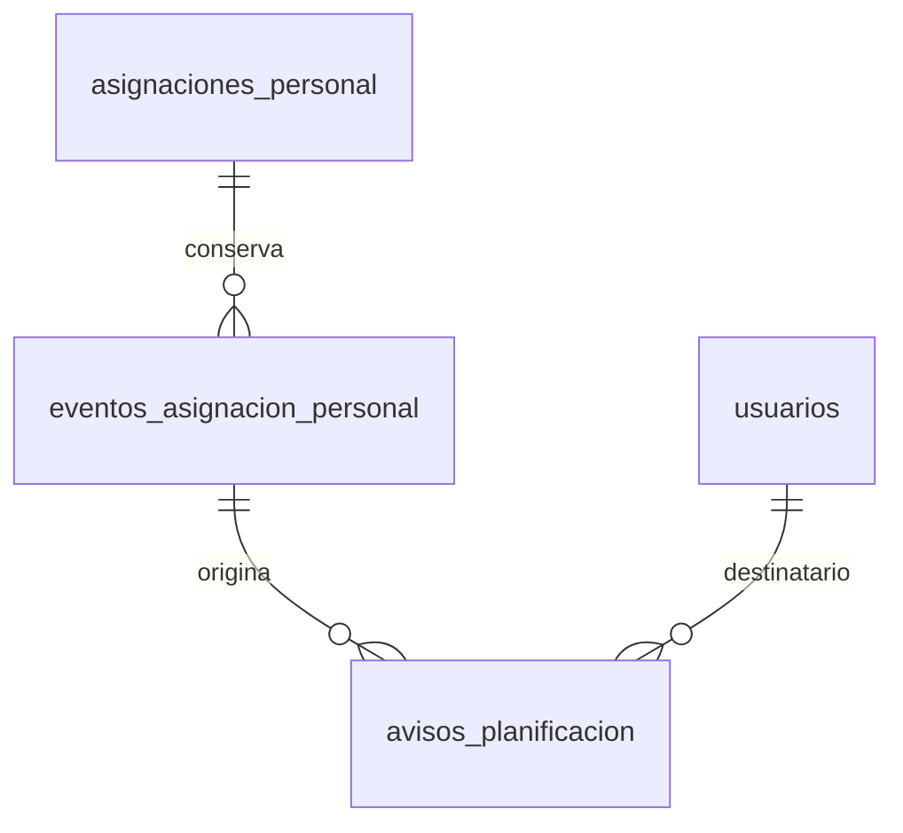

# Decisión requerida para cerrar PC14/PC15

**Decisión posterior de la propietaria — 27/10/2026:** «NO APRUEBO LA CREACION DE NINGUNA TABLA MAS, PUEDES AMPLIAR CAMPOS EN TABLAS NO CREAR OTRAS». Esta propuesta de una tabla queda **rechazada y nunca instalada**. Su DDL y Model propuestos se retiraron del árbol ejecutable, al igual que la prueba que los creaba. Los logs de ensayo conservan únicamente evidencia histórica del diseño rechazado, no aceptación del reemplazo. El inventario permanece106. El texto siguiente es antecedente de diseño; no autoriza instalarlo ni conceder sus permisos.

El contrato23A ya adoptado requiere avisos internos a Administración y al
trabajador afectado después de confirmar cambios de planificación. No
autoriza por sí solo cambiar el esquema congelado o conceder permisos.
Se solicita aprobar **una tabla nominal y dos permisos**, con los estados
técnicos y alcances que se detallan aquí. No solicita nuevas alertas clínicas,
correo, acuses de lectura, firmas, borradores de horarios o cambios de jornada.

Fuentes: [Planificación](14-PLANIFICACION-DEL-EQUIPO.md),
[PC14/PC15](16-ACEPTACION-PLANIFICACION-COBERTURA.md),
[instalación35/37](40-INSTALACION-AUTORIZADA-Y-PRORROGA-EXPEDIENTE.md),
[baseline](../../../base-de-datos/REMEMBERMIND_BDD_BASELINE_CONGELADO.md) y
[gobierno BDD](../../../../database/AGENTS.md).

## Brecha real y alternativa sin cambio estructural

`eventos_asignacion_personal` conserva el acto de dominio, pero no sus cuentas
destinatarias, disponibilidad en la bandeja ni intentos. `activity_log`
audita técnicamente; jobs y caché son infraestructura de transporte y no
reemplazan esa relación. No se escribe una lista en observación o JSON/EAV.

Una consulta derivada de eventos puede mostrar información al trabajador y
Administración actuales, sin DDL. No conserva los destinatarios originales o
su seguimiento y no puede declarar entrega, lectura o reintento durable;
no cierra íntegramente PC15. Esta propuesta conserva ese grano explícito.

## Diccionario físico exacto — avisos_planificacion

Grano: **un aviso de un evento concreto para una cuenta destinataria**.
Un mismo destinatario puede ser Administración y afectado; conserva los dos
motivos sin duplicar el aviso. No copia asignaciones, residentes o datos
clínicos. La identidad física propuesta sigue el código `COD_AVP_000001`.

| Columna | Tipo | NULL | Significado/restricción |
|---|---|---|---|
| cod_aviso_planificacion | varchar(20) | no | PK nominal, generador existente, prefijo AVP |
| cod_evento_asignacion | varchar(20) | no | FK a eventos_asignacion_personal, ON DELETE RESTRICT |
| cod_usuario_destinatario | varchar(20) | no | FK a usuarios.cod_usuario, ON DELETE RESTRICT |
| por_administracion | boolean | no | Pertenecía al conjunto de Administración destinatario al confirmar |
| por_afectacion | boolean | no | Cuenta del trabajador afectado al confirmar |
| fecha_hora_creacion | timestamp | no | Instante técnico de captura de membresía; zona institucional |
| estado | varchar(16) | no | PENDIENTE/DISPONIBLE/FALLIDO; valor inicial PENDIENTE |
| numero_intentos | integer | no | Intentos de disponibilidad; inicial0, no contador de lecturas o correos |
| fecha_hora_ultimo_intento | timestamp | sí | Instante del último intento efectivo |
| fecha_hora_disponible | timestamp | sí | Momento de incorporación a la bandeja; no es acuse |
| categoria_fallo | varchar(40) | sí | Únicamente FALLO_DISPONIBILIZACION; sin excepción/SQL/documentos |

### Integridad e índices

- UNIQUE(evento,destinatario). La FK de evento queda cubierta por este índice;
  índice compuesto(destinatario,estado,creación) e índice de estado.
- CHECK al menos uno de los dos motivos verdadero.
- PENDIENTE:0 intentos y fechas de intento/disponibilidad/categoría NULL.
- DISPONIBLE: intento positivo, ambas fechas presentes e iguales, sin categoría.
- FALLIDO: intento positivo, fecha de intento presente, disponibilidad NULL y
  categoría nominal indicada.
- Intento nunca anterior a creación. Identidad, evento, destinatario, motivos
  y creación inmutables mediante trigger. No permite reducir intentos,
  revertir un DISPONIBLE o borrar físicamente el aviso.
- Estados y restricciones de asignaciones/jornadas existentes no cambian.

El DDL propuesto fue retirado tras el rechazo. No se instaló en `remembermind_dev`, no se activó el flag ni se concedieron los permisos propuestos a roles instalados.

## Normalización e inventario

Los datos dependen de la identidad del aviso(evento,cuenta). No se mezclan
colecciones de intentos o receptores en una fila. Los dos motivos booleanos
son atributos de esa membresía, no una lista serializada. El contador y último
resultado representan el estado de transporte; los intentos anteriores se
auditan como operaciones técnicas en Spatie, sin otra auditoría corporativa.
No se afirma guardar un historial de lecturas o cada ejecución como entidad
de dominio independiente. Esta separación de granos evita dependencias
multivaluadas independientes en el aviso; no es una certificación global de4FN.

Inventario instalado actual: **106 de negocio +16 técnicas**. Con aprobación
e instalación de este DDL: **107 de negocio +16 técnicas =123 físicas**,
82 operativas +25 expertas. Conserva margen hasta110 y no retira relaciones.

## Permisos y alcance propuestos

| Permiso | Roles propuestos | Restricción de backend |
|---|---|---|
| avisos_planificacion.ver | Gerencia, Administración, seis roles profesionales y Superadministración; Familiar excluido | Cuenta activa. Receptor ve únicamente sus filas disponibles, con competencia actual de Administración o vínculo propio activo. Lectura no concede otras fuentes |
| avisos_planificacion.gestionar | Gerencia, Administración y Superadministración | Además requiere turnos.asignar, rol vigente y ausencia de preview. Gerencia/Superadministración inspeccionan pendientes/fallos institucionales; Administración únicamente de cambios cuyo autor original es su cuenta |

No se conceden estos permisos a roles instalados antes de la decisión.
Solo se crean y asignan en fixtures de bases desechables. Reintento vuelve
a autorizar después de adquirir el bloqueo. Una concesión aislada a Familiar
no permite el acceso ni el reintento.

La lista de destinatarios se calcula dentro de la transacción del evento:
cuentas activas, personal activo y no Familiar; Administración o cuenta
vinculada al trabajador afectado. Motivos se conservan aunque cambie el rol;
la consulta exige además el alcance vigente. Un rol nuevo posterior no recibe
retrospectivamente el aviso. No se recalcula membresía al reintentar.

## Flujo y semántica técnica a adoptar

1. Guardar asignación y evento con sus destinatarios en una transacción.
   Captura sin guardar, cancelación o rollback no producen avisos.
2. Después del commit, encolar el código de evento mediante la cola Laravel
   existente. El payload técnico lleva el código; no expediente clínico.
3. Publicar cada aviso con bloqueo y transacción propios. DISPONIBLE significa
   que puede consultarse en la bandeja interna; no leído o entregado fuera.
4. Fallo de publicación: conservar FALLIDO y categoría segura; la asignación
   confirmada no se revierte ni se vuelve a guardar.
5. Si falla la cola o el proceso se interrumpe después del commit, las filas
   PENDIENTE permiten recuperación manual autorizada. Un worker detenido no
   se presenta como comunicación entregada.
6. Reintento de PENDIENTE/FALLIDO utiliza la misma fila. Si otro proceso ya
   la dejó DISPONIBLE, termina sin otro intento, aviso o auditoría de éxito.

Bandeja compartida existente: sección propia de planificación, máximo50 filas
explícito, fechas y contexto comprensibles, estado de preparación y botón de
reintento cuando corresponde. No es otra alerta clínica ni notifica residentes.
Consultar no marca leído; no se implementa acuse sin una decisión distinta.

Los fallos del callback posterior al commit se contienen/reportan para no
anunciar falsamente que un horario confirmado falló. Si ni siquiera se puede
persistir el fallo de transporte, el error técnico se reporta; no se inventa
un intento confirmado y la fila pendiente queda recuperable al restablecer SQL.

## Instalación y reversión propuestas

Se ensaya el DDL únicamente en SQLite/PostgreSQL temporales, tras35/37. El
flag `remembermind.avisos_planificacion_habilitados` queda **false** por defecto.
La futura instalación requiere respaldo, hash revisado, aprobación explícita,
inventario comprobado y grants exactos. Solo después se puede habilitar.
No modifica usuarios existentes, eventos históricos o asignaciones para
fabricar destinatarios anteriores.

Rollback vacío: retirar exclusivamente esta relación y sus triggers/función.
Poblado: `down()` rechaza el retiro para conservar la historia. Apagar el flag
y detener nuevos despachos no elimina filas ni justifica borrar sus datos;
una transición poblada requiere análisis y decisión específicos.

Código, scripts y pruebas se documentarán en el informe de este hito; la
aprobación e instalación se registrarán separadamente si se reciben.
