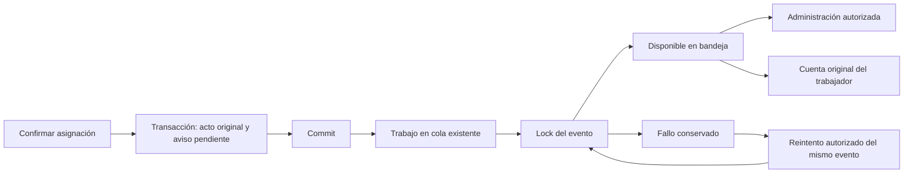

# Alcance terminado y decisión vigente

PC14/PC15 se implementan con **un aviso compartido por cambio**, alcance
adoptado expresamente por la propietaria. Se amplía el evento existente con
seis columnas; **no se crea ninguna tabla ni permiso**. La
[decisión específica](../../../base-de-datos/DECISION_AVISO_COMPARTIDO_CAMPOS_2026_10_27.md)
y el [diccionario43](43-AVISOS-SIN-TABLAS-NUEVAS.md) identifican el diseño.
La propuesta42 de otra tabla sigue rechazada.

El flujo autoriza la consulta y el reintento, conserva el acto y su afectado,
publica después del commit y permite recuperarlo sin guardar otra asignación.
No certifica lectura, entrega individual a administradores ni asistencia.
No acredita la aceptación de todos los212 casos de Gerencia o del experto.

## Arquitectura y recorrido



- `ConservarEventoAsignacion` inserta el snapshot singular y PENDIENTE junto
  con ALTA/FINALIZACION/CANCELACION/RECTIFICACION. Rollback no encola el aviso.
- `GestionarAvisosPlanificacion` coordina afterCommit, lock, idempotencia y
  fallos. Un fallo de cola deja PENDIENTE; uno de publicación conserva FALLIDO.
  La operación principal ya confirmada no se anuncia como revertida.
- `PublicarAvisoPlanificacion` usa la cola Laravel existente. El trabajo SQL
  real fue ejecutado en una base desechable, además de las pruebas síncronas.
  La cola nominal `planificacion` evita procesar trabajos de correo al
  levantar un worker exclusivo. `composer dev` incorpora esa cola al listener
  habitual junto con las colas que ya atendía.
- `ConsultarAvisosPlanificacion` valida la capacidad instalada y aplica el
  ámbito en SQL antes de paginar o limitar. No reconstruye eventos desconocidos.
- La bandeja `/admin/avisos-planificacion` pagina15 registros. La campana
  muestra los últimos cinco de su ámbito y el total, con acceso a todos.
- Gerencia llega desde «Ver avisos» en Planificación. Los trabajadores y
  Administración llegan desde la campana. Reintentar ofrece carga, bloqueo
  del botón y confirmación correspondiente al estado efectivamente guardado.

La disponibilidad automática necesita el worker de la cola configurada que
escuche `planificacion` (incluido por `composer dev`).
Si la cola no procesa, Gerencia puede preparar el aviso pendiente desde esta
bandeja. No se crea un segundo planificador, correo ni servicio externo.

## Persistencia, normalización e historia

Inventario institucional: **106 tablas de negocio +16 técnicas =122 físicas**,
antes y después de la ampliación. Las seis columnas pertenecen al grano
singular evento/publicación. No hay JSON/EAV ni destinatarios repetidos.
Una bandeja administrativa compartida no almacena membresías individuales.
No se afirma una certificación global de4FN por la sola ejecución de CHECK.

Los atributos originales y la cuenta afectada son inmutables. Los eventos
previos conservan sus seis campos NULL. No se inicializa historia desconocida
ni se limpia seguimiento mediante NULL. DISPONIBLE es terminal.
El reintento bloquea la fila y devuelve el estado disponible sin incrementar
el contador otra vez; no invoca la acción de guardar asignaciones.

La función histórica compartida de vínculos no se modifica. Solo cambia el
trigger del evento para permitir sus cinco metadatos técnicos. El rollback
adquiere bloqueo exclusivo antes de comprobar la ausencia de seguimiento;
rechaza retirar columnas si existe cualquier aviso conservado.

## Seguridad y límites

La [matriz de alcance adoptada](../../../base-de-datos/DECISION_AVISO_COMPARTIDO_CAMPOS_2026_10_27.md#alcances-de-consulta-y-recuperación)
se aplica en el backend. Cuenta activa, rol y permiso vigentes se revalidan
tras esperar un lock. Administración no reintenta actos de otro emisor.
La consulta propia exige personal activo y coincidencia con la cuenta
original; el rol Familiar queda excluido.

No se conceden permisos clínicos ni se usa `alertas.ver` como permiso de
gestión laboral. El texto del aviso muestra tipo, persona, jornada, área,
turno, fecha efectiva y situación tras el cambio; no expone motivo libre,
identificadores internos, expedientes clínicos o excepciones técnicas.
El estado publicado no es un recibo individual ni modifica la asistencia.

Activitylog conserva publicaciones y fallos con el contador de intento;
no se añade una tabla corporativa de auditoría ni un registro de lecturas.

## Trazabilidad de código y aceptación

| Requisito | Código | Prueba/evidencia |
|---|---|---|
| PC14: solo postcommit, afectado y compartida | ConservarEventoAsignacion, GestionarAvisosPlanificacion | `test_aviso_unico_se_publica_despues_del_commit_y_conserva_el_afectado`, rollback y bandeja compartida |
| PC15: fallo y recuperación sin repetir | GestionarAvisosPlanificacion, PublicarAvisoPlanificacion | fallo postcommit, cola indisponible, cola SQL real y dos publicadores |
| Historia y estructura | DDL000003, EventoAsignacionPersonal | GerenciaCamposAvisoEstructuraTest, reversión concurrente PostgreSQL |
| IDOR y permisos vigentes | ConsultarAvisosPlanificacion, autorizarReintento | cuenta suspendida, permiso revocado durante espera, otro emisor, Familiar, >50 ajenos |
| UI por rol y foco | AvisosPlanificacionPanel, CampanaNotificaciones | Laravel/Livewire en navegador, cinco anchos, Escape y retorno del foco |

Rutas completas de implementación:

- `app/Models/EventoAsignacionPersonal.php` (artefacto local del corte, no incluido en esta rama).
- [`ConservarEventoAsignacion`](../../../../app/Modulos/Institucion/Aplicacion/Acciones/ConservarEventoAsignacion.php).
- `app/Modulos/Institucion/Aplicacion/Acciones/GestionarAvisosPlanificacion.php` (artefacto local del corte, no incluido en esta rama).
- `app/Modulos/Institucion/Aplicacion/Consultas/ConsultarAvisosPlanificacion.php` (artefacto local del corte, no incluido en esta rama).
- `app/Modulos/Institucion/Infraestructura/Jobs/PublicarAvisoPlanificacion.php` (artefacto local del corte, no incluido en esta rama).
- `app/Modulos/Institucion/Presentacion/Livewire/Paginas/AvisosPlanificacionPanel.php` (artefacto local del corte, no incluido en esta rama) y `app/Modulos/Institucion/Presentacion/Vistas/livewire/avisos-planificacion-panel.blade.php` (artefacto local del corte, no incluido en esta rama).
- [`CampanaNotificaciones`](../../../../app/Modulos/Alertas/Presentacion/Livewire/Funcionalidades/CampanaNotificaciones.php) y [vista](../../../../app/Modulos/Alertas/Presentacion/Vistas/livewire/alertas/campana-notificaciones.blade.php).
- `database/propuestas/gerencia/2026_10_27_000003_campos_aviso_evento_asignacion.php` (artefacto local del corte, no incluido en esta rama), [configuración](../../../../config/remembermind.php), [registro de rutas](../../../../app/Modulos/Institucion/Presentacion/Rutas/web.php) y [grupo autenticado](../../../../routes/web.php).
- [`composer dev`](../../../../composer.json) incorpora la cola de planificación sin cambiar dependencias.

## Pruebas realmente ejecutadas

| Entorno/grupo | Resultado |
|---|---|
| Específicas SQLite en memoria | **16 pruebas /109 aserciones, PASS** |
| Específicas PostgreSQL18 desechable | **20 pruebas /152 aserciones, PASS** |
| Regresión relacionada SQLite, corte previo a los dos casos adicionales de cola SQL y cambio de cuenta | **68 pruebas /745 aserciones, PASS** |
| Navegador real | Un recorrido PASS con Gerencia, Administración y afectado;1440/1280/1024/768/390px, teclado/carga/confirmación y tema oscuro390 |
| Vite | PASS; permanece advertencia de tamaño de chunk, sin error de build |

No sumar filtros solapados. Cuatro casos PostgreSQL usan procesos y bloqueos
reales: dos reintentos del mismo aviso, suspensión mientras espera, revocación
de permiso mientras espera y rollback que espera un INSERT concurrente antes
de rechazar la retirada de su seguimiento. SQLite no acredita esos bloqueos.

El navegador encontró inicialmente un403 del arnés al cambiar de actor con
la sesión de Gerencia. Se corrigió separando las sesiones, sin relajar
autenticación ni middleware del producto. No se cuenta ese intento como PASS.

```powershell
./scripts/probar-sqlite.ps1 -Filtro 'GerenciaAvisoCompartidoTest|GerenciaCamposAvisoEstructuraTest' -Informe output/auditoria-integral-20261025/gerencia-aviso-compartido-cierre-sqlite.xml -Log output/auditoria-integral-20261025/gerencia-aviso-compartido-cierre-sqlite.txt
./scripts/probar-postgres.ps1 -Filtro 'GerenciaAvisoCompartidoTest|GerenciaCamposAvisoEstructuraTest' -Informe output/auditoria-integral-20261025/gerencia-aviso-compartido-cierre-postgres.xml -Log output/auditoria-integral-20261025/gerencia-aviso-compartido-cierre-postgres.txt
./scripts/probar-sqlite.ps1 -Filtro 'GerenciaAvisoCompartidoTest|GerenciaCamposAvisoEstructuraTest|GerenciaHistoriaNominalTest|GerenciaPlanificacionSeguridadTest|PersonalInstitucionalHorariosTest|AlertasFlujosPorRolTest|AlertasRolesConsistenciaTest' -Informe output/auditoria-integral-20261025/gerencia-aviso-compartido-regresion.xml -Log output/auditoria-integral-20261025/gerencia-aviso-compartido-regresion.txt
$env:RM_GERENCIA_QA_AMPLIACION='1'; $env:RM_GERENCIA_QA_HISTORIA='1'; $env:RM_GERENCIA_QA_AVISOS='1'
node --test tests/Frontend/gerencia-renovacion-e2e.test.js
Remove-Item Env:RM_GERENCIA_QA_AMPLIACION,Env:RM_GERENCIA_QA_HISTORIA,Env:RM_GERENCIA_QA_AVISOS
npm run build
./scripts/auditar-aceptacion-gerencia.ps1
```

JUnit/logs/capturas y manifiesto se conservan localmente bajo
`output/auditoria-integral-20261025/`. El inventario de212 casos enlaza PC14/15
a métodos realmente aprobados; los demás casos no pasan automáticamente.

## Instalación y conservación local

**Instalado y habilitado localmente el27/10/2026.** Un respaldo privado de
6.684.763 bytes fue verificado mediante su catálogo antes de modificar el
esquema. No se incorpora el respaldo al repositorio ni a documentación pública.
La instalación se limitó al DDL000003, dentro de una transacción con bloqueo
de tabla; no ejecutó todas las migraciones pendientes ni seeders.

DDL ensayado e instalado SHA-256:
`e72cb423eb479ebec977c5180d257df1be041d46ef78aa20c8129482e054acf4`.

Verificaciones reales:

- Mismo inventario106+16; seis columnas presentes.
- Huella del contenido original y número de eventos idénticos.
- Seguimiento anterior NULL, sin inicialización retrospectiva.
- Función histórica compartida y trigger de vínculos idénticos.
- Dos CHECK y una FK nuevos validados; dos índices y trigger histórico activos.
- Migración específica registrada una sola vez.
- `AVISOS_PLANIFICACION_HABILITADOS=true` aplicado únicamente a esa clave
  local; no se documentan claves SMTP ni se cambia el remitente protegido.

Evidencias locales: `gerencia-campos-aviso-manifiesto.json`,
`gerencia-campos-aviso-instalacion.json` y
`gerencia-campos-aviso-verificacion.json`. La copia privada conserva su SHA-256
en el acta. Una consulta posterior confirmó la capacidad activa. No se crearon
asignaciones, usuarios, residentes ni avisos ficticios en la base institucional.

Se inició y comprobó un worker local exclusivo de `planificacion`, con ventana
oculta y logs privados. No atiende las colas de correo ni las demás colas.
Su PID y estado observado están en `gerencia-aviso-compartido-worker-local.json`.
Es un proceso de desarrollo, no una instalación como servicio del sistema.
En sesiones posteriores, `composer dev` levanta el listener que incluye esta
cola; debe mantenerse activo para publicar automáticamente.

Comando equivalente de ejecución exclusiva:

```powershell
php artisan queue:work database --queue=planificacion --sleep=3 --tries=1 --timeout=30
```

La verificación final posterior a la instalación se registra por separado en
`gerencia-aviso-compartido-verificacion-final.json`. El manifiesto inicial
conserva su corte; no se presenta como si incluyera las pruebas añadidas después.
El caso final de cambio de cuenta prueba que la nueva cuenta del personal
no hereda avisos anteriores; la cuenta original sin vínculo vigente pierde
también esa lectura propia.

## Revisión final por capas

| Capa | Dictamen y evidencia | Límite |
|---|---|---|
| Persistencia | PASS en alcance: SQL directo, grupos NULL, FK/CHECK, originales inmutables, ampliación/reversión poblada y carreras PostgreSQL | No certificación global de4FN ni de todas las tablas |
| Seguridad | PASS en alcance: ámbito antes de límite, Familiar excluido, otro emisor rechazado, cuenta/permiso revocados mientras espera, cuenta cambiada sin transferencia | No auditoría integral de todos los módulos |
| Interacción | PASS en alcance: recorrido por tres roles, cinco anchos, tema oscuro móvil, foco de campana, carga/confirmación y texto sin códigos | No certificación WCAG de toda la aplicación |
| Instalación | PASS local: respaldo verificable, mismos originales,106+16, tres restricciones nuevas validadas y capacidad activa | No despliegue ni activación en otro entorno |

Las comprobaciones fueron realizadas por el mismo implementador en fases de
lectura y verificación, sin subagentes, como pidió la propietaria. No se
presentan como auditoría independiente ni evaluación posterior en uso real.

## Límites y continuidad

- No se fabrican avisos de eventos anteriores con seguimiento NULL.
- No se registra entrega/lectura individual a cada administrador.
- Nombres de personal, área y turno son los autorizados de su catálogo actual;
  el aviso conserva el acto y sus referencias, no promete una instantánea de
  todos los textos de catálogo.
- Debe mantenerse el worker de `planificacion`; la bandeja ofrece recuperación manual
  autorizada de pendientes/fallos sin volver a confirmar la asignación.
- Permanecen las aceptaciones no acreditadas de Reportes (RG-T13/RG-T17),
  historia de Ocupación (RO18), Alertas (AG10) y demás casos de Gerencia.
- No se modifican reglas clínicas, fuentes del experto ni expedientes.
- Sin subagentes, staging, commit, push ni despliegue. Se conserva trabajo
  concurrente de otras pantallas; este informe no lo acredita como propio.
