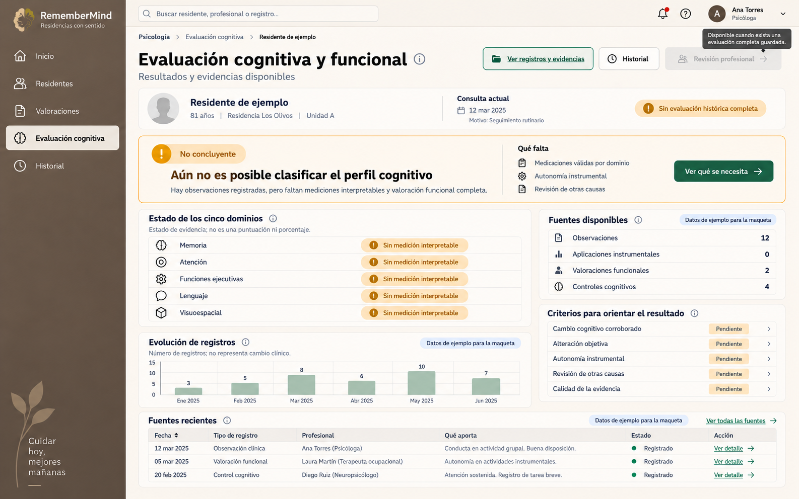
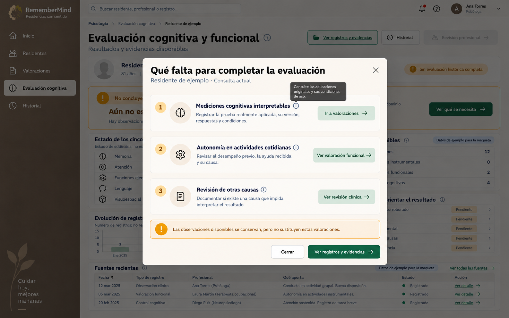
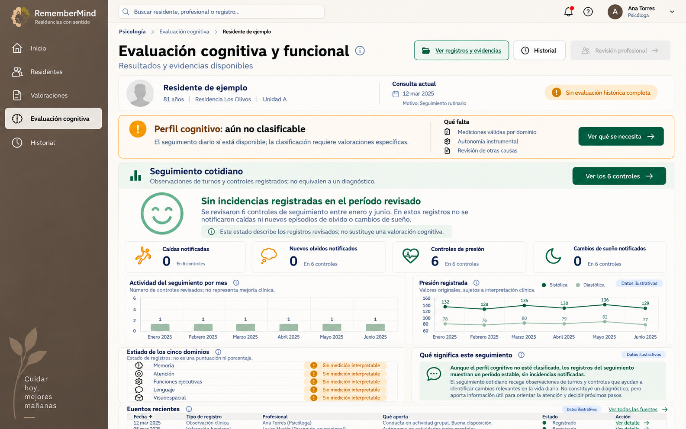
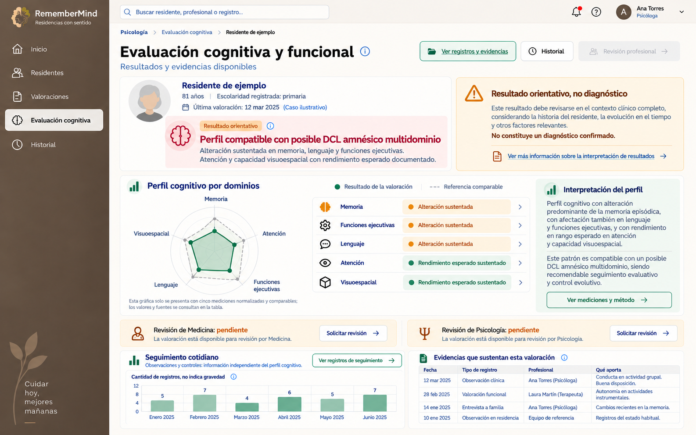

# Vista de evaluación cognitiva y funcional para Psicología

**Estado:** composición de las dos referencias integrada en la vista real de Psicología el 22/10/2026. Las maquetas usan una persona y cifras de ejemplo; la implementación consulta datos autorizados del expediente y conserva los estados reales de abstención. La comparación visual directa en navegador sigue pendiente.

## REFERENCE ANALYSIS — dos variantes recibidas el 22/10/2026

**Referencias:** `codex-clipboard-e5ea530d-479a-4633-911a-30985d006f35.png` (perfil multidominio) y `codex-clipboard-32c9ef21-6d6e-41b3-a56a-c7a35bc6a5d6.png` (dominio único), ambas de aproximadamente 1586 × 992 px. Son diseños de referencia, no evidencia de un residente ni autorización para cargar sus cifras.

**Layout y proporciones aproximadas:** shell institucional a la izquierda, contenido útil a la derecha; encabezado horizontal con tres acciones. En la primera variante la cabecera del residente y el aviso ocupan dos columnas cercanas a 60/40. El bloque de dominios ocupa el ancho completo y organiza mapa, lista e interpretación en tres franjas. En la segunda variante la ficha del residente es horizontal, el resultado ocupa el ancho completo, y debajo hay tres tarjetas para dominios, criterios y proceso. Ambas cierran con seguimiento a la izquierda y evidencias a la derecha. La grilla se apila según el ancho disponible, manteniendo resultado antes de detalles.

**Superficies y tipografía:** fondo neutro cálido; fichas claras con bordes finos y radios moderados; salvia para acciones y datos disponibles; ámbar para límite interpretativo. Título de página y tarjetas usan la jerarquía Nunito Sans del sistema; cuerpo y tablas, Inter. Los relieves se obtienen con bordes y sombras compartidas, sin nueva paleta ni glass en tablas.

**Componentes y acciones:** ficha de residente, tarjeta principal de resultado, aviso persistente, estados de cinco dominios, criterios, proceso, gráfica de registros, tabla de inventario de evidencias, botones de consulta y ayuda contextual. Se reutilizan botones, modal y tokens actuales. Los botones abren secciones reales o el modal de ayuda; no se representan acciones clínicas no habilitadas.

**Adaptaciones necesarias:** el radar numérico, su «rango esperado» y los valores *z* ilustrativos no se reproducen sin cinco mediciones comparables; el mapa categórico existente mantiene puntos equidistantes y lista textual. Las filas con fechas, nombres y hallazgos de ejemplo se sustituyen por un inventario verificable y acceso a los registros originales. Las solicitudes de revisión se muestran únicamente mediante el flujo real de revisión de una evaluación conservada; la consulta transitoria no simula una firma. Una imagen fija no define animaciones; se conservan los estados de foco y carga del sistema.

## Implementación de la composición principal

La ruta de resultados de Psicología conserva el componente Livewire compartido `ResultadosExpertoResidente`. Su vista ahora usa una composición propia para el resumen de Petersen: ficha compacta, banda de resultado o abstención, dos columnas de dominios/fuentes/criterios y gráfica de **número de controles cognitivos vigentes por mes durante los últimos 90 días**. Esa gráfica tiene tabla equivalente y no interpreta mejoría o deterioro. El detalle de reglas y soportes sigue disponible en un panel desplegable. Las aplicaciones y sus respuestas conservan el acceso existente desde «Fuentes y mediciones disponibles».

La revisión de legibilidad posterior redujo los tamaños de título, ficha, barras y espacios, y retiró de Psicología la tarjeta que duplicaba los conteos de fuentes. La franja «Actualizar la consulta» conserva la acción del motor en formato compacto. Los botones «?» de dominios, fuentes, controles y criterios abren el modal compartido con explicaciones en lenguaje común; «Entender los requisitos» abre en ese mismo modal los estados de la evaluación actual. El modal reutiliza el componente institucional con trampa de foco y cierre por Escape. A partir del ancho disponible, las columnas se reordenan sin perder estados ni fuentes.

El caso con patrón muestra el resultado orientativo junto a un aviso persistente y el mapa categórico de cinco áreas. El radar numérico de la maqueta no se dibuja porque la consulta actual no aporta cinco medidas originales normalizadas bajo una escala comparable; el mapa usa puntos equidistantes y una tabla de estados. Los valores de ejemplo de la maqueta no se transfirieron al sistema. Se retiraron las tarjetas de revisión futura que repetían una opción todavía no disponible para la consulta transitoria.

Las gráficas de caídas, presión y sueño de la propuesta siguen pendientes de un contrato de consulta autorizado y verificable para esas fuentes. El resumen actual muestra únicamente controles cognitivos y fuentes ya conectadas a la lectura experta. La ausencia de registros no se presenta como ausencia de problemas. La tabla de fuentes recientes de la maqueta tampoco se reemplaza por datos incompletos: el inventario y los registros originales siguen en el panel de fuentes.

## Variante con perfil orientativo de posible DCL

La última maqueta adapta las referencias visuales entregadas por la propietaria el 22/10/2026. Muestra un **caso sintético multidominio**, distinto de la variante anterior de dominio único. No se atribuye ese patrón a ningún residente real. Para mostrarlo con datos institucionales, la evaluación debe contar con los cinco dominios sustentados, los requisitos de Petersen acreditados y una regla vigente aplicable; la interfaz representa la salida real del motor.

En la parte superior, la ficha reúne fotografía autorizada o avatar, nombre, edad, escolaridad documentada y fecha de la valoración. Si falta uno de esos datos, se lee «No registrado»; no se completa por inferencia. Dentro de la ficha, una banda de gran tamaño muestra **«Perfil compatible con posible DCL amnésico multidominio»** y explica cuáles dominios cuentan con alteración sustentada. A su lado, un panel ámbar permanente advierte **«Resultado orientativo, no diagnóstico»** y recuerda que se interpreta en el contexto clínico completo. El aviso no se oculta en un tooltip.

El panel central **«Perfil cognitivo por dominios»** combina una representación visual y una tabla de cinco filas. El gráfico radial de la referencia solo se habilita cuando existen cinco valores originales transformados mediante **la misma escala válida y una referencia comparable documentada**; el eje, unidad, método y referencia se identifican en «Ver mediciones y método». Sin esa condición, se sustituye por cinco estados categóricos de igual jerarquía: «Alteración sustentada», «Rendimiento esperado sustentado» o «No interpretable». Nunca se dibujan coordenadas radar a partir de etiquetas A/P/I ni de observaciones nominales. La tabla de dominios permanece accesible aun cuando sí exista gráfico.

La columna **«Interpretación del perfil»** resume la combinación que produjo el patrón, los límites y la necesidad de seguimiento. Sus frases se componen de condiciones y soportes realmente conservados, no de números o puntuaciones inventadas. «Por qué este resultado» abre la cadena fuente → valoración → condición → regla → perfil; «Ver evidencias» abre registros y exclusiones autorizados; «Ver mediciones y método» abre instrumentos, edición, idioma, puntuaciones originales y referencia interpretativa de cada dominio. Las filas de dominios abren el detalle de ese dominio.

Medicina y Psicología aparecen en tarjetas de **revisión independiente**, cada una con su estado real y acceso al acto posterior autorizado. No se exige ninguna revisión para que el motor ejecute la evaluación. El bloque «Seguimiento cotidiano» continúa separado del patrón cognitivo, con sus registros de caídas, olvidos, sueño y presión, y sus gráficas de cantidades o lecturas originales; no se incorpora al radial cognitivo.

## Objetivo y ubicación

La pantalla de Psicología, «Evaluación cognitiva y funcional», responde en este orden: **qué concluyó la consulta**, **con qué evidencias**, **qué falta o limita la interpretación** y **dónde revisar la información original**. Conserva la ruta funcional actual del resultado por residente y la navegación «Psicología → Evaluación cognitiva → Residente». No convierte una consulta actual en una evaluación histórica guardada.

El primer plano muestra un resultado grande en lenguaje común: perfil orientativo cuando esté sustentado o «Aún no es posible clasificar el perfil cognitivo» cuando corresponda abstención. El rótulo de fecha se expresa como «Información considerada hasta el …» en vez de «corte». La versión técnica, las claves de base de datos, las compuertas y los identificadores no se muestran como texto clínico. Una vista técnica, si se requiere para auditoría y está autorizada, se ofrece por separado.

## Composición visual

| Zona | Contenido y comportamiento |
| --- | --- |
| Sidebar y barra superior | Mantienen el shell actual de RememberMind. «Evaluación cognitiva» queda seleccionada; búsqueda global, avisos y usuario mantienen sus componentes compartidos. |
| Encabezado | Breadcrumb, título «Evaluación cognitiva y funcional», subtítulo «Resultados y evidencias disponibles» y acciones de consulta. |
| Contexto del residente | Identidad y edad, fecha de la consulta o evaluación elegida, tipo de lectura («Consulta actual» o «Evaluación guardada») y profesional cuando exista autoría verificable. No se muestran códigos. |
| Resultado principal | Tarjeta de máxima jerarquía con estado, titular comprensible, síntesis en dos frases, motivos concretos y enlace a lo que falta. Ámbar indica insuficiencia; no equivale a gravedad clínica. |
| Cinco dominios | Memoria, atención, funciones ejecutivas, lenguaje y capacidad visuoespacial en filas categóricas. Cada fila abre el detalle de fuentes, condiciones y razones. Nunca se dibuja una barra de “porcentaje de deterioro” sin escala válida. |
| Fuentes disponibles | Conteos por tipo de fuente, separados entre observaciones, aplicaciones instrumentales, valoraciones funcionales y controles. El conteo indica volumen documental, no calidad ni normalidad. |
| Criterios del resultado | Cinco nombres legibles: cambio cognitivo corroborado, alteración objetiva, autonomía instrumental, revisión de otras causas y calidad de la evidencia. Cada fila muestra «Acreditado», «No acreditado», «No interpretable», «Pendiente» o «Contradictorio», según el estado real, y abre qué soporte se usó o falta. |
| Gráfica temporal | Número de registros por fecha, solo si existen fechas reales. Eje vertical «Registros» y leyenda «No representa cambio clínico». Para medir evolución clínica se requerirían mediciones comparables y su método; si no existen, se muestra un estado vacío. |
| Tabla de fuentes recientes | Fecha, tipo, profesional, aporte, estado y «Ver detalle». Orden y filtros visibles; permite consultar el registro original autorizado. En móvil pasa a tarjetas. |

La composición sigue el diseño actual: fondo arena/crema, shell capuchino, superficies neutras, acento salvia para acciones, ámbar para límites de información y tipografía de título Nunito Sans con contenido Inter. Se reutilizan los tokens del Design System, `x-ui.section-card`, `x-ui.status-badge`, tarjetas de residente, tabla, estado vacío, modal y drawer compartidos; no se crea una paleta de Psicología. El modal y el panel lateral utilizan el glass cálido moderado del sistema; la tabla sigue opaca para lectura.

## Botones y microinteracciones

| Control | Acción visible para el usuario | Estado alternativo |
| --- | --- | --- |
| **Ver registros y evidencias** | Abre un panel lateral con pestañas «Resumen», «Registros» y «Por qué se obtuvo este resultado». Cada fuente muestra fecha, profesional, tipo, uso o exclusión y acceso a su detalle permitido. | Si no hay fuentes, muestra «Aún no hay registros disponibles» y la acción de captura permitida. |
| **Historial** | Abre una línea de tiempo de evaluaciones realmente conservadas; al elegir una, la pantalla cambia claramente a «Evaluación guardada» y lee su instantánea. | Si no hay evaluaciones guardadas, estado vacío; no se presenta la consulta actual como historia. |
| **Revisión profesional** | Abre el modal de revisión de Psicología sobre una evaluación histórica completa y recuperable, con acuerdo, desacuerdo o revisión no concluyente según el contrato vigente. | Deshabilitado con explicación visible cuando falta evaluación completa, permiso o competencia; no crea una firma sobre datos transitorios. |
| **Ver qué se necesita** | Abre el modal de la segunda maqueta: faltantes concretos, explicación y rutas de trabajo. | Si no falta nada, este botón cambia a «Ver fundamento del resultado». |
| **Ir a valoraciones** | Desde el modal, navega al registro instrumental autorizado, conservando el residente seleccionado. | Sin permiso, ofrece una explicación y no muestra una acción que vaya a fallar. |
| **Ver valoración funcional** | Lleva al registro de autonomía instrumental o su consulta autorizada. | Si falta autorización, explica quién puede completarla. |
| **Ver revisión clínica** | Lleva a las fuentes o valoraciones de causas alternativas accesibles a Psicología. | Si la acción corresponde a Medicina, se presenta como pendiente de ese profesional, sin atribuirle una firma ficticia. |
| **Ver todas las fuentes** | Amplía la tabla en panel de lectura con filtros por tipo, fecha y estado. | Permisos de fuente aplicados en backend. |
| **Ver detalle** | Abre el registro original y su procedencia, respuestas o condiciones conservadas; nunca lo reconstruye a partir de una conclusión. | Si está restringido, muestra «No tienes acceso a este registro». |
| **Fila de dominio o criterio** | Abre un detalle con estado en lenguaje común, soporte, condición evaluada, regla aplicada y motivo de abstención o exclusión. | Si falta una pieza, indica cuál y no infiere «normalidad». |
| **Cerrar / × / Escape** | Cierra modal o drawer y devuelve el foco al botón de origen. | Un guardado en curso previene doble envío y explica su estado. |

## Seguimiento cotidiano, independiente de la clasificación cognitiva

El residente puede tener controles y observaciones útiles aunque no exista una medición suficiente para clasificar su perfil cognitivo. Por ello, debajo del resultado principal se agrega una tarjeta **«Seguimiento cotidiano»** que nunca se oculta por la abstención cognitiva. Se alimenta solo de registros reales y autorizados, con fecha, autor y tipo de fuente. Una caída anotada, un olvido observado, una lectura de presión o un cambio de sueño mantienen su significado original: no se convierten en diagnóstico ni en una puntuación cognitiva.

La cabecera de seguimiento contiene el período efectivamente consultado y **«Ver registros del seguimiento»**. Cuatro tarjetas muestran: **caídas notificadas**, **episodios de olvido observados**, **controles de presión disponibles** y **cambios de sueño notificados**. Cada número abre el listado filtrado de sus registros originales, con fecha, autor, contexto y estado. Un cero solo se muestra como «0 notificados en los controles revisados» cuando los campos correspondientes fueron registrados explícitamente; la ausencia de registros o un valor desconocido produce «Sin datos suficientes», nunca cero. El período no se fija arbitrariamente: se muestra el rango real seleccionado.

La gráfica principal «Episodios observados por mes» compara **cantidad de registros** por categoría con barras y etiquetas numéricas; no representa gravedad. La segunda gráfica muestra las **lecturas originales de presión por fecha**, con unidad y leyenda de sistólica/diastólica; no dibuja rangos objetivo, bandas verdes o alertas clínicas sin un contrato aprobado. Ambas tienen tabla accesible equivalente. Si faltan fechas, mediciones comparables o permiso de lectura, se sustituye la gráfica por una explicación concreta.

La variante visual con carita sonriente corresponde únicamente al estado **«Sin incidencias registradas en el período revisado»**. Debe existir un conjunto identificable de controles revisados y constancias explícitas para las categorías resumidas. El texto indica cuántos registros se revisaron y en qué fechas. La carita es un icono amable de seguimiento, acompañado siempre por texto; no declara «residente sano», «sin deterioro» o «presión normal». Si aparece un episodio, la tarjeta cambia a «Hay cambios registrados para revisar» y destaca los hechos observados sin atribuirles severidad médica inventada. Si no hay cobertura suficiente, muestra «Seguimiento sin información suficiente», sin carita positiva.

Este estado de seguimiento es **independiente** del resultado cognitivo: puede coexistir «Perfil cognitivo aún no clasificable» con «Sin incidencias registradas en los controles revisados». También puede existir un perfil cognitivo orientativo y episodios de seguimiento que requieren consulta. La interfaz nunca usa la ausencia de patrón cognitivo como prueba de bienestar ni usa la presencia de observaciones como prueba de DCL.

| Acción del nuevo bloque | Resultado de la interacción |
| --- | --- |
| **Ver registros del seguimiento** | Abre un drawer con filtros «Todos», «Caídas», «Olvidos», «Presión» y «Sueño», y tabla de fecha, tipo, profesional, descripción y enlace al registro. |
| **Seleccionar barra o punto** | Enfoca y filtra la tabla equivalente al mes o fecha seleccionada; el tooltip muestra cifra, unidad y procedencia. |
| **Ver detalle** | Abre el registro original autorizado, sin sustituirlo por una interpretación resumida. |
| **Cambiar período** | Actualiza tarjetas, gráficas y tabla en conjunto; muestra carga, período efectivo y estado vacío si corresponde. |

Las ayudas emergentes breves explican términos como «medición interpretable» y el motivo de un botón deshabilitado. Los mensajes de éxito solo aparecen después de guardar realmente; los errores identifican el campo o la acción que falló. Cada control tiene hover, foco visible, estado activo, loading y área táctil adecuada; se respeta movimiento reducido.

## Estados del resultado

- **Con evidencia suficiente:** titular del perfil orientativo, dominios y criterios sustentados, fuentes y límites; nunca diagnóstico confirmado automático.
- **Información insuficiente:** resultado grande «Aún no es posible clasificar…»; debajo, faltantes concretos por dominio y por criterio. Las observaciones existentes siguen visibles como observaciones.
- **Contradicción o impedimento diferencial:** explicación separada y prioritaria, con los registros enfrentados o el factor pendiente de resolver.
- **Consulta actual:** etiqueta persistente; no ofrece firma ni afirma conservación histórica íntegra.
- **Evaluación guardada:** fecha y autor, estado de revisión médica y psicológica por separado, y lectura del contenido histórico conservado.
- **Sin registros / cargando / error:** textos específicos y recuperables; no tablas vacías sin explicación ni valores de prueba.

La comparación temporal de resultados solo agrupa evaluaciones hechas con métodos compatibles. Si no se dispone de esa comparabilidad, la gráfica se limita a **frecuencia de registros**. No se usan radar, porcentajes o puntuaciones normalizadas para estados categóricos.

## Adaptación y alcance

A 1440 y 1280 px: dos columnas (dominios y gráfica a la izquierda; fuentes y criterios a la derecha) y tabla completa abajo. A 1024 px: columnas flexibles, acciones con salto de línea. A 768 y 390 px: una columna, resultado antes que los detalles, tabla en tarjetas y modal a ancho de pantalla. La cabecera y el resultado deben conservar lectura sin desplazamiento horizontal. Modal con trampa de foco, Escape, etiqueta accesible y retorno de foco; gráfica con tabla equivalente.

Estas imágenes especifican **cómo debería verse y actuar** la pantalla. La implementación requiere conectar cada control a los componentes, permisos, fuentes y estados existentes y verificarlo visual y funcionalmente; ninguna cifra o persona de la maqueta debe sembrarse en la base de datos.
