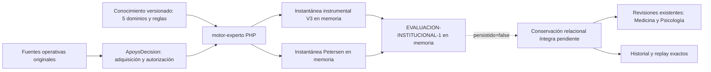

# O.R.I.O.N. — corte de aceptación integral

**Fecha:** 21/10/2026. **Estado:** cierre técnico parcial verificable. No se declara culminación institucional ni validación clínica. Sin commit, push, despliegue o migración institucional.

## Actualización del 22/10/2026

El inventario actual es **100 tablas de negocio: 75 operativas y 25 expertas**, tras las [cuatro consolidaciones adicionales aprobadas e instaladas](CIERRE_REFACTOR_BLOQUES_2026_10_22.md). Los conteos de 104 y las pruebas de las secciones siguientes corresponden al corte histórico del 21/10.

La [continuación de conservación](CONSERVACION_LECTURA_Y_REPLAY_2026_10_22.md) separa lectura íntegra y replay sin alterar la inferencia existente. Quedaron verificadas 52 pruebas unitarias, 20 de integración SQLite y 57 sobre PostgreSQL desechable, con evidencia JUnit enlazada. Estas baterías se solapan y no acreditan almacenamiento compuesto: `EVALUACION-INSTITUCIONAL-1` mantiene `persistido=false`. El diseño físico completo bajo 110 y su integración con revisiones históricas siguen pendientes materiales.

## Verificación posterior del 21/10/2026

Se corrigió la lectura de autoridad en `AGENTS.md`, `database/AGENTS.md`, `tests/AGENTS.md`, el baseline, su diccionario y el índice de O.R.I.O.N.: **70** es el núcleo V2.1, **104** es el inventario instalado comprobado (75 operativas, 29 expertas) y **110** es el máximo de diseño aprobado. Esta aclaración documental no modifica el esquema ni aprueba DDL.

En el árbol local actual, `php artisan test --filter='SistemaExpertoOrionNivel1Test|PreparacionCompuestaCoherenteTest|ReferenciaF02SqliteDesechableTest|RevisionValoracionExpertaTest' --compact --stop-on-failure` terminó con **31 pruebas, 129 aserciones y tres omisiones** propias de carreras que requieren dos conexiones. `php artisan test --filter='CapturaInstrumentalInstitucionalTest|ConocimientoCognitivoInstitucionalTest|CapturaPetersenOriginalTest|PetersenInstitucionalTest|InstantaneaEvaluacionInstitucionalTest' --compact --stop-on-failure` terminó con **205 pruebas y 1734 aserciones**, sin fallos. El segundo filtro también incluyó `GobiernoPetersenInstitucionalTest`. Son pruebas sintéticas sobre la configuración de testing; no acreditan validación clínica ni guardado institucional bajo 110 tablas.

El oráculo SQL completo pasó en SQLite desechable, incluida la variante montada sobre las migraciones actuales; sobrepasa el presupuesto relacional y no es una migración candidata. La brecha de conservación y la necesidad de mediciones originales interpretables permanecen. `persistido=false` continúa siendo el estado correcto de `EVALUACION-INSTITUCIONAL-1`.

## Fuentes y árbol auditado

La instrucción de la propietaria del 21/10 sustituyó el límite de 104 por [110 tablas de negocio](DECISION_MAXIMO_110_TABLAS_2026_10_21.md), sin aprobar DDL concreto. El baseline y el diccionario operativo mantienen el inventario **instalado** de 75 operativas y 29 expertas. `php artisan db:show` informó 120 tablas físicas en PostgreSQL local: 104 de negocio y 16 técnicas. La rama era `feature/apoyo-decision-informe-neurocognitivo`, HEAD `be8cd5807898a1dd8e5eebee29f6db7c4d431d93`. El árbol ya contenía numerosos cambios concurrentes y archivos sin seguimiento; este corte no los descartó ni los atribuye a un único autor.

Se consultaron las instrucciones raíz y por ámbito, ADR híbrido, baseline y diccionario, contrato C01–C05, propuestas E–H y de captura, fase 6, dictamen de factibilidad y ensayos B01–B03. El archivo solicitado `docs/sistema-experto/IMPLEMENTACION_V1.md` **no existe** en el árbol actual; referencias a él son históricas y no se reconstruyeron desde memoria. Los contratos actuales y el código prevalecen en su alcance. El manifiesto reproducible de los llamados «104 escenarios» no está identificado en la matriz maestra; no se afirma haberlos ejecutado.

## Arquitectura observada

## Matriz de aceptación

| Componente | Implementado | Verificado técnicamente en este corte | Validado clínicamente | Pendiente o bloqueo |
| --- | --- | --- | --- | --- |
| Captura instrumental | Sí, con instrumento, preguntas/respuestas y procedencia | Regresión de permisos y baterías relacionadas | No | Aplicaciones originales de pruebas concretas, método y derechos adoptados. Las 286 actuales son observaciones. |
| Cinco dominios / 19 componentes | Motor y contratos existentes | Pruebas Petersen y compuestas; no aceptación clínica por dominio en esta entrega | No | Entradas originales interpretables y perfiles habilitados por método. |
| Red y reglas | Paquetes versionados, 17 reglas cognitivas, gobierno Petersen | Pruebas de cuatro patrones y archivo/revisión existentes | No | Activación clínica por regla/perfil y evaluación profesional de rendimiento. |
| Petersen C01–C05 | Nueve juicios originales; C02 derivado; cuatro patrones y abstenciones | 134 pruebas / 1495 aserciones en batería relacionada SQLite; 28 / 208 Petersen en PostgreSQL desechable | No | Sin originales suficientes, abstención; sin historia íntegra no puede firmarse este resultado. |
| DTO compuesto / ejecutor | Preparación y replay en memoria; vínculo verificable a release | Suite compuesta y ensayos parciales B01–B03 | No | SQL institucional guardar/recuperar/replay completo. `persistido=false`. |
| Revisión profesional | Dos cadenas inmutables en tabla existente | Tests de firmas separadas, permisos, rectificación | No | Enlace al Petersen histórico requiere conservar previamente esa evaluación. `NO_CONCLUYENTE` no es valor SQL aprobado. |
| Interfaz por rol | Captura, consultas, resultados y revisión de evaluaciones actualmente revisables | Build Vite; pruebas Livewire existentes | No | Aceptación visual en 1440/1280/1024/768/390 y recorrido del historial Petersen tras persistencia. |
| Seguridad de fuentes | Policy, permisos y competencia; corrección de respuesta parcial | Tres regresiones focales SQLite; Petersen en PostgreSQL | No aplica | Auditoría final de todo el recorrido una vez exista guardado. |

## Cambio compatible realizado

`CapturasInstrumentalesResidente` y `ConsultarPetersenInstitucional` ahora deniegan la consulta cuando falta un permiso de fuente citada o competencia IADL. No presentan una evaluación recortada como si la fuente faltara clínicamente. El documento original no se lee antes de autorizarlo. Se ajustaron las pruebas de regresión para exigir denegación, sin alterar Policies, roles, tablas, estados clínicos ni conocimiento.

## Trazabilidad de los contratos comprobados

| Requisito | Componente existente o modificado | Prueba y evidencia | Límite |
| --- | --- | --- | --- |
| Captura original con procedencia y corte | `CapturasInstrumentalesResidente`, `ConsultarConocimientoCognitivo`, `CorteDocumentoInstrumental` | `CapturaInstrumentalInstitucionalTest`, `ConocimientoCognitivoInstitucionalTest`: NULL, autor, documento posterior al corte y rechazo de fuente ajena | No sustituye protocolos originales ausentes. |
| Cinco dominios y conocimiento versionado | `EvaluarConocimientoCognitivo` en `motor-experto`, paquete de reglas institucionales | `ConocimientoCognitivoInstitucionalTest` y ensayos independientes del motor: 19 observaciones no se convierten en 15 mediciones G09 | No hay activación clínica sin método y originales. |
| C01–C05 y abstención Petersen | `ConsultarPetersenInstitucional`, `EvaluarPetersenInstitucional` | `PetersenInstitucionalTest`, `CapturaPetersenOriginalTest`: cuatro patrones sintéticos, faltantes, contradicciones, competencia IADL | Resultado transitorio hasta conservar DTO completo. |
| Denegación ante fuente sin permiso | `CapturasInstrumentalesResidente`, `ConsultarPetersenInstitucional` | Pruebas de permiso revocado, documento y competencia IADL en las tres suites de captura/conocimiento | Se requiere gate final del recorrido guardado cuando exista. |
| Preparación compuesta sin escritura implícita | `PrepararEvaluacionInstitucional`, `InstantaneaEvaluacionInstitucional` | `PreparacionCompuestaCoherenteTest`, `InstantaneaEvaluacionInstitucionalTest` | No prueba recuperación desde SQL institucional. |
| Revisiones separadas posteriores | `RevisarValoracionExperta`, tabla `revisiones_evaluacion_experta` | `RevisionValoracionExpertaTest`: autoría y cadenas independientes | No firma un Petersen transitorio; `NO_CONCLUYENTE` requiere decisión estructural. |

## Conservación: gate estructural no superado

El máximo actual deja hasta seis tablas adicionales, pero no demuestra qué seis relaciones son suficientes. El prototipo amplio representa 39 modelos en 42 tablas de ensayo; no es instalable por conteo. El mapa reducido anterior contiene 51 rutas de colección y 783 rutas de campos. Las pruebas aisladas de B01 (contratos adquiridos distintos de relaciones semánticas), B02 (preguntas sin respuesta compartidas) y B03 (membresías de soporte) pasan en SQLite, así como la representación de 96 respuestas tipadas entre ramas. **No existe todavía un escritor/lector SQL del DTO íntegro bajo una variante de máximo 110**, ni una transición poblada y reversible de todos los consumidores y FK. En consecuencia no hay diccionario nominal final, prueba de recuperación exacta, replay histórico ni propuesta DDL apta para aprobación específica.

No se crean tablas ni migraciones, no se fusionan relaciones pobladas, no se activa `persistido=true` y no se vincula una revisión al cálculo Petersen transitorio. Antes de solicitar aprobación estructural deben existir: inventario de cada grano y campo con PK/FK/checks/índices/orden, mapa de los 39 modelos, escritor y lector completos en SQLite y PostgreSQL desechables, comparación canónica estricta, replay desde release retenido, concurrencia y cierre, transición poblada/reversión, revisión independiente de 4FN y seguridad.

Para registrar formalmente una revisión **no concluyente** falta una decisión estructural distinta: ampliar el CHECK `rev_contrato_ck` y su equivalente SQLite en `revisiones_evaluacion_experta.decision` para un valor nominal aprobado, más Action/lector/visualización/pruebas. La tabla actual admite solo `CONFIRMADA` y `RECHAZADA`. No se introdujo un tercer valor por inferencia; no firmar conserva `PENDIENTE`.

## Evidencia de esta ejecución

| Comando | Entorno | Resultado |
| --- | --- | --- |
| `php artisan db:show` | PostgreSQL local, solo lectura | 120 tablas físicas; inventario documental 104 negocio + 16 técnicas. |
| `php artisan test --filter='PetersenInstitucionalTest\|CapturaPetersenOriginalTest\|RevisionValoracionExpertaTest\|InstantaneaEvaluacionInstitucionalTest' --stop-on-failure` | SQLite de testing | 117 pruebas, 517 aserciones, PASS antes de la corrección final de permisos. |
| `php artisan test --filter='CapturaInstrumentalInstitucionalTest\|ConocimientoCognitivoInstitucionalTest\|CapturaPetersenOriginalTest\|PreparacionCompuestaCoherenteTest' --compact --stop-on-failure` | SQLite de testing | 134 pruebas, 1495 aserciones, PASS después de la corrección; tres carreras omitidas porque requieren PostgreSQL con dos conexiones. |
| `php artisan test --filter='test_sin_permiso_documental_no_lee_una_aplicacion_vinculada_a_documento\|test_permiso_fuente_retirado_no_devuelve_datos\|test_iadl_exige_competencia_contextual_en_selector_y_lector_antes_de_consultar' --compact` | SQLite de testing | 3 pruebas, 9 aserciones, PASS después de la corrección. |
| `powershell -NoProfile -ExecutionPolicy Bypass -File scripts/probar-postgres.ps1 -Filtro CapturaPetersenOriginalTest` | Cluster PostgreSQL propio y desechable | 28 pruebas, 208 aserciones, PASS; cluster detenido. |
| `powershell -NoProfile -ExecutionPolicy Bypass -File scripts/probar-postgres.ps1 -Filtro 'test_sin_permiso_de_respuestas_no_consulta_ni_expone_las_fuentes\|test_sin_permiso_documental_no_lee_una_aplicacion_vinculada_a_documento\|test_permiso_fuente_retirado_no_devuelve_datos'` | Cluster PostgreSQL propio y desechable | 3 pruebas, 6 aserciones, PASS; cluster detenido. |
| `php prototipos/orion-consolidacion-104/ensayar-dto-compuesto-sqlite.php` | SQLite en memoria | PASS B01/B03 parcial; no DTO íntegro. |
| `php prototipos/orion-consolidacion-104/ensayar-identidad-preguntas-compuestas-sqlite.php` | SQLite en memoria | PASS B02 parcial; cinco preguntas sin respuesta compartidas. |
| `php prototipos/orion-consolidacion-104/ensayar-respuestas-dos-ramas-sqlite.php` | SQLite en memoria | PASS 96 respuestas tipadas; solo ese grano. |
| `php motor-experto/tests/independencia.php` | PHP independiente | PASS, cinco casos técnicos. |
| `npm run build` | Vite | PASS. |
| `npm test` | Node frontend | 226 pruebas PASS, dos omitidas, cero fallos. |
| `vendor/bin/pint --test` sobre los cinco PHP modificados | Estilo PHP | PASS. |
| `git diff --check` | Árbol compartido | FAIL por espacios finales en una vista de Cuidados ajena a este cambio. No se modificó esa vista. |

La aceptación visual de esta entrega y la validación clínica con casos profesionales **no se ejecutaron**. No hay prueba nueva del round-trip institucional ni de concurrencia de su diseño, porque ese diseño aún no existe. Las pruebas sintéticas no equivalen a una firma o a desempeño diagnóstico.

## Matriz para validación profesional posterior

| Caso anonimizado | Original y protocolo real | Instrumento/edición/idioma | C01–C05 y dominios sustentados | Resultado O.R.I.O.N. conservado | Revisión Medicina | Revisión Psicología | Concordancia y justificación |
| --- | --- | --- | --- | --- | --- | --- | --- |
| Pendiente de adquisición | Pendiente | Pendiente | Pendiente | Pendiente | Pendiente | Pendiente | Pendiente |

No se rellenan firmas ni resultados esperados antes de obtener y revisar originales.

## Estado Git al cierre de este corte

`git status --short`: 56 archivos rastreados modificados y 44 entradas sin seguimiento en el árbol compartido. `git diff --stat`: 56 archivos rastreados, 2161 inserciones y 616 eliminaciones. Estas cifras incluyen trabajo preexistente y simultáneo de otros flujos; no representan únicamente las correcciones de este corte. No se ejecutó `git add`, `git commit`, `git push` ni cambio de rama.
