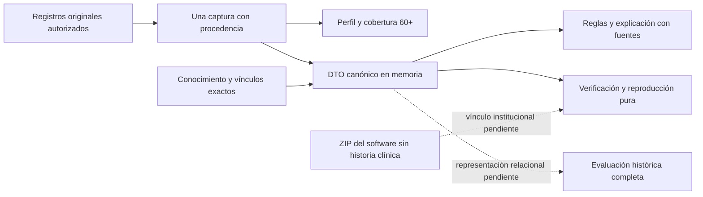

# Cierre de pendientes técnicos y fuentes verificadas

Fecha: 19/10/2026, America/La_Paz. Continúa el [incremento 60+](FASE_4_FUENTES_Y_METRICAS_60_MAS_2026_10_19.md), la [fase 4](FASE_4_RED_Y_REGLAS_2026_10_19.md) y la preparación de la fase 6. La solicitud vigente pide revisar fuentes reales, completar pendientes y documentarlo todo. Este cierre distingue el software comprobado de la adquisición de datos originales y de la conservación institucional aún no representada.

## 1. Fuentes contrastadas y qué resuelven

Se revisaron primero las decisiones aprobadas, el código y las pruebas. La búsqueda externa fue dirigida, no una revisión sistemática. No se reprodujeron reactivos protegidos ni se enviaron datos de residentes a servicios externos.

| Fuente y localizador | Acceso comprobado | Aplicación y límite |
|---|---|---|
| [OMS, Ageing and health, 1/10/2025](https://www.who.int/news-room/fact-sheets/detail/ageing-and-health) | Texto oficial consultable | Sustenta el uso descriptivo de 60+ y la heterogeneidad del envejecimiento. No da un corte cognitivo ni determina la edad de una persona |
| [OMS, ICOPE, segunda edición, 22/9/2025, ISBN 9789240103726](https://www.who.int/publications/i/item/9789240103726) | Ficha editorial oficial; los enlaces PDF inglés/español fallaron | Confirma una vía de valoración y atención adaptada al contexto. No se extrajeron tablas ni parámetros de un PDF no leído |
| [NIH/NIA, Assessing Cognitive Impairment in Older Patients](https://www.nia.nih.gov/health/health-care-professionals-information/assessing-cognitive-impairment-older-patients) | Texto oficial consultado | Selección de pruebas según población, idioma y aplicador; evaluación y seguimiento de las preocupaciones. Una prueba breve no basta para diagnosticar. No acredita qué instrumento recibió cada residente |
| [Albert et al., NIA-AA 2011, DOI 10.1016/j.jalz.2011.03.008](https://pmc.ncbi.nlm.nih.gov/articles/PMC3312027/) | Texto primario completo, §2.1–2.2 | Cambio, evaluación objetiva y función independiente. El intervalo orientativo de 1–1,5 DE no se define como corte. Es antecedente metodológico, no un protocolo institucional de 2026 ni una autorización para deducir DCL desde un z aislado |
| [Dickerson et al., DETeCD-ADRD, DOI 10.1002/alz.14337](https://pubmed.ncbi.nlm.nih.gov/39713957/) y [texto primario](https://pmc.ncbi.nlm.nih.gov/articles/PMC11772716/) | Registro PubMed y contenido indexado de recomendación 14/§2.5; apertura directa de PMC con reCAPTCHA | Integra antecedentes del paciente/informante, pruebas y contexto educativo, cultural y sensorial. No proporciona una transformación universal de las 19 mediciones a A/P |
| [International Test Commission, traducción/adaptación, segunda edición, v2.4, 2017](https://www.intestcom.org/files/guideline_test_adaptation_2ed.pdf) | PDF original de 41 páginas consultado | Documentar versión, adaptación y evidencia de equivalencia; compartir idioma no vuelve intercambiables dos normas. No identifica retrospectivamente una edición administrada |
| [HL7 FHIR R5, Provenance, §6.3.1–6.3.3](https://hl7.org/fhir/R5/provenance.html) | Especificación oficial consultada | Referencia técnica para origen, actividad, agentes y versiones, separada del evento de auditoría. Orienta el contrato de procedencia; no se declara conformidad FHIR ni se añade otra tabla de auditoría |

No se eludieron restricciones de acceso. Se conservan las [referencias instrumentales investigadas](CIERRE_TECNICO_FASE_3_2026_10_19.md); esta entrega no las reemplaza ni afirma que sus muestras sean residentes bolivianos de esta institución.

La investigación completa definiciones, métodos y límites. No puede determinar una hora original, edición, puntuación, escolaridad o firma que no aparezca en los registros. Tampoco puede sustituir una revisión diferencial ausente por la inexistencia de un diagnóstico registrado.

## 2. Hallazgos independientes corregidos

La revisión de conocimiento del incremento `8d53d673` encontró dos defectos P2. Se implementaron por separado de la revisión:

| Hallazgo | Corrección | Regresión |
|---|---|---|
| Perfil y reglas leían los originales dos veces; una rectificación intermedia podía mezclarlos | `ConsultarConocimientoCognitivo` coordina una única captura autorizada. `ConsultarPerfilInstrumental` utiliza esa captura para mediciones, métricas y originales | El proveedor documental cambia una respuesta entre los pasos; se comprueba una sola extracción y la coherencia entre captura y conclusión |
| La explicación perdía respuesta, columna, identidad instrumental y procedencia ya verificadas | `TrazaFuentesInstrumentales` añade una proyección explícita a rutas y evidencias declarativas, incluidos autor, pregunta, documento y fuente de edad | Comparación de PK de respuesta/pregunta, columna original, documento verificado y fecha de nacimiento utilizada |

También se corrigieron dos pérdidas relacionadas: preguntas declarativas seleccionadas sin respuesta conservan su definición observada; el corte y las fechas de la explicación declarativa conservan microsegundos. El formato histórico del ejecutor COG-MEM no se modifica para esta mejora.

La reauditoría independiente del delta confirmó ambos cierres y emitió **PASS estático acotado**, sin P1/P2 nuevos identificados, en seguridad y trazabilidad. No ejecutó SQL ni pruebas. Un reintento del revisor inicial terminó por límite de uso; el cierre estático lo realizó el revisor independiente disponible. No se atribuye un dictamen clínico o una auditoría global a esa lectura.

## 3. Contrato canónico implementado

`CapturaInstrumentalCanonica` proyecta columnas explícitas: aplicaciones, instrumentos, respuestas, preguntas, opciones, preguntas declarativas sin respuesta, selectores, documento sin ruta y datos derivados de captura. Conserva también fuentes excluidas y sus motivos. No firma directamente un `getRawOriginal()` abierto.

- `valor_numero`: cadena decimal de escala 4; puntajes/máximos: escala 2. Se rechaza una precisión no representable. La materialización real de SQLite solo se admite si convertirla a esa escala no cambia el valor; los decimales del DTO son cadenas.
- Booleanos SQL se canonizan sin convertir NULL en false. Ausencia de clave, NULL, cero, false y texto «0» producen huellas distintas.
- Mapas se ordenan por clave; aplicaciones y respuestas por identidad/fecha contractual. El orden semántico de listas, motivos y condiciones se conserva.
- Valores calculados finitos mantienen su precisión binaria en la huella mediante el codec IEEE-754 existente. No se redondea z para firmar el contenido.
- El corte conserva UTC, zona, offset y microsegundos. Las fechas fuente conservan la precisión materializada disponible: una columna SQL sin subsegundos no aporta subsegundos originales por mostrar `.000000`.

`InstantaneaInstrumental` conserva en memoria el contexto y usuario ejecutor, la declaración completa de conocimiento, estados/revisiones observados, contratos, vínculos exactos, fuentes canónicas y salida reproducida. Verifica huella y recalcula desde esas copias; no vuelve a consultar SQL, configuración ni reglas actuales.

La consulta devuelve únicamente el resultado, la captura autorizada y metadatos de preparación (`contrato`, `huella`, `persistido=false`, `release_recuperable=false`). El DTO completo se prepara en el backend; no se envía como otro bloque de conocimiento a la interfaz ni se guarda en un archivo JSON clínico. El hash es de integridad, no una firma profesional ni una prueba de autenticidad por sí solo.

## 4. Artefacto recuperable del motor

`ReleaseMotorInstrumental` y `scripts/preparar-release-orion.php` crean un ZIP nuevo de software. Incluye únicamente PHP del motor, su `composer.json`, `composer.lock` y ejecutables de independencia. Excluye `.env`, configuración local, almacenamiento, bases de datos, documentos clínicos y capturas. No lee Laravel ni SQL.

El manifiesto incluye revisión Git **base**, conjunto exacto de archivos y SHA-256 por archivo; los bytes empaquetados determinan la identidad. Una base Git no significa que un árbol con modificaciones sea idéntico a ese commit. El verificador comprueba el conjunto y los bytes sin extraer ni ejecutar el ZIP. Rechaza alteración, archivo ausente y reemplazo de un release existente. El manifiesto JSON es metadato de software, no un depósito de historias.

```powershell
$revision = git rev-parse HEAD
php scripts/preparar-release-orion.php storage/app/private/orion-motor-NUEVO.zip $revision
```

La distribución/retención institucional y el enlace inmutable evaluación → release pertenecen al cierre de persistencia. Por ello la consulta todavía no declara `release_recuperable=true`: crear un ZIP local no equivale a vincularlo a una evaluación guardada ni garantiza retención futura. Las dependencias de Composer se identifican por su lock; el ZIP no contiene los binarios del runtime ni un entorno ejecutable completo.

## 5. Qué queda para el cierre institucional

El [análisis relacional](CONSERVACION_INSTRUMENTAL_ANALISIS_2026_10_19.md) sigue vigente en su alcance; el DTO ahora está implementado y permite precisar la decisión física. Se mantienen **106 tablas de negocio**, sin DDL, catálogos, permisos nuevos ni escrituras sobre historia clínica.

| Pendiente | Información/decisión concreta | Lo que no lo sustituye |
|---|---|---|
| Versión institucional ejecutable | Reglas declaradas, semántica de sus predicados y vínculos a preguntas originales; creación por el gestor autorizado | Activar una versión vacía o copiar las reglas técnicas del laboratorio |
| Adquisición original | Instrumento/edición/forma/idioma realmente administrados, mediciones y condiciones verificables | Escoger retrospectivamente un instrumento porque sus tareas se parecen |
| Contribución clínica de las comparaciones | Contrato explícito que conecte medidas e interpretación de componentes/dominios, contexto y C01–C05 | Suponer que cualquier z bajo determina un patrón Petersen |
| Conservación relacional íntegra | Resolver el origen instrumental de hechos sin atención/actividad, medidas/contexto, copia histórica y enlace a artefacto retenido | Fabricar una atención, alterar el XOR vigente, guardar todo en JSON o eliminar guardas experimentales |
| Cierre posterior | Guardar/recuperar completo, replay histórico tras cambios, revisión MED/PSI y QA del flujo con su contrato final | Confundir la consulta actual `persistido=false` con una evaluación firmada |

La regla física de origen D-137 exige atención o actividad, mientras una aplicación instrumental puede carecer de ambas. Las nueve relaciones candidatas del análisis anterior **no son un mínimo demostrado ni una ampliación aprobada**. Antes de migraciones se debe cerrar el diccionario físico contra este DTO y decidir el alcance histórico; no se infiere autorización estructural de una petición general de limpieza.

## 6. Checklist de esta entrega

- [x] Fuentes primarias/oficiales verificadas, con acceso, alcance y límites documentados.
- [x] Revisión independiente del incremento anterior y corrección de los dos P2.
- [x] Una captura autorizada compartida y preguntas declarativas sin respuesta.
- [x] Procedencia instrumental y precisión temporal conservadas en la explicación.
- [x] DTO canónico tipado y reproducción desde fuentes/conocimiento conservados en memoria.
- [x] Artefacto de software recuperable y verificador de integridad, sin datos clínicos.
- [x] Casos sintéticos de tipos, decimales, NULL, orden, corrupción, replay y no reemplazo.
- [ ] Conservación institucional relacional completa y vínculo evaluación/release.
- [ ] Adquisición/vinculación institucional y reglas clínicas de integración antes descritas.

## 7. Evidencia de verificación

Verificación final en candidato aislado de `8d53d673` con únicamente los archivos de este incremento; sin `.env` ni cambios simultáneos de horarios/proveedor modular. Se compararon SHA-256 de todos los PHP propios entre candidato y workspace. Las pruebas usan datos sintéticos; no se presentan como exactitud clínica.

| Comprobación | Evidencia final |
|---|---|
| SQLite `:memory:`, selección relacionada | **109 pruebas / 5751 aserciones**, sin fallos, errores ni omisiones |
| PostgreSQL desechable, misma selección | **109 pruebas / 5750 aserciones**, sin fallos, errores ni omisiones; clúster detenido y eliminado por el script guardado |
| Revisión independiente | PASS estático acotado de seguridad/trazabilidad y cierre de los dos P2; no es evaluación clínica ni ejecución dinámica |
| Independencia del motor y O.R.I.O.N. | Ambos ejecutables PASS sin Laravel ni SQL |
| Pint, sintaxis PHP, diff y enlaces locales | PASS; sin legacy ejecutable, TODO/FIXME o sustituto de depuración en los archivos PHP propios |
| Build del candidato | PASS, **3,63 s**; no se modificó interfaz ni se acredita QA visual |
| CLI de artefacto, candidato con revisión base real `8d53d673` | ZIP nuevo verificado con **130 archivos** de software; incluye los bytes del incremento, aún no un árbol idéntico a la base |

Filtro exacto de la selección final:

```powershell
$filtro = 'ConocimientoCognitivoInstitucionalTest|PerfilInstrumentalInstitucionalTest|CapturaInstrumentalInstitucionalTest|CapturaInstrumentalCanonicaTest|ReleaseMotorInstrumentalTest|PerfilCognitivoDeclarativoTest|AplicabilidadGeriatricaTest|IntegracionRedCognitivaTest|ApplicationBoundaryTest|FolderOrganizationTest'
php vendor/phpunit/phpunit/phpunit --filter $filtro --log-junit storage/app/private/cierre-pendientes-final-sqlite.xml
./scripts/probar-postgres.ps1 -Filtro $filtro -Informe storage/app/private/cierre-pendientes-final-pg.xml -Log storage/app/private/cierre-pendientes-final-pg.log
php motor-experto/tests/independencia.php
php motor-experto/tests/orion_independencia.php
npm run build
```

Se preservan XML/logs en el almacenamiento privado del candidato. La regresión inicial encontró una prueba que asumía el primer elemento de una colección de evidencias: se corrigió la prueba para localizar la evidencia por su PK, sin alterar el orden ni el motor. La selección final incorpora además la copia de la cabecera de conocimiento y comprueba que retirar la versión actual no cambia la reproducción de la cabecera capturada.

El archivo de software verificado durante la preparación tiene huella de manifiesto `36544d0d2101ca9877e78aeef93859954488d79749d17d6ddd23530140f5fc75`. El commit local y un nuevo artefacto desde ese corte se identifican al entregar; no se ejecuta push ni se modifica la BDD operativa.


