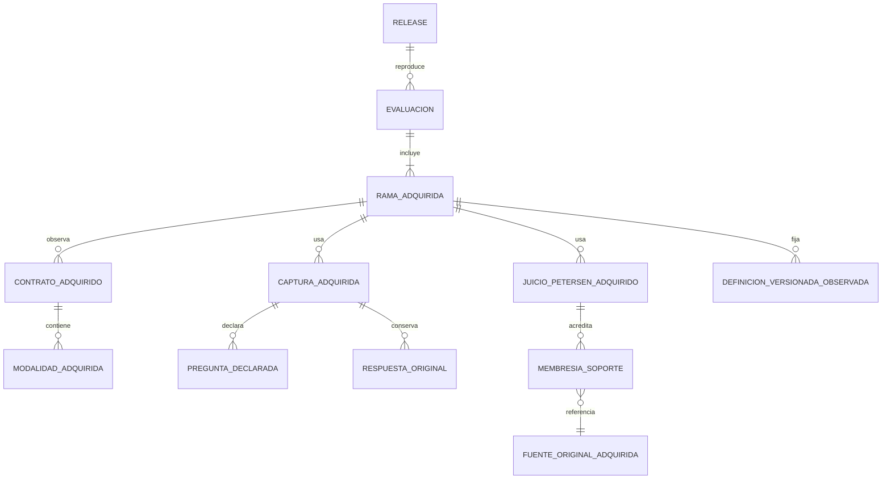

# O.R.I.O.N. — gate relacional de conservación institucional bajo 110 tablas

**Fecha:** 21/10/2026. **Resultado:** diseño de máximo 110 **no demostrado**. Este dictamen no es propuesta DDL apta para instalación ni solicitud de aprobación estructural. No se tocó `remembermind_dev`.

## Alcance y autoridad

Se aplicaron el [informe de aceptación](ACEPTACION_INTEGRAL_ORION_2026_10_21.md), la [decisión de máximo 110](DECISION_MAXIMO_110_TABLAS_2026_10_21.md), [Fase 6](FASE_6_PREPARACION_COMPUESTA_2026_10_20.md), [B01–B03](ENSAYO_CINCO_RELACIONES_104_2026_10_21.md), el [contrato Petersen](CONTRATO_FUNCIONAL_PETERSEN_C01_C05_2026_10_21.md), el baseline congelado y `database/AGENTS.md`. La decisión 110 sustituye el techo anterior, sin aprobar tablas, columnas, FK ni retiros concretos. Las 286 aplicaciones observacionales no se transformaron en mediciones.

## Inventario y matriz reproducibles

`auditar-esquema.php` forzó `sqlite::memory:` **antes de iniciar Laravel**, comprobó la conexión y ejecutó allí todas las migraciones existentes. Produjo [inventario de columnas, índices, FK salientes y entrantes](../../prototipos/orion-conservacion-110/inventario-esquema-sqlite.json) y [clasificación de las 120 tablas](../../prototipos/orion-conservacion-110/inventario-120-tablas.csv). Resultado: **75 operativas + 29 expertas = 104 de negocio**, más 16 técnicas; **299 FK** y 130 índices declarados en el esquema desechable. Esto reproduce el conteo instalado documentado, pero no verifica el contenido de filas de la base institucional.

`auditar-mapas.php` cotejó la [matriz completa de 51 rutas](../../prototipos/orion-conservacion-110/matriz-auditoria-rutas.csv) y las 783 rutas de campo del candidato anterior. Hay **39 modelos distintos**, 640 rutas escalares, 93 de objeto y 50 de colección. Nueve rutas apuntan a tablas candidatas inexistentes. Cuarenta y seis rutas requieren resolver una brecha física o de conservación; esto no afirma que las otras cinco sean por sí solas instalables. El [resumen reproducible](../../prototipos/orion-conservacion-110/resumen-auditoria.json) distingue los siete B01–B03 declarados (4, 2 y 1) de otros contratos aún no probados. El [índice léxico de consumidores](../../prototipos/orion-conservacion-110/consumidores-codigo.csv) recoge 4716 pares tabla/archivo en aplicación, motor, rutas, configuración, seeders, vistas y pruebas; complementa las FK físicas, pero requiere revisión manual para SQL dinámico y alias.

## Granos incompatibles del candidato actual

| Grano del DTO | Rutas | Destino del candidato | Restricción que impide declararlo resuelto |
| --- | ---: | --- | --- |
| Contrato y modalidad **adquiridos** de ambas ramas | 4 | `relaciones_semanticas` | Esa tabla define red versionada por nodos/modelo; la adquisición depende de evaluación, rama, contrato y orden. B01 necesita una relación propia o una transición equivalente probada, sin alterar la definición. |
| Captura, constancia documental, juicio, procedencia y soporte **adquiridos** | 6 | `evidencias_evaluacion` | La evidencia extraída exige `cod_mapeo_variable_fuente` y `cod_registro_fuente` no presentes en esos granos. Relajar ambos para alojarlos cambiaría su unicidad y significado. |
| Respuesta instrumental original tipada en ambas ramas | 2 | `hechos_instantanea_experta` | La tabla actual conserva hechos de `ORION-SNAP-2`; la respuesta bruta requiere aplicación, pregunta, forma escalar, presencia y proyección específica de cada rama. El ensayo de 96 respuestas demuestra esa diferencia, no un destino físico aprobado. |
| Selector, medición requerida, pregunta sin respuesta y vínculo declarativo | 9 | Tres tablas candidatas todavía inexistentes | B02 exige identidad de aplicación/pregunta compartida, incluso con respuesta ausente; perfiles, predicados y vínculos tienen propietarios y cardinalidades distintos. |
| Membresía entre juicio Petersen y soporte original | 1 | `evidencias_criterio_evaluacion` | B03 exige FK del juicio/soporte de la **misma evaluación**, orden y cierre. El subtipo cerrado se probó aislado, no junto a todos los consumidores D-137 y `ORION-SNAP-2`. |
| Definiciones de conocimiento observadas en dos ramas | 24 | Tablas de definición vigentes | Hace falta fijar membresía, versión y estado observado, e impedir adiciones/mutaciones que cambien el replay. Apuntar a la versión vigente no demuestra la copia histórica. |

La [matriz de 783 campos original](../../prototipos/orion-conservacion-100/mapa-campos-candidato.csv) es **candidata**, no diccionario físico nominal aprobado. Sus 640 rutas escalares utilizan nombres lógicos que aún no corresponden a columnas instaladas. La proyección literal con el codec de seis columnas por escalar presionaría, según el dictamen anterior, aproximadamente 445 columnas nuevas en `evaluaciones_expertas`, 1144 en `evidencias_evaluacion` y 189 en `hechos_instantanea_experta`. Esas son estimaciones de ese codec, no el número mínimo para un diseño distinto. Aceptarlas solo para cumplir un conteo de tablas perjudicaría mantenibilidad y checks por subtipo.

## B01–B03 y referencia de replay

Los tres ensayos SQLite ya disponibles se ejecutaron de nuevo:

- B01/B03 del DTO compuesto: tres contratos instrumentales, uno Petersen y nueve membresías, con NULL/ausencia, orden y cierre; **PASS acotado**.
- B02: cinco aplicaciones y preguntas sin respuesta compartidas entre ramas, con FK, tipo de clave, NULL/ausencia y cierre; **PASS acotado**.
- Respuestas de las dos ramas: 96 filas tipadas; **PASS acotado**.

PostgreSQL desechable pasó tres pruebas B02, cierre y criterio: **3 pruebas, 53 aserciones**. La referencia F02 de [42 tablas de ensayo](../../prototipos/orion-conservacion-0_2/esquema.up.sql) pasó `guardar → recuperar → reconstruir → replay` del DTO completo y huellas en otro PostgreSQL desechable: **1 prueba envolvente, 5 aserciones**, que exige cero fallos del ensayo interno, igualdad estricta y rollback parcial. Se corrigió únicamente el lanzamiento del PHP retenido bajo rutas Windows 8.3; no se cambió el contrato clínico. **Esta referencia amplia no cumple ni propone el presupuesto físico de 110** y su proyección tipada no es un diccionario nominal institucional.

Los cuatro ensayos SQLite de retiro (`criterio`, `vínculos`, `clasificación` y `variable/nodo`) pasaron por separado con filas sintéticas, FK, comparación inversa y rollback. No prueban la transición **conjunta** de las cinco tablas existentes, sus filas pobladas, todos los consumidores o su reversión bajo el DTO compuesto.

## 4FN, FK, consumidores y presupuesto

Una relación de conocimiento y una relación adquirida tienen propietarios y dependencias funcionales distintos. Una evidencia extraída y una captura original también. Empaquetarlas en la misma fila o hacer nullable sus FK obligatorias no conserva su grano. Contratos/modalidades, preguntas/respuestas y juicios/soportes son conjuntos independientes: requieren filas hijas con claves, orden y cierre; un arreglo, una cadena o columnas repetidas no satisface 4FN. Los ensayos B01–B03 prueban solo esas partes, no la composición de 39 modelos.

El candidato de cinco retiros para liberar cupo tiene consumidores y FK entrantes verificables:

Sin retirar tablas, las cinco relaciones del candidato anterior (`perfiles_instrumentales_versionados`, `entradas_perfil_instrumental`, `predicados_perfil_instrumental`, `vinculos_declarativos_instantanea`, `contratos_relaciones_instantanea`) llevarían el inventario de 104 a **109**. Una relación para el release retenido agotaría el sexto cupo. Quedarían sin destino compatible las seis rutas de captura/constancia/juicio/soporte enviadas a `evidencias_evaluacion`, las dos de respuestas brutas, y el sellado/membresía de conocimiento. Este es el fallo **del candidato actual sin retiros**, no una demostración de que ningún otro diseño de seis tablas pueda existir.

| Retiro candidato, **no autorizado** | FK entrantes | Archivos de aplicación que lo nombran literalmente | Consecuencia |
| --- | ---: | ---: | --- |
| `resultados_criterio` | 0 | 7 | Resultado y lector D-137 requieren transición poblada y reversión. |
| `trazas_inferencia` | 1 | 7 | `evaluaciones_reglas.cod_traza_inferencia` debe reconectarse sin pérdida. |
| `evidencias_soporte_condicion` | 0 | 6 | Mantener soportes y sus condiciones, incluidos OR/NOT. |
| `clasificaciones_dcl_instantanea` | 3 | 5 | `hechos_instantanea_experta`, `motivos_dcl_instantanea` y `reglas_aplicadas_dcl_instantanea` dependen de ella. |
| `variables_expertas` | 3 | 12 | `condiciones_regla_experta` y dos FK de `mapeos_variables_fuente` dependen de ella. |

Las referencias de código son una búsqueda léxica, no una certificación de todos los accesos dinámicos. No se eliminó, migró ni vació ninguna de estas tablas. Para la composición institucional hacen falta simultáneamente FK de residente, evaluación/rama, aplicación, pregunta/instrumento, juicio, soporte y versión, unicidad de solicitud, cierre inmutable y transacciones. Ninguno de los ensayos parciales demuestra aún esa integridad conjunta o su reversión poblada.

| Alternativa cuantificada | Total resultante desde las 104 actuales | Estado |
| --- | ---: | --- |
| Seis tablas nuevas, sin retiros | 110 | Cupo autorizado para diseñar, pero el mapa actual no representa 46 rutas de forma demostrada; no existe escritor/lector íntegro con este esquema. |
| Cinco retiros y once nuevas | 110 | Solo aritmética. Requiere transición de cinco tablas pobladas, todas sus FK/consumidores, diccionario nominal y replay completo; no está aprobado ni probado. |
| Candidato previo de quince nuevas | 119 | Nueve por encima del máximo, además de no tener replay reducido integral. |
| Propuesta previa de veinticinco nuevas | 129 | Diecinueve por encima del máximo; fue rechazada y no debe instalarse. |

No se ha demostrado una **cota matemática universal** de tablas: subtipos cerrados o transiciones legítimas podrían reducir el número. Sí se ha demostrado que el mapa actual no permite instalar una solución íntegra y mantenible de máximo 110. No se presenta DDL exacta como aprobable mientras falten el destino de 46 rutas, la igualdad canónica desde ese destino y la transición/reversión de cualquier tabla reutilizada.

## Modelo de granos a resolver



El diagrama expresa **granos**, no once tablas aprobadas: algunas relaciones pueden reutilizar destinos existentes solo tras probar correspondencia semántica, FK, 4FN y retorno exacto. Su cardinalidad y columnas se cerrarán en un diccionario físico cuando el diseño elegido supere el gate.

## Reproducción y decisión pendiente

```powershell
php prototipos/orion-conservacion-110/auditar-esquema.php > prototipos/orion-conservacion-110/inventario-esquema-sqlite.json
php prototipos/orion-conservacion-110/auditar-mapas.php
php prototipos/orion-conservacion-110/auditar-consumidores.php
php prototipos/orion-consolidacion-104/ensayar-dto-compuesto-sqlite.php
php prototipos/orion-consolidacion-104/ensayar-identidad-preguntas-compuestas-sqlite.php
php prototipos/orion-consolidacion-104/ensayar-respuestas-dos-ramas-sqlite.php
php prototipos/orion-consolidacion-104/ensayar-criterio-sqlite.php
php prototipos/orion-consolidacion-104/ensayar-vinculos-sqlite.php
php prototipos/orion-consolidacion-104/ensayar-clasificacion-sqlite.php
php prototipos/orion-consolidacion-104/ensayar-variable-nodo-sqlite.php
powershell -NoProfile -ExecutionPolicy Bypass -File scripts/probar-postgres.ps1 -Filtro 'ConservacionB02PostgresTest|ConservacionCierrePostgresTest|ConservacionCriterioPostgresTest'
powershell -NoProfile -ExecutionPolicy Bypass -File scripts/probar-postgres.ps1 -Filtro ReferenciaF02PostgresDesechableTest
```

El siguiente diseño deberá asignar 39 modelos y 783 rutas a columnas nominales y relaciones concretas, demostrar `guardar → recuperar → replay` **bajo 110** en SQLite y PostgreSQL, probar cierre concurrente y migración poblada/reversión, y pasar auditoría independiente de 4FN y seguridad. Solo entonces corresponde presentar DDL exacta para autorización de instalación. `persistido=false` y las revisiones separadas existentes permanecen correctamente desacopladas de este resultado transitorio.
