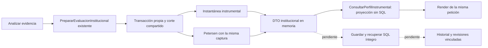

# Ejecución compuesta integrada en la pantalla de resultados

Fecha: 22/10/2026. Alcance: correcciones del circuito de análisis existente. No es aceptación total del sistema ni activación clínica. No se modificó el esquema ni los registros de la base institucional.

## Problemas corregidos

1. `ConsultarPerfilInstrumental` silenciaba un fallo de adquisición Petersen. El botón podía anunciar éxito aunque esa rama no estuviera disponible.
2. `analizarEvidencia` descartaba el resultado ejecutado; el render volvía a consultar con otro instante. Un segundo fallo conservaba la bandera de éxito anterior.
3. La consulta de Petersen podía volver a adquirir las mediciones que la consulta instrumental ya había leído.
4. La cabecera trataba cualquier resultado sin patrón como falta de valoraciones, incluso cuando el motor había emitido un requisito negativo explícito con cinco dominios interpretables.
5. El texto de revisión diferencial afirmaba un impedimento clínico incluso cuando el motor sólo acreditaba una conclusión negativa de C04.

## Integración implementada

Se reutiliza `PrepararEvaluacionInstitucional`, con su aislamiento `REPEATABLE READ` en PostgreSQL, corte común, captura compartida y reautorización posterior. El nuevo método `ConsultarPerfilInstrumental::desdePreparacion` presenta las dos salidas y sus huellas sin consultar fuentes actuales. La caché de la presentación es privada y sólo dura esa petición; el DTO completo no se incorpora al estado público de Livewire.

La siguiente petición Livewire invalida el aviso y la fecha del análisis previo. Sin conservación SQL, una nueva lectura no se presenta como recuperación de aquel resultado. Los errores de adquisición llegan al manejo seguro; una denegación de permisos sigue siendo una denegación. Ningún fallo crea una evaluación ni un aviso de éxito.

La consulta pasiva sigue siendo una lectura actual. Comparte la captura instrumental verificada cuando obtiene Petersen, pero no se declara un guardado histórico. Los hallazgos observacionales y las fuentes actuales mantienen su presentación separada.

`ResumenPetersenVisible` traduce el estado que ya emitió el motor: patrón, requisito negativo, información insuficiente, contradicción, revisión diferencial o falta de reglas. No deriva criterios ni cambia la precedencia clínica. Las reglas, la clasificación y la estructura de datos permanecen en sus componentes existentes.

## Archivos de este incremento

| Archivo | Responsabilidad |
| --- | --- |
| `app/Modulos/ApoyoDecision/Aplicacion/Consultas/ConsultarConocimientoCognitivo.php` | Expone al backend la adquisición autorizada con su DTO para compartir medidas. |
| `app/Modulos/ApoyoDecision/Aplicacion/Consultas/ConsultarPerfilInstrumental.php` | Proyección de ambas salidas sin SQL; consulta pasiva con captura compartida y errores visibles al manejador. |
| `app/Modulos/ApoyoDecision/Presentacion/Livewire/Paginas/ResultadosExpertoResidente.php` | Ejecución compuesta, estado de éxito correcto, denegación de acceso, caché privada de petición e invalidación al hidratar. |
| `app/Modulos/ApoyoDecision/Presentacion/Soporte/ResumenPetersenVisible.php` | Cabecera comprensible según el estado emitido, sin inventar faltantes. |
| `app/Modulos/ApoyoDecision/Presentacion/Soporte/MotivoPetersenVisible.php` | Explicación diferencial que admite C04 negativo sin atribuir un impedimento inexistente. |
| `app/Modulos/ApoyoDecision/Presentacion/Vistas/livewire/medico/resultados-experto-residente.blade.php` | Confirmación accesible con fecha humana del análisis. |
| `app/Modulos/ApoyoDecision/Presentacion/Vistas/livewire/medico/resultados-experto/petersen-institucional.blade.php` | Cabecera y orientación fieles al resultado. |
| `tests/Feature/EjecucionConsultaCognitivaTest.php` | Adquisición única, proyección sin consultas, errores, reintentos, permisos, falta de versión y nueva petición. |
| `tests/Feature/SistemaExpertoOrionNivel1Test.php` | Recorrido de los cuatro perfiles y abstenciones, con transacción propia y textos actuales. |
| `tests/Unit/ResumenPetersenVisibleTest.php` | Distingue requisitos negativos, faltantes, contradicción, diferencial y reglas no disponibles. |

## Verificación

La batería inicial de captura, conocimiento, originales Petersen, preparación compuesta, revisiones y permisos pasó 186 pruebas con 1808 aserciones; omitió tres carreras que requieren PostgreSQL. Ese resultado corresponde al estado previo a estas correcciones; no se suma a los resultados siguientes como si fueran pruebas únicas.

| Comando | Entorno | Resultado |
| --- | --- | --- |
| `php artisan test --filter='EjecucionConsultaCognitivaTest\|ResumenPetersenVisibleTest\|MotivoPetersenVisibleTest\|SistemaExpertoOrionNivel1Test' --compact --stop-on-failure` | SQLite desechable y unitarias | 26 pruebas, 136 aserciones; satisfactorio sobre el código final. Incluye ocho casos nuevos de ejecución, los cuatro perfiles por la acción de Livewire, las abstenciones y la traducción de estados. |
| `php artisan test --filter='ConocimientoCognitivoInstitucionalTest\|CapturaInstrumentalInstitucionalTest\|InformeCognitivoTest\|RevisionValoracionExpertaTest' --compact --stop-on-failure` | SQLite desechable | 153 pruebas, 1603 aserciones; satisfactorio tras integrar la ejecución compuesta y compartir las medidas. |
| `powershell -NoProfile -ExecutionPolicy Bypass -File scripts/probar-postgres.ps1 -Filtro 'EjecucionConsultaCognitivaTest\|PreparacionCompuestaCoherenteTest'` | Cluster PostgreSQL desechable | 11 pruebas, 75 aserciones; satisfactorio, incluidas las carreras reales. Incluyó seis pruebas de ejecución anteriores a los dos casos añadidos posteriormente. |
| `powershell -NoProfile -ExecutionPolicy Bypass -File scripts/probar-postgres.ps1 -Filtro EjecucionConsultaCognitivaTest` | Nuevo cluster PostgreSQL desechable | 8 pruebas, 58 aserciones; satisfactorio con los dos casos adicionales de hidratación y falta de versión. |
| `npm run build` | Vite | Satisfactorio. |
| `vendor/bin/pint --test` sobre los PHP modificados | Estilo | Satisfactorio. |
| `git diff --check -- <archivos modificados>` | Cambios de esta entrega | Sin errores de espacios. |

La verificación visual con navegador no pudo ejecutarse: la herramienta devolvió `Local browser use is disabled in Work settings`. El render funcional se verificó con Livewire. No se ejecutó la suite Laravel global ni se afirma validación clínica.

## Límites materiales del cierre integral

- **Conservación institucional:** continúa sin escritor/lector SQL íntegro instalado para ambas ramas. `persistido=false` es el estado real. La referencia F02 es un ensayo amplio, no el esquema institucional nominal. Cambiar una bandera no resuelve la conservación.
- **Historial y revisiones Petersen:** requieren una evaluación completa y recuperable. Las revisiones existentes no se conectaron a un DTO transitorio.
- **Mediciones originales:** la consulta local del 22/10 encontró 286 aplicaciones observacionales, 704 funcionales y cero aplicaciones cognitivas instrumentales o valoraciones Petersen originales. No se fabricaron registros para obtener un patrón.
- **Validación clínica:** los casos automatizados son sintéticos. No constituyen mediciones, firmas ni aceptación profesional de residentes reales.

La conservación íntegra sigue siendo una implementación pendiente. Se conserva el inventario de 104 tablas de negocio y el trabajo simultáneo del árbol. Sin commit, push ni despliegue.
