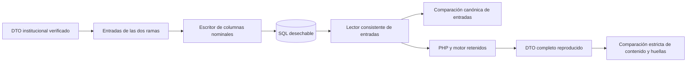

# Conservación institucional: escritor nominal, lector y replay

**Fecha:** 22/10/2026. **Dictamen:** avance técnico comprobado; **no se cierra la conservación institucional ni el sistema completo**. Este ensayo no modifica `remembermind_dev`, no instala migraciones y no cambia el máximo aprobado de 110 tablas.

La preparación y consulta institucional existentes siguen funcionando. Este corte desarrolla el bloqueo de conservación sin reconstruir Petersen, los cinco dominios ni el gobierno de reglas. No incorpora observaciones como mediciones instrumentales ni atribuye aprobación clínica a una investigación bibliográfica.

## Autoridad y alcance

Se mantienen el [máximo de 110](DECISION_MAXIMO_110_TABLAS_2026_10_21.md), el baseline, `database/AGENTS.md`, el [contrato C01–C05](CONTRATO_FUNCIONAL_PETERSEN_C01_C05_2026_10_21.md), [Fase 6](FASE_6_PREPARACION_COMPUESTA_2026_10_20.md) y el [dictamen de las brechas B01–B03](DICTAMEN_CONSERVACION_INSTITUCIONAL_110_2026_10_21.md). Este informe amplía la evidencia de aquel dictamen; no sustituye su decisión estructural ni autoriza la DDL del laboratorio.

La rama observada es `feature/apoyo-decision-informe-neurocognitivo`, HEAD local `47da9c0f`. El árbol tenía numerosos cambios simultáneos; se preservaron. No se ejecutaron operaciones de staging, commit, push ni despliegue.

Los archivos propios de este corte son `prototipos/orion-conservacion-nominal/`, `tests/Feature/ConservacionNominalCompuestaTest.php`, `tests/Unit/ContratoNominalTest.php`, este informe y su entrada en el README del sistema experto. No se atribuyen a este corte las modificaciones concurrentes de aplicación, frontend, BDD u otros módulos. `git diff --stat` no incluye el contenido de los archivos todavía sin seguimiento; el estado se inspeccionó además con `git status --short`.

## Implementación real de este corte

Se añadió [el candidato nominal ejecutable](../../prototipos/orion-conservacion-nominal/README.md), fuera del contenedor Laravel y de las migraciones. Usa el mapa cerrado F02 y el motor PHP existente.



Hay dos comprobaciones distintas:

1. **Recuperación exacta de entradas:** el lector devuelve desde SQL las entradas, tipos, ausencias, NULL y orden conservados. No consulta información clínica actual.
2. **Replay determinista:** el motor, adaptador y ejecutable PHP retenidos reproducen ambas ramas y el DTO completo, incluidas sus huellas. Se compara el contenido íntegro, además del código final de perfil.

**No hay todavía una tercera propiedad:** recuperar las salidas y trazas completas directamente desde SQL sin ejecutar el motor. `EntradasCompuestas::proyectar` retira las salidas y las extracciones recalculables; el prototipo nominal conserva esa decisión de la referencia F02. Por ello no se presenta el replay como lectura independiente del resultado emitido.

## Inventario físico y normalización

Las migraciones actuales se crean en cada ensayo sobre una base desechable: **120 tablas físicas, 104 de negocio y 16 técnicas**. El candidato añade:

| Grupo | Relaciones nuevas |
| --- | ---: |
| Contexto y entradas de las dos ramas | 1 |
| Capturas, motivos, selectores, preguntas, respuestas y vínculos | 6 |
| Contratos adquiridos y modalidades | 2 |
| Copias del conocimiento observado | 12 |
| Vínculos interpretativos, mediciones requeridas y predicados | 3 |
| Exclusiones y constancias documentales | 2 |
| Membresías, miembros, procedencias, juicios, dominios revisados y fuentes de soporte | 6 |
| Cabecera de conservación y release retenido | 2 |
| **Total** | **34** |

El resultado sería **138 tablas de negocio**, 28 por encima del máximo autorizado. Es un candidato fallido respecto del presupuesto, aunque sus pruebas técnicas pasen. No se instaló.

El mapa anterior tenía 39 modelos, 51 ubicaciones y 783 rutas de campos. Se extrajo como registro 1:1 la captura original de un soporte, dando 40 modelos lógicos. Ocho parejas compatibles comparten tabla, con propietarios y roles cerrados; quedan 32 tablas de entradas más cabecera y release. Las dos variantes de captura tienen FK distintas y exclusivas hacia la entrada o la fuente de soporte; no se sustituyen por un par de texto `tipo/id`.

Las colecciones independientes tienen filas hijas: contratos/modalidades, captura/preguntas/respuestas, juicio/soportes y membresía/miembros. No se guardan arreglos clínicos en JSON, ni atributos/valores dinámicos, ni listas delimitadas. Cada escalar tiene columna nominal y tipo declarado; sólo los campos con unión real de tipos disponen de alternativas tipadas cerradas. Las fechas originales se conservan como texto del contrato, incluido su huso, sin convertirlas a una fecha local de precisión inferior. Los decimales originales representados como cadenas conservan su precisión textual.

La representación física suma **1215 columnas** entre las 34 tablas. Las mayores son `entradas_institucionales` (**207**) y `capturas_adquiridas` (**173**). Aunque reduce la expansión del codec genérico anterior, esta anchura sigue siendo un problema de mantenibilidad que impide declarar el diseño definitivo. No hay dictamen independiente de 4FN aprobado para instalarlo.

## Diccionario y matrices completas

El [generador](../../prototipos/orion-conservacion-nominal/generar-diccionario.php) compila el candidato exclusivamente en SQLite en memoria y genera 14 artefactos reproducibles:

- [Cobertura de las 783 rutas](../../prototipos/orion-conservacion-nominal/cobertura-783.csv).
- [Cobertura de las 51 ubicaciones](../../prototipos/orion-conservacion-nominal/cobertura-51-rutas.csv).
- [Modelos y propietarios](../../prototipos/orion-conservacion-nominal/modelos.csv).
- [Campos locales, tipos y destinos](../../prototipos/orion-conservacion-nominal/matriz-campos.csv).
- [Diccionario físico](../../prototipos/orion-conservacion-nominal/diccionario-fisico.csv), [FK](../../prototipos/orion-conservacion-nominal/fk.csv) e [índices](../../prototipos/orion-conservacion-nominal/indices.csv).
- [Modelo entidad-relación](../../prototipos/orion-conservacion-nominal/modelo-er.mmd).
- DDL exacta de ensayo para [SQLite](../../prototipos/orion-conservacion-nominal/esquema-sqlite.sql) y [PostgreSQL](../../prototipos/orion-conservacion-nominal/esquema-pgsql.sql), con reversión para ambos motores.
- [Referencias semánticas pendientes](../../prototipos/orion-conservacion-nominal/referencias-conocimiento-pendientes.csv) y [resumen cuantificado](../../prototipos/orion-conservacion-nominal/resumen.json).

Las **651 rutas locales** no reemplazan ni recortan las 783 ubicaciones originales: los mismos modelos de conocimiento aparecen en ambas ramas. El generador comprueba un destino unívoco para cada una de las 783 rutas y las 51 ubicaciones, y falla si el inventario cambia sin actualizar el mapa. `--check` comprueba que los artefactos versionables coinciden con el código.

## Estado preciso de B01–B03

| Brecha | Avance implementado y probado | Lo que no queda cerrado |
| --- | --- | --- |
| B01: definición frente a relación adquirida | Contratos y modalidades adquiridos tienen tablas propias; no se insertan en `relaciones_semanticas`. | Reutilización institucional con presupuesto de seis tablas y todas las referencias históricas. |
| B02: captura frente a evidencia extraída | Capturas, preguntas declaradas, respuestas y vínculos tienen campos y propietarios propios. Se conserva una pregunta sin respuesta. No se relajan FK de `evidencias_evaluacion`. | Todas las referencias semánticas entre identificadores originales, catálogos y copias históricas requieren su diseño final, distinguiendo referencias válidas de originales excluidos o incompletos. |
| B03: membresía de soporte | Los IDs de miembro conservan orden, presencia y propietario dentro de la misma evaluación. | El FK del propietario no acredita por sí solo la identidad del soporte terminal. Falta cerrar la correspondencia completa entre cada ID de membresía, juicio/procedencia y soporte original, incluidas exclusiones. |

El cotejo con el inventario del esquema identifica **44 referencias del conocimiento** copiadas como identificadores originales, sin FK semántica histórica equivalente todavía. Se enumeran individualmente en el CSV. No deben apuntarse automáticamente a definiciones actuales: haría falta la versión y rama conservadas. Tampoco se debe forzar como válida una referencia original ausente o excluida. Esta brecha impide afirmar integridad relacional completa, incluso si se autorizara un máximo mayor.

## Atomicidad, cierre y concurrencia

`RepositorioNominal` exige su propia transacción. La identidad SQL debe coincidir con la del DTO, residente y usuario provienen de su contexto verificado, y la solicitud tiene formato UUID y unicidad. Una repetición sólo devuelve «ya conservada» si coinciden identidad, solicitud y contenido; no sobrescribe historia.

En PostgreSQL, las solicitudes todavía sin fila se serializan mediante un advisory lock por solicitud. Otro lock por evaluación cubre la creación y la inserción de sus hijas. La prueba lanza **tres conexiones reales**: una conserva/cierra, otra intenta insertar una hija y otra repite la solicitud. Comprueba en `pg_stat_activity` que las otras dos esperan un bloqueo antes de confirmar la primera; después se rechaza la inserción tardía y el reintento reconoce el registro existente.

Las FK compuestas incluyen evaluación y propietario. Las restricciones verifican propietarios exclusivos, roles, claves de mapa/lista, unicidad de posición y clave, estados de presencia, alternativas de tipo y cardinalidad de las colecciones. El cierre verifica posiciones continuas. El lector rechaza campos ocultos bajo objetos ausentes, tipos incompatibles, filas no consumidas y claves ambiguas.

Una evaluación cerrada, sus hijas y el registro de release son inmutables. PostgreSQL también rechaza `TRUNCATE` y confirmar una cabecera abierta mediante trigger diferido. SQLite carece del equivalente de este último trigger al confirmar la transacción; allí el escritor y los triggers de cierre impiden que su operación produzca una evaluación cerrada parcial. Los lectores sólo admiten evaluaciones cerradas.

El fallo intermedio deja cero cabeceras y cero filas hijas. El ensayo poblado retira las 34 relaciones añadidas, comprueba que permanecen las 120 tablas originales y sus filas sintéticas de residente/usuario, reinstala el candidato y restaura ambas ramas desde lo recuperado. **No es una migración ni una reversión de tablas institucionales pobladas.**

## Seguridad e integración

- El repositorio sólo admite SQLite en memoria sin adjuntos persistentes o el runner PostgreSQL efímero propio con propietario no privilegiado. No modifica `.env`.
- Los artefactos binarios y casos se retienen en un directorio temporal privado, comprobado antes de eliminarlo. No se añaden binarios ni registros de residentes reales al repositorio.
- El ejecutor retenido F02 es Windows; no se afirma portabilidad del replay binario a Linux. Las pruebas que lo necesitan se omiten explícitamente fuera de Windows/ZIP.
- El candidato no se registra en rutas, Livewire, Policies ni el contenedor. No concede permisos nuevos, no ofrece una API de escritura institucional y no vincula revisiones a estos ensayos.
- Se conserva `persistido=false` en la aplicación. La bandera dentro del DTO histórico forma parte de su contenido; una futura integración deberá distinguirlo del estado real del envoltorio de persistencia sin reescribir el original.
- No se auditó como superado el gate independiente de seguridad, normalización ni compatibilidad de todos los consumidores de una futura migración. Los ensayos añadidos no son autorización clínica.

## Pruebas y reproducción

```powershell
php prototipos/orion-conservacion-nominal/generar-diccionario.php --check
php vendor/bin/pint prototipos/orion-conservacion-nominal tests/Feature/ConservacionNominalCompuestaTest.php tests/Unit/ContratoNominalTest.php --test
php artisan test --filter='ConservacionNominalCompuestaTest|ContratoNominalTest|CicloObservacionalConservadoTest|EjecucionConsultaCognitivaTest|ResumenPetersenVisibleTest|MotivoPetersenVisibleTest|SistemaExpertoOrionNivel1Test' --compact --stop-on-failure
powershell -NoProfile -ExecutionPolicy Bypass -File scripts/probar-postgres.ps1 -Filtro 'ConservacionNominalCompuestaTest|ContratoNominalTest'
```

Los resultados finales de este corte se registran en la tabla siguiente. Las ejecuciones previas no se suman como si fueran casos distintos.

| Comprobación | Entorno y alcance | Resultado |
| --- | --- | --- |
| Diccionario, matrices y DDL | SQLite en memoria, sin iniciar Laravel | 14 artefactos; 783 rutas y 51 ubicaciones con destino; reproducción de artefactos comprobada. |
| Representación tipada | SQLite | 2 pruebas unitarias / 13 aserciones: incluye `PHP_INT_MAX`, precisión textual, `PHP_FLOAT_MAX`, signo de `-0.0`, booleano frente a entero, NULL y ausencia. |
| Batería final SQLite y unitarias | Filtro exacto indicado arriba; incluye ejecución Livewire, cuatro perfiles y revisión observacional independiente | **34 pruebas satisfactorias, 317 aserciones, una omitida**: la carrera se ejecuta en PostgreSQL. Duración 155,23 s. [Salida completa](../../prototipos/orion-conservacion-nominal/evidencia/sqlite-final.txt). |
| Batería final del candidato en PostgreSQL | Cluster desechable propio, PHP 8.3.33 / PostgreSQL 18 | **7 pruebas, 154 aserciones, cero fallos y cero omisiones**. Duración 115,39 s. [JUnit](../../prototipos/orion-conservacion-nominal/evidencia/postgres-final.junit.xml) y [salida](../../prototipos/orion-conservacion-nominal/evidencia/postgres-final.txt). |
| Entradas y replay completos | SQLite y PostgreSQL desechables | Diez variantes: cuatro perfiles, falta de C03, falta de gobierno, falta de datos, NULL/ausencia/orden, seis fuentes/documentos y vínculo interpretativo. Se comparan todas las entradas y el contenido completo reproducido con las huellas de ambas ramas. |
| Concurrencia | PostgreSQL desechable | Tres conexiones y dos esperas de lock comprobadas; inserción tardía rechazada, solicitud repetida sin duplicación. |
| Atomicidad, FK, identidad, cierre y reversión añadida | Bases desechables | Rollback parcial, rechazo de identidad ajena y propietario de otra evaluación, cierre incompleto, historia inmutable y restauración del candidato poblado. |
| Frontend/build | No se cambió frontend en este corte | No repetido; el build satisfactorio anterior sigue documentado en la entrega de ejecución compuesta. No constituye QA visual de una persistencia que aún no está integrada. |

## Trazabilidad de este avance

| Requisito | Archivo | Prueba/evidencia | Aceptación |
| --- | --- | --- | --- |
| Columnas nominales y tipos | `ContratoNominal`, `EsquemaNominal` | `ContratoNominalTest`, diccionario y DDL generado | Comprobado en el ensayo. |
| Cobertura de 39 modelos originales / 51 ubicaciones / 783 rutas | `generar-diccionario.php` | CSV de cobertura; 40 modelos tras extraer un registro 1:1 | Comprobado como representación, no como diseño institucional aprobado. |
| Preguntas sin respuesta y fuentes de ambas ramas | `ProyeccionNominal` | Diez variantes de `ConservacionNominalCompuestaTest` | Comprobado en el ensayo. |
| Recuperación de entradas exactas y replay íntegro | `RepositorioNominal`, adaptador y runtime F02 existentes | Igualdad estricta y tres huellas por variante | Comprobado en Windows; salida directa independiente pendiente. |
| Cierre concurrente e idempotencia | DDL PostgreSQL y `worker-concurrencia.php` | Prueba con tres conexiones | Comprobado en PostgreSQL desechable. |
| Integridad semántica completa / B03 | Copias de conocimiento y membresías | CSV de 44 referencias pendientes | No aceptado todavía. |
| Máximo 110 | Conteo físico del generador | 104 + 34 = 138 | No aceptado. |
| Historial y revisiones institucionales compuestas | Integración Laravel existente | No se conectó a un repositorio de ensayo | Bloqueado por un diseño instalable y su autorización específica. |

## Qué falta para poder instalar

1. Rediseñar o reutilizar legítimamente granos hasta cumplir **104 + como máximo seis**; la variante nominal actual no sirve para instalar.
2. Cerrar las FK semánticas y las membresías originales sin confundir definición, captura, soporte, evidencia y juicio.
3. Conservar y leer las salidas/trazas completas independientemente del replay, o formalizar expresamente otro contrato; el requisito actual pide ambas propiedades.
4. Probar la transición y reversión pobladas de cualquier tabla existente que se reutilice, todos sus consumidores, 4FN, crecimiento y mantenimiento. Este ensayo sólo añadió tablas propias.
5. Pasar el gate independiente y presentar entonces el diccionario/DDL concreto que cumpla el máximo para aprobación estructural, como exigen los [AGENTS de BDD](../../database/AGENTS.md). No se pide aprobar este candidato que ya incumple el máximo.
6. Tras esa autorización, integrar conservación real, historial y revisiones posteriores independientes; repetir la aceptación operativa completa. Las mediciones reales y la validación clínica siguen siendo requisitos distintos del desarrollo técnico.

No se afirma una cota mínima universal. Como simple comparación aritmética, incluso reutilizar hipotéticamente las 12 tablas de conocimiento y una cabecera reduciría este candidato a 21 tablas adicionales (**125 en total**), todavía 15 por encima del máximo; esa reutilización tampoco está demostrada. Aumentar el máximo por sí solo no corrige los puntos 2–4.

**Clasificación final del corte:** escritor/lector de entradas y replay del candidato **implementados y probados**; conservación institucional completa **no culminada**, por diseño físico todavía incompatible y brechas de integridad/lectura directa. No hay activación clínica, instalación ni revisión firmada de estos casos sintéticos.
