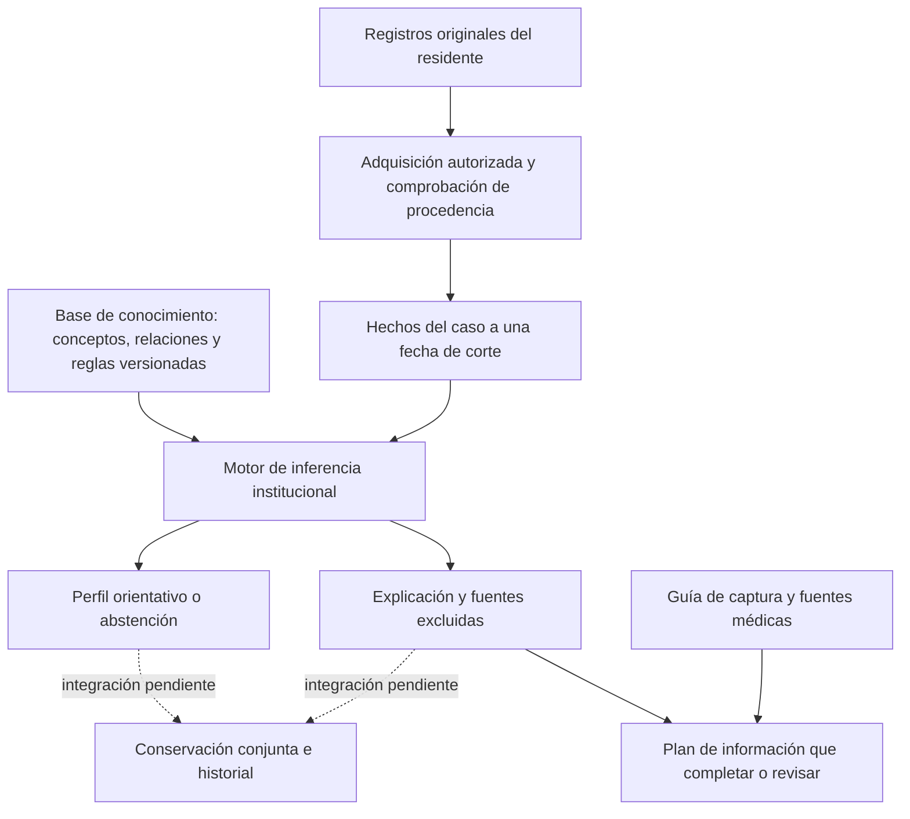

# Alcance y resultado

Se completa la guía médica de adquisición y su conexión con el resultado institucional existente. El sistema muestra qué información falta o necesita revisión, dónde se registra y qué fuentes profesionales fundamentan esa orientación. Esta entrega no modifica criterios, puntos de corte, permisos, relaciones ni tablas. **No cierra la conservación conjunta instrumental/Petersen ni activa instrumentos todavía sin perfil operativo.** Esas dos brechas quedan delimitadas aquí, sin presentarlas como funciones terminadas.

Se mantiene la decisión de la propietaria: durante todo el desarrollo no se solicitan estudios con residentes, firmas, referencias humanas ni avales externos. La evaluación posterior en uso real no es condición de desarrollo. Las pruebas usan datos controlados exclusivamente dentro del entorno técnico; no se agregan simulaciones al producto.

## 1. Qué debe hacer el sistema

Apoyar la detección temprana de **posible DCL en personas mayores de 60 años**, mediante información original, reglas versionadas y explicación reconstruible. Debe distinguir resultado orientativo, información insuficiente, contradicción y datos no interpretables. No establece por sí solo etiología Alzheimer ni cambia prescripciones.

La preocupación por un cambio cognitivo, la objetivación del rendimiento y el funcionamiento cotidiano deben analizarse conjuntamente. La independencia funcional puede conservarse con mayor esfuerzo o estrategias compensatorias; una puntuación aislada no resuelve esa distinción. Estos conceptos proceden de los criterios de Albert y colaboradores; el detalle ejecutivo C01–C05 pertenece al contrato institucional adoptado. [Fuente médica: NIA-AA, 2011](https://pmc.ncbi.nlm.nih.gov/articles/PMC3312027/).

La guía DETeCD describe una evaluación individualizada de personas con síntomas cognitivos o conductuales: historia, informante, examen y pruebas según el contexto. No la convertimos en una regla automática de cribado universal por cumplir años. [Fuente médica: Alzheimer’s Association, recomendaciones para atención primaria](https://pmc.ncbi.nlm.nih.gov/articles/PMC12173843/).

## 2. Arquitectura y responsabilidades

| Componente | Implementación y estado |
|---|---|
| Registros originales | Atención/contexto, aplicaciones y respuestas, funcionamiento cotidiano, valoraciones originales y documentos. Se conservan autor y fecha clínica. |
| Adquisición | `CapturasInstrumentalesResidente` y `ConsultarPetersenInstitucional`; lectura por residente y fecha, soportes coherentes y permisos vigentes. |
| Hechos | `ConstructorMemoriaInstrumental`; traduce originales explícitos, no narrativas interpretadas automáticamente. |
| Conocimiento | `ContratosConocimiento`, `PaqueteConocimiento`, paquetes institucionales y catálogo por versión. |
| Inferencia | `EvaluarPerfilInstitucional` y `EvaluarPetersenInstitucional`, existentes; no se crea otro motor. |
| Ayuda de captura nueva | `GuiaAdquisicionDcl`, metadatos descriptivos y fuentes. `PlanCapturaDcl` organiza únicamente los estados ya calculados. |
| Pantalla existente | Consulta de resultados de Medicina/Psicología: desplegable «Qué información conviene completar o revisar». No requiere otra pantalla ni escritura implícita. |
| Historial conjunto | Pendiente de un contrato estructural y de autorización compatible con el modelo vigente. El guardado observacional tiene un alcance distinto. |

**Precisión de la auditoría:** el contrato cognitivo incorporado incluye `admite_memoria_vacia=true`. Puede ejecutar con vínculos vacíos y abstenerse justificadamente. La falta de perfiles impide interpretar pruebas específicas; no significa que el motor no exista o no pueda ejecutar una evaluación sin datos. Un contrato personalizado puede tener otro comportamiento explícito.

## 3. Ficha profesional de adquisición

Los apartados siguientes orientan los campos y las notas existentes. No añaden obligatoriedad, preguntas puntuables, escalas nuevas ni resultados automáticos.

| Apartado | Información que registrar | Fuente propia del sistema | Efecto permitido |
|---|---|---|---|
| Contexto | Edad a la fecha de aplicación; escolaridad en años; lectura/escritura referidas; idioma y apoyos; informante principal y conocimiento del nivel previo. | Atención enlazada y contexto compartido; circunstancias adicionales en notas. | Ayuda a valorar aplicabilidad; no corrige puntuaciones por sí mismo. |
| Cambio | Qué ha cambiado, ejemplos, inicio y evolución; separar relato del residente, del informante y observación profesional. | Entrevista/valoración original y soportes de historia/corroboración. | Sustento de C01 conforme al contrato existente. |
| Cognición | Instrumento, edición, forma e idioma exactos; tareas administradas, brutos, unidades, autor, fecha, ayudas e interrupciones. | Aplicación, respuestas y documento original cuando corresponda. | Entrada de un método explícito; nunca reparto de un total entre dominios. |
| Funcionamiento | Actividad previa/actual, oportunidad real de realizarla, ayuda y causa; limitación física frente a dificultad cognitiva. | Formulario propio IADL, con rectificación enlazada. | Sustento funcional; no equivale automáticamente a FAQ ni a C03 favorable. |
| Diferencial | Contexto médico relevante, evolución aguda/fluctuante, ánimo, sueño, fármacos, condiciones sensoriales y lo todavía no resuelto. | Atención profesional, antecedentes, diagnósticos y documentos. | Sustento de C04; sin nuevas órdenes de estudios o tratamientos automáticos. |
| Interpretabilidad | Correspondencia entre material, administración y referencia; limitaciones; juicios exactos revisados de cada área. | Condiciones originales y valoración C05 con soportes. | Mantener no interpretable o desconocido cuando corresponda. |

Las recomendaciones DETeCD respaldan integrar contexto demográfico, medicamentos, historia y rendimiento, en lugar de decidir por un único número. La selección de pruebas y la interpretación de su perfil dependen del caso. [Fuente médica: instrumentos de evaluación clínica, 2025](https://pmc.ncbi.nlm.nih.gov/articles/PMC11772712/).

### Diseño de los formularios propios

1. **Entrevista/contexto:** identificar residente, atención y autor; conservar fecha clínica e informante. Las preguntas guía son «¿Qué ha cambiado?» y «¿Qué ejemplos permiten compararlo con antes?». No asignan puntos.
2. **Captura instrumental:** seleccionar identidad exacta y aplicación; conservar respuesta original y unidad. Desconocido/no medido permanece ausente. Cero y No son valores válidos, diferentes de ausencia.
3. **Funcionamiento cotidiano:** registrar una actividad por acto, oportunidad y ayuda con su causa. No concluir dependencia por vivir en una residencia ni por no cocinar allí.
4. **Valoración original:** seleccionar dominio o requisito autorizado, estado explícito, justificación y soportes. C02 se deriva de los dominios; no aparece como captura manual.
5. **Consulta:** presentar resultado, impedimentos y plan de faltantes. Consultar o abrir la guía no registra una evaluación ni sustituye el juicio profesional original.

Los campos nuevos de contexto ya instalados mantienen un idioma y un informante principal por atención. No almacenar listas multivaluadas en esas columnas ni extraer hechos automáticos desde notas. No se ha modificado esa estructura en esta entrega.

## 4. Instrumentos iniciales y evaluación ampliada

Se conserva la selección aprobada: entrevista e informante → **MoCA o RUDAS** como alternativas de cribado → información funcional, incluyendo FAQ cuando se disponga de su edición aplicable. Una batería ampliada se elige por la pregunta del caso; no se administran automáticamente todos los instrumentos del catálogo.

| Instrumento/apoyo | Qué aporta | Qué falta para usarlo como entrada ejecutable |
|---|---|---|
| MoCA Full | Cribado cognitivo global en la forma realmente administrada. | Edición/forma/idioma exactos, alcance de incorporación, identidad de catálogo y perfil correspondiente. |
| RUDAS | Alternativa de cribado concebida para reducir influencia cultural/lingüística. | Material español final e identidad exacta; no intercambiar RUDAS original y RUDAS-PE. |
| FAQ/Pfeffer | Información instrumental aportada por un informante. | Edición aplicable y reglas de datos desconocidos/no aplicables. No sustituir por las ocho actividades propias. |
| Evaluación por dominios | Objetivar el área afectada cuando el cribado no responde la pregunta. | Mediciones originales y método aplicable para memoria, atención, función ejecutiva, lenguaje y capacidad visuoespacial. |

MoCA distingue el uso del total de la interpretación de tareas/subpuntuaciones; además, sus condiciones regulan reproducción e incorporación. No se copian reactivos ni se presenta una guía propia como MoCA. [Administración e interpretación](https://mocacognition.com/faq/) · [Condiciones oficiales vigentes consultadas](https://mocacognition.com/terms-of-use/).

RUDAS-PE cuenta con evidencia en adultos mayores de Lima, con características educativas y lingüísticas concretas. Sus resultados no constituyen normas bolivianas ni autorizan una equivalencia entre ediciones. No se importan sus puntos de corte a las reglas institucionales. [Dementia Australia: descripción original](https://www.dementia.org.au/professionals/assessment-and-diagnosis-dementia/rowland-universal-dementia-assessment-scale-rudas) · [Custodio et al., 2020](https://www.frontiersin.org/journals/neurology/articles/10.3389/fneur.2020.00374/full).

FAQ informa sobre funcionamiento instrumental; la información indirecta puede sobreestimar o subestimar capacidades. Por ello se distingue quién informa y la oportunidad de observar la actividad. No se reproducen sus preguntas ni se asigna su puntuación al formulario propio. [Fuente profesional: Hartford Institute for Geriatric Nursing](https://hign.org/sites/default/files/2020-06/Try_This_Dementia_13.pdf).

El diccionario existente `CatalogoCapturaCognitiva` documenta los 19 componentes y sus referencias. El registro de 23 métodos técnicos no significa que las tres familias iniciales tengan perfiles activos. Para comparar aplicaciones se necesita identidad, condiciones y método compatibles; un cambio de bruto entre instrumentos distintos no se presenta como empeoramiento.

## 5. Reglas, inferencia y salidas

Se conservan las reglas adoptadas y su orden: contradicción → impedimento diferencial → información insuficiente/no interpretable → requisito negativo explícito → patrón si las condiciones y la regla vigente lo permiten. No se añaden porcentajes de certeza ni umbrales desde esta investigación.

| Condición del motor | Plan de captura nuevo |
|---|---|
| U: información insuficiente | Consultar qué valoración o soporte original falta. |
| I: dato no interpretable | Revisar condiciones y referencia antes de interpretarlo. |
| X: contradicción | Revisar registros incompatibles conservando su procedencia; no elegir uno en silencio. |
| A/P en dominios o S/N en requisitos | Mantener el estado. Un resultado negativo explícito no se presenta como información ausente. |
| Todos los estados definidos | Indicar que no hay faltantes de estado; esto incluye negativos y no significa que exista un patrón DCL o un resultado guardado. |

Los cuatro patrones orientativos existentes son amnésico de dominio único, amnésico multidominio, no amnésico de dominio único y no amnésico multidominio. Las exigencias institucionales de cinco dominios y sus soportes permanecen; no se atribuyen como requisitos universales literales de una publicación.

No se incorpora un plazo fijo universal de días o meses. Deben documentarse inicio, evolución y comparación disponible; la repetición de pruebas depende del instrumento y de la pregunta profesional. El seguimiento no se usa como excusa para detener el desarrollo técnico.

## 6. Brecha estructural concreta: conservación conjunta

**Estado: NO IMPLEMENTADA.** Esta entrega no cambia silenciosamente el contrato congelado. La petición de completar el funcionamiento no se interpreta como permiso para ampliar relaciones o competencias sensibles.

Evidencia técnica:

- `InstantaneaEvaluacionInstitucional` obliga `persistido=false` y `release_retenido=false`; es un DTO verificable en memoria.
- `ConservarObservaciones` conserva controles cognitivos y sus indicadores; no conserva íntegramente aplicaciones instrumentales/Petersen.
- Los checks `snap_origen`, `snap_episodio_original` y `snap_tipo_criterio` limitan orígenes y contratos de conservación. Añadir originales instrumentales exige una transición explícita.
- `AlmacenInstantaneas` y el repositorio experimental conservan guardas de entorno desechable y casos sintéticos; quitarlas no los convierte en repositorios institucionales.
- La Policy tiene ejecución observacional; no existe todavía autorización de escritura conjunta equivalente. Lectura de resultados no concede ese permiso.

### Contrato que debe resolverse antes de instalar esa transición

| Decisión | Condición de diseño requerida |
|---|---|
| Orígenes originales | Representar cada aplicación, respuesta y valoración con identidad íntegra, pertenencia al residente y fecha de corte. Documentar columnas/checks/FK concretos antes de DDL. |
| Relaciones y 4FN | Reutilizar relaciones de igual grano; no combinar colecciones independientes de respuestas, reglas, soportes o condiciones en una sola fila. No crear tablas por esta entrega ni introducir JSON/EAV como atajo. |
| Métodos y conocimiento históricos | Conservar versión y parámetros realmente usados, junto con originales; consultar la configuración actual no reconstruye el pasado. |
| Ejecución autorizada | Decidir el permiso específico y su alcance para Medicina/Psicología; cuenta activa, competencia y Policy del residente siguen siendo necesarios. No asignar permisos por iniciativa técnica. |
| Acción de ejecución | UUID idempotente, reautorización, adquisición consistente, transacción, escritura, lectura independiente y comprobación antes de confirmar. |
| Recuperación | Leer el resultado conservado y su explicación sin reinterpretarlo con reglas actuales. Enlazar revisión posterior a su identificador persistido. |

**No hay migración propuesta como lista para instalar:** falta cerrar la representación íntegra compatible con esas restricciones. Una lista de columnas improvisada o un archivo JSON no resolvería la conservación profesional ni la 4FN. El entregable identifica el límite con precisión; no inventa una aprobación estructural. No es un requisito de aval externo.

## 7. Verificación de esta entrega

| Dimensión | Evidencia |
|---|---|
| Motor puro y guía | `PlanCapturaDclTest`: ausencia, negativo explícito, contradicción, no interpretable, contrato/estado incompatible, fuentes y ausencia de mutación. |
| Integración autorizada | `EjecucionConsultaCognitivaTest`: misma captura para ambas ramas, una adquisición, cero consultas adicionales al proyectar el DTO, fallo/revocación sin éxito, ninguna evaluación guardada implícitamente. |
| Inventario sin historias | Guía incluida en `PreparacionCircuitoInstrumental`, ya consumida por `scripts/inventariar-experto.php`; conserva contrato de lectura de metadatos. |
| UI | Vista Blade real renderizada con SQL prohibido; details por teclado, cinco anchos, enlaces explícitos y ningún identificador de criterio visible. |
| Seguridad | Ningún permiso nuevo, ninguna escritura añadida, fuentes médicas públicas sin datos del residente en URL. Las Policies y controles de lectura vigentes permanecen. |
| BDD | Sin DDL, tablas, relaciones ni datos modificados. No se altera el inventario institucional. |
| Legacy | Sin reconectar catálogos TEST, paquetes históricos o repositorios experimentales al producto. |

Resultados ejecutados el 31/10/2026:

- SQLite: **18 pruebas / 454 aserciones correctas** en plan, preparación y contrato de entradas sin residentes; **8 pruebas / 63 aserciones correctas** en integración de la consulta.
- PostgreSQL 18 desechable y aislado: **19 pruebas / 150 aserciones correctas** en plan, preparación y consulta. No se usó la base operativa para estas pruebas.
- Navegador: **1 prueba correcta** sobre el Blade real, en 1440, 1280, 1024, 768 y 390 px. Sin desbordamiento horizontal, controles de al menos 44 px, apertura/cierre por teclado, fuentes HTTPS y sin códigos de criterios visibles. Imágenes de 390 y 1440 px inspeccionadas. Es QA del apartado nuevo, no una nueva auditoría de todas las pantallas.
- `npm run build`: correcto; persiste el aviso anterior de bundle mayor de 500 kB.
- Revisión independiente de lectura: PASS en guía y proyección; no se añadieron reglas diagnósticas, SQL, permisos o persistencia. Sintaxis PHP y diff revisados.

Comandos reproducibles: `php vendor/phpunit/phpunit/phpunit --no-progress --do-not-cache-result tests/Unit/PlanCapturaDclTest.php tests/Unit/PreparacionCircuitoInstrumentalTest.php tests/Feature/ContratoEntradasSinResidentesTest.php`; integración con `tests/Feature/EjecucionConsultaCognitivaTest.php`; navegador con `node --test tests/Frontend/plan-captura-dcl.test.js`; build con `npm run build`. PostgreSQL usa el perfil `phpunit.postgres.xml` exclusivamente contra una base técnica desechable.

Evidencia local, excluida del commit: `output/dcl-entrega-20261031-*.txt` y `output/dcl-guia-20261031/`. Las pruebas anteriores conservan su propio corte; no se vuelven a atribuir a esta entrega. No se ejecutó la suite completa del repositorio ni se afirma desempeño diagnóstico en uso real.

## 8. Qué puede utilizarse ahora y qué no está terminado

**Disponible:** captura contextual original ya instalada; inferencia institucional y abstenciones; conservación observacional existente; nueva ayuda médica de captura integrada en resultados y preparación del circuito.

**Pendiente esencial para el experto integral:** perfiles exactos de instrumentos iniciales y su incorporación permitida; conservación y recuperación institucional conjunta; autorización de esa escritura; historial y revisión del conjunto conservado. No se declaran finalizados por tener documentación o pruebas del motor.

No se enviaron correos, se contactó a profesionales ni se solicitaron estudios reales, firmas o avales externos. No se realizó push. La fase posterior en uso real queda fuera del desarrollo actual.
