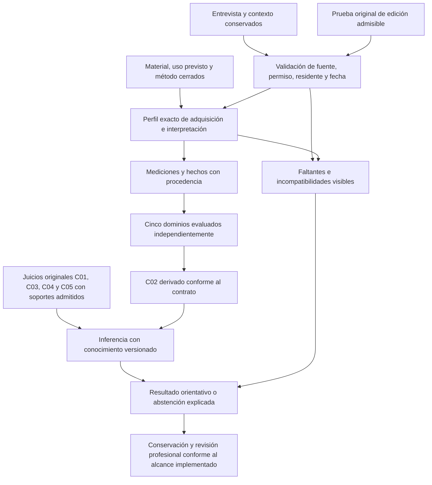

# Resultado ejecutivo

**Corte posterior vigente:** [activación del04/11/2026](ENTREGA_ACTIVACION_PERFILES_INICIALES_2026_11_04.md). Están instalados los tres perfiles de captura y puntuación identificados allí. Este documento conserva la evidencia de preparación del29/10; las frases sobre perfiles no habilitados describen ese corte y quedan sustituidas por la entrega posterior para ese alcance. No se habilita clasificación automática desde un total de cribado.

Esta entrega reúne en un único documento el circuito inicial aprobado —**entrevista e informante + MoCA o RUDAS + FAQ**—, sus conceptos, referencias de versión, requisitos de incorporación, conexión al experto, comprobación técnica y pendientes verificables.

**Resultado real del corte:** preparación documental y consulta técnica implementadas; **incorporación clínica e interpretación automática de los tres instrumentos todavía no habilitadas**. No se pueden cerrar derechos de terceros, cotejar materiales que no se obtuvieron o certificar aplicabilidad clínica por decisión de programación. La elección de familias por la propietaria no resuelve esas condiciones. No se enviarán consultas externas, conforme a su instrucción vigente.

La población objetivo se conserva como **personas mayores de 60 años**, sin cambiarla silenciosamente a «60 o más». Esa definición no modifica la población de los estudios consultados ni los rangos de los métodos existentes.

## 1. Qué queda completado en esta entrega

| Parte | Entrega concreta |
|---|---|
| Conceptos | Diferencia entre familia, edición, material, registro original, perfil, método, hecho e inferencia. |
| Versiones | Tres referencias candidatas identificadas, límites y condiciones exactas que impiden declararlas ediciones operativas. |
| Investigación | Cotejo público de fuentes originales y condiciones de uso; distingue uso asistencial, incorporación digital y referencias de investigación. |
| Perfiles de preparación | I01, I02 e I04 consultables desde una única clase, con faltantes explícitos; no son perfiles ejecutables ficticios. |
| Integración técnica | El inventario existente incorpora `preparacion_circuito_inicial`, sin datos de residentes ni cambios en los perfiles del motor. |
| Conexión conceptual al experto | Mapa de originales, contexto, extracción, cinco dominios y juicios C01–C05, con sus exclusiones. |
| Aceptación | Casos técnicos y criterios para distinguir preparación, activación y evaluación posterior en uso real. |

No se entrega una batería clínica activada, una licencia, una nueva escala propia, reactivos protegidos o baremos bolivianos inexistentes en las fuentes revisadas.

## 2. Conceptos que evitan confusiones

| Término | Significado en RememberMind |
|---|---|
| Familia | Grupo seleccionado, por ejemplo MoCA. No identifica forma, traducción o versión concreta. |
| Edición operativa | Paquete exacto adoptado para el uso previsto: versión, forma, adaptación, idioma e instrucciones correspondientes. |
| Material cotejado | Original comprobado por procedencia, identidad e integridad. Un archivo público o su hash no acreditan autorización de uso. |
| Registro original | Resultado o respuesta conservados con fecha, residente, autor y fuente; no se reemplazan por una etiqueta interpretativa. |
| Perfil de preparación | Ficha de identidad candidata, capacidades y faltantes. Puede consultarse antes de tener residentes. |
| Perfil ejecutable de adquisición | Vinculación exacta de instrumento/versión y preguntas del catálogo con entradas tipadas de un método registrado. No se identifica por parecido de nombre. |
| Método | Transformación definida y versionada, con entradas, población, condiciones, fuente y manejo de datos ausentes. |
| Perfil interpretativo | Contrato que establece cómo una medición admisible contribuye a un componente o dominio; no es sinónimo del perfil de adquisición. |
| Hecho del caso | Evidencia obtenida conforme al contrato, con procedencia y fecha; no toda fila de la BDD se convierte en hecho. |
| Cribado | Obtención de indicios para una evaluación profesional. Un total aislado no constituye diagnóstico ni subtipo de DCL. |
| Abstención | Salida explicada cuando faltan evidencias o no son interpretables; no equivale a resultado normal. |

## 3. Perfiles iniciales y resolución de versiones

### I01 — MoCA Full en papel

**Finalidad:** cribado cognitivo; alternativa inicial a RUDAS, no segundo examen obligatorio por defecto. La referencia candidata es **8.1, español**, pendiente de cotejar el paquete oficial exacto. No se sustituye por Basic, Blind, forma remota o producto digital, ni se transfieren sus reglas entre formas. La FAQ oficial diferencia versiones y advierte que las correcciones educativas dependen de las instrucciones de la versión utilizada. [S1]

Los términos del titular distinguen el uso del total para cribado de la interpretación de tareas/subpuntuaciones/dominios en sus requisitos de capacitación. También separan la asistencia ordinaria de la reproducción, adaptación e incorporación a otro producto, que requieren autorización específica. No se acredita esa autorización para RememberMind. [S2]

**Perfil preparado:** captura de la identidad exacta, resultados originales, condiciones y procedencia; sin reparto del total entre cinco dominios, corrección educativa automática o umbral diagnóstico. **Edición operativa, selectores y método del circuito: no cerrados.**

**Para habilitarlo:** paquete oficial cotejado, alcance de uso en software acreditado, protocolo aplicable y perfil verificado contra ese protocolo. El profesional debe disponer de la competencia/capacitación exigida para el uso que realice; el rol del sistema no la demuestra.

### I02 — RUDAS, con referencia RUDAS-PE

**Finalidad:** cribado cognitivo que considera diversidad educativa y lingüística en su diseño. El original inglés publicado por Dementia Australia está cotejado localmente; no es la adaptación peruana ni una traducción española. [S3]

La publicación de **Custodio y colaboradores, 2020**, es la referencia candidata RUDAS-PE. Estudió una población peruana concreta con condiciones de escolaridad, idioma y exclusiones; no acredita normas para toda la población boliviana ni elimina las barreras sensoriales o lingüísticas de un caso. El material español final del suplemento sigue sin cotejar. [S4]

UNSW/CHeBA describe uso profesional clínico o de investigación no comercial y condiciones para otros usos; ello no acredita por sí solo el alcance de adaptación y software de esta residencia. [S5]

**Perfil preparado:** identidad RUDAS-PE diferenciada del original, resultados y ausencias según su futura edición adoptada, contexto y fuente. **No se instala el punto de corte del estudio como regla universal ni se derivan cinco dominios desde un total.**

**Para habilitarlo:** material español final e instrucciones correspondientes, derechos del uso previsto acreditados, aplicabilidad y método aprobados en su alcance, más vínculo verificable a las preguntas originales autorizadas.

### I04 — FAQ/Pfeffer

**Finalidad:** información de un informante sobre actividades instrumentales; complementa la evaluación y no sustituye una prueba cognitiva directa. La referencia de diez actividades se distingue de variantes de once y de NACC FAS. HIGN describe su uso funcional y su relación con evaluación de personas mayores. [S6]

El B7S español UDSv2 de febrero de 2008 está cotejado como **referencia histórica**, no adoptado como edición asistencial digital. El procedimiento NACC consultado restringe sus formularios a investigación y excluye el uso clínico diagnóstico; no se utilizará esa vía como autorización para RememberMind. [S7]

**Perfil preparado:** identificar informante efectivo, conocimiento del nivel previo, oportunidad para observar y protocolo exacto de respuestas/ausencias. No convertir desconocido, nunca realizado, no aplicable o actividad asumida por la residencia en capacidad normal. **No se adopta suma, imputación, prorrateo o umbral sin cerrar la edición.**

Las ocho actividades del formulario propio IADL no reproducen FAQ y no deben renombrarse como tal. Un total FAQ tampoco acredita automáticamente independencia funcional o el criterio C03.

**Para habilitarlo:** edición española exacta y derechos del uso previsto, reglas de cálculo/ausencias y aplicabilidad cerradas, procedencia del informante y recorrido profesional hacia la valoración funcional conforme al contrato vigente.

## 4. Contrato de información para un perfil ejecutable

Esta tabla especifica cómo revisar un perfil; no es una propuesta de nuevas columnas o tablas ni una configuración de ejemplo lista para activar.

| Grupo | Contenido que debe quedar cerrado |
|---|---|
| Identidad de catálogo | PK del instrumento, código y versión exactos; edición, forma, adaptación e idioma cotejados. |
| Identidad del método | Clave del método realmente registrado y coincidencia de la identidad requerida; referencia normativa y límites aplicables. |
| Selectores | Una pregunta exacta del mismo instrumento por entrada; campo y tipo compatibles. No reutilizar la misma respuesta como medidas independientes. |
| Original y autoría | Aplicación, respuesta, residente, fecha clínica, aplicador y registrador; documento original y localizador si es transcripción. |
| Contexto | Datos conocidos de edad y condiciones de aplicación; escolaridad/idioma de una atención vinculada conservan su fecha y no se copian automáticamente a respuestas. |
| Ausencias | Distinguir cero, No, desconocido, incompleto, no aplicable y referencia incoherente según el protocolo. |
| Transformación | Fórmula, reglas, unidades y población justificadas por el método; nada de convertir categorías a años o totales a dominios por suposición. |
| Salida y explicación | Resultado admisible, restricciones, fuentes, versión y motivos de abstención; sin diagnóstico autónomo o probabilidad inventada. |
| Condiciones de incorporación | Material y uso previsto pertinentes al alcance implementado; protocolo, perfiles y verificación técnica. No exigir un estudio externo durante el desarrollo. |

Los contratos de extracción existentes comprueban identidades, selectores, tipos y procedencia. Esta entrega no altera sus reglas ni introduce un atajo desde las notas de entrevista.

**El contexto instalado no acredita por sí solo aplicabilidad:** idioma principal no demuestra dominio lingüístico nativo o tiempo de uso; lectoescritura referida no es una comprobación estandarizada; conocer el nivel previo no certifica calidad del informante; una atención de otra fecha no prueba condiciones idénticas durante el examen. Las condiciones particulares de cada referencia deben verificarse profesionalmente y conservarse en la fuente admisible, sin inferirlas desde estos campos.

## 5. Conexión con hechos e inferencia



| Evidencia | Destino y límite |
|---|---|
| Relato de cambio | Apoyo a revisión profesional de C01 mediante sus fuentes admitidas; una nota o contacto seleccionado no activan C01 automáticamente. |
| Medición instrumental | Puede contribuir a componentes/dominios únicamente con método y perfil admisibles. Un cribado global no equivale a cinco mediciones independientes. |
| Función cotidiana y FAQ | Informan la revisión profesional; la aplicación FAQ no se incorpora como una nueva FK o sustitución directa del soporte IADL de C03. |
| C02 | Continúa derivado de las cinco áreas; no se introduce un campo para que el formulario lo afirme. |
| C04/C05 | Conservan revisión diferencial y calidad/interpretabilidad del conjunto, con juicios y soportes existentes. |
| Resultado | Orientativo y explicable, sin prescripción o modificación automática de cuidados. La conservación conjunta instrumental/Petersen sigue siendo un pendiente independiente. |

El [contrato C01–C05](CONTRATO_FUNCIONAL_PETERSEN_C01_C05_2026_10_21.md) y el mapa de fuentes existente conservan autoridad. No se admite automáticamente una fuente adicional por estar conectada a la misma BDD.

## 6. Implementación y estado observado

La consulta [PreparacionCircuitoInstrumental](../../app/Modulos/ApoyoDecision/Aplicacion/Consultas/PreparacionCircuitoInstrumental.php) centraliza la preparación de I01/I02/I04 y sus límites. El [inventario existente](../../scripts/inventariar-experto.php) la publica en `preparacion_circuito_inicial`:

```powershell
php scripts/inventariar-experto.php
```

El corte documental se identifica como `PREPARACION-CIRCUITO-INICIAL-1`, fecha 29/10/2026. **Es una consulta de estado, no un permiso ni un bloqueo de ejecución del motor.** No modifica el comportamiento de perfiles o métodos previamente existentes.

Ejecución local de solo lectura PostgreSQL: **0 perfiles instrumentales configurados, 0 interpretativos, 0 contratos de conocimiento y 0 contratos de lectura clínica** en la configuración efectiva. El registro técnico contiene **23 métodos**, lo que no acredita que implementen los tres instrumentos iniciales, tengan derechos o sean apropiados para un caso. No se atribuyen métodos/perfiles a una familia por semejanza de nombres. Los identificadores de edición operativa y perfil inicial siguen NULL, coherentes con el estado real.

La consulta no recibe datos de residentes, no lee aplicaciones/respuestas ni ejecuta cálculos. Solo publica metadatos preparados y conteos, no el contenido privado de la configuración. El script conserva su transacción de solo lectura y rollback. No hay cambios de BDD, permisos, correos, pantallas o dependencias.

## 7. Criterios de aceptación y verificación

| Escenario | Resultado esperado |
|---|---|
| Base sin residentes o sin esquema operativo | Preparación consultable, con ausencia estructural visible; no crear registros. |
| Registro técnico con métodos existentes | Contarlos sin declarar licencia, edición inicial adoptada o perfil clínico activado. |
| Configuración con nombres «MoCA» o «RUDAS» | El nombre no concede derechos ni sustituye identidad exacta o selectores. |
| Entrada de configuración no estructurada | Fallo explícito; no mostrar éxito ni generar una edición por defecto. |
| Datos privados dentro de configuración | No incluirlos en esta proyección pública de metadatos. |
| Documento inglés o variante de otra longitud | No declararlo material español final o edición intercambiable. |
| Total global sin perfil admisible | No convertirlo en dominio, C02, C03, subtipo o probabilidad de DCL. |

Pruebas del alcance: SQLite, 15 pruebas/407 aserciones correctas, incluyendo invocación real del CLI sobre una base en memoria nueva y de solo lectura. PostgreSQL 18 aislado: 14 correctas/369 aserciones y 1 omitida porque comprueba `PRAGMA query_only`, específico de SQLite. El cluster desechable se detuvo y eliminó al terminar. Los tests usan metadatos artificiales y bases desechables; no son pruebas piloto con residentes ni evaluación posterior en uso real.

Se verificaron nuevamente firma PDF, tamaño y SHA-256 de los seis originales ya conservados; coinciden con los metadatos del 28/10. No se registra como obtenido un paquete o suplemento faltante y no se confunde integridad del archivo con derechos de uso.

**Revisión independiente:** PASS técnico acotado para consulta, integración y documentación, sin hallazgos bloqueantes. La evaluación en uso real corresponde a una etapa posterior al funcionamiento integral y no condiciona el desarrollo técnico actual. El revisor no repitió suites; examinó código, fuentes y evidencias. No se presenta esa revisión como evaluación posterior en uso real independiente de instrumentos o inferencia.

Build y QA visual no aplican: esta fase no modifica frontend. No se añadieron nombres o dependencias V1. Las evidencias locales `output/perfiles-iniciales-*` quedan fuera del commit; código y pruebas son reproducibles.

## 8. Pendientes que impiden declarar activación clínica

| Condición externa o clínica | Estado y cierre requerido |
|---|---|
| Material exacto | MoCA: paquete profesional oficial; RUDAS-PE: material español final; FAQ: edición española asistencial elegida y cotejada. |
| Alcance de uso | Acreditar que cubre el uso previsto en RememberMind. No se presume por descarga pública, licencia del artículo o permiso concedido a otro editor. |
| Protocolo y aplicabilidad | Cerrar puntuación, ausencias, normas y límites por edición para la población atendida, con criterio profesional. |
| Perfil ejecutable | Después de lo anterior, ligar PK/versiones/preguntas reales con método e interpretación verificados; sin crear un instrumento de sustitución. |
| Conservación conjunta | Guardado y recuperación completos de evaluación instrumental/Petersen por su contrato; no declarar persistido un resultado transitorio. |

La ingeniería de esta preparación está entregada. **La fase de activación no puede darse por terminada mientras falten esas condiciones.** No se sustituye su resolución por simulaciones, resultados inventados o contacto externo no autorizado. La captura propia contextual ya instalada puede continuar dentro de sus competencias, sin presentarse como MoCA, RUDAS o FAQ.

## 9. Fuentes y trazabilidad

Consultadas nuevamente el 29/10/2026; se resumen condiciones pertinentes sin reproducir reactivos o instrucciones protegidas:

- **S1:** [MoCA, FAQ oficial](https://mocacognition.com/faq/), versiones y alcance de capacitación; no usar sus apartados históricos de producto como autorización de integración.
- **S2:** [MoCA, Terms of Use](https://mocacognition.com/terms-of-use/), actualizado 27/08/2026, secciones 4–5, 10–11 y 15. La [página de permisos](https://www.mocacognition.com/permission) contiene un enunciado general de capacitación distinto; se registra la diferencia y se conserva el alcance específico de los términos fechados, sin fingir autorización del software.
- **S3:** [Dementia Australia, RUDAS](https://www.dementia.org.au/professionals/assessment-and-diagnosis-dementia/rowland-universal-dementia-assessment-scale-rudas), enlaces a originales ingleses.
- **S4:** [Custodio et al., 2020, validación RUDAS-PE](https://www.frontiersin.org/journals/neurology/articles/10.3389/fneur.2020.00374/full), población y exclusiones del estudio. No se adoptan sus puntos de corte.
- **S5:** [UNSW/CHeBA, DOMS, apartado RUDAS](https://www.unsw.edu.au/cheba/clinical-care/dementia-outcomes-measurement-suite-doms/doms-cognition-measures-tools), condiciones publicadas de uso.
- **S6:** [HIGN/NYU y Alzheimer’s Association, FAQ D13, revisión 2016](https://hign.org/sites/default/files/2020-06/Try_This_Dementia_13.pdf), finalidad funcional y alcance del material.
- **S7:** [NACC, Permission Request Form, página 1](https://files.alz.washington.edu/nacc-permission-form.pdf), restricción de finalidad y traducciones.
- **S8:** [DETeCD-ADRD, instrumentos de evaluación clínica](https://pmc.ncbi.nlm.nih.gov/articles/PMC11772712/), integración de historia y pruebas con juicio clínico; no constituye adopción de una batería o umbral particular para RememberMind.

Antecedentes locales conservados: [selección adoptada](instrumentos/SELECCION_ADOPTADA_2026_10_28.md), [materiales y huellas del 28/10](instrumentos/METADATOS_MATERIALES_2026_10_28.json), [cotejo y prohibición de contacto externo](instrumentos/COTEJO_MATERIALES_2026_10_28.md) y [contexto de captura ya instalado](ENTREGA_FASE_CONTEXTO_COGNITIVO_2026_10_29.md). Este documento es la entrada única de la entrega actual y distingue sus evidencias de los cortes anteriores.
