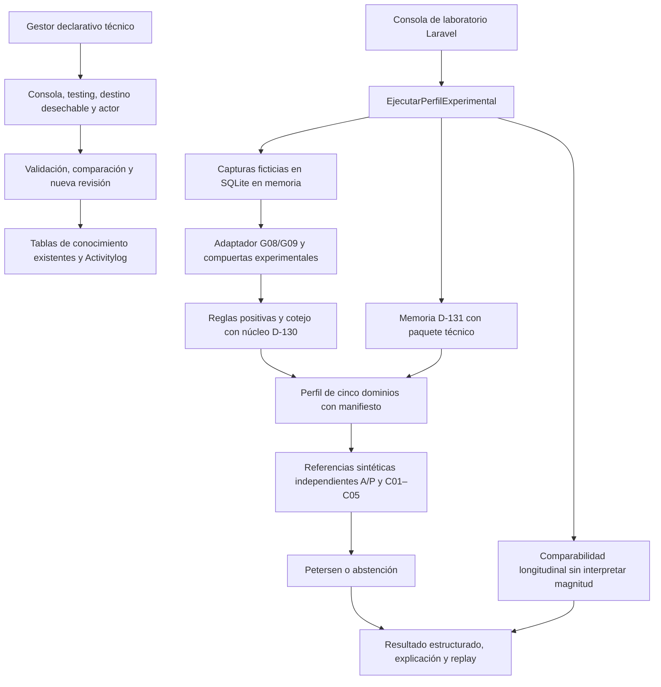
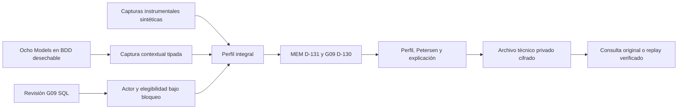

# Sistema experto — laboratorio integrado y trazabilidad de Fase 01

Estado: **recorridos técnicos integrados; cierre y verificación registrados por incremento**. No validado clínicamente. La matriz actual está en [aceptación A–M y 24 grupos](FASE01_ACEPTACION_INTEGRAL_2026_10_18.md); la lista y sus restricciones se conservan en el [checklist maestro](PROMPT_MAESTRO_01_CHECKLIST_2026_10_18.md). Las secciones iniciales describen el laboratorio básico; la sección final incorpora adquisición común, reglas SQL G09 e historia técnica.

## Ejecución sin conexión a expedientes

En desarrollo o testing:

```powershell
php artisan experto:probar-perfil
php artisan experto:probar-perfil --escenario=memoria
php artisan experto:probar-perfil --escenario=memoria-atencion
php artisan experto:probar-perfil --escenario=ejecutivo
php artisan experto:probar-perfil --escenario=atencion-ejecutivo
php artisan experto:probar-perfil --escenario=memoria --json
php artisan experto:probar-perfil --escenario=incompleto --json
php artisan experto:probar-perfil --escenario=contradictorio
php artisan experto:probar-perfil --escenario=diferencial
php artisan experto:probar-perfil --escenario=iadl-incompleta
```

Los primeros cinco escenarios declaran capturas instrumentales ficticias y referencias independientes antes de ejecutar el motor. Sus salidas esperadas, verificadas mediante pruebas, son respectivamente abstención por información insuficiente y PET-01, PET-02, PET-03, PET-04. El comando no devuelve un texto de patrón guardado por escenario: el orquestador, las reglas y el clasificador calculan la salida. Cambiar hechos o requisitos puede modificarla o producir abstención.

Los cuatro escenarios adicionales modifican datos de entrada: respuesta NULL y contexto de Memoria desconocido; contradicción documentada en Atención; diferencial B; IADL no acreditada. La salida conserva la causa concreta y el clasificador decide la abstención. No se asigna un patrón esperado dentro del constructor de informes.

La entrada no acepta códigos de residentes ni una conexión a la base institucional. Crea otra SQLite `:memory:` y la descarta al terminar. El contrato estructurado indica `persistido=false`, incluye `instantanea_entrada`, perfil de cinco dominios, versiones, trazas, referencias y limitaciones. Ese campo permite replay durante pruebas; no promete un historial institucional que no se haya guardado.

La advertencia exigida por el Prompt Maestro se conserva en toda salida: `SIMULACIÓN TÉCNICA / NO VÁLIDO PARA DECISIONES ASISTENCIALES`. El manifiesto separa `VER_TEST` de Memoria, `G09-EXP-20261017`, el contrato DCL y el puente. No crea una supuesta versión clínica común.

La entrada integral exige `contexto_memoria` independiente, con campos CTX-MEM-01 booleanos o NULL. Los contextos por dominio G09 no pueden sustituirlo. Un confusor omitido en la entrada integral permanece desconocido; no se hereda un falso favorable del ejecutor previo. Los contenedores mal tipados se rechazan.

`ConstructorResultadoExperimental` añade identidad/corte/manifiesto, hechos instrumentales con bruto/tipo, fuentes originales incluso rechazadas, reglas/condiciones/soportes, faltantes, perfil y 19 subcomponentes, confusores, contradicciones, C01–C05, Petersen y traza. Los cuatro subcomponentes MEM no reciben por copia el resultado de D-131. El [catálogo de fuentes](FASE01_CATALOGO_FUENTES_Y_HECHOS_2026_10_18.md) describe la cobertura exacta y sus pendientes.

## Gestión de conocimiento declarativo

El gestor de este incremento está cerrado a **consola + APP_ENV testing + base expresamente desechable**, con cuenta técnica activa identificada y Policy. No se habilitó administración HTTP ni se concedieron permisos nuevos a ningún rol. Cambiar solo APP_ENV no basta: `BaseTecnicaDesechable` rechaza la base de desarrollo configurada.

```powershell
php vendor/phpunit/phpunit/phpunit --filter GestionConocimientoExperimentalTest
php artisan experto:gestionar-conocimiento --help
```

El test crea la base de pruebas y demuestra el recorrido mediante el servicio real y el CLI. En esa base descartable, los comandos disponibles son:

```text
experto:gestionar-conocimiento crear --autor=<cuenta existente> --codigo=TEST-... --motivo=<fundamento> --paquete=<archivo local>
experto:gestionar-conocimiento sucesora --autor=<cuenta existente> --revision=<PK anterior> --codigo=TEST-... --motivo=<fundamento> --paquete=<archivo local>
experto:gestionar-conocimiento comparar --autor=<cuenta existente> --revision=<PK conservada> --paquete=<archivo local>
experto:gestionar-conocimiento retirar --autor=<cuenta existente> --revision=<PK conservada> --motivo=<fundamento>
```

El archivo local es **datos declarativos de conocimiento**, con `version`, `tablas`, `contratos_relaciones`, `contratos_extraccion` y `tipo_regla_resultado`. No se evalúa PHP, SQL ni expresiones del archivo. Las tablas permitidas son exclusivamente las doce del contrato `PaqueteConocimiento`; validadores comprueban grafo, variables, valores y consecuencias. No es un almacenamiento JSON de resultados ni un sustituto de relaciones normalizadas: cada definición se inserta en sus tablas existentes.

Una nueva regla puede definirse con condiciones variable/valor existentes y consecuencia compatible mediante `EditorPaqueteExperimental::revisar`. Se genera otra revisión, con claves nuevas al persistir y referencia a la anterior. La comparación utiliza códigos semánticos, condiciones, consecuencias, fundamento, estado, tipo y nombre; no considera equivalentes reglas de distinto tipo ni confunde PK regeneradas con cambios de significado.

`GestionarConocimientoExperimental::probar` carga el conocimiento realmente guardado y mantiene actor, bloqueo, elegibilidad y evaluación dentro de la misma transacción. Una versión retirada no admite otra prueba por esta entrada. La lectura histórica sigue disponible. El retiro técnico afecta **al paquete completo**, conserva `INACTIVO` y todo su contenido, utiliza la fecha de retiro existente y Activitylog para actor/motivo. Una regla concreta puede dejar de ser elegible en una sucesora marcándola INACTIVA allí, sin modificar la regla histórica.

`GestionarConocimientoExperimental::compararImpacto` bloquea ambas revisiones en orden estable, revalida actor y retiro y carga los paquetes guardados. `EditorPaqueteExperimental::compararImpacto` ejecuta la misma batería sobre ambas memorias, comprueba originales/caso/corte/criterio iguales y conserva ambas salidas y diferencias del conocimiento. Funciona con PK regeneradas; rechaza datos alterados entre versiones. Antes de evaluar rederiva las evidencias desde su fuente/mapeo, incluidas las restricciones específicas de Memoria, y rechaza valores semánticos o admisibilidades manipulados. No guarda una evaluación ni publica conocimiento. Esta capacidad se consume desde el caso de aplicación; el CLI descrito arriba administra declaraciones y diferencias de conocimiento.

No se declara una publicación clínica, un estado físico ARCHIVADA, un gestor institucional habilitado ni conservación completa de evaluaciones G09 por disponer de esta capacidad técnica.

## Arquitectura implementada



Los lectores Livewire del residente y las operaciones asistenciales permanecen fuera de este circuito. No hay evento, listener o tarea programada que publique sus conclusiones.

## Evidencia y trazabilidad del incremento

| Requisito | Componente / archivo | Prueba y evidencia | Estado |
|---|---|---|---|
| Auditoría y reutilización | `FASE01_AUDITORIA_Y_EVIDENCIA_2026_10_18.md`; núcleo original y fuentes recuperadas | Baseline 782/5.496; comparación de hashes del núcleo y PR consultados | Acceso completo a EXP-01/G09-EXP resuelto; cotejo G06–G13 documentado |
| Fuentes hasta perfil | `BaseInstrumentalExperimental`, `EjecutarPerfilExperimental`, `EjecutorPerfilG09Experimental` | `PerfilExperimentalTest`; `g08_g09_integracion_sqlite.php` | Verificado con capturas instrumentales ficticias; no base completa de todas las fuentes §4 |
| Quince reglas y núcleo | `investigacion/g09/`, `PaqueteSemanticoG09Experimental`, `VerificadorNucleoG09Experimental` | Cuatro suites G09/puente/núcleo, ocho programas originales PASS | Verificación técnica, sin aprobación instrumental |
| NULL, procedencia y calendario | `EvaluadorG09Experimental`, adaptador y ejecutor | `PerfilExperimentalTest`: NULL, confusor, fecha imposible, procedencia mal tipada, dominio desconocido y caso operativo | Verificado; contexto MEM ajeno a G09 se rechaza expresamente |
| Cinco dominios y versiones | `OrquestadorCincoDominiosExperimental` | `orion_cinco_dominios_experimental.php`, pruebas de identidad/cotejo/replay | Verificado; no cuatro tareas específicas de memoria inventadas |
| Petersen | `AdaptadorEstadosPetersenExperimental`, clasificador y puente | Oráculos intactos 30 + 32; cuatro patrones; abstenciones y requisitos/IADL/contradicción | Verificado sobre referencias ficticias independientes |
| Nueva regla declarativa | `EditorPaqueteExperimental`, evaluador D-130 existente | `EditorPaqueteExperimentalTest` prueba efecto de una regla sin editar el motor | Verificado en paquete técnico |
| Versionar, comparar y retirar | `GestionarConocimientoExperimental`, CLI de gestión | `GestionConocimientoExperimentalTest`: PK/FK reales, sucesora, lectura intacta, retiro, duplicado, rollback, cuenta revocada, consola declarativa | Verificado en base desechable; no archivo institucional completo |
| Comparar impacto | `EditorPaqueteExperimental::compararImpacto` y acción Laravel | Misma batería positiva/negativa/NULL, fuentes alteradas rechazadas, PK regeneradas y retiro | Verificado; ninguna evaluación se guarda por esta capacidad |
| Contrato completo del laboratorio | `ConstructorResultadoExperimental` | `ResultadoPerfilExperimentalTest`: bruto NULL, rechazo, tareas ausentes, contexto/contradicción, fuentes DCL, 19 componentes y replay | Verificado para el laboratorio; cobertura total de fuentes y conservación pendientes |
| Longitudinalidad | `ComparadorLongitudinalExperimental`, contrato de perfil | Casos comparables, protocolo distinto, oportunidad desconocida, tipo incompatible, corte, ausencia, replay integrado | Verificado sin diagnóstico, progresión ni ventana inventada |
| Seguridad e integración | CLI y proveedor modular existente | `ConsolaPerfilExperimentalTest`: rechazo de producción y códigos operativos, cero escrituras institucionales | Verificado; no nuevos permisos ni rutas HTTP |
| Historia y persistencia integral G09 | Contratos D-137 y conservación V2 existentes | Se conserva conocimiento y se devuelve snapshot en memoria; no se guarda el perfil G09 integral | Pendiente de resolver contrato, sin fingir persistencia |
| Reportes y cierre | Este manual, checklist y auditoría | JUnit SQLite/PostgreSQL y programas independientes | Evidencia final registrada en auditoría; sin validación clínica |

## Restricciones registradas tras el segundo incremento

1. **Gestión institucional:** falta definir responsable y permiso explícito para crear/habilitar/retirar conocimiento desde una superficie institucional. La competencia de ejecución observacional no lo autoriza. El CLI de pruebas no elude esa decisión.
2. **Retiro individual:** el esquema actual identifica antecesora y retiro del paquete; no contiene autor/motivo propios de retiro de cada regla. El retiro técnico por paquete + auditoría es funcional en testing; no se promete una entidad de archivo individual inexistente.
3. **Persistencia integral y manifiesto:** `evaluaciones_expertas` tiene una versión principal y los lectores exigen que criterios, mapeos y reglas pertenezcan a ella. El perfil experimental conserva versiones diferentes para Memoria, G09 y puente. `id_evaluacion_dominio` es único: no puede reutilizarse como agrupación de varias cabeceras. Falta formalizar la representación del manifiesto compuesto y de las atestaciones originales antes de guardar/reconstruir este perfil sin perder procedencia. No se añadió un JSON, tabla genérica o versión ficticia para ocultarlo.
4. **Cobertura de fuentes y componentes:** este incremento recorre quince tareas G09 y Memoria integrada; no acredita captura/extracción íntegra de cada fuente permitida ni cuatro reglas específicas de Memoria. Los 19 subcomponentes son conceptuales; no se convierten en 19 criterios por conveniencia.
5. **Conocimiento pendiente:** G06–G13 y normas/licencias/interpretaciones no se convierten en aprobados por ejecutar fixtures. A01–A14 son controles previos y deben terminar de trazarse por fuente; no se añaden como nuevas condiciones clínicas por analogía.

Estos puntos se mantienen abiertos en el checklist y requieren su contrato/RFC o decisión correspondiente. Ninguna migración, tabla, catálogo, permiso nuevo, publicación asistencial o borrado de historia se realizó como parte de este incremento.

La [RFC de conservación](RFC_CONSERVACION_PERFIL_EXPERIMENTAL_2026_10_18.md) concreta la brecha, alternativas sin tablas nuevas y un diccionario candidato acotado para el manifiesto. La recomendación no autoriza un cambio estructural; todavía falta cerrar las copias originales por fuente antes de proponer una migración completa.

## Incremento integral: adquisición, selección SQL e historia técnica

La adquisición común y la cobertura del contexto psicológico/médico del punto 4 anterior se implementaron después del segundo incremento. `RecolectorContextoPerfilExperimental` captura ocho fuentes autorizadas por el contrato de pruebas, reutilizando adaptadores existentes. `IncorporadorContextoExperimental` conserva originales/tipos/fecha/autor/estado y relaciones sin interpretación libre; el catálogo actualizado detalla campos y límites. A01–A14 y confusores se conservan por tarea como atestaciones sintéticas. No se afirma haber acreditado licencias ni aprobación clínica.

El paquete G09 puede modificarse por datos. El laboratorio sin Models acepta una declaración local ficticia:

```text
experto:probar-perfil --escenario=sin-referencias --conocimiento-g09=<archivo declarativo TEST_ONLY> --json
```

Para una revisión registrada se usa la selección SQL autorizada. `PaqueteSemanticoG09Experimental::paraConservacion` declara los metadatos técnicos exigidos por las tablas actuales. El gestor conserva la revisión en esas tablas, deriva actor/fecha y traduce las identidades. `GestionarEjecucionesExperimentales::ejecutarConRevision` calcula bajo el mismo bloqueo que protege la elegibilidad; una revisión retirada falla. El archivo se publica después de terminar el cálculo transaccional.

```text
experto:archivo-perfil ejecutar --autor=<cuenta técnica existente> --entrada=<entrada integral JSON> --revision-g09=<PK elegible>
experto:archivo-perfil consultar --autor=<cuenta técnica existente> --caso=SINTETICO-01 --evaluacion=SIM-INTEGRAL-01
experto:archivo-perfil historial --autor=<cuenta técnica existente> --caso=SINTETICO-01
experto:archivo-perfil reproducir --autor=<cuenta técnica existente> --caso=SINTETICO-01 --evaluacion=SIM-INTEGRAL-01
```

Estos comandos exigen APP_ENV testing y una base expresamente desechable; no se cambian variables de desarrollo para eludir la guarda. Las pruebas preparan la cuenta y el destino. No hay credenciales predeterminadas ni creación de cuentas/personas como fallback. El comando puro `probar-perfil` permanece disponible en local porque no consulta Models ni guarda evaluaciones.

La entrada integral es el objeto devuelto por `CasoSinteticoCincoDominios::crear`, con `contexto`, `capturas`, `tareas`, `memoria` y referencias opcionales. `fuentesComplementarias` recibe las capturas del recolector y `comparaciones` los pares longitudinales. No incluye salidas esperadas. Para seleccionar SQL no se aporta `conocimientoG09`; lo carga el gestor. Copiar una identidad SQL a la entrada libre se rechaza. Las referencias DCL deben declarar la versión realmente utilizada; no se reescriben para aparentar compatibilidad con una sucesora.

`ArchivoEjecucionesExperimentales` conserva exclusivamente evidencia de ingeniería en el disco privado local, bajo `laboratorio-experto/SINTETICO-…/SIM-….enc`. El cifrado autenticado usa Laravel; cada documento contiene entrada, salida, copia del conocimiento, autor técnico, instante de archivo y huellas tipadas del contenido/motor. No se guarda JSON/EAV en la BDD ni un informe en Activitylog. La tabla institucional de evaluaciones no recibe este perfil, por lo que `persistido=false` sigue siendo correcto dentro del resultado; el documento indica `conservacion_bdd_institucional=false`.

Consulta entrega el original conservado sin releer fuentes. Replay compara la huella del motor actual antes de recalcular: si difiere, falla con una explicación y permite consultar el original. Misma identidad/contenido es idempotente; otro contenido bajo la misma identidad se rechaza. Un archivo alterado no se acepta. Debe preservarse la clave de cifrado para leer estos artefactos privados; no se exporta ni se imprime en consola.

Activitylog conserva intención y confirmación del archivo, consultas e historial; la administración de conocimiento registra creación, lectura, prueba, impacto y retiro. SQL y filesystem no comparten una transacción distribuida: si falla una confirmación posterior a publicar, se devuelve fallo, el intento deja la identidad y el artefacto puede recuperarse idempotentemente. El archivo no es historia clínica ni auditoría corporativa adicional.



El ciclo de aceptación demuestra efecto de una nueva conjunción G09, sucesora con PK/FK reales, retiro del paquete anterior y recuperación/replay intactos. Esto sustituye el pendiente de historia **técnica** del segundo incremento. La conservación **institucional en BDD** y la publicación profesional permanecen separadas en la RFC y la matriz actual. El acceso a las fuentes está resuelto en el [cotejo documental y VT](FASE01_COTEJO_DOCUMENTAL_Y_VT_2026_10_18.md).

Las explicaciones G09 incluyen rutas hasta la aplicación/respuesta, instrumento, tarea, edición original y esperada, perfil, norma artificial, fecha, condiciones y advertencias. Cada corroboración se conserva sin multiplicar su soporte efectivo. Para repetir los negativos y trazas de las quince reglas:

```text
php vendor/bin/phpunit tests/Unit/ContratoG09ExperimentalTest.php
```

El workflow independiente ejecuta doce programas, incluidos los dos de auditoría/localizadores G08 recuperados selectivamente. Resultados exactos, matriz VT y hashes están en la auditoría y el cotejo; no se suman sus cantidades con PHPUnit.
