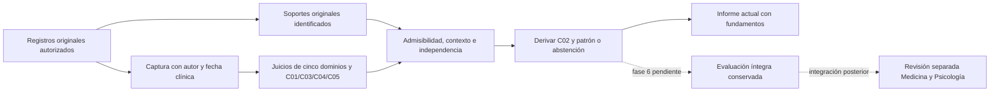

# Petersen institucional: captura original, cálculo y reproducción instrumental

19/10/2026. Incremento del plan de cierre. Contrato clínico **E–H adoptado** y
**dos tablas/tres permisos aprobados explícitamente por la propietaria**.
La instalación local y la verificación dinámica se registran al final de
esta acta. Este incremento no cierra la conservación integral de fase 6 ni la
aceptación visual de fase 7.

## Qué resuelve

El laboratorio conserva su contrato de casos sintéticos. El recorrido
institucional obtiene ahora juicios originales identificados y soportes
relacionales: cinco dominios y C01/C03/C04/C05. C02 se calcula desde el perfil
objetivo; no existe un campo para introducir la clasificación deseada.

El motor obtiene los cuatro patrones de Petersen cuando se acreditan los
requisitos y los cinco dominios. Ante faltantes, contradicciones, impedimentos
diferenciales o fuentes incompatibles se abstiene y explica los motivos. No
convierte observaciones nominales, G09 o un z aislado en un dominio alterado.
Las aplicaciones históricas confirmadas como observaciones siguen siéndolo.
No se han creado mediciones ni valoraciones originales para los residentes.

## Componentes e integración

| Responsabilidad | Archivo o directorio |
|---|---|
| Contrato puro, originales y clasificación | `motor-experto/src/motor_experto/dominio/petersen/` |
| Registro atómico, autoría propia y reintento | `app/Modulos/ApoyoDecision/Aplicacion/Acciones/RegistrarValoracionPetersenOriginal.php` |
| Fuentes cerradas por elemento y tipo | `app/Modulos/ApoyoDecision/Aplicacion/Servicios/ContratoFuentesPetersen.php` |
| Integridad del documento original privado | `app/Modulos/ApoyoDecision/Aplicacion/Servicios/VerificarOriginalDocumentalPetersen.php` |
| Adquisición SQL autorizada y cálculo al corte | `app/Modulos/ApoyoDecision/Aplicacion/Consultas/ConsultarPetersenInstitucional.php` |
| Autorización contextual | `app/Modulos/ApoyoDecision/Presentacion/Policies/ValoracionPetersenPolicy.php` |
| Interacción y formulario | `app/Modulos/ApoyoDecision/Presentacion/Livewire/Paginas/CapturaPetersenPanel.php`, vista `livewire/petersen/captura-original.blade.php` |
| Esquema aprobado | `database/migrations/2026_10_19_020000_create_captura_petersen_original.php` |
| Instalación acotada de permisos | `database/seeders/PermisosPetersenOriginalSeeder.php` |

Entrada autorizada: ficha del residente → resultados expertos → **Valoraciones
originales de Petersen**. Ruta nombrada
`admin.sistema-experto.petersen-original`,
`/admin/sistema-experto/residentes/{residente}/petersen`.
El informe instrumental integra la consulta actual de Petersen cuando el actor
tiene el permiso y alcance. El resultado calculado sigue siendo una consulta,
sin presentarlo como una evaluación histórica completa ya guardada.

### Uso de la captura

1. Entrar con Medicina o Psicología y abrir las valoraciones originales del
   residente. La pantalla deriva el profesional de la sesión; no permite escoger
   a otra persona como autor.
2. Elegir el dominio o requisito realmente valorado. Registrar fecha/hora del
   acto, conclusión original y fundamento. Los campos sin información se dejan
   pendientes, sin seleccionar «Sí» para completar el formulario.
3. Vincular los registros originales del mismo residente. Si existen, indicar
   la atención y el documento original con página/sección. El sistema verifica
   relaciones, autorización y bytes del documento privado.
4. Para C05, vincular calidad/condiciones y cada uno de los cinco juicios de
   dominio revisados. Un juicio añadido después, incluso concordante, no queda
   acreditado por esa revisión anterior. No se elige silenciosamente el último.
5. Confirmar el registro. El historial distingue fecha clínica de fecha de
   registro. Si hay un error, rectificar o registrar una anulación en la propia
   cadena; no volver a introducir el original para ocultar el anterior.
6. Consultar el informe: patrón orientativo o abstención, dominios, requisitos,
   fundamentos y fuentes excluidas. La revisión posterior de Medicina/Psicología
   se mantiene pendiente; su vinculación a esta ejecución completa depende de
   la conservación de fase 6.

Guardar un juicio incompleto conserva lo observado y no acredita automáticamente
el requisito. La captura no administra un instrumento ni crea aciertos, tiempos,
normas o episodios que no existan en el original.



### Requisitos ejecutados

- C01 conserva cambio, historia y corroboración identificables; exige episodios
  explícitos independientes. La fecha distante no crea por sí sola un episodio.
- Los dominios A/P exigen interpretación original de alcance suficiente y medida
  objetiva original que el método pueda interpretar para mayores de 60 años.
  Se reextraen los brutos; una cifra conservada como z no sustituye el original.
- C03 requiere contexto IADL, oportunidad, desempeño, ayuda, causa y nivel previo
  coherentes. BADL/Barthel no sustituyen esta fuente.
- C04 conserva una revisión diferencial explícita. La ausencia de diagnóstico
  registrado no acredita el requisito.
- C05 identifica los cinco juicios de dominio concretos que se revisaron y su
  calidad. Cambiar posteriormente un juicio no equivale a revisar ese nuevo
  conjunto; el motor detecta la incompatibilidad.
- Las interpretaciones competidoras y los negativos explícitos se conservan.
  Compartir soportes no transforma una contradicción en simple ausencia.

Los cuatro patrones se implementan en `PETERSEN-INSTITUCIONAL-1`. No son todavía
cuatro reglas SQL administrables por el gestor de las 17 reglas A–D. Extender
ese gobierno al nuevo contrato sigue siendo un pendiente explícito.

## Integridad, 4FN y seguridad

Se incorporan únicamente `valoraciones_petersen_originales` y
`soportes_valoracion_petersen`: una fila por juicio original y otra por enlace
original tipado. No hay productos cruzados de colecciones, JSON/EAV ni nueva
tabla de auditoría. Inventario aprobado: **75 operativas + 33 expertas = 108**.
El [diccionario aprobado](PROPUESTA_CAPTURA_PETERSEN_ORIGINAL_2026_10_19.md)
describe columnas, checks, claves, nulabilidad y grano.

La Action obtiene la cuenta y el personal propios de la sesión, verifica
competencia Medicina/Psicología, estado, permiso y residente. Cada fuente exige
además su permiso específico. Superadministración consulta; no recibe escritura
clínica. No se aceptan autor, identidad de solicitud o cadena de corrección
manipulados por el formulario.

Registrar, rectificar y anular son actos distintos. Rectificación/anulación
insertan una sucesora; no sobrescriben ni borran originales. Una anulación es
terminal. Corregir una fecha clínica exige motivo explícito y no altera la fecha
técnica del servidor. Se conservan microsegundos en modelo y comparaciones.

Cabecera y soportes se guardan en una transacción. La solicitud UUID protege
reintentos del mismo contenido; otra carga con esa UUID produce conflicto. Un
reintento válido compara los enlaces ya conservados antes de releer fuentes
mutables y mantiene la autorización actual. Las carreras de rectificación se
resuelven con bloqueo y unicidad de sucesora.

SQL impide modificar/borrar cada fila y protege FK, XOR de fuente, unicidades y
categorías. La coherencia entre fuentes, residente, fechas y competencia se
verifica también en la Action y el lector. SQL **no sella por sí solo la
colección completa de soportes frente a INSERT directo**: la vía institucional
es la Action atómica, no una escritura SQL manual.

El acceso contextual `controles_funcionales_iadl.ver` de Medicina/Psicología
continúa como [propuesta separada pendiente](PROPUESTA_LECTURA_IADL_PETERSEN_2026_10_19.md).
No se concede por inferencia a partir de los tres permisos de Petersen.

## Reproducción instrumental V3

`INSTRUMENTAL-DECLARATIVO-3` conserva en memoria la fuente conceptual documental
y el perfil exacto aplicado. Reextrae respuestas brutas, recalcula normalización,
construye el perfil instrumental/declarativo y compara su salida. Alterar una
normalización aunque se recalcule el hash del contenedor se detecta al reproducir.
V1/V2 conservan sus ramas y formatos históricos.

`ARTEFACTO-MOTOR-2` incluye código puro, lock de Composer y la red documental
`orion-v1-conceptos.json`. El manifiesto verifica conjunto y bytes. La prueba de
reproducción ejecuta otro proceso PHP con solo el código extraído del ZIP y una
captura sintética en memoria; no depende del checkout ni de Laravel.

**Alcance exacto:** reproduce `salida.perfil_instrumental`. Petersen se añade
después desde las nuevas tablas originales y todavía no forma parte de ese DTO
ni de una evaluación relacional completa. El lector declara
`fuentes_originales_mutables=true` y `conservacion_completa=false`.
No se guarda historia clínica en ZIP, JSON o archivos auxiliares.

## Trazabilidad de pruebas

| Riesgo / resultado | Prueba |
|---|---|
| Cuatro patrones desde soportes independientes; faltantes y contradicciones | `tests/Unit/PetersenInstitucionalTest.php` |
| Cuatro patrones desde tablas SQL, brutos instrumentales, IADL y juicios originales | `tests/Feature/CapturaPetersenOriginalTest.php::test_caso_completo_se_clasifica_desde_mediciones_y_soportes_originales` |
| Autoría, documento alterado, misma UUID, fechas, rollback y fuentes ajenas | `tests/Feature/CapturaPetersenOriginalTest.php` |
| Formulario y metadatos bloqueados | Pruebas Livewire en `CapturaPetersenOriginalTest.php` |
| Mismo UUID y dos rectificaciones concurrentes en procesos reales | `tests/Feature/PetersenOriginalConcurrenciaPostgresTest.php` |
| Solo tres permisos; reintento sin modificar permisos ajenos | `tests/Feature/PermisosPetersenOriginalTest.php` |
| Perfil rehecho, corrupción y replay desde ZIP en otro proceso | `tests/Unit/InstantaneaInstrumentalCompletaTest.php` |
| Conjunto y bytes del software | `tests/Unit/ReleaseMotorInstrumentalTest.php` |
| IADL original/rectificado al corte, cuenta revocada y permiso de fuente | `tests/Feature/InformeNeurocognitivoTest.php` |
| Inventario 108 y códigos canónicos | `BddOperativaV2Test.php`, `CodigosCorrelativosTest.php` |

## Verificación e instalación

Pruebas ejecutadas en candidato aislado de `9ebe2b71`, sin `.env`, con bases
sintéticas desechables. Las correcciones de horarios y proveedor modular de otra
tarea se excluyen del candidato y del commit. Los dictámenes independientes de
persistencia y seguridad son PASS estáticos acotados; no certifican desempeño
clínico ni reemplazan las pruebas dinámicas.

La QA visual real no se deduce del render de Livewire ni del build. El navegador
estuvo inicialmente deshabilitado; después permitió comprobar la pantalla con
la sesión de Psicología, residente/profesional correctos, nueve elementos de
captura y apertura del formulario diferencial. No se guardaron datos. El control
del navegador no pudo resolver la confirmación nativa de cancelación; se cerró
la pestaña temporal y se reabrió la pantalla sin captura. La matriz completa de
interacción y los cinco tamaños de pantalla siguen pendientes. Esto no se
presenta como aceptación visual completa.

| Verificación final | Resultado y alcance |
|---|---|
| Selección amplia relacionada SQLite `:memory:` | **159 pruebas / 1619 aserciones**, sin fallos/errores; dos omisiones de concurrencia, que requiere PostgreSQL |
| Cierre final SQLite del formulario, permisos, arquitectura y roles | **55 pruebas / 4944 aserciones**, sin fallos/errores/omisiones |
| Cierre final PostgreSQL desechable, incluidos núcleo y concurrencia real | **87 pruebas / 5052 aserciones**, sin fallos/errores/omisiones; clúster detenido y retirado por el script |
| Arquitectura y matriz de roles en el workspace | 18 / 4768 y 12 / 58, respectivamente, PASS; se mantienen aparte por contener el workspace cambios simultáneos ajenos |
| Independencia del motor y O.R.I.O.N. | Ambos ejecutables PASS sin Laravel ni SQL |
| Compilación frontend | `npm run build`: PASS, 107 módulos, 8,02 s |
| Revisiones independientes | Persistencia, seguridad y corrección final C05: PASS estáticos acotados |
| Sintaxis, formato y enlaces locales | PHP lint/Pint, `git diff --check` y enlaces locales de documentos propios, PASS |

Las selecciones se solapan; no se suman para anunciar un total distinto de
pruebas. XML y logs se retienen en el almacenamiento privado del candidato,
fuera del commit. Las pruebas usan datos sintéticos; no miden sensibilidad,
especificidad ni exactitud clínica.

La suite general de 3268 pruebas quedó **interrumpida**, sin resultado final.
Había mostrado tres fallos: dos expectativas de arquitectura anteriores a la
nueva ruta/panel, corregidas y verificadas posteriormente, y una prueba de
navegador de Medicación cuyo candidato no contiene `node_modules` (resolución
de `puppeteer`: `ERR_MODULE_NOT_FOUND`). No se cambia ese flujo ajeno ni se
declara la suite global aprobada. Un fallo de acceso psicológico observado en
otra selección también se reprodujo en HEAD sin este incremento: su fixture
carecía del personal activo exigido. La prueba positiva se corrigió añadiendo
el profesional sintético y se añadió el negativo sin personal; no se relajó la
autorización del backend.

La regresión inicial del seeder esperaba cuatro permisos absolutos, pero la
instalación de prueba ya contenía dos permisos técnicos. Se corrigió para
comparar exactamente el conjunto anterior más los tres aprobados, manteniendo
la comprobación de que no se crea el permiso IADL ni usuarios/residentes.
Las suites finales anteriores incluyen esa corrección.

Comandos del cierre final:

```powershell
$filtro = 'CapturaPetersenOriginalTest|PermisosPetersenOriginalTest|PetersenInstitucionalTest|PetersenOriginalConcurrenciaPostgresTest|RolesVistasPermisosMatrixTest|FolderOrganizationTest|FrontendArchitectureTest'
./scripts/probar-postgres.ps1 -Filtro $filtro -Informe storage/app/private/petersen-cierre-postgres.xml -Log storage/app/private/petersen-cierre-postgres.log
php vendor/phpunit/phpunit/phpunit --filter 'CapturaPetersenOriginalTest|PermisosPetersenOriginalTest|RolesVistasPermisosMatrixTest|FolderOrganizationTest|FrontendArchitectureTest' --log-junit storage/app/private/petersen-cierre-sqlite.xml
php motor-experto/tests/independencia.php
php motor-experto/tests/orion_independencia.php
npm run build
```

Para una instalación existente se aplica únicamente la nueva migración y el
seeder acotado, después de verificar la conexión de destino; nunca
`migrate:fresh` ni la resincronización global de roles:

```powershell
php artisan migrate --path=database/migrations/2026_10_19_020000_create_captura_petersen_original.php
php artisan db:seed --class=PermisosPetersenOriginalSeeder
```

**Instalación local verificada el 19/10/2026:** se comprobó `APP_ENV=local`,
PostgreSQL y host loopback antes de aplicar únicamente esa migración y el seeder
acotado. Ambos finalizaron correctamente en `remembermind_dev`. El catálogo
contiene 108 entidades y no falta ninguna tabla. Medicina/Psicología tienen los
tres permisos; Superadministración tiene solo lectura. Ninguno de esos tres
roles recibió el permiso IADL pendiente.

Las tablas nuevas están vacías tras la instalación: no se cargaron juicios
clínicos sintéticos. La consulta backend con una cuenta activa de Psicología y
residente autorizado devolvió `PETERSEN-INSTITUCIONAL-1`, abstención por
información insuficiente y `persistido=false`. Se comprobó la ruta nombrada en
esa instalación. Esto acredita conexión y control de ausencia de originales;
no acredita un patrón clínico del residente ni QA visual.

## Checklist del incremento

- [x] Adopción E–H y decisión estructural/competencias registradas por separado.
- [x] Dos relaciones normalizadas, modelos y captura transaccional original.
- [x] Autoría propia, permiso/contexto, rectificación y anulación sin borrar historia.
- [x] Núcleo de cuatro patrones desde soportes originales y abstenciones explicadas.
- [x] Formulario conectado y resultado actual integrado en la consulta instrumental.
- [x] Replay instrumental/declarativo V3 y artefacto de software verificable.
- [x] Instalación acotada y consulta backend en PostgreSQL local verificadas.
- [x] Verificaciones dinámicas del incremento consignadas, con suite global interrumpida explícita.
- [ ] Decisión del permiso específico de lectura IADL.
- [ ] Gobierno SQL del contrato Petersen.
- [ ] Conservación relacional completa y vínculo evaluación → release de fase 6.
- [ ] QA visual y recorrido completo de revisión de fases 7–8.
