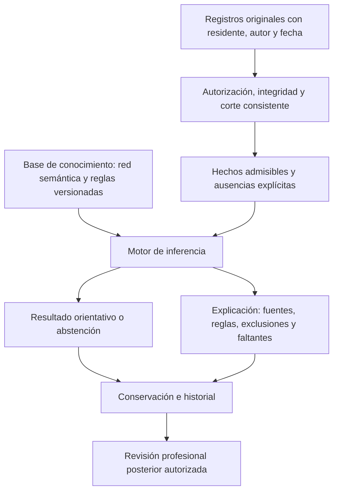

# Matriz única de trazabilidad del sistema experto

**Actualización del04/11:** [MoCA8.1, RUDAS-PE2020 y FAQ B7S activados para captura/puntuación](ENTREGA_ACTIVACION_PERFILES_INICIALES_2026_11_04.md). El anexo contiene26 métodos:23 previos por componentes y3 iniciales descriptivos con componentes vacíos. La configuración estática vacía no cuenta estos vínculos resueltos desde el catálogo exacto instalado. Las brechas sobre interpretación de dominios y conservación conjunta permanecen; el cuerpo del31/10 conserva su corte salvo esta actualización y el anexo regenerado.

## 1. Resultado y autoridad

Esta matriz conecta **dato original → instrumento o valoración → hecho admisible → regla → resultado → conservación**. Es la entrada actual para planificar las conexiones y corregir las reglas. Sustituye como guía de trabajo la [matriz D01–D27 anterior](MATRIZ_DATOS_DETECCION_DCL_2026_10_27.md), conservada como corte histórico. No crea otro motor, catálogo de reglas o formulario paralelo.

La selección de familias está [adoptada](instrumentos/SELECCION_ADOPTADA_2026_10_28.md): entrevista e informante, MoCA **o** RUDAS, información funcional y evaluación ampliada según el caso. La petición posterior de formularios propios autoriza la captura descriptiva; no la convierte en una edición de una prueba estandarizada. Las reglas actuales siguen sus [contratos aprobados](CONTRATO_FUNCIONAL_PETERSEN_C01_C05_2026_10_21.md). Las correcciones médicas propuestas en la sección8 todavía no se instalan.

**Conclusión operativa:** hay captura original, métodos técnicos, reglas y lectura conjunta. Faltan conexiones instrumentales específicas y conservación conjunta. La captura propia de funcionalidad y los juicios originales pueden desarrollarse y utilizarse conforme a sus contratos actuales; la falta de una edición FAQ no los convierte en FAQ ni detiene toda la ingeniería.

Alcance de este documento: código en `f294c6dd`, documentos y decisiones vigentes, configuración base del repositorio y fuentes públicas consultadas el31/10/2026. No consulta pacientes, historias, secretos, configuración efectiva de un despliegue ni catálogos SQL. Los [resultados técnicos previos](ENTREGABLE_REGLAS_Y_DEPURACION_2026_10_31.md) conservan su fecha y alcance.

## 2. Recorrido y significado de los estados



El nodo de conservación funciona en la rama observacional. **La rama conjunta instrumental/Petersen sigue transitoria**; el diagrama describe el recorrido a completar, no afirma que ese guardado ya exista.

| Término | Significado en esta matriz |
|---|---|
| Captura disponible | Existe un flujo que conserva el original; no demuestra que haya datos de una persona ni que un instrumento específico esté instalado. |
| Método registrado | Hay un cálculo y metadatos en el código; no acredita aplicabilidad, derechos, protocolo adoptado ni perfil conectado. |
| Conexión pendiente | Falta identificar edición, preguntas/selectores, método o interpretación específica. Se explicita la ausencia; no se adivinan valores. |
| Contexto | Ayuda a valorar el dato; no se convierte automáticamente en una condición acreditada. |
| Juicio original | Valoración documentada de Medicina/Psicología, con justificación y soportes, anterior a la clasificación. No es la revisión posterior del resultado. |
| Derivado | Lo calcula el motor desde hechos admitidos; el usuario no captura una conclusión deseada. |
| Abstención | No se reúnen las condiciones para clasificar; conserva su motivo. No equivale a normalidad. |

Los dominios utilizan `A/P/U/I/X`: alteración sustentada, rendimiento esperado sustentado, información insuficiente, no interpretable y contradicción. Los requisitos utilizan `S/N/U/I/X`: acreditado, negativo explícito, insuficiente, no interpretable y contradicción. `U/I/X` son estados de la evaluación, no tres valores que el usuario deba inventar en un formulario original. Los dominios originales admiten `A/P/I`; C01/C03/C04/C05 originales admiten `S/N` según el contrato.

La población solicitada es **mayores de60 años**. Los identificadores técnicos «60+» o «60 o más» que ya existen no resuelven por sí solos la diferencia en el límite de60. Esta matriz no cambia elegibilidad ni rangos normativos. La edad pertinente es la de la fecha de aplicación, con los límites particulares de cada método.

## 3. Datos originales y conexión a la inferencia

Los identificadores D01–D27 se conservan para rastrear el trabajo anterior. Las columnas descritas existen en las fuentes localizadas; «narrativa» no significa un nuevo campo estructurado. Una necesidad conceptual sin fuente cerrada permanece identificada como tal.

| ID | Dato y lugar de captura | Fuente conservada / grano | Conexión a reglas y resultado | Estado y ausencia |
|---|---|---|---|---|
| D01 | Identidad y fecha de nacimiento; admisión formal. | `residentes.fecha_nacimiento`, `cod_residente`; una persona admitida. | Edad en aplicación y pertenencia del caso; no acredita una regla cognitiva. | Fuente disponible; fecha desconocida o edad fuera del método impide su normalización. Límite exacto de60 pendiente de conciliación. |
| D02 | Escolaridad, lectura y escritura del episodio. | `atenciones.escolaridad_anios`, `puede_leer`, `puede_escribir`; una atención. El vínculo es `aplicaciones_instrumento.cod_atencion`. | Contexto de interpretación; un método que pide una respuesta explícita no la recibe automáticamente desde la atención. | Captura principal disponible; `NULL` permanece desconocido. No convertir nivel educativo general en años. |
| D03 | Idioma de evaluación y contexto cultural. | `atenciones.idioma_principal_evaluacion`; otros idiomas/condiciones en notas existentes. | Aplicabilidad y C3/contexto; no acredita compatibilidad con una edición o baremo por el nombre del idioma. | Captura disponible; edición/idioma de material y adaptación siguen por cotejar en cada perfil. |
| D04 | Condiciones sensoriales, motoras y de administración pertinentes. | Respuestas lógicas explícitas mediante `respuestas_instrumento.valor_logico`, con pregunta/aplicación identificadas. | C1/C3 y admisibilidad del método que realmente las exige. | Parcial por método. No marcar Sí por defecto ni interpretar ausencia como condición favorable. |
| D05 | Ocupación previa, actividades habituales y nivel previo. | Relato profesional/documento existentes; no se localiza aquí un campo estructurado específico de ocupación para la inferencia. | Contexto de C01/C03, cuando queda valorado y enlazado mediante soportes admitidos. | Necesidad conceptual delimitada; no hay extracción automática de narrativa. |
| D06 | Informante principal, vínculo y conocimiento referido del nivel previo. | `atenciones.cod_residente_contacto_informante` → `residentes_contactos`; `informante_conoce_nivel_previo`. | Contexto de C01/C05; la identidad del contacto no acredita la calidad de su relato. | Selección explícita disponible; no elegir al primer contacto ni al responsable por defecto. |
| D07 | Cambio respecto al nivel anterior, naturaleza y período. | `controles_cognitivos.cambio_cognitivo`; juicio C01 con `cambio_respecto_previo` y justificación. | OBS-COG-01 puede señalar un cambio; C01 exige su propio juicio y soportes. | Captura y regla OBS disponibles. La señal no se convierte en alteración objetiva C02. |
| D08 | Historia previa y corroboración identificables. | `soportes_valoracion_petersen`, tipos `HISTORIA_PREVIA` y `CORROBORACION`, vinculados a originales admitidos. | Acreditación de C01, con orden temporal e independencia establecidos por el contrato local. | Contrato disponible; ausencia o episodio incompatible mantiene insuficiencia. Revisar la exigencia local de independencia antes de cambiarla. |
| D09 | Instrumento, edición/forma, idioma y protocolo utilizados. | `instrumentos.codigo/version/tipo/estado`; preguntas/opciones; aplicación identificada. Identidad cotejada en perfil del servidor. | Vincula originales a un método; no genera hallazgos por similitud de nombre. | Captura genérica disponible; perfiles iniciales específicos pendientes. Una familia aprobada no es una PK ni una edición. |
| D10 | Respuestas, aciertos, tiempos y puntuaciones originales pertinentes. | `respuestas_instrumento.valor_numero/valor_logico/valor_texto/puntaje`, cada respuesta de una pregunta/aplicación. | Método → medida contextualizada → antecedente acreditable, si existe interpretación específica. | Disponible genéricamente; cero, No, desconocido y no aplicable se distinguen según protocolo. El total de cribado no llena cinco dominios. |
| D11 | Autor original, fecha clínica, fecha de registro y transcripción. | `aplicaciones_instrumento.cod_personal/fecha_hora/cod_usuario_registro/registrado_en`, documento original y antecesora cuando corresponde. | Admisibilidad al corte y explicación de procedencia de todas las ramas. | Disponible. Documento ajeno, no verificable o futuro se excluye; no sustituir fecha clínica por fecha de captura. |
| D12 | Interpretación de cada uno de los cinco dominios. | `valoraciones_petersen_originales.elemento/estado_original/justificacion`, comprobaciones y soportes `MEDICION → cod_aplicacion`. | Juicio original A/P/I; el motor resuelve U/X y deriva C02. | Disponible con soportes pertinentes. Una salida G09, una observación o un total global no son automáticamente A/P. |
| D13 | Actividad cotidiana, oportunidad, ayuda, causa y nivel previo. | `controles_funcionales_iadl`: una actividad observada/referida por registro; ocho actividades propias, rectificaciones enlazadas. | Evidencia funcional descriptiva que el profesional puede valorar para C03. | Formulario propio disponible para Medicina/Psicología. No es FAQ ni genera su puntuación. |
| D14 | Independencia instrumental relativa en el contexto residencial. | Juicio C03: `revision_integrada`, `oportunidad_adecuada`, `atribucion_revisada`, justificación y soportes IADL. | Requisito C03 de las cuatro reglas PET. | Disponible como juicio sustentado; no deducir dependencia cognitiva de que la institución realice una actividad. |
| D15 | Ánimo, conducta y factores clínicos pertinentes. | `valoraciones_psicologicas` y fuentes clínicas admitidas con autor/fecha. | Apoyo de la revisión diferencial C04; no conversión automática en una escala administrada. | Fuente narrativa disponible; GDS-15 u otra escala conserva su identidad y protocolo separados. |
| D16 | Sueño, fluctuación y otros factores del episodio cuando sean pertinentes. | Relato clínico/documento existente; extracción específica no localizada para este circuito. | Revisión profesional C04/C05 a través de fuentes admitidas. | Parcial; «no registrado» no significa ausente. No se crea un requisito universal de estudio o escala. |
| D17 | Revisión de medicación/sustancias pertinente al caso. | Prescripción/administración en Medicacion; conclusión clínica en fuentes admitidas para C04. | La prescripción no es una FK de soporte directo de C04 en el contrato actual. | Lectura clínica según permisos; no se añade extracción farmacológica ni relación nueva desde esta matriz. |
| D18 | Antecedentes, diagnósticos y exploración relevantes. | `antecedentes_clinicos`, `diagnosticos`, valoración psicológica o documento, según tipos admitidos. | Soportes de C04; una nota o atención disponible no se convierte por ello en un tipo adicional de soporte. | Parcial por caso; una tabla vacía no descarta causas alternativas. |
| D19 | Resultados de estudios disponibles e interpretación pertinente. | `documentos_clinicos` y estudio enlazado cuando exista; archivo privado y procedencia verificables. | Apoyo documental de C04/C05, con revisión explícita. | Según indicación y disponibilidad; no imponer laboratorio/imagen a toda persona ni inferir normalidad del archivo. |
| D20 | Revisión diferencial integrada y factores no resueltos. | Juicio C04: `revision_explicita`, `factores_pertinentes_revisados`, `impedimento_no_resuelto`, justificación y soportes. | C04 puede impedir clasificar; tiene prioridad sobre un patrón deseado. | Captura disponible; `impedimento_no_resuelto=false` no basta sin las demás condiciones. |
| D21 | Calidad del conjunto y dominios concretos revisados. | Juicio C05, comprobaciones, soportes `CALIDAD` y `DOMINIO_REVISADO` a originales identificados. | Requisito de interpretabilidad del conjunto; no es una firma sobre un resultado transitorio. | Disponible; datos incompletos, contradictorios o ajenos al conjunto no se completan por proximidad temporal. |
| D22 | Identidad de perfiles, métodos y contrato de extracción. | Configuración del servidor y código versionado; ningún payload del cliente selecciona umbrales o fuentes arbitrarias. | Conecta C1/C2/C3 y la memoria instrumental solo mediante originales verificables. | Pendiente de conexiones específicas. El anexo cuenta defaults del repositorio, no un despliegue. |
| D23 | Reglas, relaciones semánticas, antecedentes y consecuencias. | Catálogo por versión y contratos incorporados; gobierno institucional autorizado. | 17 reglas cognitivas +4 Petersen +3 observacionales en el alcance descrito. | Definiciones existentes. Estado activo, disponibilidad del catálogo, aplicabilidad y ejecución del caso son comprobaciones distintas. |
| D24 | Resultado conjunto, estados, explicación y fuentes efectivamente usadas. | DTO conjunto en memoria: `persistido=false`; rama observacional con conservación propia. | Resultado orientativo o abstención, con reglas/exclusiones; pendiente de conservación conjunta. | Brecha abierta. No guardar el DTO en JSON, sesión o archivo como sustituto del modelo. |
| D25 | Revisión profesional posterior del resultado conservado. | `revisiones_evaluacion_experta`, vinculadas a una evaluación persistida y su revisión anterior cuando corresponda. | Dictamen posterior independiente; no reescribe el resultado ni las valoraciones originales D12/D20/D21. | Disponible en el alcance conservado existente; no atribuirla a la evaluación conjunta transitoria. |
| D26 | Cuenta, permiso, competencia, residente y acceso a las fuentes. | Policies, asignación aplicable, permisos y reautorización del backend. | Determinan qué puede adquirirse y mostrarse; no son variables médicas. | Lectura consistente y reautorización implementadas. Enfermería consulta mediciones/historia autorizadas sin inferencia conjunta. |
| D27 | Seguimiento comparable y efectos de una rectificación. | Fechas originales, ediciones/métodos, fuentes anteriores y resultados históricos conservados. | Comparación entre medidas compatibles; un corte sobre datos mutables no recupera por sí solo la evaluación antigua. | Conservación conjunta pendiente; toda corrección origina una nueva lectura/evaluación, sin alterar el resultado anterior guardado. |

## 4. Posición de los instrumentos y formularios

| Fuente | Dato que aporta | Conexión admisible hoy | Qué falta para una conexión específica |
|---|---|---|---|
| Entrevista propia e informante | Cambio, funcionamiento anterior, contexto y discrepancias. | Atención/valoración/documentos originales; C01 mediante juicio y soportes admitidos. | No tratar las notas o el vínculo familiar como acreditación automática. |
| MoCA | Cribado cognitivo de una edición determinada, con sus resultados originales. | Captura genérica de originales conforme al catálogo autorizado; sin método propio MoCA en el registro técnico actual. | Edición/material y alcance de uso, identidad/preguntas/selectores, puntuación y aplicabilidad. No repartir el total entre cinco dominios. |
| RUDAS | Cribado cognitivo con identidad lingüística/protocolaria definida. | Captura genérica; no hay método RUDAS propio en el registro actual. | Adaptación española operativa, protocolo, condiciones y perfiles exactos. No equiparar RUDAS original con RUDAS-PE ni trasladar normas entre poblaciones. |
| FAQ/Pfeffer | Información funcional de la versión efectivamente administrada. | Aplicación original separada. `cod_aplicacion` de FAQ no es un soporte directo IADL de C03 en el mapa actual. | Edición española y tratamiento de desconocidos/no aplicables, captura exacta y conexión por resolver. No convertir ocho actividades propias en diez/once ítems FAQ. |
| Funcionamiento cotidiano propio | Oportunidad, desempeño, ayuda, causa y nivel previo por actividad. | Writer/rectificación IADL existente → soporte del juicio C03. | Integración clínica explícita; no requiere llamar FAQ a este formulario. |
| Evaluación ampliada | Medidas específicas de memoria, atención, ejecución, lenguaje y percepción/construcción. |23 métodos técnicos para19 componentes, documentados en el anexo. | Elegir método/edición aplicable a la persona, selectores reales e interpretación específica. La lista no exige administrar las23 alternativas. |
| Seguimiento cognitivo de Enfermería | Hechos cotidianos: repetición de preguntas, olvido de indicaciones y cambio señalado. |3 reglas OBS, explicación y conservación observacional autorizada. | Corroborar/valorar mediante el circuito correspondiente; nunca convertir estas señales directamente en un patrón PET. |

La guía DETeCD integra historia, funcionamiento y pruebas interpretadas en contexto; las circunstancias del caso determinan qué herramientas aportan información. Esta es la razón clínica para separar cribado, medida específica y valoración del conjunto, conservando las ausencias. No se adopta aquí un umbral o una batería universal. [DETeCD: instrumentos de evaluación clínica](https://pmc.ncbi.nlm.nih.gov/articles/PMC11772712/).

MoCA distingue el uso del total y la interpretación de tareas/subdominios; sus instrucciones y condiciones corresponden al paquete oficial. La elección de una familia no resuelve la incorporación en software. [MoCA: información oficial](https://mocacognition.com/faq/). Dementia Australia presenta RUDAS como cribado y proporciona su guía original; esto no selecciona una adaptación española concreta. [RUDAS: fuente oficial](https://www.dementia.org.au/professionals/assessment-and-diagnosis-dementia/rowland-universal-dementia-assessment-scale-rudas). FAQ evalúa actividades instrumentales mediante información del informante; la información indirecta tiene límites que deben conservarse. [Hartford Institute: FAQ](https://hign.org/sites/default/files/2020-06/Try_This_Dementia_13.pdf).

Se consultan fuentes públicas y se redacta contenido propio de captura. No se copian reactivos, se envían correos, se obtienen avales externos ni se condiciona el desarrollo a estudios con residentes.

### Ficha exacta que debe cerrar cada perfil

| Capa | Contrato localizado | Criterio de cierre |
|---|---|---|
| Identidad y captura | `perfiles_instrumentales`: `id`, `cod_instrumento`, `codigo_instrumento`, `version_instrumento`, `metodo`, `identidad_instrumento`, `selectores`. | Identidad cotejada con el material realmente utilizado; cada selector identifica pregunta/campo reales del instrumento. Ninguna PK se obtiene por parecido de nombre o primer registro disponible. |
| Medida del método | Entradas tipadas del anexo y sus respuestas originales. | Unidad, condiciones, fórmula o tabla aplicable, tratamiento de ausencias, rango y significado de salida documentados para esa edición. No transformar automáticamente una normalización en una etiqueta clínica. |
| Vínculo declarativo | `contratos_conocimiento → vinculos_instrumentales`, por identidad real del mapeo: instrumento/código/versión, `cod_pregunta`, `campo`, `componente`, `perfil_interpretativo`. | El adaptador actual requiere un literal original lógico/textual como entrada semántica; no recibe directamente un número como condición acreditada. La respuesta y sus mediciones pertenecen a la misma aplicación. |
| Perfil de interpretación | `codigo`, `version`, `metodo`, `fuente`, `componente`, `instrumento.codigo/version`, `predicados`, `mediciones_requeridas`. | Cada predicado C1/C2/C3 o MEMORIA necesita significado y procedimiento de acreditación expresos. Las mediciones requeridas identifican `cod_pregunta` y `campo=valor_numero` con originales finitos y coherentes. |
| Consecuencia y límites | Regla/versión, salida permitida, exclusiones y alcance por componente/dominio. | Definir qué resultado puede emitir y en qué situaciones se abstiene. Un juicio profesional original y una derivación automática se identifican como mecanismos distintos. |
| Conservación y comprobación técnica | Original, perfil/versión, método, valores usados, regla, resultado, explicación y casos de la sección9. | No declarar historia conjunta hasta tener writer/reader autorizado. Probar positivo, negativo explícito, ausencia, incompatibilidad y contradicción, sin completar datos desconocidos. |

Fuentes técnicas: [adaptador de originales](../../motor-experto/hechos/ConstructorMemoriaInstrumental.php) y [admisibilidad institucional](../../motor-experto/conocimiento/AdmisibilidadCognitivaInstitucional.php). **Brecha concreta:** la admisibilidad comprueba identidad del perfil, predicado declarado y presencia/coherencia de mediciones; no ejecuta por ello la interpretación médica descrita por las cadenas `metodo` o `fuente`. El vínculo lógico/textual y su respaldo deben cerrarse expresamente. No se atribuye al código una conversión automática desde los23 métodos registrados hacia C1/C2/C3; el registro incluye también cálculos descriptivos que no son normalizaciones.

## 5. Reglas y composición del resultado

Las15 reglas específicas utilizan C1 ∧ C2 ∧ C3: interpretación específica versionada, atribución de tarea al componente y contexto suficiente. Deben corresponder a la misma aplicación/componente. El anexo identifica cada variable, regla y consecuencia. La normalización de una medida no acredita por sí sola estos tres antecedentes.

| Regla agregada de memoria | Antecedente existente | Consecuencia existente | Límite |
|---|---|---|---|
| `MEM-DIFICULTAD` | `VAR-MEM-INST-01 = DIFICULTAD_INSTRUMENTAL` | `DIFICULTAD_EVIDENCIADA` | Requiere interpretación instrumental legítima; no representa automáticamente los cuatro componentes ni un juicio A de todo el dominio. |
| `MEM-SIN-DIFICULTAD` | `VAR-MEM-INST-01 = SIN_DIFICULTAD_INSTRUMENTAL` | `SIN_DIFICULTAD_EVIDENCIADA` | Su ausencia no genera este resultado; el alcance se limita a lo efectivamente evaluado. No descarta DCL por sí sola. |

Fuente de estas dos definiciones y de las15 específicas: [paquete cognitivo institucional](../../motor-experto/conocimiento/ReglasCognitivas.php). **Son17 reglas, no19 reglas individuales.** La agrupación de memoria sigue siendo una decisión de revisión explícita; no se oculta aumentando el número de reglas documentadas.

C02 se deriva de los dominios: contradicción si hay X; S si existe alteración objetiva admisible; N si los cinco son interpretables y ninguno es A; U cuando el perfil no lo permite. No se permite capturar C02 ni seleccionar PET-01–PET-04 como dato de entrada. La clasificación actual exige C01–C05 acreditados y cinco dominios interpretables; un solo dominio A puede derivar C02=S sin permitir todavía clasificar.

| Resultado orientativo | Composición del perfil, además de los requisitos |
|---|---|
| PET-01 | Memoria A y un único dominio alterado: posible DCL amnésico de dominio único. |
| PET-02 | Memoria A y más de un dominio alterado: posible DCL amnésico multidominio. |
| PET-03 | Memoria P y un único dominio no mnésico alterado: posible DCL no amnésico de dominio único. |
| PET-04 | Memoria P y más de un dominio no mnésico alterado: posible DCL no amnésico multidominio. |

Se conserva la precedencia actual: contradicción, impedimento diferencial, insuficiencia/no interpretabilidad y requisitos negativos se atienden antes de emitir un patrón. No activar ninguna regla no es declarar cognición normal. La exigencia de cinco dominios completos y la independencia de soportes/episodios son reglas institucionales locales; no se atribuyen como requisitos universales a las fuentes médicas.

## 6. Anexo que se contrasta automáticamente con el código

<!-- INICIO_ANEXO_TRAZABILIDAD -->

### A. Los diecinueve componentes y sus métodos registrados

Esta es cobertura del código, no una batería obligatoria, un catálogo instalado o un perfil habilitado. Las cuatro filas de memoria comparten las dos reglas agregadas; no existen cuatro reglas específicas de memoria en este paquete.

| Componente | Significado en la red | Métodos técnicos que lo declaran | Regla de resultado del paquete |
|---|---|---|---|
| `MEM-S01` | Aprendizaje / adquisición | `HVLT-R-BO-2015-F5`<br>`PFCSRT-ES-2025-IMAGENES-A-LIBRE` | Agregadas: `MEM-DIFICULTAD` / `MEM-SIN-DIFICULTAD`; alcance específico pendiente. |
| `MEM-S02` | Recuerdo diferido libre | `HVLT-R-BO-2015-F5` | Agregadas: `MEM-DIFICULTAD` / `MEM-SIN-DIFICULTAD`; alcance específico pendiente. |
| `MEM-S03` | Recuerdo con claves | `FCSRT-ES-SABIEX-2021-APRENDIZAJE`<br>`FCSRT-PALABRAS-NEURONORMA-BRUTO-1` | Agregadas: `MEM-DIFICULTAD` / `MEM-SIN-DIFICULTAD`; alcance específico pendiente. |
| `MEM-S04` | Reconocimiento | `CERAD-RECONOCIMIENTO-CO-API-2019`<br>`HVLT-R-F5-RECONOCIMIENTO-BRUTO-1` | Agregadas: `MEM-DIFICULTAD` / `MEM-SIN-DIFICULTAD`; alcance específico pendiente. |
| `ATE-S01` | Atención sostenida | `CANCELACION-A-CO-API-2019` | `R-ATE-S01-P01` → `ATE-R-SOSTENIMIENTO` |
| `ATE-S02` | Atención selectiva | `LC-PW-ES-SCAND-2023-EFICIENCIA` | `R-ATE-S02-P01` → `ATE-R-SELECCION` |
| `ATE-S03` | Atención dividida | `BTA-BO-2015-NL` | `R-ATE-S03-P01` → `ATE-R-DISTRIBUCION` |
| `EJE-S01` | Control inhibitorio / inhibición | `STROOP-BO-2015-GOLDEN` | `R-EJE-S01-P01` → `EJE-R-INHIBICION` |
| `EJE-S02` | Flexibilidad cognitiva / set shifting | `TMT-B-BO-2015` | `R-EJE-S02-P01` → `EJE-R-FLEXIBILIDAD` |
| `EJE-S03` | Actualización / manipulación en memoria de trabajo | `DSB-ES-SABIEX-2021-LONGITUD`<br>`LN-ES-SABIEX-2021-LONGITUD`<br>`SPAN-ES-SABIEX-2021-LONGITUDES` | `R-EJE-S03-P01` → `EJE-R-ACTUALIZACION` |
| `EJE-S04` | Planificación y resolución de problemas | `TOL-F-DE-GHS-2019-24` | `R-EJE-S04-P01` → `EJE-R-PLANIFICACION` |
| `EJE-S05` | Razonamiento / abstracción | `RAVEN-A-CO-API-2019` | `R-EJE-S05-P01` → `EJE-R-RAZONAMIENTO` |
| `LEN-S01` | Denominación / acceso léxico | `BNT-BO-2015-60` | `R-LEN-S01-P01` → `LEN-R-DENOMINACION` |
| `LEN-S02` | Fluidez verbal / generación léxica | `FLUIDEZ-BO-2015-FAS-ANIMALES` | `R-LEN-S02-P01` → `LEN-R-FLUIDEZ` |
| `LEN-S03` | Comprensión del lenguaje | `TOKEN-CO-UNAL-2017-TABLAS` | `R-LEN-S03-P01` → `LEN-R-COMPRENSION` |
| `LEN-S04` | Repetición | `TB-A-ES-NEURONORMA-2011-LENGUAJE`<br>`WAB-ES-2000-ORAL-BRUTO-1` | `R-LEN-S04-P01` → `LEN-R-REPETICION` |
| `LEN-S05` | Producción verbal / discurso | `TB-A-ES-NEURONORMA-2011-LENGUAJE`<br>`WAB-ES-2000-ORAL-BRUTO-1` | `R-LEN-S05-P01` → `LEN-R-DISCURSO` |
| `VIS-S01` | Percepción / relaciones visuoespaciales | `JLO-ES-SABIEX-2021-30` | `R-VIS-S01-P01` → `VIS-R-PERCEPCION` |
| `VIS-S02` | Visuoconstrucción | `ROCF-BO-2015-COPIA-A` | `R-VIS-S02-P01` → `VIS-R-CONSTRUCCION` |

### B. Entradas tipadas de los veintitrés métodos

Los identificadores siguientes son claves del método, no columnas nuevas ni preguntas ya instaladas. Cada entrada requiere un selector explícito de una pregunta real y su respuesta. Edad en aplicación y contexto conservan su procedencia; los tipos no autorizan un punto de corte. Los campos y rangos completos permanecen en el [diccionario de adquisición](DICCIONARIO_ADQUISICION_23_METODOS_2026_10_19.md).

| Método | Entradas declaradas y tipo | Referencia técnica declarada |
|---|---|---|
| `HVLT-R-BO-2015-F5` | `ensayo_1:ENTERO`<br>`ensayo_2:ENTERO`<br>`ensayo_3:ENTERO`<br>`recuerdo_diferido:ENTERO`<br>`demora_minutos:NUMERO`<br>`escolaridad_anios:ENTERO`<br>`espanol_nativo:LOGICO`<br>`nacimiento_bolivia:LOGICO`<br>`residencia_bolivia:LOGICO`<br>`lectoescritura:LOGICO`<br>`administracion_estandarizada:LOGICO` | [Fuente declarada](https://doi.org/10.3233/NRE-151286) |
| `BTA-BO-2015-NL` | `forma_n_aciertos:ENTERO`<br>`forma_l_aciertos:ENTERO`<br>`audicion_compatible:LOGICO`<br>`escolaridad_anios:ENTERO`<br>`espanol_nativo:LOGICO`<br>`nacimiento_bolivia:LOGICO`<br>`residencia_bolivia:LOGICO`<br>`lectoescritura:LOGICO`<br>`administracion_estandarizada:LOGICO` | [Fuente declarada](https://doi.org/10.3233/NRE-151283) |
| `STROOP-BO-2015-GOLDEN` | `palabras_correctas:ENTERO`<br>`colores_correctos:ENTERO`<br>`palabra_color_correctas:ENTERO`<br>`segundos_palabras:NUMERO`<br>`segundos_colores:NUMERO`<br>`segundos_palabra_color:NUMERO`<br>`condiciones_sensoriales_motoras_compatibles:LOGICO`<br>`escolaridad_anios:ENTERO`<br>`espanol_nativo:LOGICO`<br>`nacimiento_bolivia:LOGICO`<br>`residencia_bolivia:LOGICO`<br>`lectoescritura:LOGICO`<br>`administracion_estandarizada:LOGICO` | [Fuente declarada](https://doi.org/10.3233/NRE-151281) |
| `TMT-B-BO-2015` | `segundos_parte_b:NUMERO`<br>`errores_observados:ENTERO`<br>`finalizada:LOGICO`<br>`condiciones_sensoriales_motoras_compatibles:LOGICO`<br>`escolaridad_anios:ENTERO`<br>`espanol_nativo:LOGICO`<br>`nacimiento_bolivia:LOGICO`<br>`residencia_bolivia:LOGICO`<br>`lectoescritura:LOGICO`<br>`administracion_estandarizada:LOGICO` | [Fuente declarada](https://doi.org/10.3233/NRE-151284) |
| `BNT-BO-2015-60` | `aciertos_espontaneos:ENTERO`<br>`aciertos_clave_semantica:ENTERO`<br>`condiciones_sensoriales_motoras_compatibles:LOGICO`<br>`escolaridad_anios:ENTERO`<br>`espanol_nativo:LOGICO`<br>`nacimiento_bolivia:LOGICO`<br>`residencia_bolivia:LOGICO`<br>`lectoescritura:LOGICO`<br>`administracion_estandarizada:LOGICO` | [Fuente declarada](https://doi.org/10.3233/NRE-151278) |
| `FLUIDEZ-BO-2015-FAS-ANIMALES` | `f_validas:ENTERO`<br>`f_segundos:NUMERO`<br>`a_validas:ENTERO`<br>`a_segundos:NUMERO`<br>`s_validas:ENTERO`<br>`s_segundos:NUMERO`<br>`animales_validas:ENTERO`<br>`animales_segundos:NUMERO`<br>`escolaridad_anios:ENTERO`<br>`espanol_nativo:LOGICO`<br>`nacimiento_bolivia:LOGICO`<br>`residencia_bolivia:LOGICO`<br>`lectoescritura:LOGICO`<br>`administracion_estandarizada:LOGICO` | [Fuente declarada](https://doi.org/10.3233/NRE-151279) |
| `ROCF-BO-2015-COPIA-A` | `puntaje_copia:NUMERO`<br>`elementos_revisados:ENTERO`<br>`condiciones_sensoriales_motoras_compatibles:LOGICO`<br>`escolaridad_anios:ENTERO`<br>`espanol_nativo:LOGICO`<br>`nacimiento_bolivia:LOGICO`<br>`residencia_bolivia:LOGICO`<br>`lectoescritura:LOGICO`<br>`administracion_estandarizada:LOGICO` | [Fuente declarada](https://doi.org/10.3233/NRE-151285) |
| `DSB-ES-SABIEX-2021-LONGITUD` | `longitud_inversa:ENTERO`<br>`escolaridad_anios:ENTERO`<br>`contexto_normativo_espana_documentado:LOGICO`<br>`condiciones_sensoriales_compatibles:LOGICO`<br>`administracion_estandarizada:LOGICO`<br>`espanol_nativo:LOGICO`<br>`nacimiento_crianza_espana:LOGICO`<br>`actividad_cognitiva_universitaria:LOGICO` | [Fuente declarada](https://doi.org/10.3390/ijerph18199958) |
| `LN-ES-SABIEX-2021-LONGITUD` | `longitud_letras_numeros:ENTERO`<br>`escolaridad_anios:ENTERO`<br>`contexto_normativo_espana_documentado:LOGICO`<br>`condiciones_sensoriales_compatibles:LOGICO`<br>`administracion_estandarizada:LOGICO`<br>`espanol_nativo:LOGICO`<br>`nacimiento_crianza_espana:LOGICO`<br>`actividad_cognitiva_universitaria:LOGICO` | [Fuente declarada](https://doi.org/10.3390/ijerph18199958) |
| `SPAN-ES-SABIEX-2021-LONGITUDES` | `longitud_inversa:ENTERO`<br>`longitud_letras_numeros:ENTERO`<br>`escolaridad_anios:ENTERO`<br>`contexto_normativo_espana_documentado:LOGICO`<br>`condiciones_sensoriales_compatibles:LOGICO`<br>`administracion_estandarizada:LOGICO`<br>`espanol_nativo:LOGICO`<br>`nacimiento_crianza_espana:LOGICO`<br>`actividad_cognitiva_universitaria:LOGICO` | [Fuente declarada](https://doi.org/10.3390/ijerph18199958) |
| `JLO-ES-SABIEX-2021-30` | `aciertos:ENTERO`<br>`elementos_puntuados:ENTERO`<br>`sexo_norma:ENTERO`<br>`escolaridad_anios:ENTERO`<br>`contexto_normativo_espana_documentado:LOGICO`<br>`condiciones_sensoriales_compatibles:LOGICO`<br>`administracion_estandarizada:LOGICO`<br>`espanol_nativo:LOGICO`<br>`nacimiento_crianza_espana:LOGICO`<br>`actividad_cognitiva_universitaria:LOGICO` | [Fuente declarada](https://doi.org/10.3390/ijerph182412977) |
| `FCSRT-ES-SABIEX-2021-APRENDIZAJE` | `libre_1:ENTERO`<br>`adicional_claves_1:ENTERO`<br>`libre_2:ENTERO`<br>`adicional_claves_2:ENTERO`<br>`libre_3:ENTERO`<br>`adicional_claves_3:ENTERO`<br>`codificacion_verificada:LOGICO`<br>`sexo_norma:ENTERO`<br>`escolaridad_anios:ENTERO`<br>`contexto_normativo_espana_documentado:LOGICO`<br>`condiciones_sensoriales_compatibles:LOGICO`<br>`administracion_estandarizada:LOGICO`<br>`espanol_nativo:LOGICO`<br>`nacimiento_crianza_espana:LOGICO`<br>`actividad_cognitiva_universitaria:LOGICO` | [Fuente declarada](https://doi.org/10.3390/ijerph182412977) |
| `PFCSRT-ES-2025-IMAGENES-A-LIBRE` | `libre_1:ENTERO`<br>`libre_2:ENTERO`<br>`libre_3:ENTERO`<br>`codificacion_verificada:LOGICO`<br>`sexo_norma:ENTERO`<br>`escolaridad_anios:ENTERO`<br>`contexto_normativo_espana_documentado:LOGICO`<br>`condiciones_sensoriales_compatibles:LOGICO`<br>`administracion_estandarizada:LOGICO` | [Fuente declarada](https://doi.org/10.1177/13872877251376906) |
| `RAVEN-A-CO-API-2019` | `aciertos:ENTERO`<br>`elementos_puntuados:ENTERO`<br>`escolaridad_anios:ENTERO`<br>`espanol_nativo:LOGICO`<br>`lectoescritura:LOGICO`<br>`contexto_normativo_antioquia_documentado:LOGICO`<br>`condiciones_sensoriales_compatibles:LOGICO`<br>`administracion_estandarizada:LOGICO` | [Fuente declarada](https://pmc.ncbi.nlm.nih.gov/articles/PMC6926163/) |
| `CERAD-RECONOCIMIENTO-CO-API-2019` | `aciertos_objetivos:ENTERO`<br>`falsas_alarmas:ENTERO`<br>`objetivos_presentados:ENTERO`<br>`distractores_presentados:ENTERO`<br>`demora_minutos:NUMERO`<br>`aprendizaje_tres_ensayos_documentado:LOGICO`<br>`escolaridad_anios:ENTERO`<br>`espanol_nativo:LOGICO`<br>`lectoescritura:LOGICO`<br>`contexto_normativo_antioquia_documentado:LOGICO`<br>`condiciones_sensoriales_compatibles:LOGICO`<br>`administracion_estandarizada:LOGICO` | [Fuente declarada](https://pmc.ncbi.nlm.nih.gov/articles/PMC6926163/) |
| `CANCELACION-A-CO-API-2019` | `aciertos:ENTERO`<br>`objetivos_presentados:ENTERO`<br>`tiempo_segundos:NUMERO`<br>`escolaridad_anios:ENTERO`<br>`espanol_nativo:LOGICO`<br>`lectoescritura:LOGICO`<br>`contexto_normativo_antioquia_documentado:LOGICO`<br>`condiciones_sensoriales_compatibles:LOGICO`<br>`administracion_estandarizada:LOGICO` | [Fuente declarada](https://pmc.ncbi.nlm.nih.gov/articles/PMC6926163/) |
| `TOL-F-DE-GHS-2019-24` | `aciertos_minimos_movimientos:ENTERO`<br>`problemas_del_protocolo:ENTERO`<br>`sexo_norma:ENTERO`<br>`nivel_educativo_ghs:ENTERO`<br>`contexto_normativo_alemania_documentado:LOGICO`<br>`modalidad_tactil:LOGICO`<br>`comprension_instrucciones_verificada:LOGICO`<br>`condiciones_sensoriales_motoras_compatibles:LOGICO`<br>`administracion_estandarizada:LOGICO` | [Fuente declarada](https://doi.org/10.1017/S1355617718001248) |
| `TOKEN-CO-UNAL-2017-TABLAS` | `puntaje_total:NUMERO`<br>`instrucciones_del_protocolo:ENTERO`<br>`escolaridad_anios:ENTERO`<br>`lectoescritura:LOGICO`<br>`contexto_normativo_neuronorma_colombia_documentado:LOGICO`<br>`audicion_vision_compatibles:LOGICO`<br>`administracion_estandarizada:LOGICO` | [Fuente declarada](https://repositorio.unal.edu.co/handle/unal/59359) |
| `LC-PW-ES-SCAND-2023-EFICIENCIA` | `aciertos:ENTERO`<br>`omisiones_corregidas:ENTERO`<br>`comisiones:ENTERO`<br>`objetivos_del_protocolo:ENTERO`<br>`filas_del_protocolo:ENTERO`<br>`columnas_del_protocolo:ENTERO`<br>`segundos:NUMERO`<br>`nivel_educativo_scand:ENTERO`<br>`zona_explorada_cotejada:LOGICO`<br>`practica_comprendida:LOGICO`<br>`lectoescritura:LOGICO`<br>`espanol_nativo:LOGICO`<br>`contexto_normativo_espana_documentado:LOGICO`<br>`condiciones_sensoriales_motoras_compatibles:LOGICO`<br>`administracion_estandarizada:LOGICO` | [Fuente declarada](https://doi.org/10.1080/13854046.2023.2173304) |
| `TB-A-ES-NEURONORMA-2011-LENGUAJE` | `repeticion_palabras_aciertos:ENTERO`<br>`repeticion_elementos_administrados:ENTERO`<br>`fluencia_gramatica:ENTERO`<br>`muestra_discurso_documentada:LOGICO`<br>`tareas_habla_espontanea_completadas:LOGICO`<br>`audicion_compatible:LOGICO`<br>`contexto_normativo_espana_documentado:LOGICO`<br>`administracion_estandarizada:LOGICO` | [Fuente declarada](https://doi.org/10.1093/arclin/acq098) |
| `HVLT-R-F5-RECONOCIMIENTO-BRUTO-1` | `aciertos_reconocimiento:ENTERO`<br>`falsas_alarmas_relacionadas:ENTERO`<br>`falsas_alarmas_no_relacionadas:ENTERO`<br>`demora_minutos:NUMERO`<br>`administracion_estandarizada:LOGICO` | [Fuente declarada](https://fitbir.nih.gov/dictionary/publicData/dataElementAction!view.action?dataElementName=HVLTRRecogDiscrimIndexRawScore&publicArea=true&style.key=fitbir-style) |
| `WAB-ES-2000-ORAL-BRUTO-1` | `repeticion_total:ENTERO`<br>`contenido_informacion:ENTERO`<br>`fluidez:ENTERO`<br>`audicion_compatible:LOGICO`<br>`muestra_discurso_documentada:LOGICO`<br>`administracion_estandarizada:LOGICO` | [Fuente declarada](https://talkbank.org/aphasia/protocol/languages/Spanish/WAB.pdf) |
| `FCSRT-PALABRAS-NEURONORMA-BRUTO-1` | `libre_1:ENTERO`<br>`adicional_claves_1:ENTERO`<br>`libre_2:ENTERO`<br>`adicional_claves_2:ENTERO`<br>`libre_3:ENTERO`<br>`adicional_claves_3:ENTERO`<br>`libre_diferido:ENTERO`<br>`adicional_claves_diferido:ENTERO`<br>`demora_minutos:NUMERO`<br>`codificacion_verificada:LOGICO`<br>`administracion_estandarizada:LOGICO` | [Fuente declarada](https://doi.org/10.3390/ijerph182412977) |
| `MOCA81-ES-PUNTUACION-1` | `alternancia:ENTERO`<br>`copia:ENTERO`<br>`reloj:ENTERO`<br>`identificacion:ENTERO`<br>`aprendizaje_1:ENTERO`<br>`aprendizaje_2:ENTERO`<br>`digitos:ENTERO`<br>`vigilancia:ENTERO`<br>`calculo:ENTERO`<br>`repeticion:ENTERO`<br>`fluidez:ENTERO`<br>`abstraccion:ENTERO`<br>`recuerdo_libre:ENTERO`<br>`recuerdo_categoria:ENTERO`<br>`recuerdo_eleccion:ENTERO`<br>`orientacion:ENTERO`<br>`ajuste_educativo:LOGICO` | [Fuente declarada](https://championsforhealth.org/wp-content/uploads/2018/12/MOCA-8.1-Spanish.pdf) |
| `RUDASPE20-ES-PUNTUACION-1` | `registro_aprendizaje:LOGICO`<br>`orientacion:ENTERO`<br>`praxias:ENTERO`<br>`construccion:ENTERO`<br>`juicio:ENTERO`<br>`recuerdo:ENTERO`<br>`lenguaje:ENTERO` | [Fuente declarada](https://www.frontiersin.org/journals/neurology/articles/10.3389/fneur.2020.00374/full) |
| `FAQB7S08-ES-PUNTUACION-1` | `actividad_1:ENTERO`<br>`actividad_2:ENTERO`<br>`actividad_3:ENTERO`<br>`actividad_4:ENTERO`<br>`actividad_5:ENTERO`<br>`actividad_6:ENTERO`<br>`actividad_7:ENTERO`<br>`actividad_8:ENTERO`<br>`actividad_9:ENTERO`<br>`actividad_10:ENTERO`<br>`informante_participo:LOGICO` | [Fuente declarada](https://files.alz.washington.edu/documentation/uds2-ivp-b7-sp.pdf) |

### C. Antecedentes y salidas específicas existentes

C1/C2/C3 son antecedentes instrumentales de cada componente; C01–C05 son requisitos del caso. Unas claves no sustituyen a las otras. Las dos reglas agregadas de memoria se describen en la sección5.

| Regla | Antecedentes | Salida / alcance |
|---|---|---|
| `R-ATE-S01-P01` | `VAR-ATE-S01-C1`, `-C2`, `-C3` = `ACREDITADA`, conjuntamente y desde la misma aplicación. | `ATE-R-SOSTENIMIENTO`; no equivale a un dominio A/P ni a DCL. |
| `R-ATE-S02-P01` | `VAR-ATE-S02-C1`, `-C2`, `-C3` = `ACREDITADA`, conjuntamente y desde la misma aplicación. | `ATE-R-SELECCION`; no equivale a un dominio A/P ni a DCL. |
| `R-ATE-S03-P01` | `VAR-ATE-S03-C1`, `-C2`, `-C3` = `ACREDITADA`, conjuntamente y desde la misma aplicación. | `ATE-R-DISTRIBUCION`; no equivale a un dominio A/P ni a DCL. |
| `R-EJE-S01-P01` | `VAR-EJE-S01-C1`, `-C2`, `-C3` = `ACREDITADA`, conjuntamente y desde la misma aplicación. | `EJE-R-INHIBICION`; no equivale a un dominio A/P ni a DCL. |
| `R-EJE-S02-P01` | `VAR-EJE-S02-C1`, `-C2`, `-C3` = `ACREDITADA`, conjuntamente y desde la misma aplicación. | `EJE-R-FLEXIBILIDAD`; no equivale a un dominio A/P ni a DCL. |
| `R-EJE-S03-P01` | `VAR-EJE-S03-C1`, `-C2`, `-C3` = `ACREDITADA`, conjuntamente y desde la misma aplicación. | `EJE-R-ACTUALIZACION`; no equivale a un dominio A/P ni a DCL. |
| `R-EJE-S04-P01` | `VAR-EJE-S04-C1`, `-C2`, `-C3` = `ACREDITADA`, conjuntamente y desde la misma aplicación. | `EJE-R-PLANIFICACION`; no equivale a un dominio A/P ni a DCL. |
| `R-EJE-S05-P01` | `VAR-EJE-S05-C1`, `-C2`, `-C3` = `ACREDITADA`, conjuntamente y desde la misma aplicación. | `EJE-R-RAZONAMIENTO`; no equivale a un dominio A/P ni a DCL. |
| `R-LEN-S01-P01` | `VAR-LEN-S01-C1`, `-C2`, `-C3` = `ACREDITADA`, conjuntamente y desde la misma aplicación. | `LEN-R-DENOMINACION`; no equivale a un dominio A/P ni a DCL. |
| `R-LEN-S02-P01` | `VAR-LEN-S02-C1`, `-C2`, `-C3` = `ACREDITADA`, conjuntamente y desde la misma aplicación. | `LEN-R-FLUIDEZ`; no equivale a un dominio A/P ni a DCL. |
| `R-LEN-S03-P01` | `VAR-LEN-S03-C1`, `-C2`, `-C3` = `ACREDITADA`, conjuntamente y desde la misma aplicación. | `LEN-R-COMPRENSION`; no equivale a un dominio A/P ni a DCL. |
| `R-LEN-S04-P01` | `VAR-LEN-S04-C1`, `-C2`, `-C3` = `ACREDITADA`, conjuntamente y desde la misma aplicación. | `LEN-R-REPETICION`; no equivale a un dominio A/P ni a DCL. |
| `R-LEN-S05-P01` | `VAR-LEN-S05-C1`, `-C2`, `-C3` = `ACREDITADA`, conjuntamente y desde la misma aplicación. | `LEN-R-DISCURSO`; no equivale a un dominio A/P ni a DCL. |
| `R-VIS-S01-P01` | `VAR-VIS-S01-C1`, `-C2`, `-C3` = `ACREDITADA`, conjuntamente y desde la misma aplicación. | `VIS-R-PERCEPCION`; no equivale a un dominio A/P ni a DCL. |
| `R-VIS-S02-P01` | `VAR-VIS-S02-C1`, `-C2`, `-C3` = `ACREDITADA`, conjuntamente y desde la misma aplicación. | `VIS-R-CONSTRUCCION`; no equivale a un dominio A/P ni a DCL. |
| `PET-01` | `C01=S`<br>`C02=S`<br>`C03=S`<br>`C04=S`<br>`C05=S`<br>`PERFIL=INTERPRETABLE`<br>`MEMORIA=A`<br>`CANTIDAD=UNICO` | Patrón orientativo; sujeto además a admisibilidad, precedencia y abstención del caso. |
| `PET-02` | `C01=S`<br>`C02=S`<br>`C03=S`<br>`C04=S`<br>`C05=S`<br>`PERFIL=INTERPRETABLE`<br>`MEMORIA=A`<br>`CANTIDAD=MULTIPLE` | Patrón orientativo; sujeto además a admisibilidad, precedencia y abstención del caso. |
| `PET-03` | `C01=S`<br>`C02=S`<br>`C03=S`<br>`C04=S`<br>`C05=S`<br>`PERFIL=INTERPRETABLE`<br>`MEMORIA=P`<br>`CANTIDAD=UNICO` | Patrón orientativo; sujeto además a admisibilidad, precedencia y abstención del caso. |
| `PET-04` | `C01=S`<br>`C02=S`<br>`C03=S`<br>`C04=S`<br>`C05=S`<br>`PERFIL=INTERPRETABLE`<br>`MEMORIA=P`<br>`CANTIDAD=MULTIPLE` | Patrón orientativo; sujeto además a admisibilidad, precedencia y abstención del caso. |
| `OBS-MEM-01` | `controles_cognitivos.repite_preguntas = true`, registro admisible al corte. | Se documentó un episodio de repetición de preguntas. No acredita C02. |
| `OBS-MEM-02` | `controles_cognitivos.olvida_indicaciones = true`, registro admisible al corte. | Se documentó un episodio de olvido de indicaciones. No acredita C02. |
| `OBS-COG-01` | `controles_cognitivos.cambio_cognitivo = true`, registro admisible al corte. | Existe un cambio cognitivo señalado que requiere corroboración. No acredita C02. |

### D. Soportes y comprobaciones de los requisitos y dominios

Las FK nombradas ya pertenecen al contrato de soportes; no son relaciones nuevas. El mapa no elimina las comprobaciones de residente, autor, episodio, estado, contenido o fecha.

| Elemento | Comprobaciones originales admitidas | Tipos y FK de soporte admitidos |
|---|---|---|
| `COG-MEM` | `alcance_dominio`<br>`contexto_interpretado` | MEDICION: cod_aplicacion |
| `COG-ATE` | `alcance_dominio`<br>`contexto_interpretado` | MEDICION: cod_aplicacion |
| `COG-EJE` | `alcance_dominio`<br>`contexto_interpretado` | MEDICION: cod_aplicacion |
| `COG-LEN` | `alcance_dominio`<br>`contexto_interpretado` | MEDICION: cod_aplicacion |
| `COG-VIS` | `alcance_dominio`<br>`contexto_interpretado` | MEDICION: cod_aplicacion |
| `C01` | `cambio_respecto_previo`<br>`corroboracion_independiente` | HISTORIA_PREVIA: cod_control_cognitivo, cod_valoracion_psicologica, cod_documento_clinico<br>CORROBORACION: cod_control_cognitivo, cod_valoracion_psicologica, cod_documento_clinico |
| `C03` | `revision_integrada`<br>`oportunidad_adecuada`<br>`atribucion_revisada` | IADL: cod_control_iadl |
| `C04` | `revision_explicita`<br>`factores_pertinentes_revisados`<br>`impedimento_no_resuelto` | DIFERENCIAL: cod_valoracion_psicologica, cod_antecedente, cod_diagnostico, cod_documento_clinico |
| `C05` | `suficiencia_conjunto`<br>`condiciones_revisadas`<br>`exclusiones_revisadas` | CALIDAD: cod_aplicacion, cod_valoracion_psicologica, cod_documento_clinico<br>DOMINIO_REVISADO: cod_valoracion_revisada |
| `C02` | Derivado de los cinco dominios; sin formulario original. | Sin soportes originales propios; conserva `derivado_de`. |

### E. Configuración base del repositorio

Conteos del archivo de configuración, sin cargar `.env` ni consultar un despliegue. No acreditan estados de la BDD ni permisos de una sesión.

| Registro base | Cantidad |
|---|---|
| `perfiles_instrumentales` | 0 |
| `perfiles_interpretativos` | 0 |
| `contratos_conocimiento` | 0 |
| `lectura_clinica` | 0 |

Los contratos institucionales incorporados pueden resolverse desde la versión vigente aunque estas listas estén vacías. Los tres perfiles iniciales se resuelven mediante PerfilesInstrumentalesIniciales desde el catálogo exacto instalado; no se fija una PK en configuración. Su estado efectivo requiere consultar el inventario de catálogo. Los otros23 métodos conservan sus bindings explícitos.

<!-- FIN_ANEXO_TRAZABILIDAD -->

## 7. Conservación y 4FN: contrato de información por resolver

Este apartado define **qué debe conservarse y con qué grano**, sin aprobar ni instalar campos, FK, checks o permisos. La [propuesta del31/10](../base-de-datos/PROPUESTA_CONSERVACION_RESULTADO_INSTITUCIONAL_2026_10_31.md) permanece rechazada. La petición de elaborar esta matriz no revoca «mantener relaciones y permisos actuales».

| Información | Grano | Fuente/destino existente o límite | Invariante para el cierre |
|---|---|---|---|
| Identidad de ejecución, residente, corte y autoría | Una ejecución. | `evaluaciones_expertas` tiene cabecera; no se da por conservado todo el resultado conjunto. | Identidad idempotente, actor derivado de sesión, residente correcto y transacción atómica. |
| Versiones cognitivas y Petersen efectivamente usadas | Versiones del conocimiento que participaron en esa ejecución. | Una referencia actual de cabecera no equivale a modelar las dos familias y su procedencia completa. | Conservar ambas identidades sin sustituirlas por una cadena o lista JSON. Relación concreta sigue pendiente. |
| Estado de cada dominio y requisito, patrón o abstención | Resultado original del conjunto. | El DTO actual los contiene en memoria; no se inventa que las tablas actuales admiten ya todo el contrato. | Conservar A/P/U/I/X y S/N/U/I/X originales, motivos y resultado, sin recalcularlos al consultar historia. |
| Valores y procedencia de hechos utilizados | Un hecho original conservado. | `hechos_instantanea_experta` existe, con orígenes/restricciones actuales que no cubren todas las fuentes conjuntas. | Un original de respuesta se identifica por su respuesta; no duplicar la aplicación determinada por esa respuesta como relación independiente. |
| Reglas y condiciones evaluadas, cumplidas o no | Una regla/condición de una ejecución, según las relaciones existentes. | Tablas y traza consolidada existentes; deben verificarse su contrato y cobertura para la rama conjunta. | Conservar regla, versión y resultado de condición; no guardar solo la regla que ganó ni una lista serializada. |
| Explicación original y faltantes/exclusiones | Explicación de la ejecución y detalle admitido por su modelo. | No hay writer/reader conjunto cerrado. | Narrativa legible y vínculos relacionales verificables; un texto o hash no sustituye las FK de procedencia. |
| Revisión profesional posterior | Una revisión de una evaluación guardada. | Mecanismo existente, con alcance conservado. | Sin firma ficticia, revisión de DTO transitorio ni sobrescritura del resultado. |
| Rectificación de fuente y nueva evaluación | Otra fila original enlazada y otra ejecución. | Cadenas de rectificación existentes; conservación conjunta pendiente. | Conservar el resultado previo con sus fuentes/versiones originales, aunque cambie el estado actual de un dato. |

**Criterio de normalización:** mantener separado residente, atención, aplicación, respuesta, juicio profesional, soporte, ejecución y revisión. No multiplicar en una fila las colecciones independientes de hechos × reglas × revisiones. No repetir nombres o datos maestros en una relación para eludir una FK; no crear columnas como instrumento1/instrumento2, ni guardar colecciones clínicas en JSON/EAV. Una respuesta determina su aplicación y esta determina residente/instrumento/episodio; esas dependencias deben respetarse al diseñar los enlaces.

La matriz no certifica la4FN global de la base. Identifica granos y dependencias que deberá comprobar el diseño concreto. Se conserva la decisión de **ninguna tabla nueva** y el inventario documentado106 de negocio+16 técnicas; no se ejecutó inventario físico en esta entrega. Hasta resolver el diseño autorizado, el resultado conjunto mantiene `persistido=false` y no se presenta como historia guardada.

## 8. Decisiones de reglas que la matriz deja preparadas

| ID | Diferencia localizada | Corrección que debe formalizarse como decisión/versionado | Situación actual |
|---|---|---|---|
| M01 | Cribado global frente a interpretación de cinco dominios. | Definir el uso del total como cribado y los datos adicionales que acreditan cada dominio, sin repartir el total. | Perfiles MoCA/RUDAS no activados. Se conservan originales y abstención. |
| M02 | Independencia de todos los soportes/episodios frente a una atención integral. | Precisar qué evidencia exige independencia y cuál puede compartir episodio sin doble conteo. | La restricción local actual se conserva; no se relaja desde esta matriz. |
| M03 | Cuatro componentes de memoria frente a dos reglas agregadas. | Definir cobertura mínima, componentes usados, método, alcance negativo y ausencia que impide integrar memoria. | Se documentan las dos reglas reales; no se inventan otras dos para completar una tabla. |
| M04 | FAQ estandarizado frente a funcionalidad propia IADL. | Resolver si habrá conexión de una edición FAQ y mediante qué contrato; conservar la valoración relativa y la oportunidad real. | Continúa el circuito propio IADL → juicio C03; no hay equivalencia automática FAQ. |
| M05 | Revisión diferencial frente a ausencia de diagnósticos. | Mantener revisión explícita, factores pertinentes e impedimentos no resueltos como fuente de la conclusión. | No existe descarte automático por tabla vacía. |
| M06 | Cinco dominios completos para clasificar subtipos frente a señal temprana. | Delimitar señal/cribado, clasificación de subtipo y abstención, sin presentar señales como diagnóstico. | Contrato actual de cinco dominios completo permanece. |
| M07 | Población «mayores de60» frente a agrupaciones técnicas «60+». | Expresar el límite exacto de elegibilidad y su relación con las edades de cada método. | No se cambia la comparación de edad por iniciativa técnica. |
| M08 | Presencia de mediciones/perfil frente a acreditación efectiva del predicado. | Especificar si el antecedente procede de un juicio original sustentado o de un procedimiento interpretativo versionado, y cómo se comprueba su significado. | El adaptador usa literales originales con respaldo; identidad/presencia no demuestran ejecución de una interpretación numérica. |

Estas son diferencias y decisiones por resolver, no nuevas normas activadas. Las fuentes médicas orientan su revisión; no suministran por sí solas una edición local, un baremo, un permiso de uso o una autorización de DDL. No se incorporan pesos, probabilidades, puntos de corte ni duración fija para llegar a un resultado.

## 9. Aceptación técnica del siguiente circuito

| Comprobación | Resultado exigido | Evidencia existente que debe mantenerse/ampliarse al implementar |
|---|---|---|
| Sin originales o con desconocidos | Faltantes explícitos/abstención; ninguna normalidad, puntuación o autoría inventada. | [Contrato sin residentes](../../tests/Feature/ContratoEntradasSinResidentesTest.php), [captura instrumental](../../tests/Feature/CapturaInstrumentalInstitucionalTest.php). |
| Método/edición/selector incompatible | No interpretar; explicar la incompatibilidad conservando el original autorizado. | [Conocimiento cognitivo](../../tests/Feature/ConocimientoCognitivoInstitucionalTest.php). |
| Solo observaciones, solo un total o C02 manual | No convertirlos en perfil A/P completo ni permitir una conclusión elegida como entrada. | [Captura Petersen](../../tests/Feature/CapturaPetersenOriginalTest.php), [hallazgos](../../tests/Feature/HallazgosObservacionalesTest.php). |
| IADL sin oportunidad o ayuda por causa no resuelta | No acreditar automáticamente C03; conservar descripción, contexto y juicio. | [Permisos y lectura IADL](../../tests/Feature/PermisosLecturaIadlPetersenTest.php), [formulario funcional](FORMULARIO_FUNCIONAMIENTO_COTIDIANO_2026_10_28.md). |
| Contradicción, impedimento diferencial o revisión insuficiente | Aplicar precedencia y abstención del contrato; no emitir el patrón deseado. | [Gobierno Petersen](../../tests/Feature/GobiernoPetersenInstitucionalTest.php), [motor Petersen](../../motor-experto/inferencia/EvaluarPetersenInstitucional.php). |
| Cambio concurrente de fuentes o permiso revocado | Una misma vista consistente para ambas ramas; denegar entrega si se pierde acceso. | [Lectura compuesta coherente](../../tests/Feature/PreparacionCompuestaCoherenteTest.php), [consulta cognitiva](../../tests/Feature/EjecucionConsultaCognitivaTest.php). |
| Guardado repetido, error parcial y consulta histórica tras rectificar | Idempotencia, rollback y lectura del resultado original sin recalcular; procedencia íntegra. | Debe ampliarse al writer/reader conjunto autorizado. El [circuito observacional](../../tests/Feature/CicloObservacionalConservadoTest.php) aporta evidencia separada, no prueba de ese writer pendiente. |
| Enfermería, Medicina/Psicología, auditoría y acceso ajeno | Competencia/permiso/Policy; consulta no concede escritura ni inferencia conjunta a Enfermería. | [Informe](../../tests/Feature/InformeCognitivoTest.php), [seguridad de originales](../../tests/Feature/PermisosPetersenOriginalTest.php). |

Son pruebas automatizadas aisladas de ingeniería, sin pilotos, cohorte operativa de ejemplo, estudios con residentes ni avales externos durante el desarrollo. Esta entrega localiza las pruebas anteriores; no declara haber vuelto a ejecutar esas suites.

## 10. Verificación y orden de implementación

El anexo se obtiene del registro de métodos, la red conceptual, las condiciones públicas Petersen y el mapa de soportes del código. No lee casos ni ejecuta inferencias. Se revisan por separado las dos reglas agregadas de memoria, la semántica clínica y el diseño de conservación; la generación automática no los aprueba.

```powershell
php scripts/verificar-matriz-trazabilidad-dcl.php --check
```

Después de un cambio revisado de esos metadatos, `--actualizar` regenera únicamente el bloque delimitado de este documento; no modifica configuración, reglas, permisos o BDD. La comprobación detecta desajustes del anexo, D01–D27 incompletos/duplicados y enlaces locales inexistentes. No certifica la configuración de un despliegue ni la corrección médica de un cálculo.

**Orden concreto:** (1) esta matriz y sus brechas; (2) cerrar cada perfil exacto y las decisiones M01–M08 que afecten sus conexiones, conservando las capturas propias; (3) resolver el diseño autorizado de conservación por los granos de la sección7; (4) implementar writer/reader y completar las pruebas de la sección9; (5) comprobar pantallas y responsive cuando cambie su interacción. Una etapa no se declara terminada por sustituir un dato o vínculo faltante por texto genérico.

La matriz queda entregada como especificación contrastable. No instala instrumentos, nuevas reglas, relaciones o permisos, ni presenta como cerrado el experto integral. El siguiente cambio de reglas deberá indicar expresamente qué decisión M adopta, su versión sucesora, fuentes y casos técnicos esperados.

### Evidencia de esta entrega

- Sintaxis PHP y comprobación offline: PASS.
- Regeneración del anexo: idéntica byte a byte al repetirla.
- Rechazo comprobado de anexo divergente, D01 ausente, enlace local roto, delimitadores invertidos, regla agregada de memoria ausente y argumento CLI inválido. Después de cada comprobación se restaura el documento original; igualdad final de SHA-256 confirmada.
- Ejecución con `php -n`, sin configuración PHP y sin drivers PDO disponibles: PASS. Un proceso separado confirma que no se cargan `Application` ni `DatabaseManager` de Laravel.
- Gate independiente de lectura: PASS acotado para D01–D27, componentes/métodos/reglas, C1 frente a C01, alcance de M08 y conservación/4FN. No declara aprobación médica de métodos ni nuevas ejecuciones funcionales del producto.
- Fuentes médicas públicas contrastadas: DETeCD, MoCA, Dementia Australia/RUDAS y Hartford/FAQ, enlazadas junto a sus afirmaciones. Las referencias del anexo son las declaradas por el código; esta entrega no reevalúa cada una de las23 referencias técnicas.

No se ejecutan migraciones, suites clínicas de aplicación ni build frontend: el cambio incorpora documentación y su verificador offline, sin cambiar runtime, UI, persistencia o permisos. Los resultados de la entrega técnica anterior no se reutilizan como pruebas de esta especificación. Evidencia local de los rechazos/idempotencia en `output/matriz-trazabilidad-comprobaciones.json`, excluida deGit.
