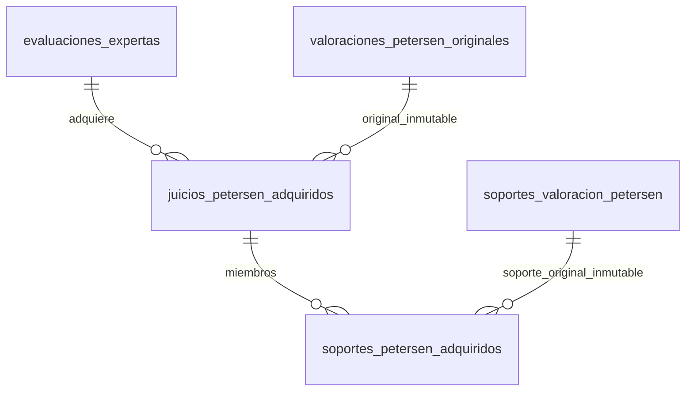

# Membresías históricas de Petersen: captura y conservación relacional

Fecha: **22/10/2026**, America/La_Paz. Continuación del [guardado SQL de referencia](RECUPERACION_SQL_COMPLETA_REFERENCIA_2026_10_22.md).

**Estado:** captura V2 integrada y probada; submodelo de membresías implementado y probado en SQLite/PostgreSQL desechables. **La conservación institucional completa de ambas ramas bajo 110 tablas sigue pendiente.** Este documento no declara cerrado ese hito ni autoriza instalar el submodelo aisladamente.

## Inventario y autorización

Se mantiene el inventario instalado de **100 tablas de negocio: 75 operativas + 25 expertas**, más 16 técnicas. El verificador de sólo lectura recuperó las 257 entidades de las cuatro consolidaciones, seis versiones y siete FK entrantes; no se ejecutó DDL sobre la base institucional durante este trabajo.

La instrucción de continuar y culminar autoriza el desarrollo. El máximo sigue siendo [110](DECISION_MAXIMO_110_TABLAS_2026_10_21.md). No existe aún un diccionario físico completo de conservación conjunta, probado bajo ese máximo, cuya instalación pueda darse por aprobada. Las restricciones de `database/AGENTS.md` continúan aplicándose al DDL institucional concreto.

Este submodelo propone **dos tablas y cuatro columnas nullable** en una cabecera existente. Aislado daría **102 tablas**. Ese número **no** incluye todavía los destinos restantes del DTO completo y **no** demuestra un diseño final de 102 ni de 110.

## Brecha corregida en la adquisición

La preparación anterior conservaba los identificadores ordenados de soportes, pero no la fila original que indica qué fuente pertenece a cada soporte. Para un juicio excluido, tampoco podía recuperarse ese vínculo desde su lista de fuentes interpretadas: dicha lista no se adquiría. Una FK histórica no puede construirse inventando después esos datos.

`ConsultarPetersenInstitucional::preparar()` adquiere ahora, antes de excluir cada juicio, las columnas nominales de sus soportes originales:

- Identidad del soporte y de la valoración propietaria.
- Tipo y orden original.
- Las ocho FK originales de fuente, conservando sus NULL.
- Método y huella de perfil de un soporte de medición.

No añade consultas por soporte: reutiliza la relación ya cargada. No obtiene fuentes adicionales, concede permisos ni cambia Policies. `consultar()` sigue devolviendo la salida clínica; no expone esta estructura de soporte como una nueva pantalla ni endpoint de descarga.

La preparación nueva se identifica como **`PETERSEN-ORIGINALES-2`**. Conserva la salida del mismo ejecutor y sus límites originales: preparación en memoria, `persistido=false`, sin revisión sobre un resultado transitorio. La V1 histórica continúa verificándose como V1; **no** recibe vínculos reconstruidos desde la base actual. No se renombra el contrato compuesto `EVALUACION-INSTITUCIONAL-1`.

`MembresiasOriginalesPetersen` comprueba sin SQL:

1. Correspondencia uno a uno entre procedencias y membresías de juicios.
2. Identidad única de cada soporte, propietario, tipo y orden original.
3. Exactamente una FK original no NULL por soporte.
4. Correspondencia entre cada fuente adquirida y su soporte original, en orden.
5. Correspondencia del método y huella canónica con el perfil realmente capturado en una medición.
6. FK exacta de `DOMINIO_REVISADO`, sin sustituirla por una descripción aproximada.
7. Orden global igual a la concatenación de las membresías originales, incluidos miembros de juicios excluidos.

No convierte una observación en medición, valida instrumentos clínicamente ni modifica C01–C05, C02 derivado, patrones, abstenciones o gobierno de reglas.

## Dos relaciones del submodelo



| Relación | Grano y claves | Datos propios |
|---|---|---|
| `juicios_petersen_adquiridos` | Una pertenencia de juicio original a evaluación; PK propia; UNIQUE evaluación+valoración; FK a ambas | Dos órdenes independientes, representaciones ISO de los dos instantes emitidos y cantidad esperada de soportes |
| `soportes_petersen_adquiridos` | Un miembro de un juicio adquirido; PK propia; UNIQUE juicio adquirido+soporte original; FK a ambos | Orden local de membresía |
| Bloque nullable en `evaluaciones_expertas` | Una adquisición de membresías por evaluación | Estado ABIERTA/CERRADA, huella de las tres colecciones, cantidad esperada de juicios y soportes |

La tabla de juicios tiene **ocho columnas** y la de soportes **cuatro**. No hay tablas anchas, JSON/EAV, discriminadores de campos ni propietarios textuales. Cada FK nueva tiene soporte de índice mediante UNIQUE o índice explícito y borrado restrictivo.

Autor, usuario, elemento, tipo, rectificación, documento y localizador se recuperan mediante el juicio original **inmutable**. Las ocho FK de fuente, método y huella se recuperan mediante el soporte original **inmutable**. No se copian esos atributos en cada evaluación: hacerlo introduciría dependencias transitivas y repeticiones innecesarias.

Las representaciones ISO son datos de la adquisición. Antes de guardarlas se comparan sus instantes y microsegundos con las columnas SQL originales, usando la zona institucional explícita. Se conserva la representación emitida, no una conversión que pierda zona o precisión.

El orden global de soportes no necesita otra columna: V2 exige que sea la concatenación de `orden_membresia` del padre y del hijo. Los órdenes de procedencia y membresía de juicios siguen separados porque son colecciones distintas. No se forman productos cartesianos entre colecciones independientes; el submodelo revisado no introduce una dependencia multivaluada no resuelta.

## Escritura y lectura

`MembresiasSQL` está en `prototipos/orion-conservacion-nominal/`. **No** está registrado en el contenedor Laravel, rutas ni migraciones institucionales. Su constructor rechaza destinos distintos de SQLite en memoria o el runner PostgreSQL efímero propio verificado.

La escritura:

1. Verifica el DTO V2 con el motor actual, sin cambiar la clasificación.
2. Abre una transacción propia y bloquea la evaluación propietaria.
3. Comprueba residente, procedencia original, instantes y filas originales de soporte.
4. Escribe las dos membresías, sus órdenes y cantidades.
5. Recupera las tres colecciones desde SQL y exige igualdad canónica estricta.
6. Cierra y confirma; ante cualquier fallo revierte el bloque completo.

Un reintento idéntico por evaluación devuelve `false`, conservando las mismas filas. Un contenido distinto se rechaza. Esta idempotencia del **submodelo** no sustituye todavía la idempotencia por UUID del futuro guardado compuesto.

La lectura usa una transacción consistente y sólo une las membresías fijadas con originales inmutables. No vuelve a buscar «todos los soportes actuales de la valoración». Por ello una inserción posterior en el expediente original no entra en la evaluación adquirida. Comprueba la huella y devuelve exactamente:

- `procedencia_valoraciones`;
- `membresias_soportes`;
- `soportes_originales`.

El lector no ejecuta el motor ni consulta los valores clínicos actuales de controles, IADL, documentos o instrumentos para completar información histórica. **No recupera todavía el resto del DTO compuesto.**

## Integridad por capa

| Garantía | Capa comprobada |
|---|---|
| Referencias a evaluación, juicio y soporte existentes | FK SQL |
| Mismo residente y propietario original del soporte | Triggers de inserción/actualización y cierre SQL |
| Cambio del original del padre después de insertar hijos | Rechazado por trigger del padre; se revalida al cerrar |
| Cantidades y secuencias continuas | UNIQUE, CHECK y trigger de cierre SQL |
| Insertar, modificar o borrar miembros tras cerrar | Triggers SQL |
| Borrar adquisición cerrada vacía mediante SQLite `REPLACE` | BEFORE INSERT comprueba también identidad existente; no depende de triggers recursivos |
| Confirmar adquisición ABIERTA | PostgreSQL: constraint trigger diferido; SQLite: transacción propia del escritor, sin atribuirle una restricción diferida inexistente |
| Instantes originales y representación ISO | Comparación del escritor PHP con originales inmutables |
| Huella y contenido íntegro de las tres colecciones | Escritor/lector PHP; no se afirma cálculo criptográfico desde SQL |
| Autorización de adquisición clínica | Policies y permisos existentes en la consulta Laravel; el prototipo no es un servicio clínico accesible |

PostgreSQL serializa inserciones por identidad del juicio adquirido mediante bloqueo asesor transaccional, **antes** de buscar un padre que podría seguir sin confirmar. Después bloquea y comprueba la evaluación. No se presupone que una FK espere por sí sola a una fila que todavía no es visible.

La prueba lanza dos workers sobre una escritura no confirmada: inserción tardía y reintento. `pg_stat_activity` y `pg_blocking_pids` acreditan que **ambas conexiones esperan un bloqueo real**. Tras confirmar, la inserción devuelve `55000`, el reintento devuelve `false` y la lectura permanece idéntica. El soporte tardío no duplica un UNIQUE: existe como nuevo soporte original fuera de la membresía capturada.

## Diseño, scripts y diccionario reproducibles

[Carpeta del candidato](../../prototipos/orion-conservacion-nominal/membresias-v2/):

- `candidato-sqlite.sql` y `candidato-postgres.sql`: DDL exacto del **submodelo desechable**, sin autorización de instalación.
- `diccionario.csv`: las 12 columnas de las nuevas relaciones y las cuatro de cabecera.
- `fk.csv`: cuatro FK nominales nuevas; las FK terminales de las fuentes siguen en el soporte original existente.
- `mapeo.csv`: todos los campos de las tres colecciones cubiertas, destinos y reconstrucción.
- `modelo-er.mmd`: relaciones y cardinalidades.
- `resumen.json`: inventario hipotético, huellas de DDL y límites expresos; sólo metadata estructural.

```powershell
php prototipos/orion-conservacion-nominal/generar-membresias.php
php prototipos/orion-conservacion-nominal/generar-membresias.php --check
```

El generador usa únicamente SQLite en memoria y definiciones mínimas para introspección. No carga Laravel, `.env`, originales ni datos institucionales. Su introspección no sustituye las pruebas contra las migraciones reales; éstas se realizan mediante `CapturaPetersenOriginalTest` en bases desechables pobladas.

`retirarEnsayo()` revierte únicamente el laboratorio. La prueba poblada comprueba que permanecen las valoraciones, soportes originales y evaluación existentes. **No es** una política de rollback institucional que permita eliminar historia adquirida en producción; esa transición debe formar parte de la propuesta conjunta final.

## Evidencia de esta ejecución

| Verificación ejecutada | Resultado |
|---|---|
| SQLite: `MembresiasOriginalesPetersenTest`, `CapturaPetersenOriginalTest`, `InstantaneaEvaluacionInstitucionalTest`, `PreparacionCompuestaCoherenteTest` | **102 pasadas, 432 aserciones**, cinco casos exclusivos PostgreSQL omitidos en SQLite |
| SQLite: regresión posterior de adquisición vacía y `INSERT OR REPLACE` | **1 pasada, 5 aserciones** |
| Revisión final tras formateo: unidades y regresión de cambio del original del padre | **21 pasadas, 33 aserciones**; subconjunto de la cobertura anterior |
| PostgreSQL efímero: `MembresiasOriginalesPetersenTest`, `CapturaPetersenOriginalTest`, `PreparacionCompuestaCoherenteTest` | **64 pasadas, 356 aserciones**, incluidas carreras, revocación concurrente y cierre diferido |
| Generador y `--check` | PASS; DDL/diccionario sincronizados |
| Inventario institucional, sólo lectura | PASS: 100 negocio + 16 técnicas, 257 entidades preservadas |
| Pint en los siete archivos PHP seleccionados y sintaxis del feature test | PASS |

Comandos:

```powershell
php artisan test --filter='MembresiasOriginalesPetersenTest|CapturaPetersenOriginalTest|InstantaneaEvaluacionInstitucionalTest|PreparacionCompuestaCoherenteTest' --compact --log-junit=work/membresias-v2-integracion-sqlite.xml
php artisan test --filter='CapturaPetersenOriginalTest::test_sqlite_membresias_vacias' --compact --log-junit=work/membresias-v2-replace-sqlite.xml
.\scripts\probar-postgres.ps1 -Filtro 'MembresiasOriginalesPetersenTest|CapturaPetersenOriginalTest|PreparacionCompuestaCoherenteTest' -Informe (Join-Path $env:TEMP 'orion-membresias-v2-final-pg.xml')
php scripts/verificar-consolidacion-experta.php
```

Los dos fallos de la prueba PostgreSQL inicial se conservaron como hallazgos de desarrollo y se corrigieron: carga explícita de la guarda del laboratorio y comprobación de cierre antes de que el padre fuera visible. No se cambió la expectativa para aceptar el rechazo por un UNIQUE duplicado ni una carrera secuencial.

Los informes JUnit y el estado de Git de la ejecución se conservaron en [la carpeta de evidencia](../auditorias/membresias-historicas-2026-10-22/). Los subconjuntos repetidos no se suman como pruebas diferentes. `git status --short` registró 230 entradas y `git diff --stat` 129 archivos seguidos modificados en el árbol **compartido**; esos totales incluyen trabajo anterior y ajeno. No se atribuyen íntegramente a este incremento.

Revisión independiente de sólo lectura: detectó discrepancias temporales, orden local ignorado, copia redundante de originales y la vía SQLite `REPLACE`. Se corrigieron y añadieron regresiones; el último dictamen estático es **PASS acotado**. Los resultados ejecutados anteriores corresponden al implementador. Las pruebas son sintéticas; no acreditan validación clínica.

## Archivos y trazabilidad

| Requisito | Implementación | Prueba/evidencia |
|---|---|---|
| Capturar vínculos de juicios admitidos y excluidos | `ConsultarPetersenInstitucional.php` | `test_captura_vinculos_originales_*` |
| Contrato V2 completo y V1 histórica fiel | `InstantaneaPetersen.php`, `MembresiasOriginalesPetersen.php` | `MembresiasOriginalesPetersenTest` |
| Método/huella/FK original y órdenes exactos | Validador de membresías | Positivos y 19 alteraciones/discordancias negativas |
| SQL normalizado de membresías | `MembresiasSQL.php` | `test_sql_membresias_*` |
| Concurrencia PostgreSQL | Triggers/bloqueos y `worker-membresias.php` | `test_postgres_membresias_cierre_*` |
| No confirmar parcial | Constraint trigger PostgreSQL | `test_postgres_membresias_no_confirma_*` |
| No borrar adquisición vacía | Guarda BEFORE INSERT SQLite | `test_sqlite_membresias_vacias_*` |
| DDL/diccionario/mapeo | `generar-membresias.php` | `--check` y carpeta `membresias-v2` |
| Replay de entradas con V2 | `EntradasCompuestas.php` acepta la colección cuando fue conservada | La referencia F02 antigua sigue limitada a su mapa V1; no se afirma cobertura V2 universal |

No cambió la interfaz, por lo que build y QA visual no corresponden a este incremento. No se ejecutaron commit, push ni despliegue. Se preservaron los cambios previos y simultáneos del árbol.

## Qué queda para cerrar el hito completo

1. **Fuentes instrumentales:** resolver captura, preguntas sin respuesta, respuestas, opciones y definiciones históricas; no basta unir a catálogos mutables actuales. El candidato de cinco relaciones de entradas requiere versionado de originales que todavía no está implementado/probado.
2. **Fuentes de soporte:** conservar los valores clínicos mutables que fueron interpretados, constancias documentales y juicios excluidos, separados de evidencia extraída. El submodelo de dos tablas fija sus identidades, no sus snapshots clínicos completos.
3. **Conocimiento retenido:** contratos, perfiles, selectores, predicados repetidos, procedencias y relaciones adquiridas necesitan destinos propios legítimos. Una versión de conocimiento actual no equivale a una copia histórica sellada.
4. **Salidas y trazas:** integrar resultados por criterio, medidas normalizadas por aplicación/componente, candidatos, contradicciones, soportes de condición y ejecuciones por unidad. No cabe usar `evaluacion_criterios` para cualquier medida: su grano actual es evaluación+nodo.
5. **Ejecutor y guardado conjunto:** retención, identidad por solicitud, ambas ramas, todas las salidas, replay y recuperación sin inferencia deben quedar unidos en **un único diseño completo ≤110**, con FK históricas, diccionario físico y transición poblada probados.
6. **Instalación e integración:** solicitar aprobación específica de ese esquema concreto, instalar sólo después y conectar entonces historial y revisiones independientes a una evaluación realmente durable.

La referencia amplia anterior demuestra recuperación del corpus V1 en SQL, pero excede el máximo y no es la solución a instalar. El submodelo actual demuestra una parte normalizada y reutilizable; **no prueba imposibilidad matemática de 110 ni garantiza que el resto quepa**. No se reserva arbitrariamente el cupo restante ni se libera retirando tablas pobladas. Hasta cerrar esos puntos, el guardado institucional completo y las revisiones sobre él siguen sin habilitarse.
