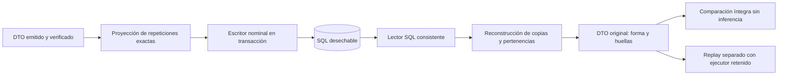

# Recuperación SQL completa: resultado comprobado y límite institucional

Fecha: **22/10/2026**, America/La_Paz. Continúa la [separación entre lectura y replay](CONSERVACION_LECTURA_Y_REPLAY_2026_10_22.md).

**Estado:** escritor y lector SQL del DTO completo implementados y verificados como referencia cerrada desechable. **No está terminada ni instalada la conservación institucional bajo 110 tablas.** La referencia conserva todas las salidas del corpus, pero incumple el presupuesto y todavía no cierra las FK semánticas originales. No se solicita aprobar ese esquema ni se presenta como diseño mantenible final.

## Cambio ejecutable

Se amplió el repositorio nominal existente, sin crear otro motor, otra base institucional ni un segundo mecanismo corporativo de auditoría. Los modos antiguo y completo comparten escritor, lector, transacciones, cierre, guardas, idempotencia y DDL.



`RepositorioNominal::recuperarCompleta()` obtiene desde SQL las fuentes, conocimiento, configuración, salidas, trazas, motivos, pertenencias y manifiesto. Reconstruye las repeticiones exactas y llama a `verificarIntegridad()`. **No ejecuta reglas ni normalizadores, no consulta los registros clínicos actuales y no completa faltantes históricos.** La salida recuperada se compara con el DTO original, incluidos tipos, ausencia, NULL, listas ordenadas y las tres huellas.

`RepositorioNominal::reproducir()` es otra operación: toma las entradas realmente conservadas y ejecuta el artefacto PHP retenido por F02. Se compara de nuevo el contenido íntegro y su huella. Obtener una misma clasificación no se considera suficiente.

El modo anterior continúa conservando sólo entradas y obteniendo salidas por replay. Su lector no se convierte implícitamente en lector completo; `recuperarCompleta()` lo rechaza si el mapa carece del contrato específico.

## Qué se almacena y cómo se evitan copias

Se conservan en columnas nominales las dos ramas del DTO y su contexto, originales, extracciones, fuentes conceptuales, versiones, conocimiento, gobierno adquirido, juicios, soportes, reglas/condiciones evaluadas, exclusiones, estados y resultados emitidos. Cada colección materializada tiene propietario SQL, posición y controles de cardinalidad/cierre. No hay JSON/EAV clínico ni serialización del DTO en una columna.

`ContenidoCompleto` elimina únicamente estas repeticiones cuya igualdad estricta comprueba antes de guardar:

| Repetición | Propietario conservado | Reconstrucción sin inferencia |
|---|---|---|
| Capturas originales del perfil | Capturas instrumentales de la rama | Copia del contenido SQL recuperado |
| Integración de cada dominio en el perfil | Resultado de inferencia de ese dominio | Referencia al resultado ya guardado |
| Observaciones del componente | Observaciones por componente del resultado | Referencia a la colección guardada; vacío sólo cuando así lo emitió el contrato |
| Adquisición en la salida Petersen | Adquisición original de la rama | Copia idéntica |
| Juicios usados por estados Petersen | Lista original de juicios de la misma rama | Membresías ordenadas; proyección sin el campo `elemento`, igual a la salida original |

Una discrepancia entre copias se rechaza; no se fuerza su igualdad para comprimir. Los juicios excluidos, las membresías de soportes adquiridos/excluidos y las preguntas sin respuesta siguen conservados. El contenido original no se modifica para señalar su almacenamiento: `persistido=false` y `release_retenido=false` siguen formando parte de la preparación emitida. El estado `CERRADA` del repositorio desechable es metadato de almacenamiento independiente; no activa el guardado institucional en Laravel.

## Evidencia sin motor disponible

`worker-lectura-completa.php` inicia otro proceso PHP, antepone un autoloader que prohíbe `MotorExperto\aplicacion`, `MotorExperto\dominio` y `MotorExperto\adaptadores`, conecta únicamente al PostgreSQL temporal y recupera el DTO desde SQL. La prueba comprueba:

- Ningún intento de cargar inferencia.
- Mismo contenido íntegro que el emitido.
- Misma huella compuesta y verificación independiente de integridad.

No basta con tener clases ya cargadas en el proceso de PHPUnit. Por ello esta comprobación usa otra conexión y otro proceso en PostgreSQL. El worker rechaza identidades ajenas al corpus sintético y el repositorio rechaza la base institucional.

## Corpus y límites de cobertura

Se reutilizan los diez casos F02 existentes, con los cuatro perfiles, insuficiencia, falta de gobierno, vacío, preguntas sin respuesta, NULL/ausencia/orden, seis fuentes y documentos, y vínculo interpretativo. Se añaden tres casos sintéticos que ejecutan los contratos actuales:

1. Cinco dominios P, conservando la salida sin patrón.
2. Revisión diferencial pendiente, con abstención diferencial.
3. Dos juicios originales opuestos del mismo dominio, con abstención por contradicción.

Son **13 casos de ingeniería**, sin pacientes reales ni nuevas reglas clínicas. No son el manifiesto no localizado de «104 escenarios» ni acreditan validación clínica. `CasosCompletos` crea fuentes exclusivamente sintéticas y no carga datos institucionales.

El mapa físico se compila **offline** a partir de este corpus y del contrato explícito del manifiesto de software. Guardar/leer sólo utiliza el mapa cerrado ya generado. Un campo o tipo nuevo que no está declarado se rechaza; no crea columnas ni cambia el esquema al recibir una evaluación. **Esto no demuestra cobertura universal de toda forma futura o no ejercitada del motor.** Los estados de contradicción Petersen sí se ejercitan; no se afirma cubrir con este corpus todos los conflictos instrumentales posibles.

## Transacción, historia y concurrencia

Las comprobaciones cubren:

- Transacción propia y rollback de cabecera, entradas, salidas y membresías ante fallo antes del cierre.
- UUID de solicitud único; reintento sólo admite la misma evaluación, identidad y contenido completo.
- Lectura consistente y comprobación separada de huella de proyección y huella original.
- Cierre que comprueba cardinalidad y continuidad del orden de colecciones.
- Rechazo SQL de actualización/borrado de historia cerrada.
- Tres conexiones PostgreSQL reales: cierre en curso, inserción tardía y solicitud repetida. Se comprueban dos esperas de bloqueo en `pg_stat_activity`; tras confirmar, la inserción se rechaza y el reintento no duplica la evaluación.
- Retirada y reinstalación del **esquema añadido de referencia poblado** en bases desechables, conservando las tablas y filas sintéticas del baseline y restaurando después el mismo DTO.

La reversión no demuestra retirar tablas institucionales pobladas ni autoriza hacerlo. SQLite no sustituye las pruebas de bloqueo PostgreSQL. Ningún ensayo ejecuta DDL en `remembermind_dev`.

## Presupuesto e integridad: por qué no se instala

El [diccionario físico generado](../../prototipos/orion-conservacion-nominal/referencia-completa/diccionario.csv), [FK](../../prototipos/orion-conservacion-nominal/referencia-completa/fk.csv), [ubicaciones](../../prototipos/orion-conservacion-nominal/referencia-completa/ubicaciones.csv), [ER](../../prototipos/orion-conservacion-nominal/referencia-completa/modelo-er.mmd) y [resumen](../../prototipos/orion-conservacion-nominal/referencia-completa/resumen.json) describen exactamente la referencia ejecutada.

| Medida de la referencia completa | Valor |
|---|---:|
| Base institucional instalada | 100 tablas de negocio |
| Relaciones de contenido materializado | 127 |
| Cabecera de conservación y release | 2 |
| Relaciones adicionales de referencia | **129** |
| Total hipotético junto a la base actual | **229**, incompatible con 110 |
| Columnas físicas de la referencia | 4.411 |
| Anchura máxima | **412 columnas**, tampoco aceptada como diseño mantenible |

Las dos relaciones de metadatos son específicas de la conservación experta: **no se esconden como tablas técnicas de Laravel para reducir el conteo**. La DDL [SQLite](../../prototipos/orion-conservacion-nominal/referencia-completa/referencia-sqlite.sql) y [PostgreSQL](../../prototipos/orion-conservacion-nominal/referencia-completa/referencia-postgres.sql) se entrega como evidencia reproducible, no como migración candidata.

Además:

- Las FK de propietario/evaluación protegen el árbol almacenado, pero no reemplazan todas las FK semánticas al conocimiento original.
- La lista `indices_valoraciones` se comprueba mediante referencias tipadas y huellas; **todavía no tiene FK terminal al juicio SQL**. La brecha B03 no se declara cerrada por igualdad de contenido.
- Las oportunidades de reutilizar conocimiento versionado, ampliar trazas existentes y consolidar capturas siguen siendo decisiones de diseño que requieren transición y pruebas. El nuevo modo no las simula.
- Copiar el DTO completo no equivale a demostrar 4FN ni mantenibilidad. Este esquema no supera esos gates ni el límite.

Por tanto, **el bloqueo del modelo institucional sigue abierto**. La referencia establece un oráculo SQL independiente con el que comprobar una futura reducción, pero no demuestra imposibilidad universal de otro diseño bajo 110. No se pide aprobar 229 tablas ni atribuir a una autorización pendiente la falta del diseño reducido.

## Código y reproducción

| Archivo | Responsabilidad |
|---|---|
| `prototipos/orion-conservacion-nominal/ContenidoCompleto.php` | Factorización reversible de repeticiones y preparación pura de entradas para replay |
| `.../RepositorioNominal.php` | Guardado atómico compartido, lectura completa sin inferencia y replay separado |
| `.../ContratoNominal.php`, `ProyeccionNominal.php`, `EsquemaNominal.php` | Columnas/tipos nominales explícitos, FLOAT nativo y signo de cero, contrato cerrado y restricciones |
| `.../CasosCompletos.php` | Trece casos sintéticos, sin modificar la suite F02 histórica de diez |
| `.../compilar-contenido-completo.php`, `mapa-completo.php` | Compilación offline reproducible del alcance observado |
| `.../generar-referencia-completa.php`, `referencia-completa/` | Diccionario, DDL, ER, reversión y presupuesto comprobables |
| `.../worker-lectura-completa.php`, `worker-concurrencia.php` | Lectura independiente con inferencia bloqueada y contención PostgreSQL real |
| `tests/Feature/ConservacionCompletaSQLTest.php` | DTO íntegro, huellas, replay, fallo parcial, cierre, idempotencia, concurrencia y reversión |

```powershell
php prototipos/orion-conservacion-nominal/compilar-contenido-completo.php --check
php prototipos/orion-conservacion-nominal/generar-referencia-completa.php --check
php artisan test --filter='ConservacionCompletaSQLTest|ContratoNominalTest' --compact --log-junit=work/conservacion-sql-completa-final-sqlite.xml
powershell -NoProfile -ExecutionPolicy Bypass -File scripts/probar-postgres.ps1 -Filtro 'ConservacionCompletaSQLTest|ContratoNominalTest'
```

| Ejecución final | Resultado | Evidencia |
|---|---|---|
| SQLite en memoria; cinco pruebas satisfactorias y dos específicas de PostgreSQL omitidas | **269 aserciones, cero fallos/errores** | [JUnit SQLite](../auditorias/conservacion-completa-2026-10-22/referencia-sql-completa-sqlite.xml) |
| PostgreSQL efímero; siete pruebas satisfactorias, sin omisiones | **284 aserciones, cero fallos/errores** | [JUnit PostgreSQL](../auditorias/conservacion-completa-2026-10-22/referencia-sql-completa-postgres.xml) |
| Mapa completo y nueve artefactos de referencia | Ambos `--check` satisfactorios | 127 modelos, 129 relaciones añadidas, presupuesto no aceptado |
| Contrato histórico de entradas | Generador/diccionario anterior satisfactorio | Sus14 artefactos y783 ubicaciones permanecen coherentes; conteo138 del corte histórico no sustituye la base actual100 |
| PostgreSQL instalado, sólo lectura | 116 tablas físicas, 25 expertas, 257 entidades trasladadas recuperadas; siete FK y seis versiones verificadas | `php scripts/verificar-consolidacion-experta.php` |

Las suites de ambos motores se solapan; no se suman como casos distintos. Cada ejecución incluye las dos pruebas unitarias del contrato nominal anterior y sus cinco pruebas funcionales nuevas. Los 13 casos se comparan dentro de la prueba de ida/vuelta y replay.

Durante el primer recorrido falló el replay aislado por la combinación de rutas temporales cortas de Windows y rutas reales del ejecutor. Se corrigió la carpeta del fixture para usar la ruta completa de `LOCALAPPDATA/Temp`. No se relajó la guarda que prohíbe cargar código ajeno al artefacto. Las ejecuciones finales anteriores superaron el mismo replay.

La revisión independiente no encontró un bypass nuevo en la lectura, las huellas o las guardas de destino. Identificó y se mantuvieron explícitas las brechas de presupuesto y FK terminales; no emitió aceptación del diseño institucional.

No se cambió interfaz, permisos, reglas, contratos C01–C05, estructura instalada ni activación clínica. No procede repetir build/QA visual por este cambio de referencia PHP. No hubo staging, commit, push ni despliegue.

Git al cerrar este corte: rama `feature/apoyo-decision-informe-neurocognitivo`, HEAD `47da9c0f`. `git status --porcelain` mostró 221 entradas compartidas y `git diff --stat` 128 archivos rastreados modificados, con 4.178 inserciones y 1.020 eliminaciones. Esos agregados incluyen trabajo simultáneo y no se atribuyen a este cambio; los archivos sin seguimiento no entran en el diff stat. El listado de responsabilidades anterior delimita el alcance propio. Se preservaron los cambios ajenos y pasó la comprobación de whitespace en los índices documentales modificados. Pint y los dos generadores `--check` también finalizaron satisfactoriamente.

## Aceptación

| Requisito | Estado |
|---|---|
| Leer desde SQL ambas ramas completas del corpus sin inferir | Implementado y probado en bases desechables |
| Replay separado con entradas y ejecutor retenidos | Implementado y probado en el corpus |
| Fallo parcial, idempotencia e historia cerrada | Implementados y probados en la referencia |
| Bloqueos/cierre concurrente | Prueba PostgreSQL real, no inferida de SQLite |
| Compatibilidad del modo anterior | Verificada por su contrato/diccionario y pruebas de tipos |
| Cumplir máximo 110 y mantenibilidad | **No cumple esta referencia; diseño institucional pendiente** |
| FK semánticas/terminales completas y 4FN | **No acreditadas para la instalación** |
| Historial y revisiones compuestas de producción | **No habilitados**; requieren modelo válido, aprobación específica e integración |
| Validación clínica | No acreditada ni modificada por estas pruebas |
