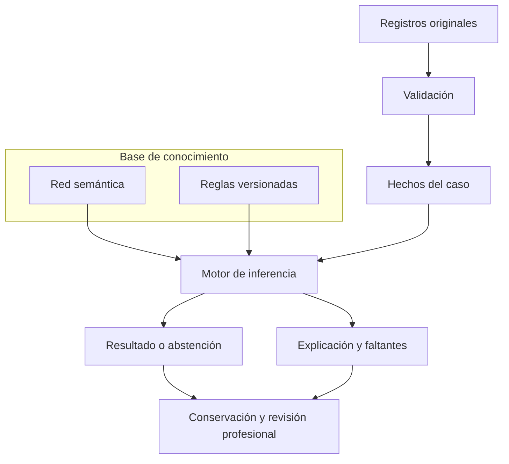

# Estructura por componentes del sistema experto

La propietaria indicó el 27/10/2026 que el experto se estructure siguiendo el diagrama adjunto `mermaid-diagram.png`. Se adoptan sus ocho componentes principales y sus conexiones. La red semántica y las reglas versionadas pertenecen a la base de conocimiento.

Esta decisión organiza responsabilidades. No selecciona una batería, añade reglas clínicas o umbrales, activa diagnósticos, amplía permisos ni modifica la estructura de la base de datos. La [matriz de datos](../MATRIZ_DATOS_DETECCION_DCL_2026_10_27.md) conserva los aspectos que requieren completar y revisar. La [arquitectura híbrida](../../arquitectura/ADR_ARQUITECTURA_HIBRIDA.md) sigue definiendo dónde vive el código.

## 1. Diagrama adoptado

La explicación corresponde a la misma ejecución que el resultado, incluso cuando el motor se abstiene. La conservación debe reunir ambas salidas y sus fuentes antes de vincular una revisión profesional al conjunto.

## 2. Componentes y límites

| Componente | Responsabilidad y salida | Entrada existente de código | Estado y trabajo pendiente |
|---|---|---|---|
| **1. Registros originales** | Mantener mediciones, respuestas, observaciones y documentos con residente, fecha clínica y autor. Son las fuentes del caso. | Captura en [Valoraciones](../../../app/Modulos/Valoraciones/README.md), [Cuidados](../../../app/Modulos/Cuidados/README.md) y [Clinica](../../../app/Modulos/Clinica/README.md); adquisición mediante [CapturasInstrumentalesResidente](../../../app/Modulos/ApoyoDecision/Aplicacion/Consultas/CapturasInstrumentalesResidente.php). | Existen capturas originales. Falta cerrar la batería y la cobertura de datos de la matriz; no se presupone que cada residente ya tenga todas las mediciones. |
| **2. Validación** | Comprobar permiso, competencia, pertenencia al residente, identidad instrumental, calidad y fecha de corte; conservar los motivos de exclusión. | [AplicarInstrumento](../../../app/Modulos/Valoraciones/Aplicacion/Acciones/AplicarInstrumento.php), [ExtractorCapturaInstrumental](../../../motor-experto/src/motor_experto/dominio/instrumentos/ExtractorCapturaInstrumental.php) y [FuentesValoracionOperativa](../../../app/Modulos/ApoyoDecision/Aplicacion/Consultas/FuentesValoracionOperativa.php). | Hay controles implementados. Cada instrumento que se adopte debe tener identidad y condiciones aplicables; un dato técnicamente válido no acredita por sí solo interpretación clínica. |
| **3. Hechos del caso — base de hechos** | Construir la evidencia de una evaluación concreta, con procedencia, corte, literal original y representación válida. Mantener ausencia y contradicción. | [ConstructorMemoriaInstrumental](../../../motor-experto/src/motor_experto/adaptadores/entrada/ConstructorMemoriaInstrumental.php) y [MemoriaTrabajo institucional](../../../motor-experto/src/motor_experto/dominio/inferencia/MemoriaTrabajo.php). | Existe construcción de hechos. Es memoria de una ejecución, no una copia editable de la historia ni una nueva tabla de residentes. |
| **4. Base de conocimiento** | Reunir una versión concreta de conceptos, relaciones, reglas, condiciones, consecuencias y referencias. | [CargadorConocimiento](../../../app/Modulos/ApoyoDecision/Infraestructura/Persistencia/Eloquent/CargadorConocimiento.php), [PaqueteConocimiento](../../../motor-experto/src/motor_experto/dominio/conocimiento/PaqueteConocimiento.php) y [gobierno de reglas](../../../app/Modulos/ApoyoDecision/Presentacion/Livewire/Paginas/GobiernoReglasPanel.php). | Existe conocimiento versionado. La fuente registrada se mantiene en la BDD existente; revisar alcance, procedencia y aprobación sin confundir estado ACTIVO con validación clínica. |
| **5. Motor de inferencia** | Aplicar el conocimiento a los hechos del caso y comprobar evaluabilidad, soportes, condiciones y conflictos. | [EvaluarPerfilInstitucional](../../../motor-experto/src/motor_experto/aplicacion/casos_uso/EvaluarPerfilInstitucional.php), [EvaluarConocimientoCognitivo](../../../motor-experto/src/motor_experto/aplicacion/casos_uso/EvaluarConocimientoCognitivo.php) y [EvaluarPetersenInstitucional](../../../motor-experto/src/motor_experto/dominio/petersen/EvaluarPetersenInstitucional.php). | Existen evaluadores de los contratos adoptados. Completar y comprobar las conexiones a fuentes reales; no incorporar resultados precargados o simulados. |
| **6. Resultado o abstención** | Entregar la salida sustentada de la ejecución y su alcance; expresar insuficiencia o contradicción cuando corresponda. | Salidas de los evaluadores y su coordinación en [ConsultarPerfilInstrumental](../../../app/Modulos/ApoyoDecision/Aplicacion/Consultas/ConsultarPerfilInstrumental.php) y [ConsultarPetersenInstitucional](../../../app/Modulos/ApoyoDecision/Aplicacion/Consultas/ConsultarPetersenInstitucional.php). | Existe salida orientativa/transitoria. Su disponibilidad en memoria no equivale a una valoración histórica guardada ni a un diagnóstico profesional. |
| **7. Explicación y faltantes** | Identificar fuentes usadas, condiciones, reglas, motivos, contradicciones y datos faltantes de esa misma ejecución. | [ConstructorTraza](../../../motor-experto/src/motor_experto/dominio/explicacion/ConstructorTraza.php), [TrazaFuentesInstrumentales](../../../motor-experto/src/motor_experto/dominio/explicacion/TrazaFuentesInstrumentales.php) y [presentación del informe](../../../app/Modulos/ApoyoDecision/Aplicacion/DTOs/PresentarInformeCognitivo.php). | Hay trazas y presentación. La explicación completa debe ser recuperable junto al resultado, sin reconstruir una conclusión histórica con datos actuales. |
| **8. Conservación y revisión profesional** | Guardar y recuperar resultado, explicación, fuentes y versión; después vincular la revisión profesional sin sobrescribir la salida original. | [PrepararEvaluacionInstitucional](../../../app/Modulos/ApoyoDecision/Aplicacion/Consultas/PrepararEvaluacionInstitucional.php), [InstantaneaEvaluacionInstitucional](../../../motor-experto/src/motor_experto/soporte/conservacion/InstantaneaEvaluacionInstitucional.php), [RevisarValoracionExperta](../../../app/Modulos/ApoyoDecision/Aplicacion/Acciones/RevisarValoracionExperta.php) y [consulta de revisiones](../../../app/Modulos/ApoyoDecision/Aplicacion/Consultas/ConsultarRevisionesValoracionExperta.php). | **El guardado y recuperación completos del conjunto instrumental/Petersen siguen pendientes.** La conservación observacional tiene otro alcance; su existencia no cierra este componente para el conjunto. |

### Interior de la base de conocimiento

- **Red semántica:** conceptos y relaciones, representados por [RedSemantica](../../../motor-experto/src/motor_experto/dominio/conocimiento/red_semantica/RedSemantica.php) y [PerfilConceptualCognitivo](../../../motor-experto/src/motor_experto/dominio/conocimiento/PerfilConceptualCognitivo.php). Una conexión representa una relación declarada; no demuestra alteración cognitiva.
- **Reglas versionadas:** condiciones y consecuencias con su fundamento, vigencia y revisión. Se consultan y gestionan desde el gobierno existente. [El mapa de reglas](MAPA_COMPONENTES.md#3-reglas-en-un-solo-lugar-fuente-y-responsabilidades) localiza su persistencia y constructores iniciales.

Los hechos de un residente no pertenecen al catálogo de conocimiento. Los resultados inferidos tampoco se convierten automáticamente en mediciones originales.

## 3. Ubicación en el proyecto

Los ocho componentes son responsabilidades del experto; no son ocho módulos Laravel adicionales ni ocho bases de datos.

| Propietario existente | Responsabilidad dentro del diagrama |
|---|---|
| Valoraciones, Cuidados y Clinica | Captura y conservación de sus registros originales. El experto consulta las fuentes autorizadas sin apropiarse de sus formularios o escrituras. |
| `app/Modulos/ApoyoDecision/Aplicacion` | Adquisición autorizada, coordinación del caso, operaciones de conservación y revisión dentro del alcance implementado. |
| `app/Modulos/ApoyoDecision/Infraestructura` | Lectura y escritura mediante las relaciones y contratos existentes; carga del conocimiento registrado. |
| `app/Modulos/ApoyoDecision/Presentacion` | Pantallas, rutas y Policies que permiten a cada rol consultar o ejecutar sus operaciones autorizadas. |
| `motor-experto/src/motor_experto` | Representación y validación pura, hechos, conocimiento, inferencia y explicación independientes de Laravel. |

El [mapa de archivos](MAPA_COMPONENTES.md) es el índice técnico complementario. Esta entrega no traslada ni renombra clases: establece el orden funcional por el que se organizarán y completarán los componentes, conservando sus consumidores y contratos.

## 4. Orden de desarrollo y criterio de cierre

Primera entrega de los componentes 1 y 2: [registros originales y validación](REGISTROS_ORIGINALES_Y_VALIDACION.md), con contrato de captura y pruebas de acceso directo. No cierra todavía la selección de instrumentos ni todos los datos de la matriz.

1. **Registros originales y validación:** cerrar dato, instrumento/fuente, autor, fecha y condición de uso; comprobar cobertura sin inventar mediciones.
2. **Hechos del caso:** definir y verificar el paso de cada fuente a evidencia, manteniendo procedencia, ausencia y contradicción.
3. **Base de conocimiento:** revisar conceptos, relaciones y reglas versionadas contra los contratos y referencias aplicables. La elección de instrumentos y reglas nuevas sigue siendo una decisión específica.
4. **Motor, resultado y explicación:** comprobar conjuntamente que la misma entrada y versión producen la salida y sus motivos correspondientes, incluida la abstención.
5. **Conservación y revisión:** completar guardado, recuperación íntegra y revisión vinculada al resultado conservado con las relaciones existentes.

Permisos, autoría, trazabilidad y manejo de errores atraviesan los ocho componentes. La revisión profesional es posterior a una ejecución desarrollada conforme al contrato aprobado; no se convierte en un permiso previo para cada prueba técnica. Las pruebas automatizadas verifican software y permanecen fuera del producto operativo. Se mantiene la [retirada del laboratorio](../RETIRADA_LABORATORIO_2026_10_27.md).

Cada componente se cierra con entradas/salidas verificables, consumidores conectados y evidencia de sus límites. Una decisión de organización, una prueba técnica y la validación clínica son estados diferentes.
