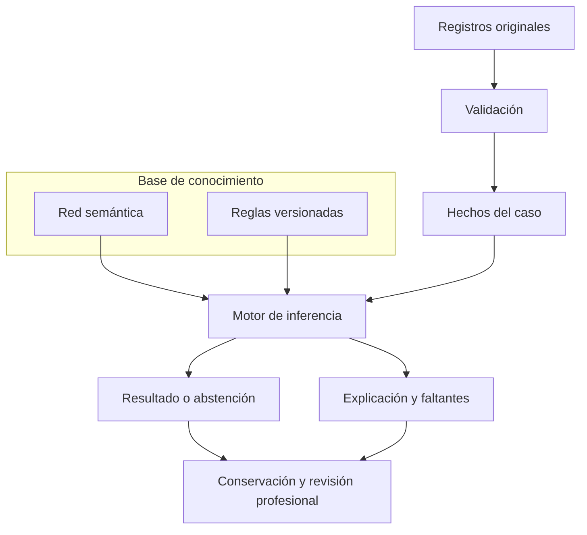

# Mapa único del sistema experto

Entrada: [portal del experto](../README.md). Este mapa organiza la implementación existente para detección temprana de DCL en personas mayores de 60 años. No crea otro motor, cambia reglas, traslada historia ni renombra identificadores.

La [estructura adoptada según el diagrama de la propietaria](ESTRUCTURA_POR_COMPONENTES.md) define los ocho componentes y su orden funcional. Este archivo conserva el índice técnico de sus implementaciones.

## Para leer el código sin recorrer tantas carpetas

Abrir primero [motor-experto/README.md](../../../motor-experto/README.md). El recorrido principal se simplificó el 04/11: 62 archivos distribuidos antes en 12 ubicaciones pasan a **seis carpetas planas**, directamente bajo `motor-experto/`. Después se eliminaron las carpetas intermedias `src/motor_experto/` para los 105 archivos productivos. Los namespaces no cambian en este segundo traslado; Composer apunta a la raíz del motor y excluye sus fixtures:

| Carpeta | Archivos principales |
|---|---|
| `conocimiento/` | `ReglasCognitivas.php`, `ReglasPetersen.php`, `ReglasObservacionales.php`, `RedSemantica.php`. |
| `hechos/` | `ConstructorMemoriaInstrumental.php`, `MemoriaTrabajo.php`, `ContextoEjecucion.php`. |
| `inferencia/` | `EvaluarPerfilInstitucional.php`, `EvaluarPetersenInstitucional.php`, `EvaluadorReglas.php`. |
| `explicacion/` | `ConstructorTraza.php`, `TrazaFuentesInstrumentales.php`. |
| `instrumentos/` | `CircuitoInstrumentalInicial.php`, `RegistroMetodosInstrumentales.php` y métodos específicos. |
| `conservacion/` | `InstantaneaEvaluacionInstitucional.php`, `InstantaneaInstrumental.php`, `InstantaneaPetersen.php`, `CodecInstantanea.php`. |

Los tres archivos `Reglas*` concentran la entrada legible a las 24 definiciones iniciales. Se mantienen clases separadas por responsabilidad, sin concatenar todo en un archivo o duplicar implementaciones. Las versiones registradas siguen en la BDD y el cargador recibe la versión correspondiente. La reorganización no cambia reglas, umbrales, fuentes, permisos o estructura.

Los tipos históricos en `dominio/orion/` y el contrato anterior de `aplicacion/puertos/` no son el punto de entrada al recorrido institucional y no se mezclan con las pruebas exclusivas de `tests/fixtures/`. Se conservaron sus identidades y los cambios locales previos.

### Comprobación del agrupamiento inicial

- Misma batería antes/después: 566 casos, 10.282 aserciones, sin fallos; una omisión idéntica en ambos cortes corresponde a `ConservacionB02PostgresTest`, que requiere su perfil PostgreSQL específico. No se presenta como caso ejecutado en SQLite.
- Integración SQLite: 53 pruebas y 255 aserciones correctas en captura inicial, gobierno de reglas y retirada del laboratorio.
- Integración PostgreSQL desechable: 12 pruebas y 88 aserciones correctas del circuito inicial, incluyendo lectura y reproducción conjunta; además, 4 pruebas y 68 aserciones correctas de los cuatro patrones desde SQL y originales. Ambos clústeres propios terminaron con apagado y limpieza confirmados; no se migró la BDD operativa.
- Navegador aislado: dos recorridos correctos, circuito inicial e informe/grafo por roles, en cinco anchos de 390 a 1440 px, con teclado y sin errores JS ni desbordamientos detectados. Las rutas siguen siendo las existentes; se comprueba el comportamiento tras actualizar referencias de clases en Blade.
- Dos verificaciones PHP independientes de Laravel/SQL y matriz de trazabilidad offline correctas. Composer regenerado; persisten sus avisos previos de clases de fixtures con namespaces deliberadamente aislados, sin trasladarlas al autoload del producto.
- Revisión independiente: las 62 clases cargan desde su ubicación nueva; 60 cuerpos conservan tokens y las otras dos diferencias son la extracción equivalente de `MEMORIA` y el ajuste de profundidad de la raíz del release. Los consumidores conservan lógica; el test de lectura sin inferencia bloquea los prefijos nuevos.

No se modifica la BDD operativa ni se instala un perfil nuevo; la comprobación de catálogo confirma los mismos tres perfiles iniciales y 35 campos. No cambia el diseño visual, CSS o JavaScript del producto, por lo que no se repite el build; sí se ejercitan las vistas afectadas en el navegador. No se ejecuta la suite global ni se cierra el guardado conjunto pendiente. Evidencias locales: `output/orden-experto-20261104-*` y `output/orden-experto-patrones-20261104-*`, fuera del commit. Se actualizan enlaces existentes en lugar de crear otro entregable o una capa de alias.

### Comprobación del traslado directo, sin `src`

- Batería previa: 566 casos, 10.282 aserciones; posterior: 568 casos, 10.831 aserciones. Sin fallos y con la misma omisión del perfil específico `ConservacionB02PostgresTest`. Los dos casos añadidos prueban lectura del release con rutas anteriores y rechazo de fixtures dentro de un release con huellas consistentes.
- Integración SQLite: 53 pruebas y 255 aserciones correctas. PostgreSQL desechable: 12 pruebas y 88 aserciones correctas del circuito inicial; clúster propio detenido y retirado.
- Arquitectura focal: tres pruebas y 932 aserciones correctas para carpetas, namespaces, pureza del motor y carga Composer sin fixtures. La comprobación general de dependencia entre capas detecta un fallo previo en `Identidad/Aplicacion/Acciones/DocumentacionUsuarioService.php`, que importa una Policy de Presentación; ese import existe en HEAD y no se modifica aquí.
- Composer válido y autoload regenerado; ambos ejecutores PHP independientes y matriz offline correctos. Los namespaces se conservan; el release enumera únicamente las ocho carpetas productivas y sigue leyendo los formatos históricos sin traducir sus rutas o huellas.

No se modifica BDD, reglas, permisos, UI, CSS ni JavaScript del producto; build y nueva revisión visual no aplican a este traslado. Evidencias locales: `output/directo-experto-*`. Los cambios locales anteriores se conservan fuera del commit de este traslado.

## 1. Dónde buscar cada parte

| Parte | Entrada principal | Qué contiene / límite |
|---|---|---|
| Datos y base de hechos | [Matriz D01–D27 vigente](../MATRIZ_TRAZABILIDAD_DCL.md), [lector de originales](../../../app/Modulos/ApoyoDecision/Aplicacion/Consultas/CapturasInstrumentalesResidente.php) y [ConstructorMemoriaInstrumental](../../../motor-experto/hechos/ConstructorMemoriaInstrumental.php) | Fuentes autorizadas del residente → evidencia de una ejecución. No confundir una respuesta original, una interpretación y un resultado inferido. |
| Instrumentos | [Candidatos](../instrumentos/CATALOGO_CANDIDATOS.md), [instalado](../inventarios/README.md) y [captura](../../../app/Modulos/Valoraciones/Aplicacion/Acciones/AplicarInstrumento.php) | Candidato investigado, catálogo instalado y prueba administrada son estados distintos. Este inventario no lee aplicaciones clínicas. |
| Base de conocimiento | [CargadorConocimiento](../../../app/Modulos/ApoyoDecision/Infraestructura/Persistencia/Eloquent/CargadorConocimiento.php) y [PaqueteConocimiento](../../../motor-experto/conocimiento/PaqueteConocimiento.php) | Carga una versión concreta de conceptos, valores, fuentes, relaciones y reglas. |
| Reglas: catálogo único | [GobiernoReglasPanel](../../../app/Modulos/ApoyoDecision/Presentacion/Livewire/Paginas/GobiernoReglasPanel.php) y [GestionarReglasExpertas](../../../app/Modulos/ApoyoDecision/Aplicacion/Acciones/GestionarReglasExpertas.php) | Consulta y gestión autorizada de reglas, condiciones, consecuencias, revisiones y versiones. La fuente institucional registrada es la BDD por versión. |
| Red semántica | [red del paquete](../../../motor-experto/conocimiento/RedSemantica.php) y [PerfilConceptualCognitivo](../../../motor-experto/conocimiento/PerfilConceptualCognitivo.php) | Conceptos y relaciones con contratos explícitos. Pertenecer a un dominio o estar conectado no acredita alteración. |
| Motor de inferencia institucional | [EvaluarPerfilInstitucional](../../../motor-experto/inferencia/EvaluarPerfilInstitucional.php), [EvaluarConocimientoCognitivo](../../../motor-experto/inferencia/EvaluarConocimientoCognitivo.php) y [EvaluarPetersenInstitucional](../../../motor-experto/inferencia/EvaluarPetersenInstitucional.php) | Evaluadores puros de los contratos adoptados. No consultan historias por su cuenta ni inventan mediciones. |
| Resultado y explicación | [ConstructorTraza](../../../motor-experto/explicacion/ConstructorTraza.php), [TrazaFuentesInstrumentales](../../../motor-experto/explicacion/TrazaFuentesInstrumentales.php) y [ResultadosExpertoResidente](../../../app/Modulos/ApoyoDecision/Presentacion/Livewire/Paginas/ResultadosExpertoResidente.php) | Salida, motivos y evidencias; la explicación y el acceso clínico siguen sujetos al contrato y permisos. |
| Conservación y revisión | [preparación conjunta](../../../app/Modulos/ApoyoDecision/Aplicacion/Consultas/PrepararEvaluacionInstitucional.php), [instantánea conjunta](../../../motor-experto/conservacion/InstantaneaEvaluacionInstitucional.php) y [RevisarValoracionExperta](../../../app/Modulos/ApoyoDecision/Aplicacion/Acciones/RevisarValoracionExperta.php) | El conjunto instrumental/Petersen sigue transitorio; no atribuirle revisiones ni replay institucional completo. Observaciones conservadas tienen otro alcance. |
| Consulta administrativa | [ConocimientoPanel](../../../app/Modulos/ApoyoDecision/Presentacion/Livewire/Paginas/ConocimientoPanel.php) | Consulta de versiones institucionales registradas; sin ejecución de casos, laboratorio ni conocimiento ficticio de respaldo. |

## 2. Cómo se conectan

La reproducción de un DTO verificado en memoria no prueba su guardado relacional, cierre histórico o revisión profesional posterior.

## 3. Reglas en un solo lugar: fuente y responsabilidades

| Responsabilidad | Ubicación existente |
|---|---|
| Regla registrada, estado y revisión | [ReglaExperta](../../../app/Models/ReglaExperta.php), `reglas_expertas`. |
| Condiciones SI | [CondicionReglaExperta](../../../app/Models/CondicionReglaExperta.php), `condiciones_regla_experta`. |
| Consecuencias ENTONCES | [ConsecuenciaReglaExperta](../../../app/Models/ConsecuenciaReglaExperta.php), `consecuencias_regla_experta`. |
| Identidad y vigencia | [VersionModeloExperto](../../../app/Models/VersionModeloExperto.php). |
| Definiciones iniciales de contratos adoptados | [ReglasCognitivas](../../../motor-experto/conocimiento/ReglasCognitivas.php), [ReglasPetersen](../../../motor-experto/conocimiento/ReglasPetersen.php) y [ReglasObservacionales](../../../motor-experto/conocimiento/ReglasObservacionales.php). No sustituyen las versiones históricas registradas. |
| Registro inicial autorizado | [RegistrarConocimientoInstitucional](../../../app/Modulos/ApoyoDecision/Aplicacion/Acciones/RegistrarConocimientoInstitucional.php) y [RegistrarConocimientoPetersen](../../../app/Modulos/ApoyoDecision/Aplicacion/Acciones/RegistrarConocimientoPetersen.php). |
| Carga y evaluación | El cargador reúne la versión y el motor interpreta sus condiciones. No copiar el conocimiento a Blade/Livewire. |

Centralizar consulta y gobierno no significa fusionar estas tablas, eliminar versiones o convertir reglas y hechos en una entidad. Las variables tienen una proyección lógica sobre `nodos_semanticos` según [consolidaciones aprobadas](../../base-de-datos/DECISION_CONSOLIDACION_BLOQUES_EXPERTOS_2026_10_22.md); el nombre lógico de una entidad no prueba otra tabla física.

## 4. Nombres que pueden confundir

| Nombre / rama | Alcance comprobado |
|---|---|
| `motor-experto/tests/fixtures/aplicacion/casos_uso/MotorExperto.php` | Piloto retirado del producto; solo regresión automatizada. |
| `motor-experto/tests/fixtures/dominio/orion/Services/Inferencia/MotorInferenciaService.php` | Recorrido técnico retirado del autoload operativo; solo regresión. |
| `hechos/MemoriaTrabajo.php` | Memoria utilizada por el recorrido declarativo institucional. |
| `dominio/orion/Entities/Hechos/MemoriaTrabajo.php` | Otra representación tipada usada por el recorrido experimental. No intercambiarlas por tener el mismo nombre. |
| `dominio/orion/` | Código puro trasladado y contratos con consumidores. No se declara descartable ni se elimina por su denominación. |
| Fuente conceptual JSON del código | Conocimiento documental del producto; no usar su formato como autorización para almacenar historia clínica en JSON/EAV. |

Las rutas y namespaces conservados son identificadores técnicos existentes. La denominación visible de esta organización es «Sistema experto para detección temprana de DCL».

## 5. Puntos de entrada existentes en la aplicación

El [registro de rutas](../../../app/Modulos/ApoyoDecision/Presentacion/Rutas/web.php) está integrado bajo el prefijo administrativo del producto:

| Ruta | Propósito y control existente |
|---|---|
| `/admin/sistema-experto/reglas` | Gobierno de reglas; Policy `consultarGobierno`. |
| `/admin/sistema-experto/residentes` | Directorio de evaluación; roles y permiso contextual de lectura. |
| `/admin/sistema-experto/residentes/{residente}/petersen` | Captura de valoraciones originales y soportes; Policy y competencia profesional. |
| `/admin/sistema-experto` | Consulta administrativa del conocimiento registrado; Superadministrador y autorización de consulta. |
| Resultados dentro del expediente por rol | Se reutilizan las rutas del módulo; permiso y Policy del residente. No añadir otra pantalla diagnóstica paralela. |

La retirada del 27/10 elimina las secciones de laboratorio sin ampliar permisos. Una entrada documental no concede acceso por URL ni convierte a Superadministración en autor clínico.

## 6. Qué sigue para terminar

1. Completar D02–D06, D09, D13 y los factores parciales de la matriz con fuentes/capturas reales; no inventar datos de residentes.
2. Revisar la batería candidata y sus derechos, rangos y normas con los profesionales responsables. El inventario técnico no aprueba un instrumento.
3. Resolver D24/D27: conservación y replay completos en el modelo existente, conforme a la decisión de no crear tablas.
4. Conectar revisión al resultado conservado y corregir las discrepancias de interpretación/permisos ya identificadas.
5. Verificar casos positivos, insuficientes y contradictorios, historia, autorización y UI responsive; distinguir validación técnica de clínica.

El [retiro del laboratorio](../RETIRADA_LABORATORIO_2026_10_27.md) trasladó sus algoritmos exclusivos a directorios de pruebas. Los contratos compartidos, las instantáneas históricas y el motor institucional conservan sus identidades.
