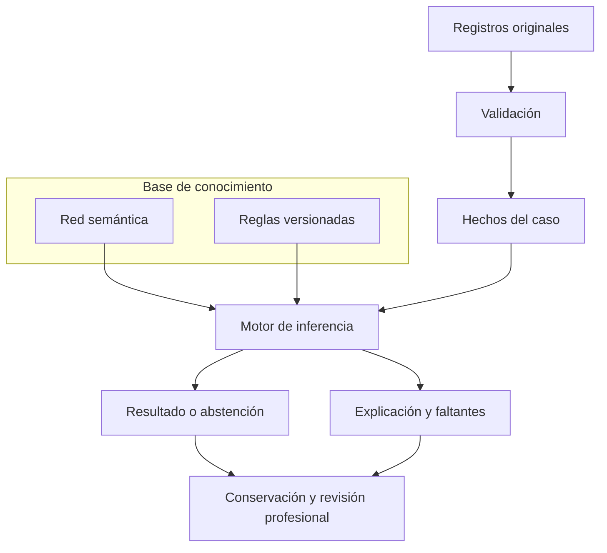

# Mapa único del sistema experto

Entrada: [portal del experto](../README.md). Este mapa organiza la implementación existente para detección temprana de DCL en personas mayores de 60 años. No crea otro motor, cambia reglas, traslada historia ni renombra identificadores.

La [estructura adoptada según el diagrama de la propietaria](ESTRUCTURA_POR_COMPONENTES.md) define los ocho componentes y su orden funcional. Este archivo conserva el índice técnico de sus implementaciones.

## 1. Dónde buscar cada parte

| Parte | Entrada principal | Qué contiene / límite |
|---|---|---|
| Datos y base de hechos | [Matriz D01–D27](../MATRIZ_DATOS_DETECCION_DCL_2026_10_27.md), [lector de originales](../../../app/Modulos/ApoyoDecision/Aplicacion/Consultas/CapturasInstrumentalesResidente.php) y [ConstructorMemoriaInstrumental](../../../motor-experto/src/motor_experto/adaptadores/entrada/ConstructorMemoriaInstrumental.php) | Fuentes autorizadas del residente → evidencia de una ejecución. No confundir una respuesta original, una interpretación y un resultado inferido. |
| Instrumentos | [Candidatos](../instrumentos/CATALOGO_CANDIDATOS.md), [instalado](../inventarios/README.md) y [captura](../../../app/Modulos/Valoraciones/Aplicacion/Acciones/AplicarInstrumento.php) | Candidato investigado, catálogo instalado y prueba administrada son estados distintos. Este inventario no lee aplicaciones clínicas. |
| Base de conocimiento | [CargadorConocimiento](../../../app/Modulos/ApoyoDecision/Infraestructura/Persistencia/Eloquent/CargadorConocimiento.php) y [PaqueteConocimiento](../../../motor-experto/src/motor_experto/dominio/conocimiento/PaqueteConocimiento.php) | Carga una versión concreta de conceptos, valores, fuentes, relaciones y reglas. |
| Reglas: catálogo único | [GobiernoReglasPanel](../../../app/Modulos/ApoyoDecision/Presentacion/Livewire/Paginas/GobiernoReglasPanel.php) y [GestionarReglasExpertas](../../../app/Modulos/ApoyoDecision/Aplicacion/Acciones/GestionarReglasExpertas.php) | Consulta y gestión autorizada de reglas, condiciones, consecuencias, revisiones y versiones. La fuente institucional registrada es la BDD por versión. |
| Red semántica | [red del paquete](../../../motor-experto/src/motor_experto/dominio/conocimiento/red_semantica/RedSemantica.php) y [PerfilConceptualCognitivo](../../../motor-experto/src/motor_experto/dominio/conocimiento/PerfilConceptualCognitivo.php) | Conceptos y relaciones con contratos explícitos. Pertenecer a un dominio o estar conectado no acredita alteración. |
| Motor de inferencia institucional | [EvaluarPerfilInstitucional](../../../motor-experto/src/motor_experto/aplicacion/casos_uso/EvaluarPerfilInstitucional.php), [EvaluarConocimientoCognitivo](../../../motor-experto/src/motor_experto/aplicacion/casos_uso/EvaluarConocimientoCognitivo.php) y [EvaluarPetersenInstitucional](../../../motor-experto/src/motor_experto/dominio/petersen/EvaluarPetersenInstitucional.php) | Evaluadores puros de los contratos adoptados. No consultan historias por su cuenta ni inventan mediciones. |
| Resultado y explicación | [ConstructorTraza](../../../motor-experto/src/motor_experto/dominio/explicacion/ConstructorTraza.php), [TrazaFuentesInstrumentales](../../../motor-experto/src/motor_experto/dominio/explicacion/TrazaFuentesInstrumentales.php) y [ResultadosExpertoResidente](../../../app/Modulos/ApoyoDecision/Presentacion/Livewire/Paginas/ResultadosExpertoResidente.php) | Salida, motivos y evidencias; la explicación y el acceso clínico siguen sujetos al contrato y permisos. |
| Conservación y revisión | [preparación conjunta](../../../app/Modulos/ApoyoDecision/Aplicacion/Consultas/PrepararEvaluacionInstitucional.php), [instantánea conjunta](../../../motor-experto/src/motor_experto/soporte/conservacion/InstantaneaEvaluacionInstitucional.php) y [RevisarValoracionExperta](../../../app/Modulos/ApoyoDecision/Aplicacion/Acciones/RevisarValoracionExperta.php) | El conjunto instrumental/Petersen sigue transitorio; no atribuirle revisiones ni replay institucional completo. Observaciones conservadas tienen otro alcance. |
| Consulta administrativa | [ConocimientoPanel](../../../app/Modulos/ApoyoDecision/Presentacion/Livewire/Paginas/ConocimientoPanel.php) | Consulta de versiones institucionales registradas; sin ejecución de casos, laboratorio ni conocimiento ficticio de respaldo. |

## 2. Cómo se conectan

La reproducción de un DTO verificado en memoria no prueba su guardado relacional, cierre histórico o revisión profesional posterior.

## 3. Reglas en un solo lugar: fuente y responsabilidades

| Responsabilidad | Ubicación existente |
|---|---|
| Regla registrada, estado y revisión | [ReglaExperta](../../../app/Models/ReglaExperta.php), `reglas_expertas`. |
| Condiciones SI | [CondicionReglaExperta](../../../app/Models/CondicionReglaExperta.php), `condiciones_regla_experta`. |
| Consecuencias ENTONCES | [ConsecuenciaReglaExperta](../../../app/Models/ConsecuenciaReglaExperta.php), `consecuencias_regla_experta`. |
| Identidad y vigencia | [VersionModeloExperto](../../../app/Models/VersionModeloExperto.php). |
| Definiciones iniciales de contratos adoptados | [PaqueteCognitivoInstitucional](../../../motor-experto/src/motor_experto/dominio/conocimiento/versiones/PaqueteCognitivoInstitucional.php) y [PaquetePetersenInstitucional](../../../motor-experto/src/motor_experto/dominio/conocimiento/versiones/PaquetePetersenInstitucional.php). Son constructores de conocimiento, no la edición de todas las versiones históricas registradas. |
| Registro inicial autorizado | [RegistrarConocimientoInstitucional](../../../app/Modulos/ApoyoDecision/Aplicacion/Acciones/RegistrarConocimientoInstitucional.php) y [RegistrarConocimientoPetersen](../../../app/Modulos/ApoyoDecision/Aplicacion/Acciones/RegistrarConocimientoPetersen.php). |
| Carga y evaluación | El cargador reúne la versión y el motor interpreta sus condiciones. No copiar el conocimiento a Blade/Livewire. |

Centralizar consulta y gobierno no significa fusionar estas tablas, eliminar versiones o convertir reglas y hechos en una entidad. Las variables tienen una proyección lógica sobre `nodos_semanticos` según [consolidaciones aprobadas](../../base-de-datos/DECISION_CONSOLIDACION_BLOQUES_EXPERTOS_2026_10_22.md); el nombre lógico de una entidad no prueba otra tabla física.

## 4. Nombres que pueden confundir

| Nombre / rama | Alcance comprobado |
|---|---|
| `motor-experto/tests/fixtures/aplicacion/casos_uso/MotorExperto.php` | Piloto retirado del producto; solo regresión automatizada. |
| `motor-experto/tests/fixtures/dominio/orion/Services/Inferencia/MotorInferenciaService.php` | Recorrido técnico retirado del autoload operativo; solo regresión. |
| `dominio/inferencia/MemoriaTrabajo.php` | Memoria utilizada por el recorrido declarativo institucional. |
| `dominio/orion/Entities/Hechos/MemoriaTrabajo.php` | Otra representación tipada usada por el recorrido experimental. No intercambiarlas por tener el mismo nombre. |
| `dominio/orion/` | Código puro trasladado y contratos con consumidores. No se declara descartable ni se elimina por su denominación. |
| Fuente conceptual JSON del código | Conocimiento documental del producto; no usar su formato como autorización para almacenar historia clínica en JSON/EAV. |

Las rutas y namespaces conservados son identificadores técnicos existentes. La denominación visible de esta organización es «Sistema experto para detección temprana de DCL».

## 5. Puntos de entrada existentes en la aplicación

El [registro de rutas](../../../app/Modulos/ApoyoDecision/Presentacion/Rutas/web.php) está integrado bajo el prefijo administrativo del producto:

| Ruta | Propósito y control existente |
|---|---|
| `/admin/sistema-experto/reglas` | Gobierno de reglas; Policy `consultarGobierno`. |
| `/admin/sistema-experto/residentes` | Directorio de evaluación; roles y permiso contextual de lectura. |
| `/admin/sistema-experto/residentes/{residente}/petersen` | Captura de valoraciones originales y soportes; Policy y competencia profesional. |
| `/admin/sistema-experto` | Consulta administrativa del conocimiento registrado; Superadministrador y autorización de consulta. |
| Resultados dentro del expediente por rol | Se reutilizan las rutas del módulo; permiso y Policy del residente. No añadir otra pantalla diagnóstica paralela. |

La retirada del 27/10 elimina las secciones de laboratorio sin ampliar permisos. Una entrada documental no concede acceso por URL ni convierte a Superadministración en autor clínico.

## 6. Qué sigue para terminar

1. Completar D02–D06, D09, D13 y los factores parciales de la matriz con fuentes/capturas reales; no inventar datos de residentes.
2. Revisar la batería candidata y sus derechos, rangos y normas con los profesionales responsables. El inventario técnico no aprueba un instrumento.
3. Resolver D24/D27: conservación y replay completos en el modelo existente, conforme a la decisión de no crear tablas.
4. Conectar revisión al resultado conservado y corregir las discrepancias de interpretación/permisos ya identificadas.
5. Verificar casos positivos, insuficientes y contradictorios, historia, autorización y UI responsive; distinguir validación técnica de clínica.

El [retiro del laboratorio](../RETIRADA_LABORATORIO_2026_10_27.md) trasladó sus algoritmos exclusivos a directorios de pruebas. Los contratos compartidos, las instantáneas históricas y el motor institucional conservan sus identidades.
