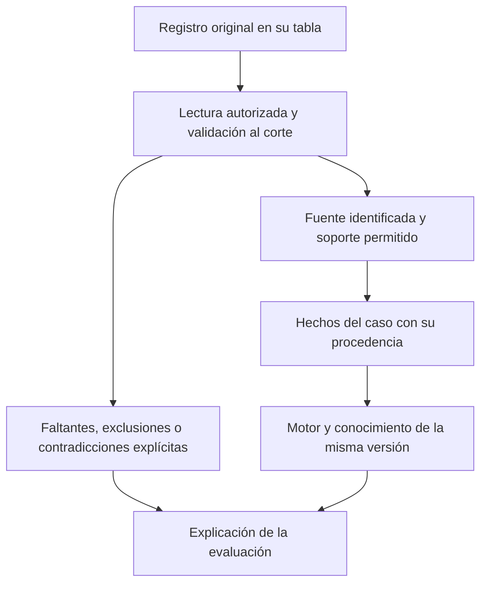

# De fuentes originales a hechos del caso

Entrega del componente 3 de la [estructura adoptada](ESTRUCTURA_POR_COMPONENTES.md), apoyada en [registros originales y validación](REGISTROS_ORIGINALES_Y_VALIDACION.md). Se hace consultable el mapa existente de fuentes por área/criterio, incluso sin residentes. No se crean historias, mediciones, nuevos juicios, reglas diagnósticas ni tablas.

## 1. Qué se conecta



El mapa prepara las conexiones permitidas. No significa que ya existan datos de residentes, ni que haya perfiles instrumentales configurados o todos los soportes reunidos. Tampoco es una carga automática de toda la BDD: cada fuente mantiene su permiso, contexto, fecha y contrato.

## 2. Mapa que ya define el contrato institucional

| Destino | Tipo de soporte | Fuente admitida | Qué debe conservarse / límite |
|---|---|---|---|
| Memoria, atención, funciones ejecutivas, lenguaje y visuoespacial: cinco destinos independientes | `MEDICION` | Aplicación original `cod_aplicacion`, vinculada a `aplicaciones_instrumento` y sus respuestas. | Identidad del instrumento, mediciones, método y aplicabilidad. El estado del dominio sigue siendo un juicio profesional original sustentado; una respuesta aislada no se convierte automáticamente en alteración. |
| C01: cambio corroborado | `HISTORIA_PREVIA` y `CORROBORACION` | Control cognitivo, valoración psicológica o documento clínico. | Conservar el episodio y las fuentes originales. Dos formularios del mismo episodio no acreditan independencia. No usar una repetición de preguntas como diagnóstico. |
| C02: alteración objetiva | **Derivado de los cinco dominios** | No tiene soporte de captura ni juicio manual propio. | El motor conserva de qué dominios procede. No se rellena C02 desde observaciones, una z aislada o una respuesta libre. |
| C03: independencia instrumental relativa | `IADL` | `cod_control_iadl` → `controles_funcionales_iadl`. | Actividad, oportunidad, ayuda, causa y nivel previo; el soporte descriptivo no acredita por sí solo independencia. |
| C04: revisión diferencial | `DIFERENCIAL` | Valoración psicológica, antecedente, diagnóstico o documento clínico. | Revisión profesional explícita y sus límites; la ausencia de diagnósticos no descarta otras causas. Prescripciones y signos vitales no se añaden como soportes directos por existir en la BDD. |
| C05: calidad del conjunto | `CALIDAD` | Aplicación original, valoración psicológica o documento clínico. | Comprobaciones del conjunto que realmente se revisó; sin deducir calidad desde un estado técnico ACTIVO. |
| C05: dominios revisados | `DOMINIO_REVISADO` | `cod_valoracion_revisada` → `valoraciones_petersen_originales`. | Identidad exacta de los juicios originales revisados. No sustituirlos después por los últimos registros disponibles. |

El mapa contiene **10 destinos**: cinco áreas y C01–C05. Nueve admiten valoraciones originales con soportes; C02 es derivado. Hay **11 combinaciones destino–tipo de soporte**, no once instrumentos ni once pruebas que cada persona deba completar. Las comprobaciones específicas conservan el [contrato C01–C05 vigente](../CONTRATO_FUNCIONAL_PETERSEN_C01_C05_2026_10_21.md).

## 3. Cómo se convierte la fuente en evidencia

### Mediciones instrumentales

[CapturasInstrumentalesResidente](../../../app/Modulos/ApoyoDecision/Aplicacion/Consultas/CapturasInstrumentalesResidente.php) reúne originales del mismo residente y fecha de corte. [ExtractorCapturaInstrumental](../../../motor-experto/src/motor_experto/instrumentos/ExtractorCapturaInstrumental.php) aplica únicamente un perfil explícito con identidad, versión y selectores. La disponibilidad de una normalización no adopta automáticamente una batería ni genera un juicio profesional.

[ConstructorMemoriaInstrumental](../../../motor-experto/src/motor_experto/hechos/ConstructorMemoriaInstrumental.php) exige el mismo residente y versión de conocimiento, mapeos y selectores explícitos, pregunta y aplicación coherentes, tipos originales compatibles y soporte acreditado. Un valor numérico o su resultado normalizado no se transforma en un literal clínico mediante un umbral inventado.

### Soportes y juicios originales

[ConsultarPetersenInstitucional](../../../app/Modulos/ApoyoDecision/Aplicacion/Consultas/ConsultarPetersenInstitucional.php) adquiere los juicios y sus soportes autorizados, con estado, corte, autoría y correcciones aplicables. [FuentePetersenInstitucional](../../../motor-experto/src/motor_experto/hechos/FuentePetersenInstitucional.php) representa su procedencia; [ValoracionOriginalPetersen](../../../motor-experto/src/motor_experto/hechos/ValoracionOriginalPetersen.php) comprueba los soportes y el alcance del juicio. El motor evalúa ese conjunto, no los códigos de una tabla por sí solos.

## 4. Procedencia que acompaña al hecho

Los objetos y lectores existentes deben conservar, en el alcance de su contrato:

| Información | Para qué sirve |
|---|---|
| Residente y contexto de ejecución | Evitar mezclar personas o ejecuciones. |
| Tabla/registro de origen y pregunta/respuesta cuando corresponda | Permitir localizar el original que sustenta el hecho. |
| Fecha clínica y fecha de registro cuando está disponible | Respetar la fecha de corte y distinguir una transcripción posterior. |
| Autor original y registrador cuando son distintos | Mantener responsabilidad y procedencia. |
| Episodio identificado | Evitar contar el mismo episodio como corroboración independiente. |
| Literal o medición original | No sustituir el original por una etiqueta o interpretación. |
| Instrumento, versión, método y perfil cuando corresponda | Explicar qué transformación está autorizada y bajo qué condiciones. |
| Conocimiento y criterio de destino | Aplicar exactamente el contrato elegido para esa ejecución. |
| Motivos de exclusión, ausencia o incompatibilidad | Abstenerse con explicación sin completar valores desconocidos. |

Esta lista documenta la trazabilidad distribuida en los contratos existentes; no propone una tabla genérica, columnas EAV ni guardar toda la historia en JSON. La conservación conjunta instrumental/Petersen sigue pendiente; el mapa no la declara implementada.

## 5. Un solo contrato para formulario e inventario

[ContratoFuentesPetersen::mapa](../../../app/Modulos/ApoyoDecision/Aplicacion/Servicios/ContratoFuentesPetersen.php) construye la proyección desde las áreas del evaluador, las comprobaciones originales y `admitidas()`. El formulario [CapturaPetersenPanel](../../../app/Modulos/ApoyoDecision/Presentacion/Livewire/Paginas/CapturaPetersenPanel.php) reutiliza sus nombres de tipos de soporte. No se cambian etiquetas, permisos ni combinaciones permitidas.

El [inventario de entradas](../../../app/Modulos/ApoyoDecision/Infraestructura/Persistencia/InventarioExperto.php) incluye `mapa_fuente_a_criterio`, y el comando existente lo expone sin leer filas clínicas:

```powershell
php scripts/inventariar-experto.php
```

El resultado puede consultarse antes de tener residentes. No crea ni activa fuentes; no acredita disponibilidad clínica. Se comprobaron el mapa y la estructura con consulta protegida de solo lectura en PostgreSQL.

## 6. Aceptación de esta entrega y siguiente paso

Se verifica que formulario e inventario comparten los mismos tipos, que solo se enumeran cinco áreas y C01–C05, que C02 permanece derivado y que los tipos de soporte conservan exactamente las fuentes admitidas. La prueba de base vacía comprueba además que el mapa se obtiene sin filas clínicas ni escrituras. Las regresiones del formulario contrastan los soportes originales y el rechazo de fuentes de otra persona o campos manipulados.

Este trabajo prepara el contrato fuente–hecho. La [selección escalonada adoptada el 28/10/2026](../instrumentos/SELECCION_ADOPTADA_2026_10_28.md) cierra las familias y prioriza entrevista e informante + MoCA o RUDAS + FAQ. El siguiente paso dependiente es cerrar sus versiones, condiciones, derechos y perfiles aplicables para conectar mediciones reales; no se configura un instrumento por parecido de nombre ni se reemplaza ese pendiente con simulaciones. La base de conocimiento, la conservación y la evaluación posterior en uso real mantienen sus propios criterios de cierre.

Verificación del corte: seis pruebas del mapa/inventario aprobadas en SQLite (366 aserciones); cinco aprobadas en PostgreSQL desechable (336 aserciones) y una omitida por verificar `PRAGMA query_only` exclusivo de SQLite. Ocho regresiones específicas de captura aprobadas (89 aserciones). Sin cambios de Blade/CSS/JS; build y QA de diseño nuevo no aplican.
