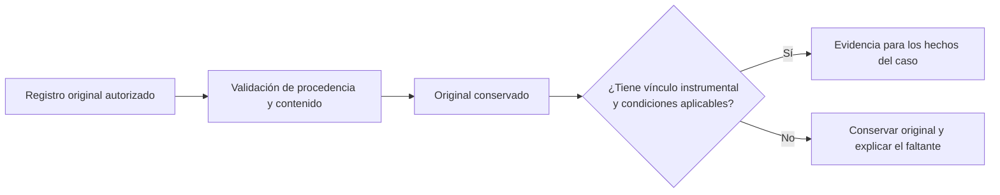

# Registros originales y validación

Primera entrega de los componentes 1 y 2 de la [estructura adoptada](ESTRUCTURA_POR_COMPONENTES.md). Se concreta el contrato técnico de captura instrumental existente y se cierra el acceso directo al lote retirado. No selecciona una batería cognitiva, crea tablas, añade requisitos médicos o completa los otros seis componentes.

## 1. Qué entra al experto

Registrar un original, extraer una medición y obtener una interpretación son operaciones diferentes. El guardado del original no genera automáticamente una evaluación experta.

## 2. Ficha de entrada técnica

| Dato | Fuente y control vigente |
|---|---|
| Residente | Identidad canónica `cod_residente`, contexto autorizado y estado admitido conforme al servicio clínico. Un ID enviado directamente recibe los mismos controles que el selector. El lote técnico retirado no es elegible. |
| Instrumento y versión | `cod_instrumento`, código y versión del catálogo. Para nuevas aplicaciones debe estar activo; no se admite sustituirlo por un nombre parecido ni por un catálogo técnico. |
| Fecha clínica | `fecha_hora` explícita en los formatos aceptados por la Action; no futura. Se conserva separada de la fecha de registro. |
| Autor de captura nueva | Personal activo derivado del usuario autenticado y autorizado. El cliente no puede atribuir el acto a otro profesional. |
| Pregunta | `cod_pregunta` perteneciente al instrumento activo; una respuesta por pregunta y referencias coherentes. |
| Valor original | Un único tipo por respuesta: número, booleano, texto u opción del catálogo, compatible con la pregunta. Cero y falso se conservan como valores válidos. |
| Opción | `cod_opcion` perteneciente a esa pregunta y vigente para la captura nueva. No usar la opción de otro instrumento. |
| Puntaje | Se obtiene o contrasta con el catálogo aplicable. Un puntaje no disponible permanece NULL; no se reemplaza por cero. |
| Total | Solo se calcula con cobertura y puntajes suficientes según el contrato actual. La etiqueta operativa `COMPLETA` no acredita por sí sola que estén todas las entradas requeridas por un método interpretativo. |
| Atención vinculada, si se indica | Debe pertenecer al mismo residente. No seleccionar una atención arbitraria para completar una FK. |
| Observación, clasificación e interpretación registradas | Conservan su carácter de registro profesional. No se presentan como una conclusión generada por el motor. |
| Edad para la interpretación | Se obtiene de la fecha de nacimiento en la fecha de aplicación. La edad actual no sustituye la edad del episodio; la norma aplicable depende del método adoptado. |
| Perfil de interpretación | Configuración explícita del instrumento, edición/forma/idioma, método y preguntas. Su ausencia permite conservar el original, pero no fabricar la interpretación. |

En la transcripción histórica se añaden autor original, documento del residente, localizador y cotejo. Se verifican pertenencia, vigencia y huella del archivo. El usuario que transcribe y el profesional del documento mantienen identidades distintas. Las correcciones utilizan antecesora y motivo conforme al mecanismo existente.

## 3. Validación por etapas

| Etapa | Comprobación | Efecto de un fallo |
|---|---|---|
| Acceso y contexto | Cuenta, permiso, rol/competencia, personal, residente y alcance aplicables. | Denegar la operación antes de exponer el contexto o escribir. |
| Identidad de la fuente | Catálogo institucional, instrumento, versión, preguntas/opciones y vínculos del mismo residente. | Rechazar una captura incompatible o identificar la fuente histórica no utilizable. |
| Contenido original | Fecha, tipo único, valor explícito y coherencia del puntaje con el catálogo. | Mensaje de validación; sin cabecera/respuestas parciales ni éxito falso. |
| Conservación | Cabecera, respuestas, autoría, fechas y auditoría en la transacción de la operación. | Un fallo revierte el registro; una conciliación no escribe. |
| Consumo por el experto | Corte temporal, identidad explícita, procedencia, estado, documento cuando corresponda y perfil aplicable. | Conservar los originales y explicar el motivo de exclusión o la falta de interpretación. |

No se convierten una observación nominal o un total aislado en una medición cognitiva estandarizada. Este bloque tampoco define puntos de corte, probabilidades, severidad o diagnósticos.

## 4. Actores y entradas del backend

Los permisos y competencias son los existentes; esta entrega no concede otros. La Action de captura utiliza `AutorizacionClinicaService` y sus roles aplicadores actuales. La transcripción histórica se restringe a Medicina/Psicología con los permisos específicos. La lectura del residente no concede automáticamente escritura clínica.

| Entrada | Responsabilidad | Control reforzado en esta entrega |
|---|---|---|
| [PrepararCapturaInstrumental](../../../app/Modulos/Valoraciones/Aplicacion/Consultas/PrepararCapturaInstrumental.php): contexto, catálogo y fuentes de transcripción | Preparar datos autorizados para el formulario. | Residente elegible también en peticiones directas; el lote técnico responde como recurso no disponible. |
| [AplicarInstrumento](../../../app/Modulos/Valoraciones/Aplicacion/Acciones/AplicarInstrumento.php): aplicar, conciliar y transcribir | Validar y registrar o conciliar dentro de la transacción. | Comprobar elegibilidad del residente al releerlo con bloqueo, antes de validar/guardar la captura. |
| [CapturasInstrumentalesResidente](../../../app/Modulos/ApoyoDecision/Aplicacion/Consultas/CapturasInstrumentalesResidente.php) | Adquirir fuentes para una consulta del experto. | Conserva los controles existentes de lectura autorizada, corte y procedencia. |
| [FuentesValoracionOperativa](../../../app/Modulos/ApoyoDecision/Aplicacion/Consultas/FuentesValoracionOperativa.php) | Centralizar la exclusión de fuentes técnicas ya adoptada. | Misma selección en consulta, preparación y escritura; sin borrar historia. |

La exclusión del lote requiere conjuntamente su documento técnico y la marca exacta de admisión. Una coincidencia aislada no bloquea una persona ordinaria. Las pruebas verifican ambos lados de esa frontera.

## 5. Disponibilidad y decisión clínica pendiente

El inventario de metadatos se repitió el 27/10/2026 mediante [inventariar-experto.php](../../../scripts/inventariar-experto.php), en PostgreSQL con transacción de solo lectura y rollback. Confirmó 26 instrumentos físicos y seis versiones; la configuración efectiva sigue con cero perfiles instrumentales. No se consultaron historias de residentes ni se modificaron catálogos. El [inventario anterior](../inventarios/README.md) clasifica esas entradas, incluidas las técnicas ya excluidas.

**Pendiente para avanzar en interpretación:** elegir los instrumentos concretos y su edición, idioma, condiciones de aplicación, normas aplicables, derechos y capacitación. El [catálogo de candidatos](../instrumentos/CATALOGO_CANDIDATOS.md) y la [matriz D01–D27](../MATRIZ_DATOS_DETECCION_DCL_2026_10_27.md) sirven de base; no son una batería aprobada.

Las brechas de escolaridad, idioma, informante y contexto documentadas en la matriz siguen abiertas en su alcance. Esta entrega no las declara resueltas ni introduce un nuevo formulario paralelo para ellas.

## 6. Verificación y alcance

- Se reprodujeron cinco fallos antes de la corrección: contexto, catálogo, aplicación, conciliación y transcripción podían alcanzar el lote retirado por ID directo.
- Se agregaron negativos sin escritura y positivos con una sola marca coincidente o ninguna, conservando cero, falso, NULL, autoría y ausencia de evaluación experta automática.
- La suite completa `CapturaInstrumentalFormularioTest` pasó con 41 pruebas y 279 aserciones; incluye validación, interacción Livewire y restricciones de acceso existentes.
- Las ocho regresiones de este bloque pasaron también en PostgreSQL desechable propio, con 52 aserciones; su evidencia local queda en `output/experto-fase1-postgres*`.
- No cambió Blade/CSS/JS ni el esquema. Esta entrega no acredita un nuevo diseño visual, un motor clínicamente validado o el cierre de conservación conjunta instrumental/Petersen.

La evidencia local de captura, reproducción e inventario queda en `output/experto-fase1-*`; no se incorpora al commit junto a datos o secretos. La siguiente entrega debe concretar la batería y el mapeo de cada medición a hechos, reutilizando este contrato de entrada.
