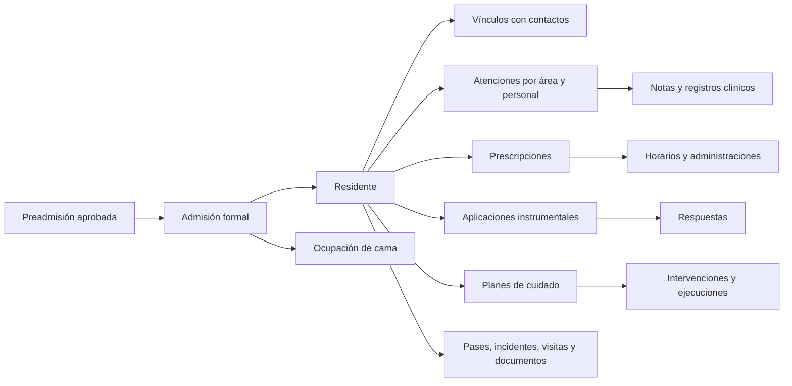

# Historiales con Superadministrador

## Resultado y alcance

Revisión local del **20/10/2026**, rama `SEEDERS`, sobre la base PostgreSQL `RememberMind`. Referencia del código inicial: `99291ce3`; incluye las dos correcciones de presentación y las pruebas incorporadas en esta entrega. No acredita producción ni aprobación clínica.

Se ingresó a la aplicación en `http://127.0.0.1:8010` con la sesión existente, comprobando identidad y rol **Carla Encinas · Superadministrador** en la interfaz. No se crearon cuentas, restablecieron contraseñas ni alteraron permisos.

- Directorio: **73 residentes**, 12 por página, siete páginas; 73 enlaces distintos recogidos desde la tabla.
- Se abrió **cada una de las 73 fichas clínicas** con la misma sesión: todas mostraron «Ficha Médica», sin error de servidor.
- Se comprobó en detalle el expediente integral y la cronología de una residente de la cohorte sintética, incluidos diagnósticos, familiar, cama, signos, cuidados, medicación y evolución.
- Se evaluó la Policy `view` para los 73 residentes desde la cuenta activa revisada y se generaron 73 informes privados. Esta comprobación de backend se distingue del recorrido visual.
- No se afirma haber recorrido todas las pestañas, filtros y exportaciones de cada uno de los 73 residentes. No se registraron actos clínicos durante la revisión.

Los 48 ingresos de La Paz son **sintéticos**; se conservaron los 25 residentes anteriores. Los nombres verosímiles no convierten los registros en historias hospitalarias reales.

## Cómo consultar a cualquier residente

1. Abrir **Expediente clínico → Expedientes integrales**. El destino actual es `/admin/salud-seguimiento/fichas`; el encabezado dice «Fichas Médicas».
2. Buscar o paginar y pulsar **Ver Ficha**.
3. En la navegación unificada, **Expediente 360°** abre identificación, contactos, documentos y resúmenes.
4. **Atención de Enfermería → Evolución** abre «Seguimiento clínico»: cronología y filtros de tipo/fecha. Esta es la entrada observada al historial longitudinal, con los límites indicados más adelante.
5. Usar las entradas específicas de signos, medicación, administraciones, valoraciones, atenciones, notas y documentos para consultar cada dominio.

Se dejaron abiertas dos pestañas: el directorio general y una ficha en Evolución. El servidor local debe seguir en ejecución; los enlaces requieren sesión autenticada. Una sesión previa válida se reutilizó: no se simuló otro usuario ni se inyectaron credenciales.

## Qué reúne cada sistema

En las rutas siguientes, `{residente}` representa `cod_residente`.

| Pantalla o entrada | Ruta / fuente principal | Contenido y alcance |
|---|---|---|
| Directorio de fichas | `/admin/salud-seguimiento/fichas` · `SaludFichaPanel` | Resumen agregado, búsqueda y paginación. «Ficha activa» no certifica historia completa. |
| Ficha clínica base | `/admin/salud-seguimiento/{residente}/ficha` · `FichaMedicaService` | Alergias, antecedentes seleccionados y banderas de condiciones. No es una cronología completa. |
| Expediente integral | `/admin/adultos-mayores/{residente}` · `AdultoMayorController::show` | Identificación, red de apoyo, documentos, salud/cognición/participación resumidas y bitácora. La ruta conserva terminología anterior. |
| Enfermería y evolución | `/admin/enfermeria/pacientes/{residente}` · `FichaPaciente`, `PrepararFichaClinica` | Diagnósticos activos, antecedentes, seguro, familiar, ubicación, estado y cronología clínica. Mezcla series con límites diferentes. |
| Signos, órdenes y administraciones | `/admin/salud-seguimiento/{residente}/{signos,medicacion,administracion}` | Entradas separadas por dominio; la administración se vincula a prescripción y residente. |
| Atenciones / notas | `/admin/adultos-mayores/{residente}/{atenciones,observaciones}` | Registros del dominio y autoría; no son equivalentes a movimientos administrativos. |
| Red de apoyo | `/admin/familia-social/red-apoyo?adulto={residente}` | Contactos vinculados, responsabilidades y autorizaciones de información. El parámetro existente no cambia la PK V2. |
| Panel de expediente del residente | `ResidenteController`, `ExpedientePanel` | El panel carga las últimas 20 atenciones y 20 prescripciones; no permite deducir ausencia de registros anteriores. |
| Consulta JSON clínica | `ExpedienteClinicoController::index` | Consolidación con límites de 50 en determinadas series. Revisada en código; no se acredita aquí una exportación íntegra mediante esa ruta. |
| Apoyo a la decisión | `ApoyoDecision` | Las evaluaciones expertas están vacías. Las valoraciones e instrumentos operativos no son resultados del experto. |

La navegación conecta pantallas, pero todavía no representa un único visor exhaustivo de todas las tablas y fechas.

## Conexiones del historial

`cod_residente` identifica a la persona admitida; `cod_personal` identifica al autor profesional; `cod_usuario` identifica la cuenta. Los familiares se resuelven mediante `residentes_contactos` y `contactos`. No se reemplazaron FK por texto ni se alteró el flujo de admisión.

## Cobertura encontrada en PostgreSQL

Conteos del corte de lectura; incluyen los residentes anteriores y la cohorte nueva, todos los estados. No describen prevalencia clínica ni calidad del entrenamiento.

| Registro | Filas |
|---|---:|
| Residentes / admisiones / ocupaciones / vínculos con contacto | 73 en cada tabla |
| Antecedentes / diagnósticos | 73 / 109 |
| Atenciones / notas clínicas | 21.045 / 19.017 |
| Signos vitales | 18.961 |
| Prescripciones / administraciones | 41 / 7.169 |
| Ingesta / hidratación | 56.833 / 94.705 |
| Ejecuciones de cuidado / pases de turno | 19.013 / 18.961 |
| Aplicaciones instrumentales / respuestas | 528 / 5.055 |
| Valoraciones funcionales / nutricionales / psicológicas | 528 en cada tabla |
| Documentos administrativos / estudios clínicos | 48 / 29 |
| Evaluaciones expertas | **0** |

Los 73 tienen admisión, contacto, antecedente, diagnóstico, signos, atención y nota persistidos. Hay 25 sin documentos administrativos, 29 con estudios y 41 con prescripción: estas diferencias se conservan; no se inventan documentos, estudios ni órdenes para uniformar expedientes. Un cero no prueba ausencia de enfermedad ni un resultado normal.

## Informes individuales privados

Ubicación local, excluida de Git y fuera del directorio público:

`storage/app/private/revision-historiales-superadministrador/corte-2026-10-20/`

| Archivo | Contenido |
|---|---|
| `indice.md` | Los 73 residentes con enlace a su informe individual y al sistema autenticado. |
| `residentes/{cod_residente}.md` | Diagnósticos tal como están guardados, contactos, conteos y rangos de fecha por tabla, enlaces a las tres entradas principales. |
| `residentes/{cod_residente}-notas.md` | Cronología legible de todas las notas de esa persona, con contenido, fecha, autor, estado y vínculo de corrección si existe. **19.017 notas entre las 73 cronologías**, sin recorte de antigüedad. No sustituye las demás series clínicas. |
| `residentes/{cod_residente}.json.gz` | Filas originales de 47 tablas con FK directa a residente, más hijos encontrados por FK y referencias de contactos/personal. Sin recortar a las últimas 10/20/60 filas. Las tablas vacías se conservan como tales. |
| `inventario.json` | Conteos, enlaces y huella SHA-256 por archivo comprimido. |
| `estadisticas.json`, `verificacion.json` | Resumen del corte y comprobaciones de los archivos. |
| `evolucion-superadministrador.png` | Evidencia visual de la cronología de una identidad sintética. |

La utilidad privada `documentar.php`, un nivel arriba del corte, ejecutó una transacción PostgreSQL **REPEATABLE READ, READ ONLY**, comprobó entorno/base local y rol, y evaluó Policy por residente. No autentica sesiones ni cambia permisos. El corte existente no se sobrescribe. No se incorporó un endpoint público de exportación.

Verificación posterior: **73 archivos legibles**, 73 huellas correctas, conteos coincidentes, cero filas con `cod_residente` de otra persona y cero campos de credenciales inspeccionados presentes. Los archivos contienen 422.005 registros sumados; algunos hijos y referencias de personal pueden repetirse entre expedientes. **No equivale a 422.005 filas únicas ni a un respaldo completo de toda la base**. Los catálogos compartidos, la auditoría técnica, las cuentas y las sesiones no se exportaron.

Estos archivos contienen información privada de la instalación y no deben añadirse a documentación pública. Este informe versionado solo contiene datos agregados y explicación técnica.

Las cronologías de notas se derivaron de los archivos del corte, sin nuevas consultas ni escrituras de base. Los informes principales enlazan estas lecturas e incluyen los antecedentes registrados.

## Hallazgos y correcciones

| Hallazgo | Evidencia e implicación | Estado |
|---|---|---|
| Expediente 360° fallaba al tener documentos | `_documentos.blade.php` intentaba formatear `created_at`, inexistente en el modelo operativo. | **Corregido**: muestra `fecha_validacion`, etiqueta «Última validación», máximo real entre documentos y ausencia explícita si es nula. Sin añadir timestamps ni columnas. |
| Identificación mostraba una colección de notas como JSON | `_identificacion.blade.php` leía la relación `observaciones` como si fuera la observación institucional. | **Corregido**: usa el campo V2 singular `observacion`. Las notas permanecen en su sección. |
| Ficha base subrepresenta diagnósticos | `FichaMedicaService` convierte diagnósticos en un conjunto fijo de banderas. En el caso revisado, dos diagnósticos persistidos se muestran como una condición en la ficha base; Enfermería sí muestra ambos. | **Pendiente de proyección UI**; no se eliminó ni cambió ningún diagnóstico. |
| «Sin datos» en antecedentes de la ficha base | Su resumen no incluye todos los tipos de `antecedentes_clinicos`; el antecedente personal sí aparece en Enfermería. | **Pendiente**; no debe interpretarse como expediente sin antecedentes. |
| Cronología incompleta al filtrar fechas antiguas | `PrepararFichaClinica` precarga series acotadas y `getHistorialFiltradoProperty` filtra después. Una fecha anterior a la precarga no recupera el resto desde la base. | **Pendiente**: consultas de historial con filtros antes del límite y paginación. Requiere una implementación posterior del visor. |
| Valoraciones sin fecha o responsable en Evolución | La proyección usa `fecha_evaluacion`/`created_at` y `evaluador->name`; `AplicacionInstrumento` persiste `fecha_hora`, `cod_personal` y datos de `Personal`. En el recorrido aparecieron «Fecha no registrada» y «Responsable: No registrado» pese a haber valores persistidos. | **Pendiente de mapeo V2**. El archivo privado conserva fecha y autor originales. |
| Pases sin resumen visible | La cronología lee `resumen_turno`; `PaseTurno` persiste `resumen`. Se observó «Sin resumen registrado». | **Pendiente de mapeo V2**; no demuestra ausencia del resumen en la base. |
| Historial institucional vacío aunque hay notas vigentes | `AdultoMayorController::show` busca notas `ACTIVO`, mientras las nuevas notas son `VIGENTE`; su pestaña tampoco equivale al historial de estados/ocupaciones. | **Pendiente**: alinear filtros con estados canónicos y distinguir historia institucional de notas clínicas. |
| Carga extensa sin paginación longitudinal | En Evolución se observaron 1.456 eventos para una residente, con 60 signos y 30 administraciones cargadas; el DOM contenía 1.463 elementos `article`, incluidos resúmenes. | **Pendiente de rendimiento/completitud**. Los porcentajes de adherencia del resumen corresponden a la ventana cargada, no a toda la residencia. |

Se aplicaron dos correcciones de presentación necesarias para abrir y leer el expediente. El resto queda registrado como resultado del análisis; no se cambiaron reglas clínicas, responsables, metodología experta ni contratos congelados para resolverlo.

## Límites exactos de las series

`PrepararFichaClinica::relaciones()` carga notas 10, actividades 20, signos 60, ejecuciones de cuidado 30 ordenadas ascendentemente, ingesta 10, hidratación 30, movilidad 10, controles cognitivos 10, dolor 10, administraciones 30, alertas 25, aplicaciones instrumentales 10 y valoraciones funcionales 10. Las atenciones y pases se cargan sin ese límite. La cronología añade su consulta de tareas limitada a 40. No confundir esos límites con conteos totales en PostgreSQL.

La ficha base mantiene `historialFichas = []`; su existencia no acredita un historial de versiones. Los indicadores de completitud y «Cognitivo: con datos» incluyen fuentes operativas; no acreditan salida experta. Tampoco se validó clínicamente el material sintético para entrenar un sistema experto.

## Seguridad, verificaciones y entrega

- Sesión y rol comprobados en navegador; navegación de lectura, sin modificar historia, cuentas, relaciones ni resultados expertos. Se revisó la excepción temporal existente de escritura de Superadministrador; no se amplió ni se activó para esta tarea.
- `php -d extension=pdo_sqlite -d extension=sqlite3 vendor/phpunit/phpunit/phpunit --filter='ExpedienteDocumentalVistaTest|test_dashboard_y_expediente_web_funcionan_con_modelos_v2|test_familiar_no_puede_acceder_por_idor_a_otro_expediente'`: **5 pruebas, 16 aserciones, PASS**. Incluye regresión documental, observación institucional, expediente V2 y familiar ajeno rechazado.
- `./scripts/probar-postgres.ps1 -Filtro 'ExpedienteDocumentalVistaTest|test_dashboard_y_expediente_web_funcionan_con_modelos_v2|test_familiar_no_puede_acceder_por_idor_a_otro_expediente'`: **5 pruebas, 16 aserciones, PASS** en cluster desechable; detenido por el runner. No se reinició la base de la aplicación.
- `php vendor/bin/pint tests/Feature/ExpedienteDocumentalVistaTest.php --test`: **PASS**.
- `npm run build`: **PASS**, Vite 8.3.1, 97 módulos. Se recargó la aplicación con los assets generados. El build no certifica clínica ni sustituye QA.
- QA: 73 fichas abiertas; expediente y Evolución comprobados en una identidad sintética, evidencia visual guardada. **PASS del acceso y de las dos correcciones; FAIL de completitud del visor longitudinal** por los hallazgos pendientes. No se acredita matriz completa responsive, teclado, exportaciones ni todos los módulos para las 73 personas.
- Legacy: permanecen rutas, clases y proyecciones anteriores en los módulos revisados; se documentan, no se declara completada su migración global. Las correcciones usan campos V2 sin introducir alias adicionales.
- Commit local de la entrega; sin push. Los informes individuales privados quedan fuera del commit.

## Fuentes locales del análisis

- [Baseline BDD](../base-de-datos/REMEMBERMIND_BDD_BASELINE_CONGELADO.md) y [diccionario](../base-de-datos/REMEMBERMIND_BDD_70_TABLAS.md).
- [Permisos temporales de Superadministrador](../arquitectura/PERMISOS_TEMPORALES_SUPERADMIN.md).
- [Cohorte instalada y límites para el experto](../../database/seeders/LaPaz/VERIFICACION.md).
- `app/Modulos/Residentes/Presentacion/Http/Controllers/{AdultoMayorController,ResidenteController}.php`, `Aplicacion/Consultas/PanelResidenteService.php`, `Presentacion/Livewire/Paginas/ExpedientePanel.php`.
- `app/Modulos/Clinica/Aplicacion/Consultas/PrepararFichaClinica.php`, `Aplicacion/Acciones/FichaMedicaService.php`, `Presentacion/Livewire/Paginas/{FichaPaciente,SaludFichaPanel}.php`, `ExpedienteClinicoController`.
- Models `Residente`, `Documento`, `AplicacionInstrumento`, `PaseTurno`; vistas `show/carpetas/{_identificacion,_documentos,_historial}` y `ficha/tab-seguimiento`.
